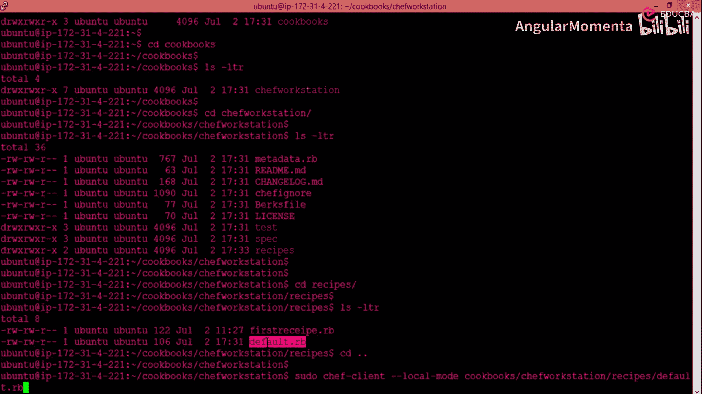
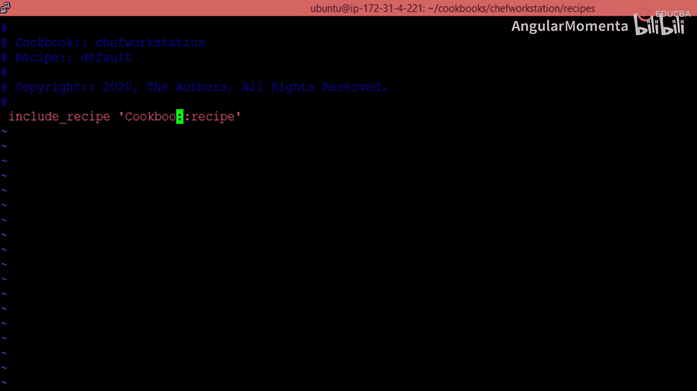
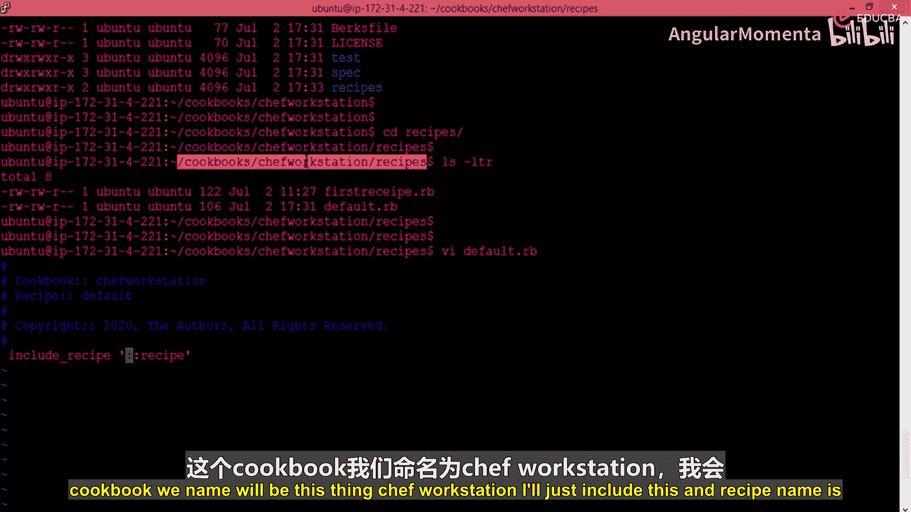
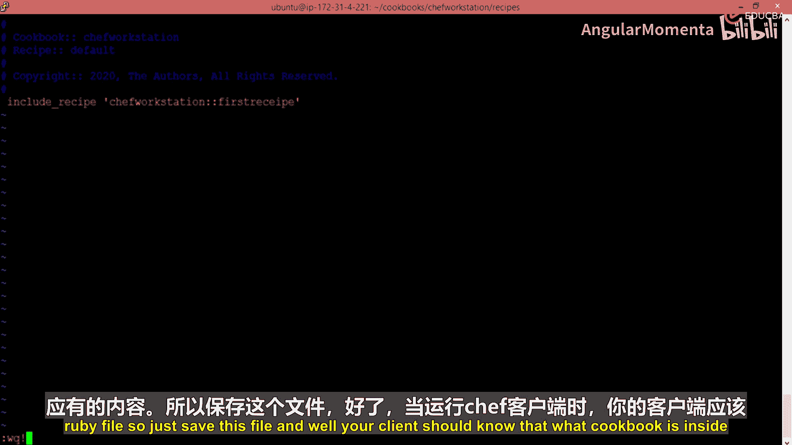
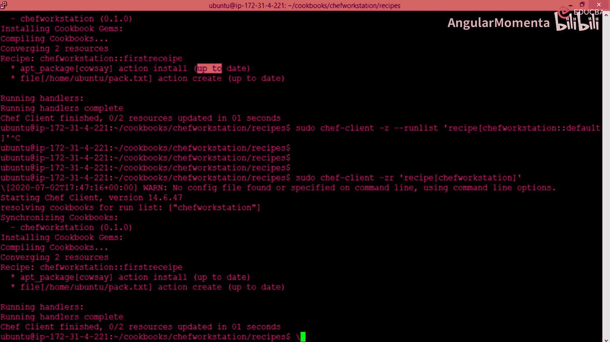
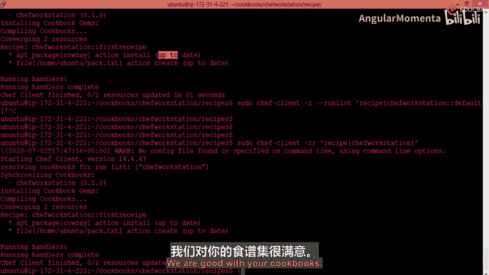
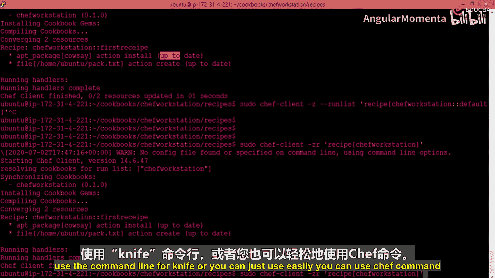

# 【EDUCBA】应用Chef实现云基础设施项目自动化 ｜ Apply Chef to Automate Cloud Infrastructure Project p10 02_02_01_在Chef Solo环境下运行 -BV134F1zaEdz_p10-

So I will just include， so this will not work。

So what I will do， I will just go to your recipes。And in your default do R file， I will include my。

First dot R first recipe， R Re dot R B file。 So this is very important file where。

You have to include all your recipes。 what you wanna include when you will run for it。

 So I what I will just write， I will just write。Include。You have to just delete this thing。

Include water include include your recipe， so basics andes are inra。A recipe。

 And what recipe will I include。You can just include recipe like the syntax normal syntax is like putting your cookbook here。

And placing two hyphens here and the name of your recipe。

 So this is normal procedure to include your recipe file and disclose close it。 So for my case。

 this will be。

Cookedbook we name will be the chef workstation。

Itll just include this。😔，And recipe name is nothing but your fuice。

You just don't need to put this dot RB extension here because your chef client would understand this is a ruby file。

 because our Ruy file will have all the inclusions of a ruby file， so just save this file。And well。

 your client should know that what cookbook is inside when it runs a safe client so。

Well， if I examine execute this file， you can just mention this defaulted RB file。

 and if I mention this there will be some exceptions of what I will show you。😔，R this。

So what happened your chef workstation right， So your chef workstation， I mean。

 it is confused where to find your hellowot recipe because everything what you have included is included in your default RV。

 So this guy is confused where to find this original recipe。 that is this recipe。This recipe。

 your first recipe or R B。 So is confused now。 Im in where and how to find this。Recipe。

 so to fix this issue， what you have to do is we have to provide a real list。

 So I will just run like your showdo chef client and your local mode。

 and then I may provide real list then your recipes cookbook and then I will define the location of my cookbook。

 So you can just mention it like this like chef。Sort of chef。Clalimed。And the minus gmans。

 it is running in local mode。And then you provide a run list here。Wttle thinks it has to run。

 and from where it has to。 Then the basic syntax is like you just provide the recipe here。

Recipes and which recipes is has and where to find the recipe， just mention it here。

 so it should be inside cookbook and we have to provide the other cookbook and the recipe file whether you want to ask the client to run。

So this is the basic syntax of your of this command to check and run your particular recipes。

 so let's omit this file here and change according to our need。

 so this will run the default recipe which will include your Che workstation that is first recipe do RV so what I will do I will just omit this。

What I will write your surf walk station。And the recipe name what as we have is to defaulted Rby。

 So just pass it here。 Here we got defaulted Aby。 I feel your chef client will be able to。

 Let's try it。😔，And I think this time it will run。Pll commander some syntax issues here。

There should not be recipes。 It should be recipe。And we should not be putting。

Dot Owell should not be there， and。Sping as strong here。So let's turn it now。Now your chef recipe。

 this has been started and this has successfully run your command。

 So this time your chef recipe has gone fine， everything seems good。

So first recipe and it has installed up to date because there was no changes to be done because we have already done all the changes in our recipe。

 so in this example we just copied our recipe to a workstation what weve mentioned like a cookbook and we just ran it with the parameters。

So when you see this command right， there are of there are a lot of sort which we can make here because there is a lot of things you have to write to just to minimize this writing what you can do。

 you can just write Che client。And。Minus Z。 And instead of writing high I run list。

 you can just mention minus R。And then you define the your location of your recipe and it follows by your cookbook name。

That is your workstation and this time I don't need to put default as well because once you mention the cookbook name right。

 So once you run the command it will take a default dot RV as your default rubby command So and in our default RV we have already mentioned included our first recipe name that is first recipe do RV。

A refinefi。So we don't need to explicitly mention this rubbi。

 the chef client will actually understand this， and it will take your defaulter RB as a default rubby file and it will run。

 So let's test this whether it's getting successful or not Check the syntax for spelling mistakes and I fail this is good。

 Let's run this。So fine。 this time Also we ran。 there is no issues。 So we are good with this thing。

 We are good with recipes。 We are good with your cookbooks。 And so these all things。

 what we have done like in this command soche client Z are minus it is like local mode and then providing run list So whence we are doing a default mode where your chef runs as a default mode。

 it means it has a server and it has a different mode。

 So you just don't need to provide this your local mode here we have overwritten the property default property。

So now what we will do well have a centralized Che server where our master server like this is our master workstation master server will upload recipe code to your server and then your server will propagate and whenever we want to send automation to the nodes it will give the information to the node to get all the automations what we have done here the only basic criteria for the node to connect to your workstation and server is that they should be having Che DK so on the other nodes also we have to just install Che DK so that we can easily use the command line for N or you can just use easily you can use Che command。

