# 【EDUCBA】应用Chef实现云基础设施项目自动化 ｜ Apply Chef to Automate Cloud Infrastructure Project p11 02_02_02_配置基于云 -BV134F1zaEdz_p11-

Now， we have to install our chef sha， which will be like running in a default mode。

 So when you have bigger organization and in real hands scenario scenario。

 suppose there are 100 nodes and there are more than 10150 nodes and there are a lot of applications install on node。

 So to maintain all those application and。To all those things。

 a developer or middleware admin won't be going to all the machine and writing and deploying all those cookbooks here and recipes here。

 So for that instance， we are maintaining one cloud based server。 So this server。

 which I am here now manage dot Che do iiot login we have to create one server here。

 which will be like cloudbased server and in this server will be mentioning and uploading all the recipes。

 whichever has to be uploaded on the client machine。

 So right now we will be creating one account here。

So I already have one account so there is no need of creating again。

 but I will just show you how what are the steps of creating so you just have to click this。

 click this to get started。And you have to full your name and your company name， the email address。

 whatever you want and user name which is not taken， and you have to agree and then get started。

And after that。You have to create an administration where you have to put the administration name and the short for name。

 I will tell you how so because I already have an account so I am not going in and just clicking here。

I'm signing in。 Now， this is getting signed into your chef。

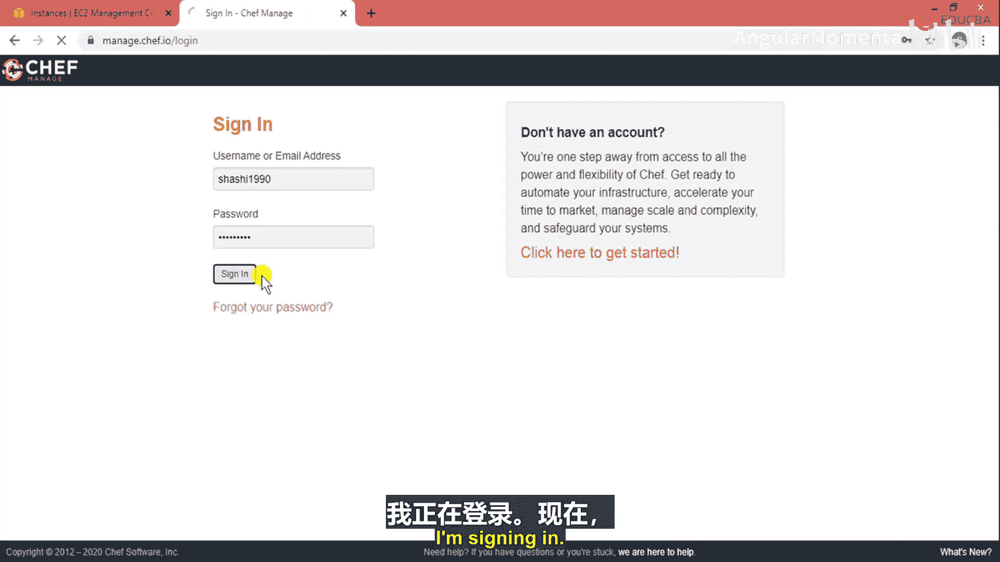

Manage now， in this administration track， you have to create one administration for me。It is。

Android dot O R G dot1。 This is what the administration I have created for my username。

 And once you have created all those。You will get one starter kit the starter kit is used for your for downloading the Che starter kit for server so we have to install on all your instances where you want to install your server so for this case study I am dedicating one entire easy to instance for the Che server where the nodes will be pooling self server every time it has to get the new configurations well if you don't have any administration then what you have to do you have to click administration and then you have to create here where you have to write the full name of your organization and short name of your organization this is how you will create your administration once you create your administration you will have to go to this full file that is starter kit so if I click node here。

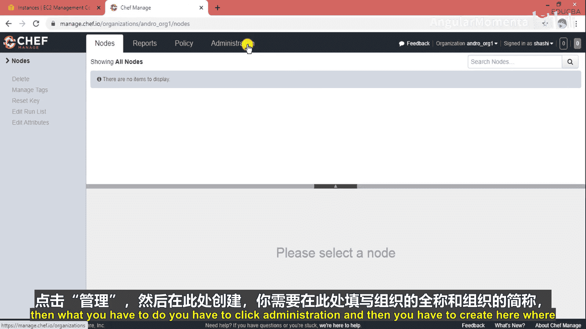

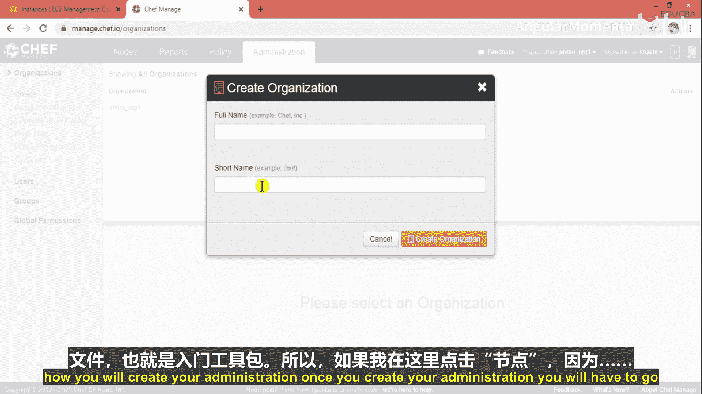

If I click node here and for the because and you have to put the shot from here and this is my user it。

 once you click this starter kit， you will get one Che starter kit and that you have to download download starter kit for Che so this is a server instance and you have to copy to EC2 instance so that you are running this。

I have already download this starter kit。 What I have to do is I have to just log into my easy to instance and just I have to name it as chef servervo。

 So this is my issue to instance and let me just name it here。

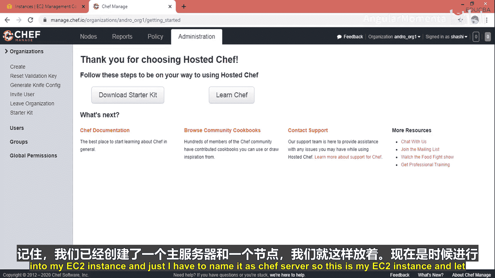

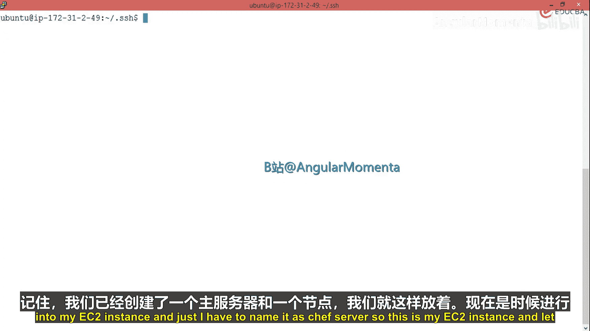

Remember， we have created one master server and one node， we have leave it like this。 Now。

 it's time for us to change it。 So this is our chef。Safe server。And let's rename this guy， as your。

Ch。😔，Walktation。Where all automation will be happening。

So all automation will be happening at one place and well be deploying all those things on the server。

And whichever nodes and how many nodes we have the nodes will be like they will be pulleded to your server and they will be getting the latest conations。

 Now， we are at this location。

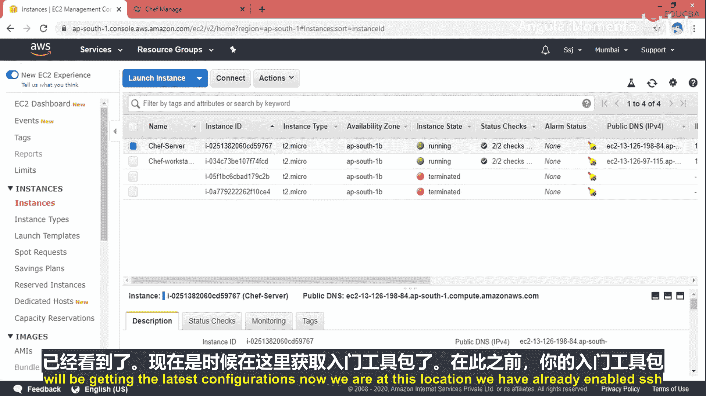

We have already enabled as such connection in the earlier video you must have seen Now it's time for us to get the starter kit here before that starter kit your starter kit relies on your Chedk so if your machine doesn't have Chedk then your Che utility tool for starter kit won't work so for that for each instance of the Che nodes either it be your node or it be your workstation or your server you have to get your starter kit not starter kit you have to get your I Che development kit So will just copy paste the Che kit kit to what we have used for our workstation well to get your Che SDk for this machine you just go to your here again and paste this download Che do iu and for Chedk you have to choose a version of1 to and click here what you have to do you just need to copy this URL here。

And grab it and just mention Webgate。And copy withs。So it will in Laiora。😔，Your package for this。

 I lets do ElS minus L to be checked。 will be okay。

 So it has got installed now it's time for it to let's install this package。

 So for that you just put the pseudo D P K G hyphen I。And this package。

So your Che decay is getting installed in this machine that is so machine。

 So on top of Che D you have to install the this server that is Che server。

 so it takes a little bit of time to get it configured。So this is configured now。

 if you want to check， you can just check。

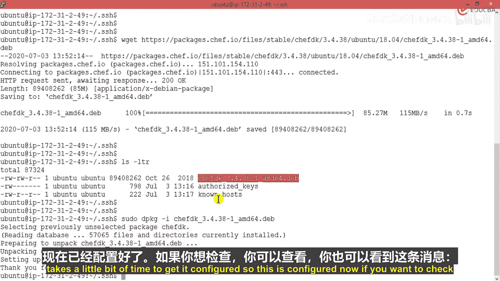

You can see this error message Also thank you for installing Che development kit。

 you can just do LS ne here and you can find it here you can just do which chef。

And you'll get to know C is installed here。Alright， now our chef is installed。

 now it' is time for us to copy your chef starter kit for our development purposes。

 so let me copy this here。Now let's copy that thing。

So what I have to do because we have downloaded from here your Che downloads。

 so it has gone into our window machine， So I am using one tool Win S。

Which will be like copying my zip file。 That is your C starter file。And from Windows machine。

 it will be compute to your Linux machine。 So I'm just using this。

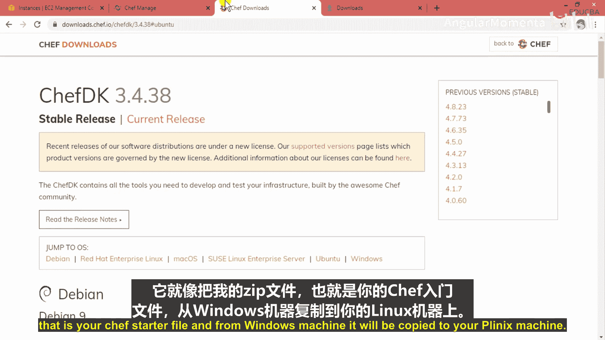

And in terms of your host name， you need to check which host do you have to connect。

 so just go here and grab the IP address of your safe server。

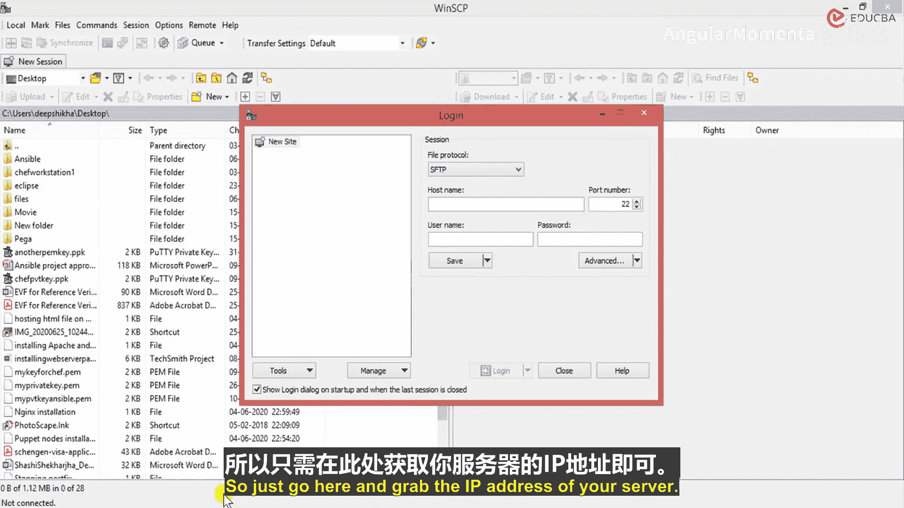

Copy this。Once done with copying， we can go here。

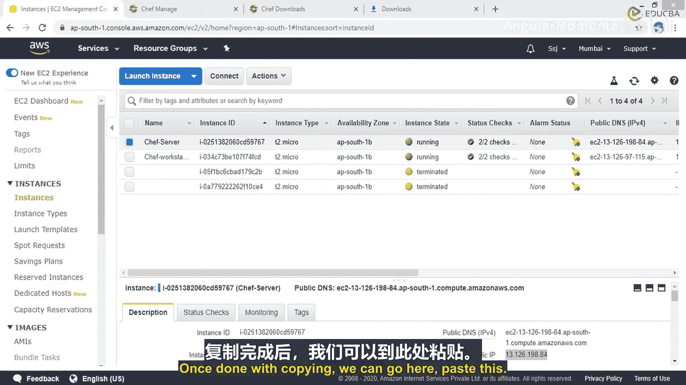

Thinks this。Usesrname will be burn to as usual。Just leave this password field as it is。

And click this advance。Once you are in advanced go to as such and click on authentication because you are directly logging into your EC2 instance and EC two instance are very secure so it requires your PEm key so without giving Pm key no one can actually enter or no one can actually authenticate your keys with your original key so you have just find your keys here。

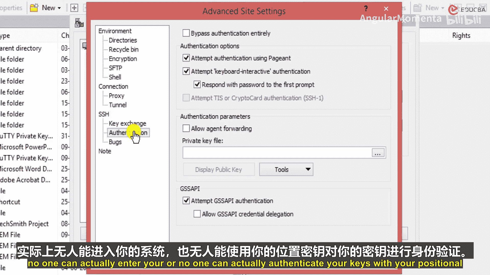

So my this is my penm key， click it。

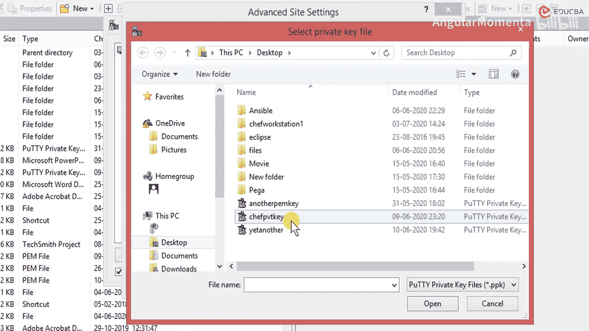

Open and O， now you are good to log in。 Im just clicking on login here。

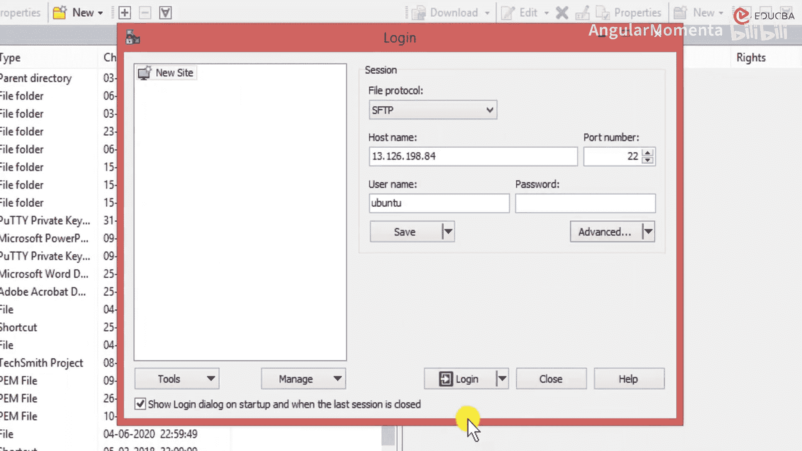

Yes。

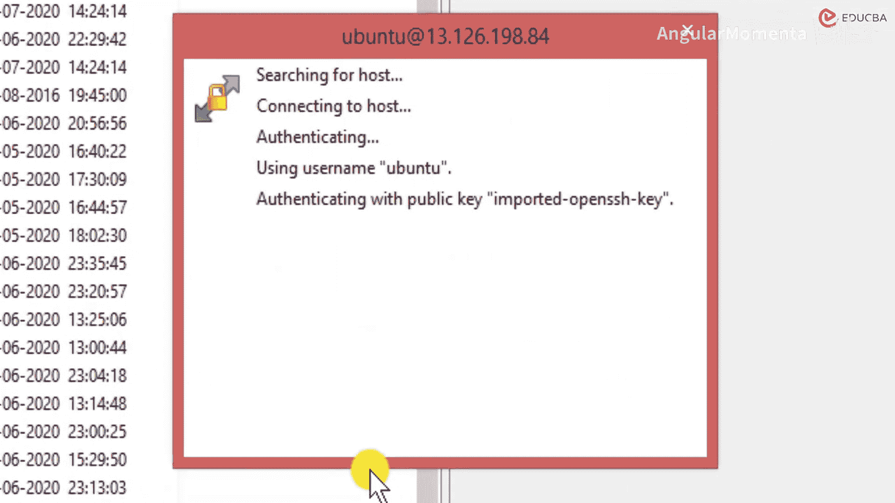

So in this step now you can see this U to adhere this thing。

 This is the host I This is the IP address of our machine which it got connected。

 So now in the situation your Windows machine is connected to your Linux machine that is your easy two instance what you have created Now it's time for us to copy the started zip file and paste it on our server I have actually move it to Savotation 1 and this is our Chestarer zip just drag it to this box。

And it will be copied This is our Windows machine， So whatever is there in my desktop dish will be shown here and this is our Ubutu machine。

 whatever is the bundledo machine it will be shown here So we have successfully copied our Che start J file Now it's time to unzip it。

 let's go to the server Let's do LSmanel here。So here is have a zip file。

 so every server startup will be in zip file only， so we have to unzip it because of the size issues。

 so just unzp it。Click this thing。Oh， it's telling Ngy not found。

 but can't be install with Sudo app install and。 So in this version machine。

 we don't have any package called and So let me install this pseudodo app gi。Install and J。

 This is a very useful tool， actually。So your unjep is getting installed。

It's almost done in your Ubutu machine。 Some Ubutu machines has this features。 Some don't have。

 So don't worry about it once you。Get these issues you just need to write one command like if you are in Ym you can use E command if you are in U2 you can just use app Getins command。

 which is like installing and uninstalling the packages。In this way。

 your commands and the package is whatever you want， it will be actually installed into your system。

So on Je is done， now let's。Try to run that command again。

So do you see this this is inflatting things and your chef started zip file has been successfully andped Now you can see the folderless here。

Now， dear you sitting Seph dottripo， I don't need this Seph started Ze file let meetinging of this。

All right， it's removed。 Now you can just safely enter into self。Dipper file。

 and you can just navigate to the folders what is inside this。

 So once you install this have starter a zip file。You say this。It contains folders like ruless。

 cookbooks， gigno and dotche file， if we else this file like we go inside the dotche file。

And if you e the contents。It must be containing two files。

 One is your knife dot aey file and one is with the user it has logged in so。

Your Che workstation and is was already was functional now we are about to functional your Se server。

 so we have installed the necessary package so two packages were installed first we a Che D and the next package what we installed here was your Cf started doze file well to test our conation of our C server so if we are inside Che repo folder let me come to Che repo。

So。We are in separatepripo， so just to check whether our our client has been successfully validated with the server if you just mention knife client。

List。And。If this command gives you output， then we are all good。 Let's see。

So this is our client list。 remember this is the organization we have created on Sa server that is was hosted on cloud。

 so this seems good。

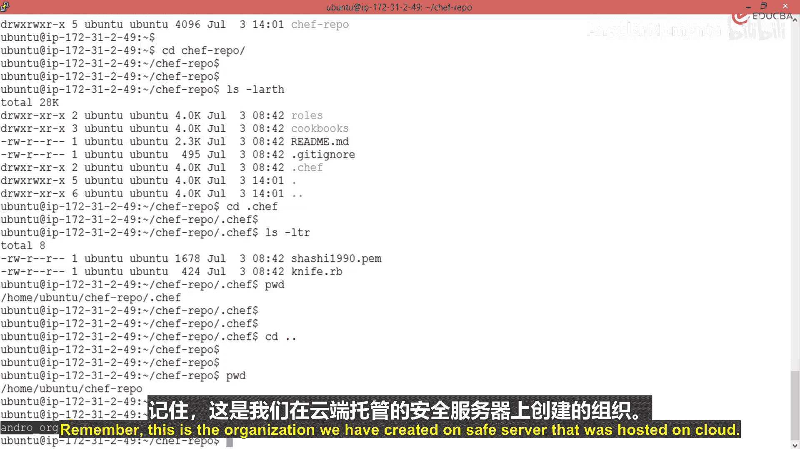