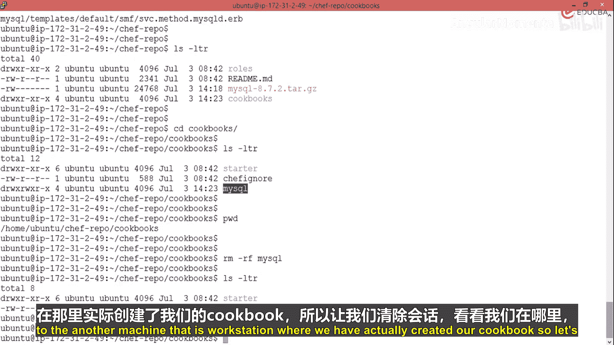
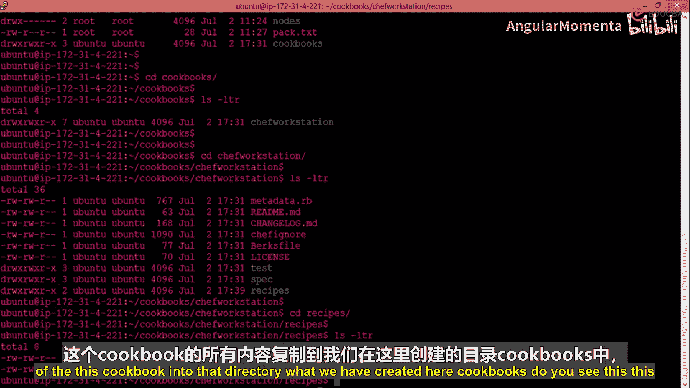
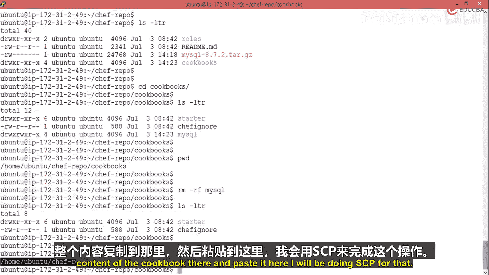
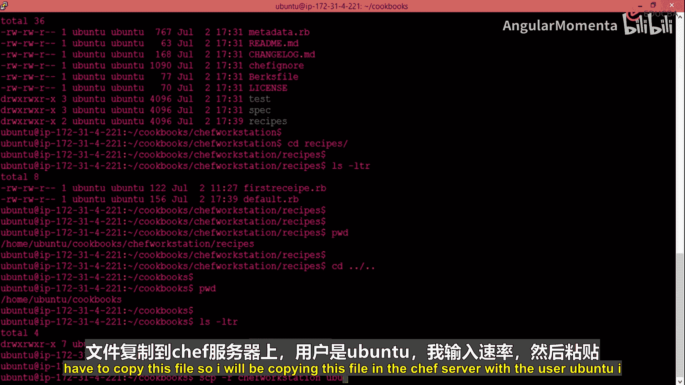
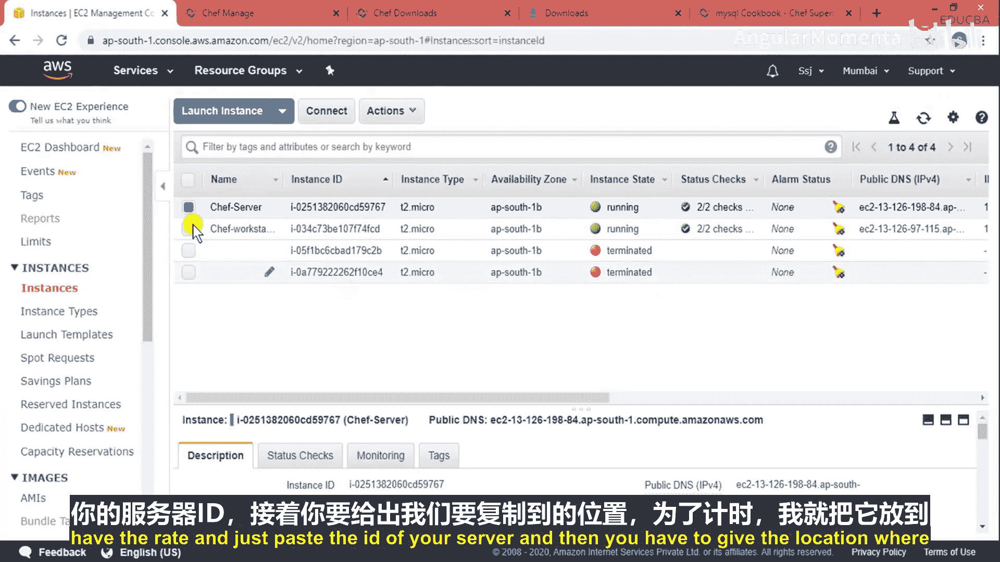
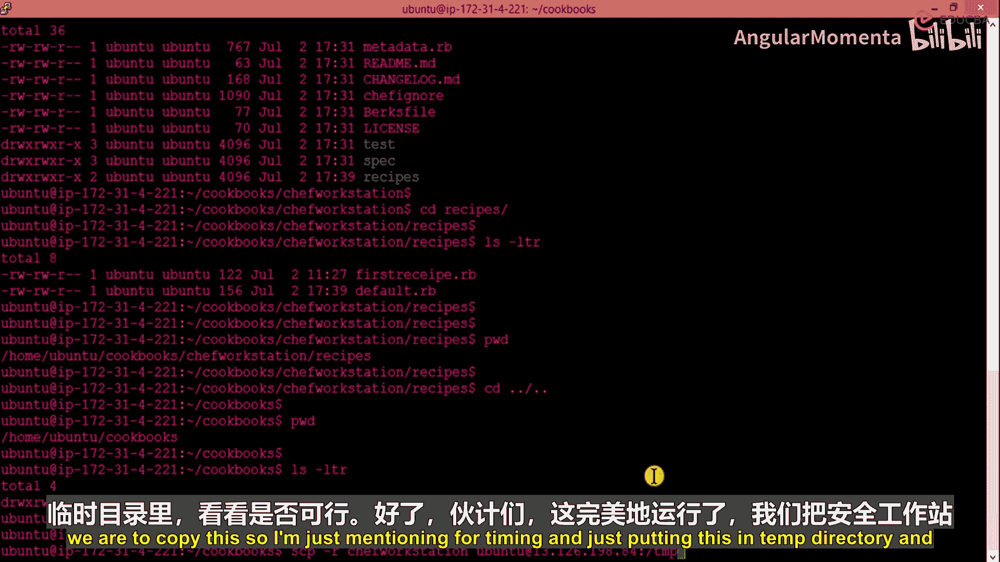
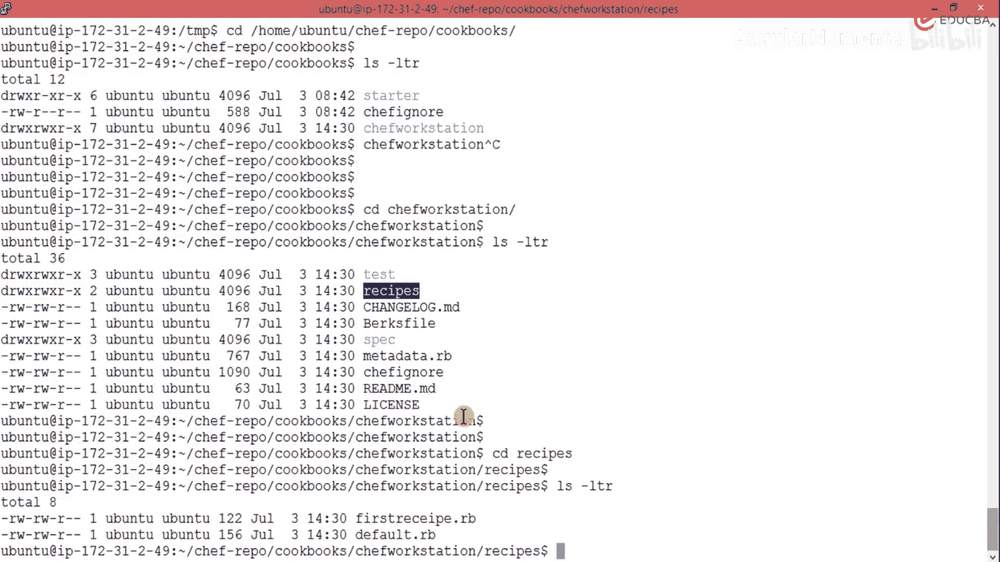
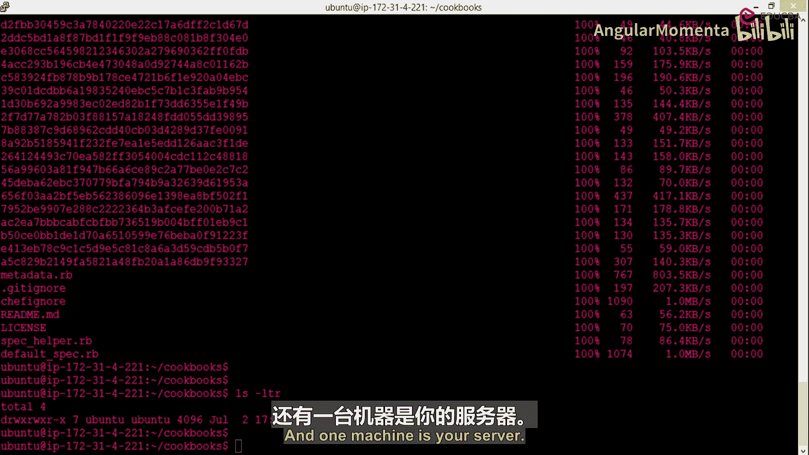
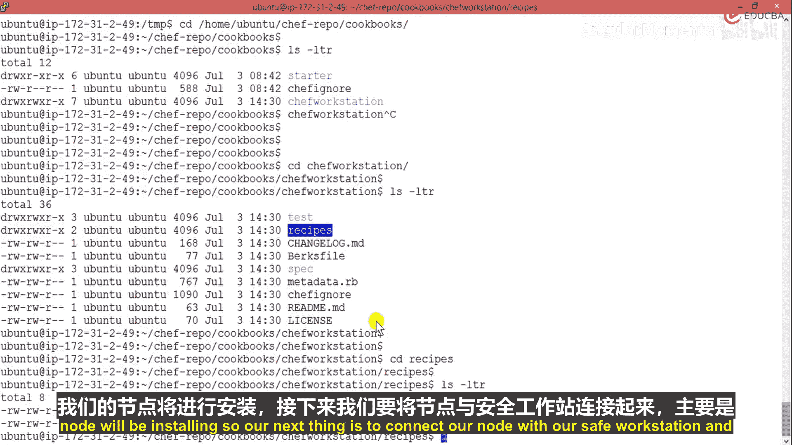

# 【EDUCBA】应用Chef实现云基础设施项目自动化 ｜ Apply Chef to Automate Cloud Infrastructure Project p12 02_03_01_配置云端持续集成 -BV134F1zaEdz_p12-

Now， you must be wondering what is knife， why we have used knife。 So knife is a very popular command。

 like it's a command interface， which is explicitly used when you are running a chef server。

So this is just to it actually what it does， it checks your Che server and it connects your node with the server。

 so it's just an online command mode。So once we click this Che client list。

 it actually connected with our this server。This so and it checked our organization here。

Administration， And if you see here， the user。It actually checked our organization here。

So these all things we are done now to understand the more powerful thing of our knife and why we are actually using Che server。

 we can there are a lot of actually recipes which is already downloaded on your chef server and we can directly fetch those recipes。

 we don't need to modify anything you can just go there and fetch everything and it will be installed in your system。

 just I told about this knife the power of knife and power of server So it is a one location in Che server where you get all sort of your recipes and you can directly download your recipes to your chef machine So that location you can just go here and check is like supermarket we call the supermarket do chef do iio it will click this。

I have already logged in， so you will find everything you want if you want to find Apache。

 you will get recipes for Apache2 here。All you have to just click these recipes。And。

It will be downloaded onion， and you have to write knife command and get download from the site。

 and it will be downloaded。 Supp if you want us check for My SQL server。And search。

 lets because we have to make our Mysql server as well。

 So let's see what all the things it has in your market please。 So if I click this Mysql server。

So you find all the codes and everything mentioned here on your marketplace。

Everything is mentioned here。 All defaults all the packages and everything。

 Suppose if you wanna install this recipe directly to your chef box stationation。

 not walk stationation to your chef server。 Then only you have to use the knife tool。

 So that's such a powerful tool。 Let me show you one demonstration for that。 Now。

 if you want to download this cookbook。 You just need to go here and type knife。

Cookbook because we are downloading a cookbook called Mysql and from where we are downloading you have to mention site download once you mention site it goes to Market download and the name of your cook with that is Mysql。

What was that here， My sequl。 That's it。 And if you click enter。

 it will directly download your cookbook in a tar file。 So guys， this is happening。

So you see this message downloading Mysql from Cook supermarket and you are getting the versions and you see where it has been downloaded in your chef report only。

 So if you do minus Ls minus Ltr。He files my SQl， and it has been entire tar file。

So let's ungyip this file， so if you want to ungyip this thing。

 let's mention this as the command for trans zip will be its your tar minus Jx Cv then fold by the name of your tar file。

And where I want to unzip it inside my cookbook directory， cookbooks。

But the among it's actually wrong。 So I will just put this as。Dle X， and see if close。

 So there's something wrong with the command。 I will need you to fix it。

 let me write this not double X。 It should be X X E E F。They should extract it purposefully。Well。

 you have to be very particular about the tar file。 If you are missing any option。

 night won't be happening。 So I was in hurry， I was just having something wrong。 Now。

 this will extract it forcefully。 Now， let's click this and see if it works。

I worked so where it went， I was just it to be inside your cookbook。 So if you check cookbooks。

You'll find this Mexico sobo。So this is working fine in this way。

 this is a way of downloading things from knife using knife command from your server。

 using your knife command， you can just upload your recipes also So what we will do we already we have created one recipe。

Which when we are running chef in soloor， so I will just copy this recipe that recipe this location。

And then I will try to post this location， this recipe on the server and check。

 So let's copy that query recipe to the server。So we are right now in cookbooks。

 I don't need my SQL server once will be creating my SQL server will be creating in a different way。

 So let me delete this。My sQL recipe。Now， I will go to。

I will go to the another machine that is workstation where we have actually created our cookbook。

So let's clear the session。😔，And see we。 So C。And let's get to the cookbook location， C cookbooks。

And here is our cookbook， Sa dot locktation， In Sa do box boxtation。 we have。Some recipes inside。

So recipes are there inside recipes。 mainan things like recipe。 So there we one recipe。

 first recipe dot RV and then default Rby。 So what I am going to do。

 I am just copying all the contents of the this cookbook into that direct you what we have created here。

 cookbooks。 De Ses this we are inside cookbook。 So inside cookbook， I will just cookbooks。

 I will be just copying the whole content of the cookbook there and paste it here。

 I will be doing before that。

So let's come out of this location。 come out of this。Do Alice。And this is a workstation。

 so what we will do I will just SC SP is a command which we can safely connect to the other workstation since those I mean this workstation and your server workstation they have some same security protocol。

 so there should not be any issue。So let's try to do it as city Menasar once you write Manasar it shows recursively so whatever folder is there it will be copied this whole directory infrastructure will be copied and you have to mention the options where you where you want to actually upload this file or where you have to copy this file so will be copying this file in the Che server with the user open to。

Have the rate。And dis the idea of your server。

And then you have to give the location where we want to copy this。

 So I'm just mentioning for timing Im just putting this in temp directly。 And let's see if it works。

All right， guys。 This worked perfectly O， and。We have copied whole contents of the safe workstation cookbook into our server。

 Let's go to its stamps in the server location。And here is a walkt。Now， what we have to do。

We have to go back。And we have to copy this thing in this location。In this location。So just go back。

Ct minus R because this is a directory and we want even folder structure inside directory or two so Che workstation into this location。

 Che Repo perbook。This is not happening。 Let me try again。Spy minus。

I this I think this just't not to work。Saiv walk station inside。

Can we first navigate to this location？😔，Let me check where we are first， okay。

So the location of your cookbook should be。Here。Sa레コ。I have never exactly to than cookbooks。

 So P W D should be Homewo to Chepher depo。 We were giving a wrong path。That's why it was not copy。

Okayk， let's go to them。 now， do C P。C P minus R copy。And put the absolute location。

 This is the absolute location home open to and yourra。Self repo and inside self reppo。

 we are going inside cookbooks。Now it should work。 might actually work to fine。

 Let me go there and validate。 We are inside now cookbooks and inside cookbooks。

 I can find my cookbook works station， She works stationation。So for our guys。

 we have successfully imported our recipes and our cookbooks。

 what we have actually created on our so machine。So this is what our bookbook is。

 So we are now able to actually communicate between the workstation and server。

 The only thing pending is like we have to put the automation into nodes So in this trip up setup we have to have one more machine here right now we have only two machine one machine I have specified for automation purpose and work purpose only so this is our dewin moment we can say and one machine as your server So we have to create one more machine and which we can call as your mode machine we can create a number of machines and we can just maintain all those machine with only these two servers this server being the dev machine and this will be the automation machine So we'll be doing other things but let's first create one more machine here。

thus go to launch instance will be quickly did creating one machine。Community， am I。Select2。

To do my crew only one， I had stored fine。This is fine。 Just add rule and in rule， just create all。

All traffic enable it to anywhere review。😔，Lunch， acknowledge， and then。

So this is getting installed our node we will be installing So our next thing is to connect our node with our safe walktation and our majorly with our chef。

