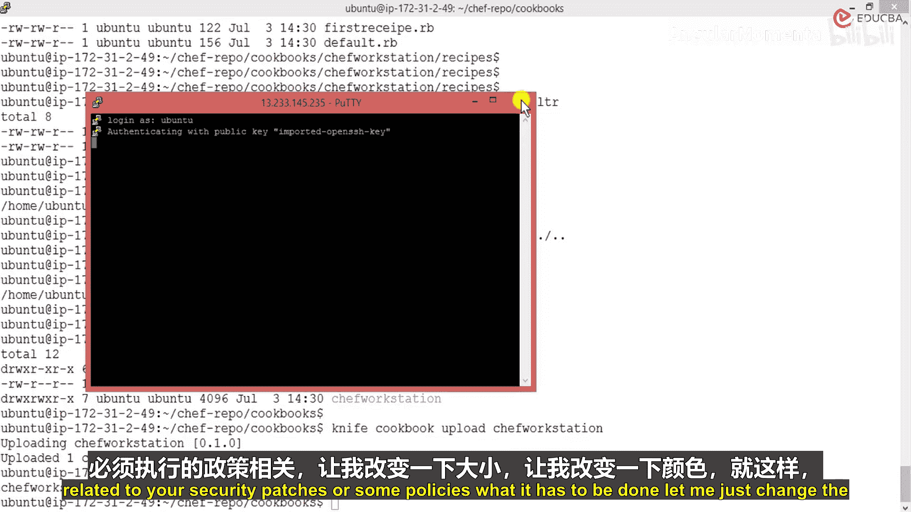
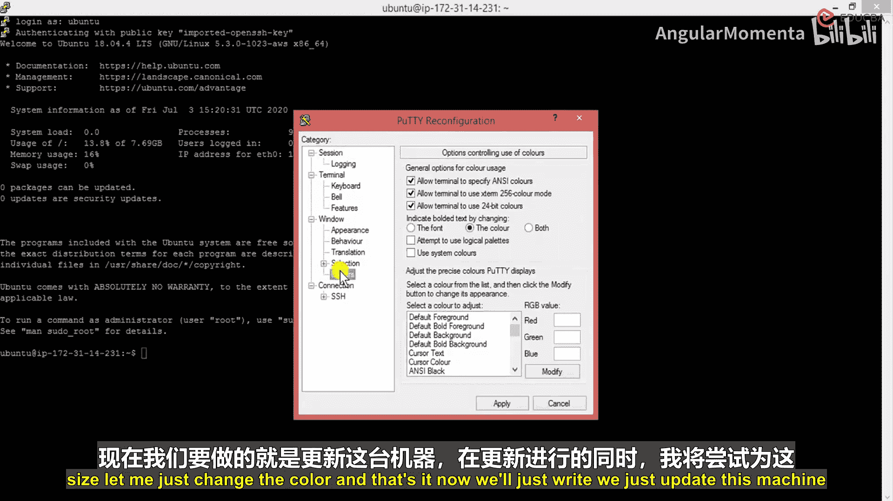
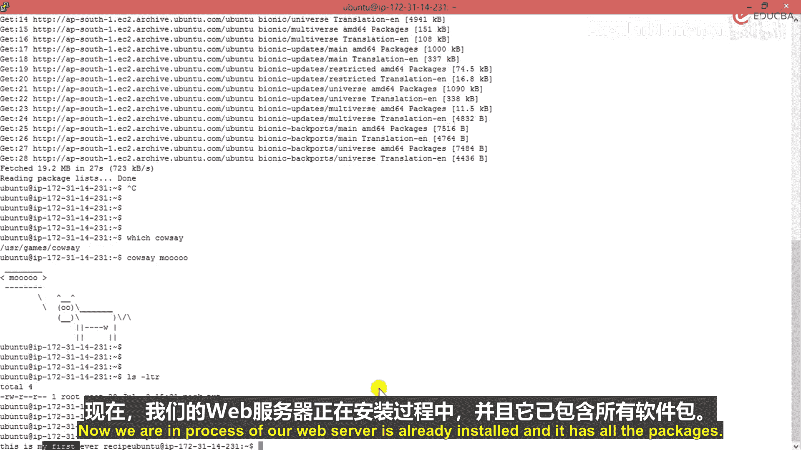

# 【EDUCBA】应用Chef实现云基础设施项目自动化 ｜ Apply Chef to Automate Cloud Infrastructure Project p13 02_03_02_引导启动主厨节点 -BV134F1zaEdz_p13-

Well our chef node has been created successfully。 I have just taed us as Che node。 Now。

 let me go to self workst。Since we have all the recipes here。

 what I will do I will be just uploading my recipe to our self server。Let's upload that。All right。

 we are here and what I will do， I will just use knife command。To upload ourbook to our steps server。

 So will the command for posting or uploading or downloading anything from the self server。

 which is hosted on the cloud server。 So we have to use a knife command， So a knife。Goodbook。

And you have to put up load。If we have load many of cookbooks you can just mention a and attached all of them since I have only one cookbook here so I'll be clicking Se workstation and once you press enter this will connect to your centralized server what we have created account on and it will install this cookbook on our username so let's click this so well it is uploading Se workstation this is our cookbook and this has been uploaded successfully and from here only we can check portal cookbooks we have available on our site so this has been uploaded if you have not run this we can just check it again like writing command callni。

cookbook。L so before uploading a few just。If you just put this command。

 you will get zero cookbook because we have not uploaded since we have uploaded one cookbook。

 I am expecting a result which will show like there is one cookbook install like Che workstation。

 So I'm just clicking this it will connect to your repos and see this has been this is there So whatever we have created whatever we have generated we have uploaded on our server and we can crossche that too So we have checked from the command line like our is existing。

 If you want to check from the Gi like on the web server I mean non your chef server only you can just go here here have to this is the administration。

 this is my administration what I've created。 We have to just the policy and this is our workstation。

This is the content。 permissionmissions are there。 Everything is there。

 so we have successfully installed our chef or cookbooks on our server。 Now。

 if you see here in your policy， you have workstation， if you go to nodes。

There is no nodes because we have not connected our nodes。 We have actually created a node where。

 but this node has been not attached to your software。 that is your shift server。

 So this node is not aware of which is the workstation which is the server which I have to contact to get the recipes。

 So this is the first time your software， your server or Sha server。

Is responsible to bootstrap the note。 Now you will be wondering what is bootstrapping。

So what Bo will do， it will automate the process of installing。

The necessary software and it will be creating authentication keys adding node to the organization here。

 So because your node may or may not be having necessary software installed if you see we have not even installed your chef De on the software on your virtual machine it is just created we have not even updated it。

 but we have to update it first So it has I mean it doesn't have any necessary software for running on Che So while bootstrapping。

Your self server will manage everything like telling that， hey。

 I am your server and you need to contact me every time you need a recipes or you need a cookbook to run。

And it will have a necessary credentials to log into the safe server or workstation。

 It will be providing the credentials and all the necessary software we requires， okay。

So let's go here first and let's just enter into your chef node。 I will do nothing。

 I will just update the machine， which is optional。 Let's create a machine here。

 and let's update this。 Well， this is completely optional method， you know。

It depends on you whether you want not。Update your machine open to machine。

 It's always beneficial right to update your machine so that it doesn't misses any package or made related to your application side。

Or it may be related to your security patches。 are some policies what it has to be done。

 Let me just change the science。

Let me just change the color。 and that's a。Now we will just write when we just update this machine。

While this update is going on， I will try to write bootstrap command for this machine。

 So let me go to this known machine。 This is our known machine。 I am in Chef Repo。对。

So I have just edited it here and let me done this。😔，So now this is working right now。

So if you see this， it is creating new client for your web1 and it is creating new node also and it is naming it as a web1。

 then it is installing omnibus， the version is this thing and it is in the downloading omnibus if install or this thing。

And this all installation is going on then U2 is getting installed it is I mean。

 open to versions of this one，8。20445k。So all those things happening。

 no matter it is happening packages， what is used for。Installing your chef is happening。

 So whatever we have done for our workstation or chef。 So through this bootstrap command。

 just one command can do all the magic。And you don't see any issues here。 It is just going smoothly。

 It is compiling cookbooks within we not only we have wrote the strip to。

Get the necessary software installed。 We have also mentioned the cookbooks。

 which it needs to install， and it gets automated。 So just by single knife command。

 we just did all sort of these things。 So this is a quite long process。

 It will take little time and see this this actually completed。

 This will the masses if client finished two hour those which updated in 45 seconds。

 It took 45 seconds。 The two things what it updated was it updated。 This package。

 it installed this package app package。 and it has created one file here。Created one content this。

 and this is the content of this file。 So whatever we have replicated on our。Vtation is present here。

So， we can just。You can actually cross check， like。Which currency。

Because this is application we have installed。And you will just get to see if you put like。C say and。

你。I don't know if this is the right syntax。I think its the problem is like I am just checking in this workstation。

 I mean your self server， it should be there in your open to machine what we have done here。

 So if we see here which cowai will show you。So this is Cai。 And if you put the option here， like。教师。

And。WWw it it will show the cow。 Okay， so it's all done。

 let's check the opentu machine where it has created a file what we try to imp This is the factorctor TxT。

 which came through your recipe。And guys， this is what we wrote in our self workstation。

 and this has been replicated through our chef。Boottap command。So we are all good。

 Now we are in process with our web server is already installed and it has all the packages。

