# 【EDUCBA】应用Chef实现云基础设施项目自动化 ｜ Apply Chef to Automate Cloud Infrastructure Project p14 02_03_03_安装MySQL服务器 -BV134F1zaEdz_p14-

Well， we have seen how to bootstrap a node earlier。 we have bootstraped one node。

 which we call as we observe。 So and the syntax was very simple。

 If it is not clear I will just reiterate again。 So what we are doing is。

 were just using the knife command interface like we are just you can I will show you again here。

It's the syntax will be like knife and then it comes with your bootstrap command。

 If you have any issues with bootstrap， you can just do knife bootstrap and hyp and F and help。

And it follows by IP P address。Of the node， which you want to bootstrap the node with your server。

 then it comes the SS user。And for open to machine。

 you will be mostly writing open to if it is easy two machine， you will be writing easy to user。

And then it comes your location of your Pm file。 so it can be any location for me。

 it was home open to。And。It was at my own to location。Somethinging x dot PM5。After that。

 you have to define the node。 So minus n。 And what I defined was Web1。

 followed by your pseudodo command， which will be having run list like now。

 not only I'm bootstrapping on node I am just along with bootstrapping。

 I am just asking my node to run some recipes。 So this is a run list what I am providing it。

 iPhonephone list。 And then you mention your recipe。 and that's it。

So if youre in the command what it will do it is that disconnect to your Che server and through Che server your Che server will assess to your open2 machine and it will install all the packages what I've explained earlier and it will boott so this is the basic bootstping process notice we have two nodes one is for web server and one is for your Db server。

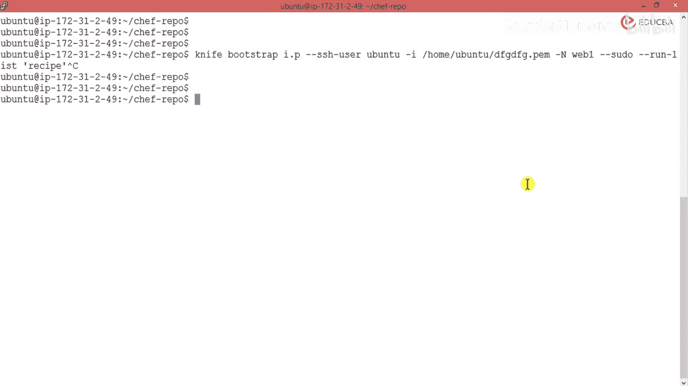

So not only we will be creating a Db server， we writing a Db script in which it will install your MysQL server。

 so we have three machines like we have workstation。

 we have one Db host that is host machine and we have the workstation so what I will be doing now I will be writing one script and we be creating one cookbook inside which will be adding script for installing MysQL server which is very important for our project。

So once we install MysQl server it will install the database。

 so database is very important because whenever you are creating a college website or any website。

 so you want a data to be stored in a centralized repository suppose someone enter your screens like a name address or password or if you wantna assign someone to specific course then they have to mention their course and they have to give some mandatory fields which is to be storeding database but once you create database you have to just ensure that your tables are according to what needs you have and this will be doing it right now so let's now create a onesha recipe in workstation because I have chosen worksspace workstation only where it will be generating all the most of the scripts but you are free to use any machine which have SaDK because any machine which have SaDK client。

Can generate work， workbooks and cookbooks or recipes， anything they can generate。 So right now。

 I mean cookbook director， let me go out。So I'll be creating one cookbook and I will name it as my D server。

 So let's try it。 Well a command is like Che and you know it's generate commands。

 have generate what to generate。I have to generate cookbook。So， it's cookbook。

And where to generate it is to be generated in your Let name make it as it should be under your cookbooks。

D your tree， and I will name this as my my sQel。So let's run this。

So yes F command will create the all the dietaryy structures which is required for a cookbook， MysQl。

Now you just go inside your Mysql。Go inside first cookbook。Alright。 And now you have My Sql here。

 what we have just created。 So go to My Sql。 So our cookbook is ready， let's。

Create recipe by using the same command， generate command。Me come back from the soldier。

And we'll use the sameme command to create recipe。 And we have to mention the recipe part instead of cookbook just。

Mention recipe here。By the way， you can just also come go inside your cookbook and just create your own recipe like you can just type your recipe and you will get to know。

But to make things easier， let's use She generate command because it creates all those necessary libraries and directory structure what is required。

 So inside your Mysql， just mention your Db server you don't need to put dot RV file because your chef will understand that okay。

 well which recipe will be in D So click enter and。I think you have to mention this thing。

 Let me correct this generate recipe and under cookbooks。 here have my sql。 It should run， actually。

Will I rent the same command here。I just check what is my directory。 and this was my directory。

 I came outside and ran the same command， but I just appended one space here so that there should not be any issue。

 and it has created your recipe。 So if you face any issue。Like we faced earlier here。

 like any options， So you'll get to know what types type of options you need to select and where you have to generate the cookbook I in your recipes。

 So your recipe and cookbooks are ready， let's go there and we can also check in our server So this is our server your workstation if you refresh this you have cookbooks under cookbooks we have Mysql what we have created and under Mysql you should be having recipes and under recipes we have Dv server do RV and re dot Rrb do just got created with this recipe when once we created that So now it's time for us to create recipe for our D server。

 let's go to your workstation So Cd cookbook。

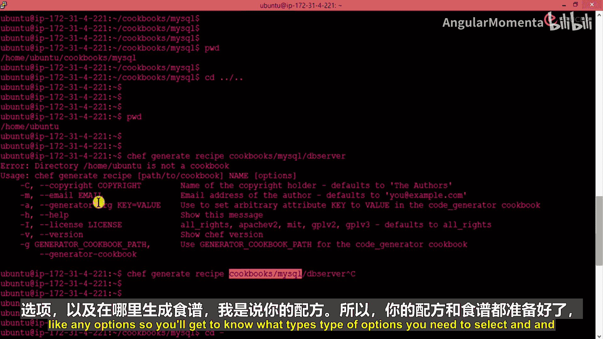

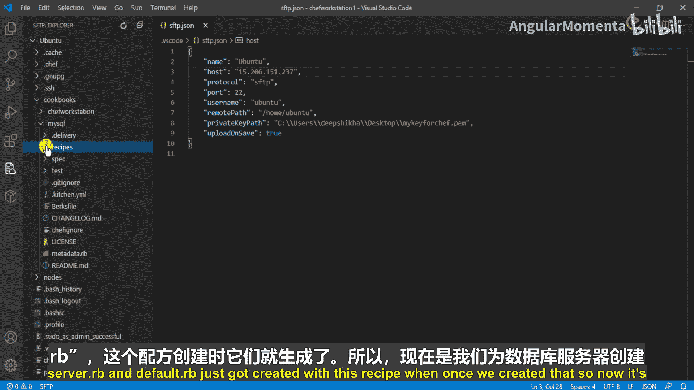

Then here comes your My equalql。And then， comesseur。The recipes。And inside recipe。

 you will have D B7 dot RV。So just enter here。 So remember if we are not using this command right。

 I mean command since if you are not reusing this generate command。

 then these things you won't be having See， you can just create recipes here just by just doing a touching a CAd file or just doing a touch or VI and put the extension as RV inside your recipe will be recipe。

 but to generate recipe according standard you have to use recipe I mean generate command So this is all could。

This will tell the versions and everything about your chef recipe。 Now， let's come down。

 And here we have to install a package， which we call as your D package。 So just。

Remove this and mention package what package it should be my equalls over。😔，Mth equals so。

Ensure that this server is according to the naming conversion of Uban2。And what it will do。

 So now I'll be opening one Ruby block。And Ruby B will do。Let me。And what it will do。

 it will just So in under do block， you just mentioned actions。 So under actions， what it will do。

 it will just install。And you need to end the package。 So I just wrote a very simple command。 I mean。

 it's just like if you are not mentioning action also， it will create an install。

 So unlike your ancible lamp upuppet where you have to specifically mentioned that whether it's your Utu machine or it's your Stous or something else or feddua where you have to mention whether it will use aft module or it will do here module So your this time your chef will take care of everything。

 you just need to mention the package what you want to install and the type of installation or the package manager Che will take control of everything。

 So you don't need to worry about it。 So。I will just save this file。

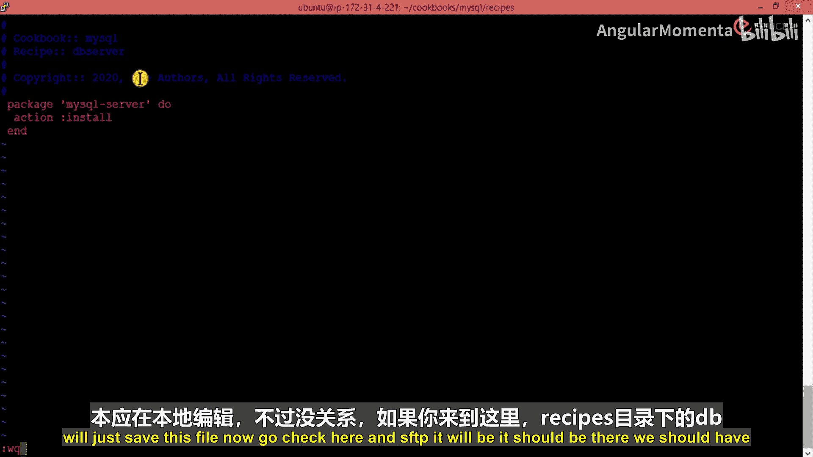

Now， go check here and a if it will be。 it should be there。 We should have， actually。

Edied this in local， but that's okay。If you go here， recipes。DB7 is when local。

So this is what we have created here。So all right guys。 So in what we can do。

 actually we can just run the recipe here or cookbook here。

 and we can get your Mysql server installed。 This is what we have to do because we I have created only three machines。

 One is for your web server， one is for Db server， and one is your works I in your servervo。

 that is self servervo。So and I am just making your web server as I mean I am making your Db server as your workstation only so what I will be doing I will be copying this recipe or workstation I in cookbooks to the location in safe server and what I will do I will bootstap this node because remember we have not bootstrap any D server we just bootstap a node which we call as web server and during bootstappping this will be installed to this so let's go here。

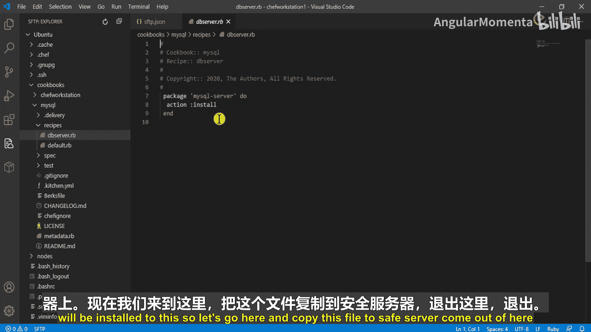

And copy this file to save server。Come out of air。 Come out。Yeah。Now。

 I will make just e everything like my sql。S E P Man are and I all the folder structure will be there in your C server。

 and user should be open to。Or for more clarity， just mentioned root。😔，At the Iit and your address。

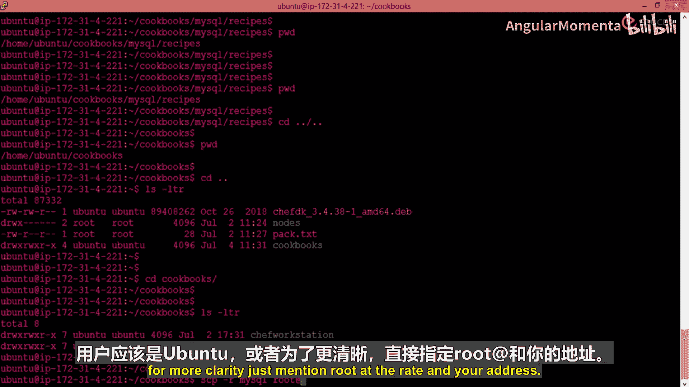

Address of your server is。

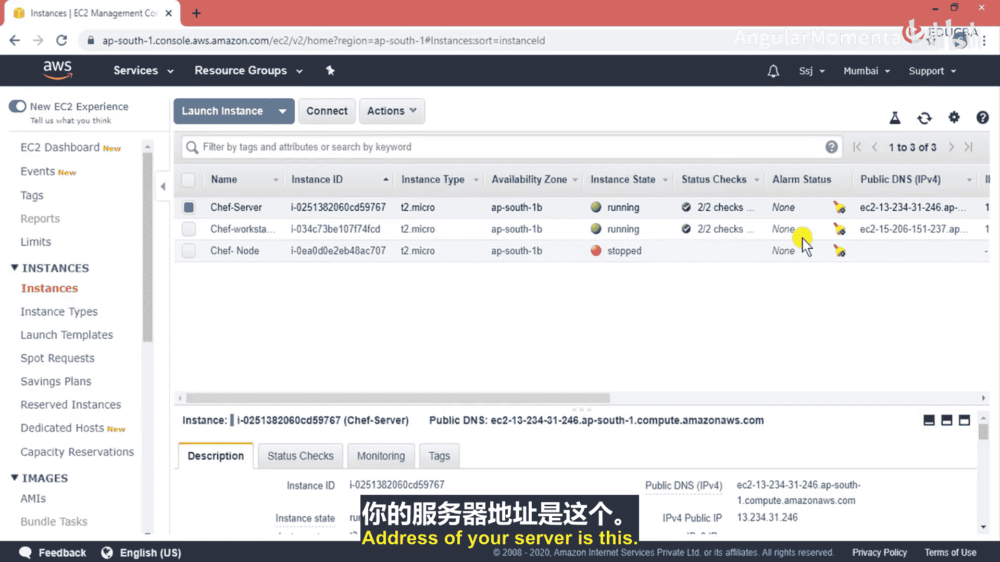

This。Copy the address and the your location as a temp location。 Now。

 it will be copied to your temp location of your safe server。

Here's maybe some S I will just fix it now。 Actually， when creating a your script for I mean。

 when I was doing S between machines， I was in route user。

 so I will just do all those things via route user only。Then I定嘅追过。Mysql。

You should understand that during real time situation， you are bound to have exceptions。

 If you are not getting exception， then。

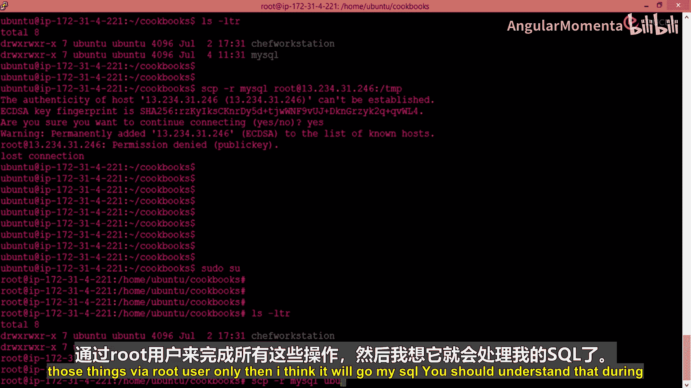

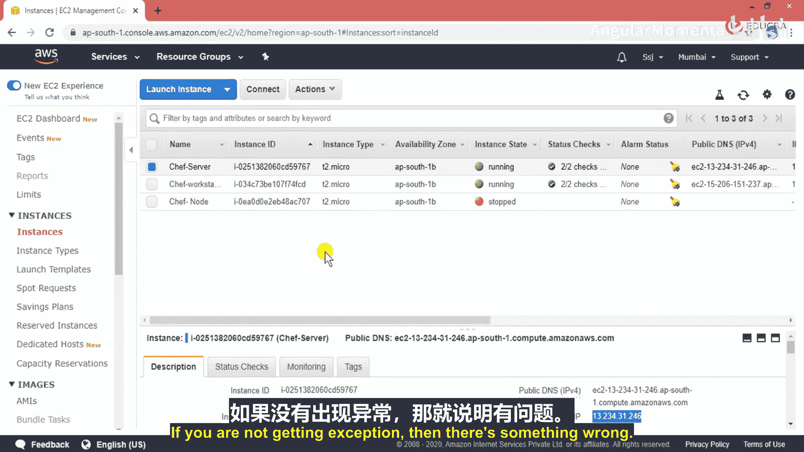

Then there is something wrong。So now I think it will go。I'm not sure。 Okay， it went actually。

 so through root here it went。

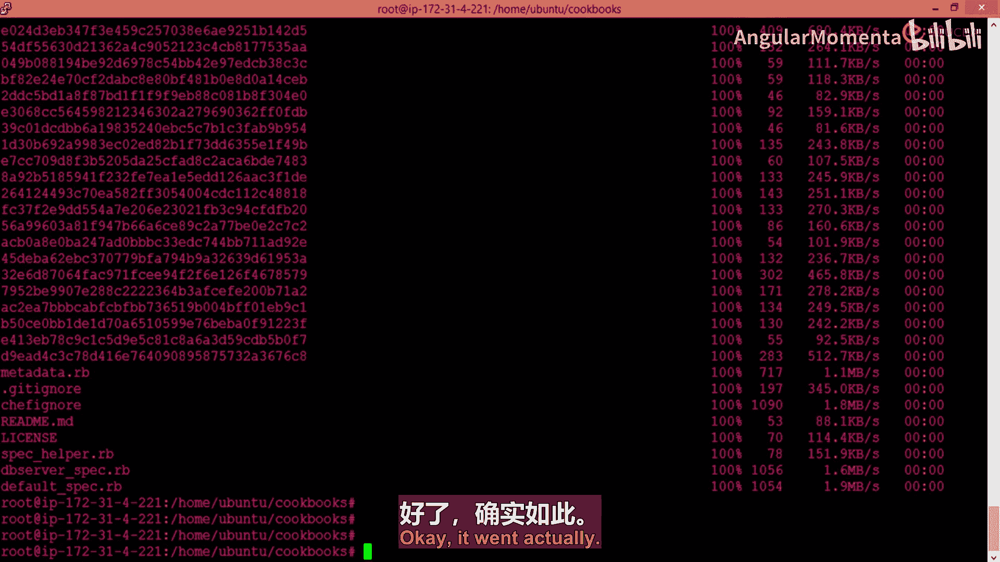

And you can just cross it here in your safe so。Go to C1 and you will find this folder here。

My SQL is here， go back to the location where I want a copy and I want a copy in under your Cphrepo inside cookbooks。

Cic cookbooks inside Ci cookbooks I want。There is another bicycle。 I will just delete it。Actually。

 I touched that file again。 So that's how it came。 And inside your self works inside your inside your cookbooks。

 it should come。 So this is the location I have on a copy。 Just go back to your temp folder。Alice。

Then C P minus r for recurible copying。And then you put the location。

So your file has been cop successfully。Okay。

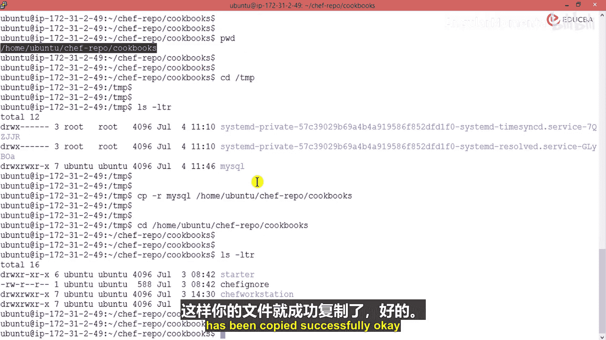