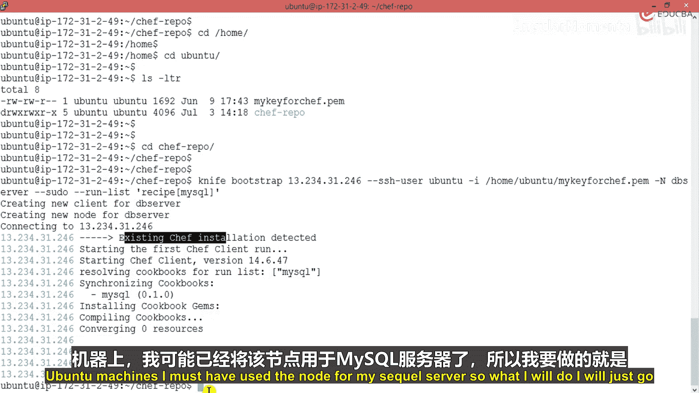
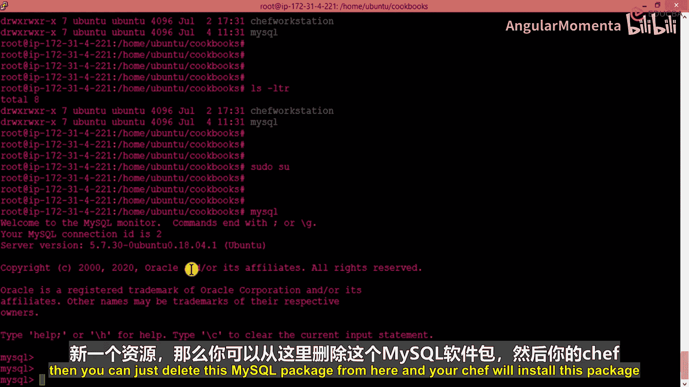
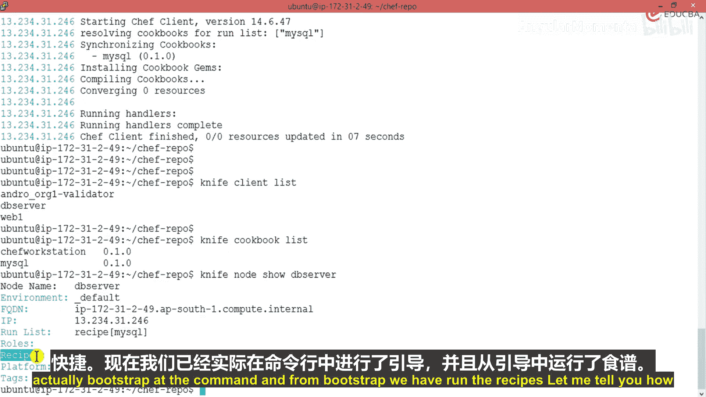
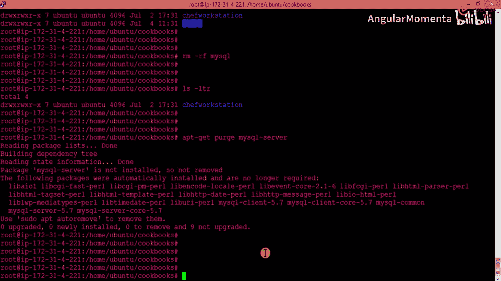
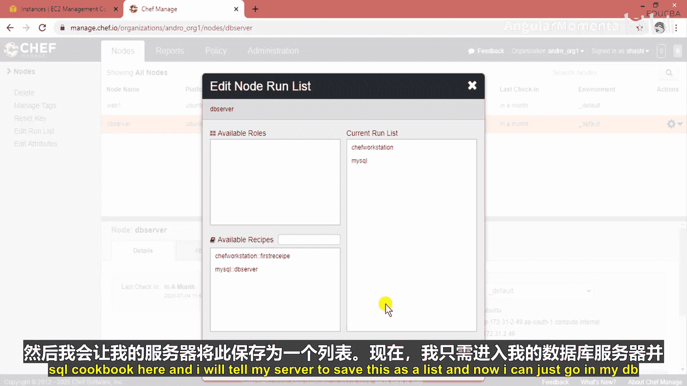
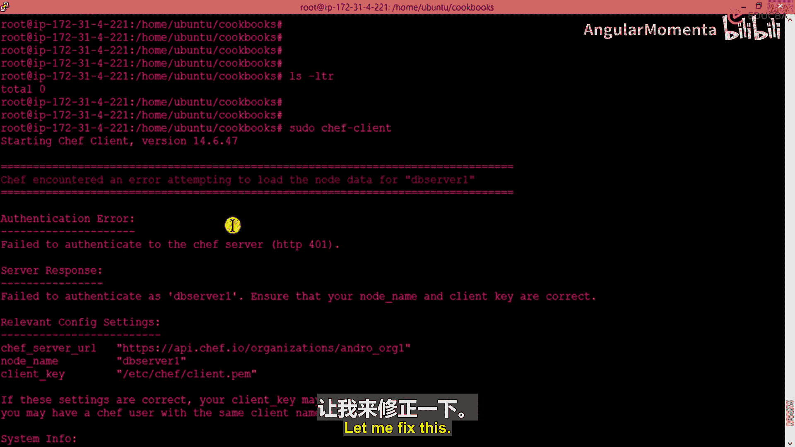

# 【EDUCBA】应用Chef实现云基础设施项目自动化 ｜ Apply Chef to Automate Cloud Infrastructure Project p15 03_01_01_集中式Chef服务器 -BV134F1zaEdz_p15-

Now what we can do， I will just there are two ways of actually applying this cookbook into your node。

 That is your D B node。 First， I will be uploading this cookbook into your self of server。

 So the command is very simple。 You just go here and mention knife。Up Lord。This cookbook。

I think you need need to mention cookbook， and then you have MysqL server， MysqL cookbook。

 So this cookbook will be there in the Mysql server。 So whenever we create new nodes。

 we don't need to explicitly actually copying and we just need to don't need to just go there and run this cookbook。

 So from server only you can just put that in your cookbooks。

 but you have to make sure that your server is like we have bootted the server before。Al right guys。

 so what I will do your My Sql has been actually uploaded to your C server。

 I'll be bootsting the t server， so the command will be。Knife。Btt。

You have to go to a the rip finally。And from here， you have actually。So， right knife。Boot strap。

Followed by the I IP address。 So IP address of this machine is this。 I will copy this here。

And followed by S SH user， iPhone user and the user I am having is U to。

Followed by the location of your PEm file。So I think it's under home。

U2 and the location is my technique name of my Pm file is my key chef dot penm。

 Let me just cross check again。I think we do whole we do。不。Mykey for factoryia。

So who do again to your chapo。😔，P the here。 And because if you do some spelling mistakes。

 it won't happen。So， we mentioned this。Now， what I will be naming this。

 I will be naming this as my Dbi11。Just make it as D so。

And I want this server to execute below commands。 That is sodo and run list。

 I will provide the list of recipe， which it has to run。Notice this is a long command。

 you may have some syntax issues， so one or two times you will be having syntax issues rest all will be fine。

So recipe and you put the recipe name。My recipient name is nothing but your that is My Sql cookbook name。

Close this bracket and try to connect。Let's hope for the beast。 It should bootstrap。

 and it should run the command on our note what we are bootstrapping that is。D B note。

 So it has started executing the command。 See， it is creating new client for D server。

 It has created new node for D server。 Now， it is checking existing chef installation is directed it means。

It is actually checking whether your chef has been preinstal or not。

 remember we have already preinstalled the chef so it is all working fine and it has synchronized all the cookbooks and shows finished zeroro of0 to upload in7 seconds because my SQL was already installed in my node so that's okay in some of two machines I must have used the node for My Sql server So what I will do I will just go back to this node and well check whether my SQL is0 or not but to check my Sql you have to be root user I am already root so just check my SQL。

Cool， your Mysql has been installeded successfully。Say there is not an issue。

 but if you wan to make sure that your chef should run like it should update one resource。

 then you can just delete this Mysql package from here and your chef will install this package again So we have already bootstrap your two servers that is your DB server and your web server Now bootstrapping is done now it's time for us to check whether how to use your knife server in a default mode So we are inside this So in just to check your how many nodes are there I mean we have just created a node on the server and you can just check with this command you can just mention knife。

And the command will be like client。Enlist so it will show you the list of all clients。

 which is associated with server。Entro this。So can you see this。

 There is one Db server web server is there， and this is the organizations。

 So we have actually replicated everything。 Now， if a client wants to have a certain set of recipe like we have already uploaded a recipe right on server So how we can do it。

 so we can just take of an example here like we will be uploading the same recipe on the Db server。

 but not through this client I mean， not through this web server。

 I will be going to the U Ui and will be doing it before that we check how many what other things we can do here to give you a more example of the cookbook you can just mention knife cookbook。

Lt it will show you how many cookbooks is there on your recipe， how many。

 on your server and how many cookbooks is there and and from those cookbooks you can just mention。

 So you just notice we have only two cookbooks like workstation and Mysql。

 If you are having easy to an instance and you forget your somehow。

 if you don't know what is your IP address。 then we can use knife again and the command will be like in knife。

And you have to mention which node node and you have to also show and the list that is your D server。

And it will tell you all details about your server list。So this is the environment。

 this is the platform， this is the IP， so and these are the recipe which is already there。

 so it's very simple and quick。Now we have actually bootstrap at the command and from bootstrapap。

 we have run the recipes。 let me tell you how to do it from the server level。

 So before that will be just deleting exit from this Mysql。

And I will be deleting the cookbooks what we have generated。 So it's my SQl just delete deleted。

 I'll be doing this from my server， and we have my Sql installed to。 So just delete this as well。

 So get。Puse。My sql。Solo。It will push。

Let me delete another cookbook。What we have created here， that is workstation。

I'll be link this cookbook as well。Now， through this client command line。

 and I'll be installing the cookbook on my deth。 So the command is like knife。Notode。

And you have to put the run list。Run hyphen list。And what where you want to add。

 you have an to add on D server。Which cookbook you will add I wan to add but before that just check how many cookbooks we have so we can just book knife cookbook list so that you will get idea of how many cookbooks we have。

是。Two cookbooks are there。 So let's add one cookbook here， note run I list。Then， add your cookbook。

That is Se workstation on the cookbook。 Where to add。

 you just need to put your ear after air on D server。Which recipe to add。

 you just mentioned this recipe， the recipe。And your Che walk station here。And it will actually run。

 and it will actually add this cookbook into your node， which is there on your。

 which is connected with your self server。 So this has been done。 Now you what you can do。

 You can just code on your。Sf server clam machine here。 server， that is your U I。 Lets me do it。

And we can actually find and add all those things and add。So let me log in。

 I'll show the Ui how it looks like。So if you see the nodes， we have two nodes here。Now。

 if you want to add some recipes here like we have Db server and web server nodes and on Db server。

 I want to do something， click this thing。Click here and you go to edit run list in its R list we have My SQL and Che workstation。

 which is already there。That is your current run list。 If you want to add something else。

 you just mention or you can just delete all those things like if you wanna delete this thing。

 you can just mention。This thing， or you can mention and remove this。And save it。 Now。

 what will happen Your D B server won't be having any cookbooks。 So there is nothing to run。

 So you can just manage and add your cookbooks here as well。 Now， again， I will go here。

 I will check your editor list， and I will add your。Safe workstation， cookbook。

And my sQl cook cookbook here。And I will tell my server to save this as list。

 and now I can just go in my D server and run Che client。

So remember guys， we don't have anything now， we don't have any cookbooks here。

 although although the package will be there， that's okay so。

You can just run Se client and see what Che。Has God for us， So shef sodo shef。Havehen clint。So。

 this will。Actually， contact to yourself server。And it will get all those things required for your note。

We are experiencing one issue here。 Let me fix this。

