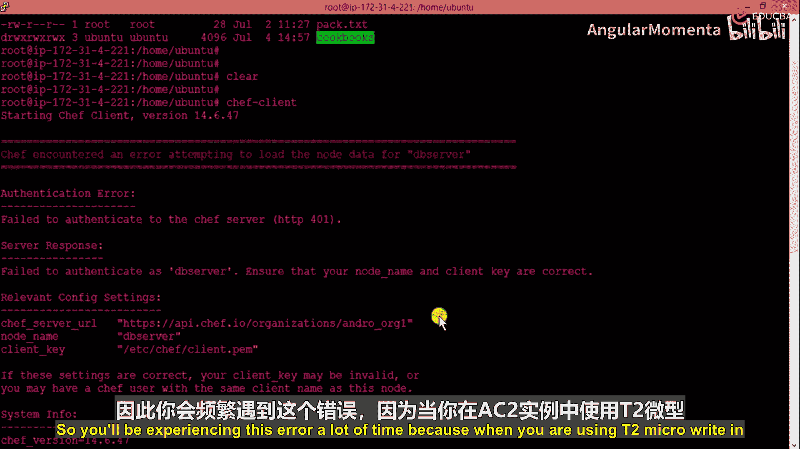
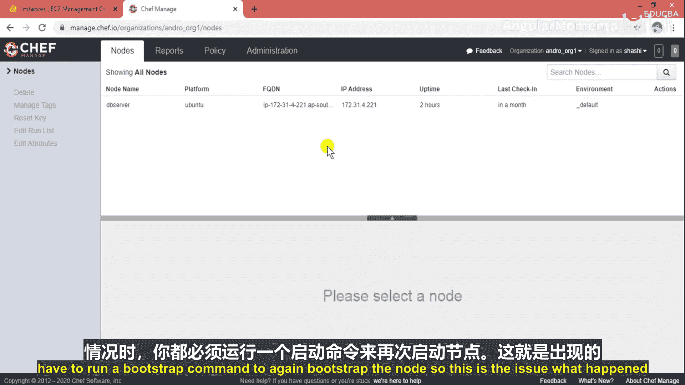
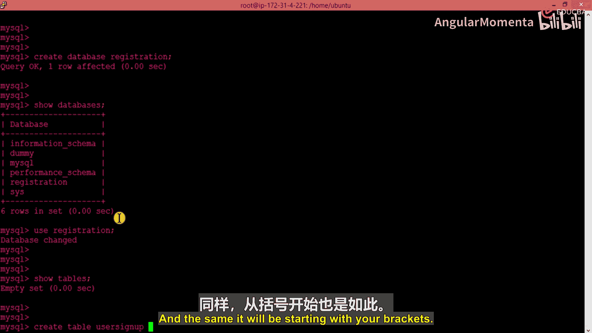
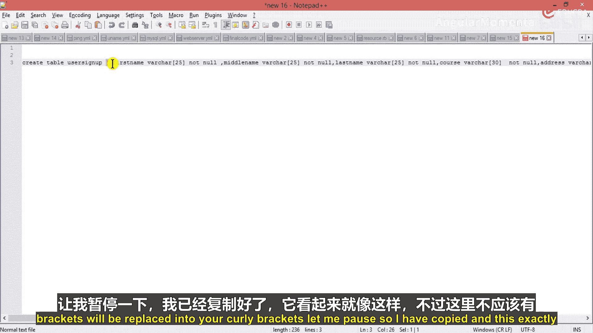
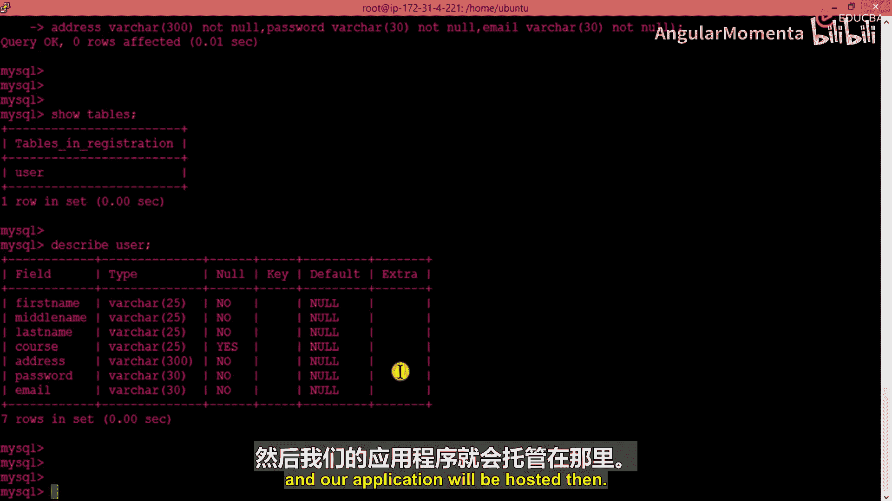

# 【EDUCBA】应用Chef实现云基础设施项目自动化 ｜ Apply Chef to Automate Cloud Infrastructure Project p16 03_01_02_设置数据库 -BV134F1zaEdz_p16-

Well， you can see this there is error like in and error attempting to load the node data from TV server。

 So you'll be experiencing this error a lot of time because when you are using T2 microrite in your E two instance see here this is our instance and I have three server。

 I have made one server down intentionally because as long as you run the server and there is no need there lot of data and losses there So they might be some although this is a free but after some time there will be some tries to be incurred。

 So once youve shut it down， these IP address are not static there dynamic there will be changing dynamically once you configure these things here so your nodes will be right。

 your nodes won't be configured with your although you have bootstraped the node but for bootstping you need centered IP address suppose if you shut down that server and when you restart the server when you started the server again the IP address will change。

So your node won't be able like your web server， your other servers or your chef server。

 They won't be able to interact with each other。So every time this happens you have to run a bootstrap command to again bootstrap the node。

 So this is the issue what happened and if you bootstrap the issue you won't be finding this issue again if you run here if I clear the session。

If you were on here， chef k， I actually bootst it。So even we finding any issues here。

 so once you are getting these types of issues what thing you have to do is to you have to just bootstrap the node again and then you have to surround this command。

So this is all good guys since we have installed MysqL server。

 lets go to MySqL and let's set up our database manually So for that lets jump into your MysqL console that is your mice type MysqL。

And the user， what you will be having with you will be U and I'm using with root with minus p as a password。

 you can just type any password you like here， Ill be typing any password here and now you are logging into your Mysql command prompt so this is interfaces clear to you so let me show you how many database is already installed by this guy Mysql which is preinstalled so for that you just need to show databases。

And you had to start with this colon。And these are the databases which is already installed here information schema under me MysQqL performancechema and says So for our case study。

 suppose we are creating a college registration form so for a registration form what else think we need people to log in I mean use their name as first name。

 middle name and their last name this is normal format apart from using name we we have to do is we have to give these characters like what course they are choosing what is their address phone numbers and all these things we have to put so let's try to create one database and if you see any there note tape there won't be any table first create one database where well be keeping andoring all those information so that once we create the website and once user logins and once you save and submit the page the data will go to database。

Now， create database。Syntax is create database。And you have to put the name of the database。

 you can just name as registration。And with Colin， this is a syntax and your database is created right now if you want to see the so databases again now。

 you will get to see your database here， so registration has been created successfully。Now。

 you have to go to your database for that you just use the registration。

And you are inside your database now because this is a dummy database we have not inserted anything and there won't be any tables。

 but to see because all your database and data structure is based on your table columns rows。

So we have just created this the database what we have not inserted or created any syntax or column where well including the database tables or detailss。

 So just type tape2。And。Tables。There is no table its empty set。

 so there is it shows empty set there is no table so what I will do I will create one table where Ill be writing a format in which the format we have to be presented there on the form and once the user logins that will be the setting set as your parameter for which the user will and creating table now so syntax is create table。

And you have to give table like what will be the use of name of your table。

 So just mention that user sign up。This is the name of our table。

And thus in it will be starting with your brackets。

 the better let's create here first write in note pad so that you can just copy paste here。

 So create and the table。

Table name is will be your user sign up。And then， it will be your。Coon。

And you have to put first name。First name and it should be wear care。

Inside your and the limit should be 25。Yeah。Then， middle name。It is also a well care。

And let's mention this as 25，2。And then comes your last name。

This is what happens when you rate the form。Well cash。This is also 25。

How about the other field is your course， they have to select course like mechanical inch electrical engineers。

 something like that。So let's put this as course。 And this is also whereca。 the limit will be 30。

 Okay， after course， they have to put the address。 So address。Wel 2。

And address field I will be giving as 300。 Then comes your email address。

 So they have to fill the email。Which is indeed a vca。 So just make it as 45。

Then comes your password field。Which is2 a v。 It cant consist of later and alphabets。 That's O。

 I'm just mentioning it as a we vca， and that's it。

I want to make these fields as like not null so that you cannot escape these things because these are the basic things。

 and they should not be optional。 So what I will do， I will just。Type not null。Not not here。

And everywhere to be nothing。Copius。This is second this got stuck。 Let me fix this。Norly。

And the last field， that is your。Password， not nu。So。

 but we have to take care of one thing like here I have insertted all those like squarequire brackets。

 though there should not bescribe brackets， they should be curly brackets。

 the reason why I am not mentioning here curly brackets like I have done some rules inside my notepa while copying this into mysQql all these brackets will be replaced into your curly brackets。

It we paused。 So I have copied， and this exactly looks like this。😔。

Except there should not be one line here。How have I click this。Your table got created。 Now。

 if you want to see your table， then show tables， you will get to the name of your table name。

So your table name is user and if you want to describe user。

 you will get to set all those parameters what you have set for the registration form。

So describe user and here you are。 So these are the fields first name middle name。

 last name course at password email that we have defined。

This should not be null co I just mentioned as N null that's okay。This weekend change I might be。

 I have not mentioned it should it should be null too because this is the main thing。

It should not be null that course keys is fine before is fine。

 So guys we have successfully created database and we have set the database now we are all set with our database Now only thing we have to do is we have to create one Stl file and then we have to host S file within we have to create one web server I'll be using Apache to web server and I'll be deploying those Sl file into Apache to web server and our application will be hosted then then we'll be all good Allright。

