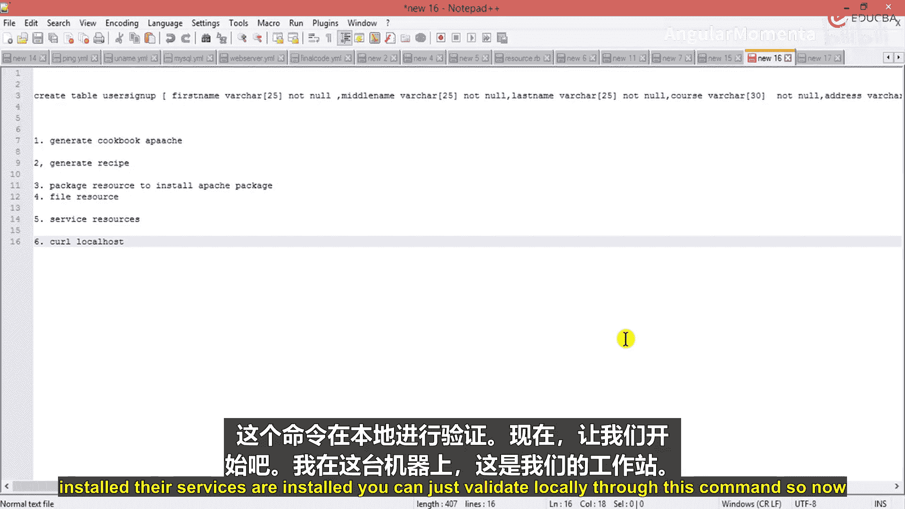
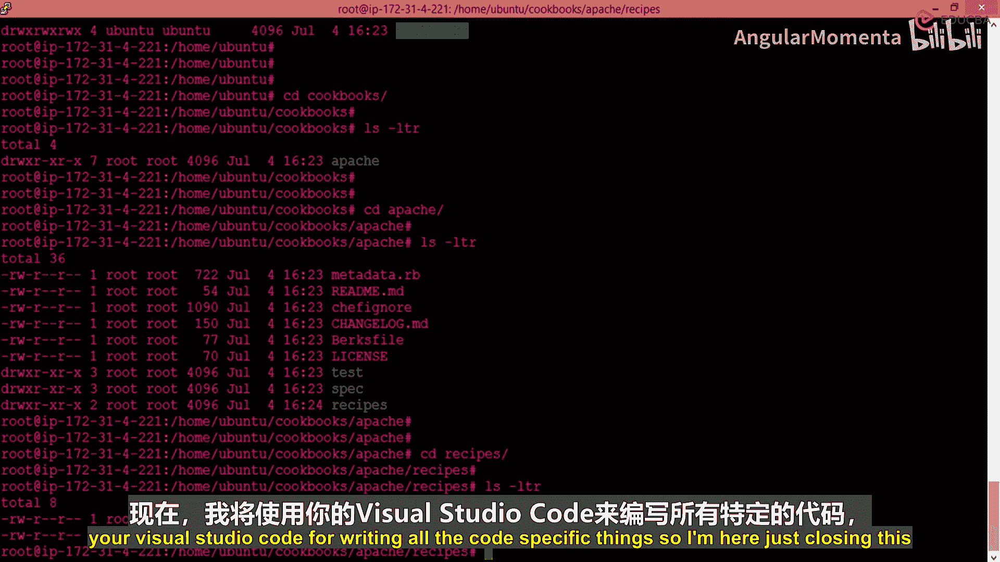
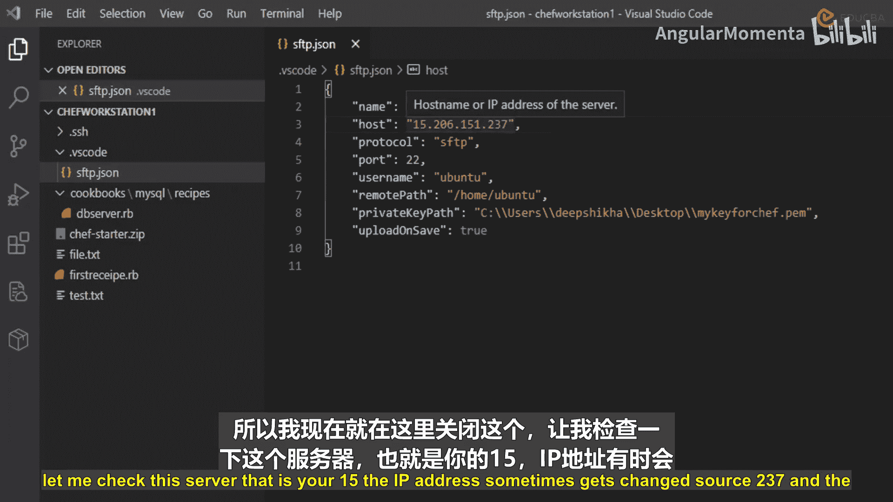
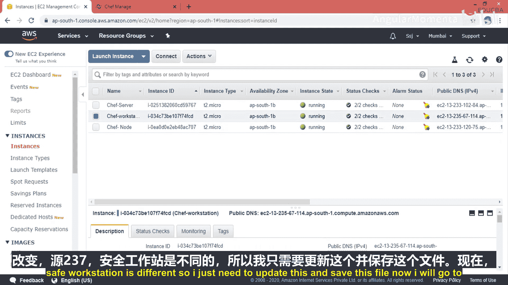
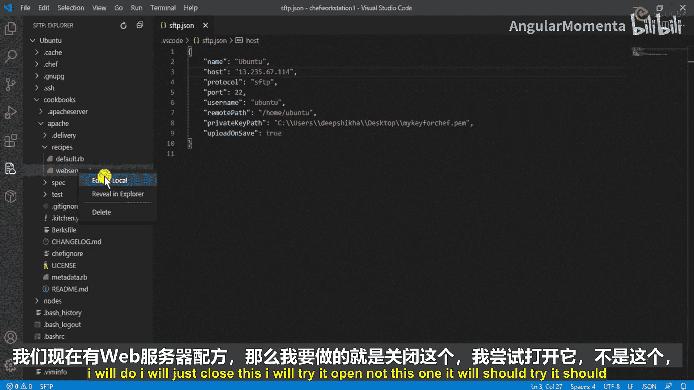

# 【EDUCBA】应用Chef实现云基础设施项目自动化 ｜ Apply Chef to Automate Cloud Infrastructure Project p17 03_02_01_配置网络服务器 -BV134F1zaEdz_p17-

Well， now it's time for us to。Wick up this note because we have used this as our web server。

So let's make the server up。😔，And now I'll be writing script， Se script。To install Apache。

And subsequently， will be。Writing all those services， which is needed。

Toren Apache and all those application， which is needed。To run on it。 now。

 let me tell you how the steps will be there while creating your Apache。

 So the first step here is to generate a new cookbook， which will be calling as Apache。So。

 to generate。Cookbook about you。This was the first step and to generate this Apache we will be using obviously Sa generate command and well be placing this Apache cookbook inside cookbooks directory what is already there in our workstation So once we verify the contents of our book cookbook we should create a recipe called web server So next step will be to generate of course we will be using generate command again。

Because it will have the all difficulty for features of your。

Cookbook and recipes then we'll be generating this recipe。 Well。

 your recipe creation is completely optional。 Either you can just use generate recipe to get all the default features or you can just go inside your cookbook workers when you rungene cookbook it will just create all the directors inside the cookbook which will be including your recipes and youll be having defaulted RV file And there if you want to have if you want to create a more recipes file。

 just you can just create this as you can use any of your text editor like Webmvi touchuch and you can put all the contents you want to put in dot RV file But for this exercise and for this key study。

 I'll be using Se generators and I will call that recipe as web server So within recipe now。

We have to edit recipe now。 So within recipes， I'll be using some self ratio。

 which we discussed earlier。So will use safe resources to stand up a sample and very simple Apache web server。

 And while installing Apache server will be using some packages。 So what type of packages you need。

 So I'll be using。Package resource。To。Install your。A party package。

So there we just mentioned install Apache2， the name which we can find in U2 and open2 will be like understanding all those things。

 So after defining your Apache， you have to use the file resource。

 so file resource will contain the address of our web page。So here we have to mention file resource。

This will contain the address of the webage which we are going to host on Apache。

 because just simply installing Apache won't give any result。

So we have to use when file resource and the name of the file will be indexed HTMLm that will be hosted on your Apache server So after confiing your Apache with your file resource。

 we can use your server resource Sos all your resources So we are just using service resources and there we need to mention start and enable of Apache server because one of our condition was there like when our server goes down So in case why it goes down because your VM is rebooted or your Vm gi shut down So as soon as your VM is up your server should be starting automatically So for that will be using enable enable is like whenever there a issue with the server and server goes down and server comes back again that is your VM comes back again there in that situation your server should come up So apart from mentioning your starting of the server I will be mentioning like it should be。

Enable and I will be passing all those things in action and for that I'll be using array and inside array I'll be passing two arguments。

 one will be your starting up and another will be your enabling it。

 So once creating the main recipe file that is web server recipe we have to configure your default recipes and in default recipes will include the web server recipe and which will be calling web server recipe from the default recipe So this means when we run chef client on any machine then it will be applying all those default recipes and the default recipe will be calling the main recipe and if the execution is successful then you will be you can able to。

See all the changes while justtriping your curl and your local host。

So curl is like when your the things are installed， their your services are installed。

 You can just validate locally through this command。 So now let's get started。 I am on this machine。

 This is our workstation。 Let me exit from my sequel， and。

Let me content the things there。 So now the first thing what I'll be doing is to generate your recipe。

 So the command will be chef。Generate fast cookbook， then recipe。Your cookbook。And。

It should be inside your cookbooks。 And I name this as。I name this as Apache， Apache， too。 Now。

 let it be Apache。 And this command will generate all the active structure for a cookbook name as Apache。

So， this isn done now。It has created recipes， and it has default RV。

 so you can go and navigate and we can just manually create one recipe file。

 but I'll be using generator F here。 So the next command will be to generate recipe Seph generate。

A recipe。And I want to generate inside cookbooks。An inside cookbook， we have Apache。

Then put the server name。 That is your web server。And this will generate your recipe inside your cookbooks。

 Apache and the name of your recipe。 is your web server。Let's see if front successful， Okay。

 trend successful。 So we have our all recipes and cookbooks folder ready。

 so let me go and navigate here。che个 box。We have Apache here。At Apaache， we have recipes。

Inside recipes， which there should be web server。And we have web server。

 so this basic setup is done now I'll be using your visualual Studio code for writing all all the code specific things。

 so I am here just closing this， let me check this server that is your 15 the IP address sometimes gets changed。

This source true 37， and。Cphalt is。

Different， so I just need to update this。And see if this file。Now I will go to view。

 come to Open view。Show F SFTP and your open two machines should come here。It takes little time。

Your machine is there now on Vigil studio code。 So we have our cookbooks here inside cookbooks。

 We have Apache。Inight A， we have。Recipes inside recipes。 Now， we have we several recipes。 Now。

 what I will do， I will just。Cls this。I will try it open。Not this one。 It will should try。

 It should edit in local。

