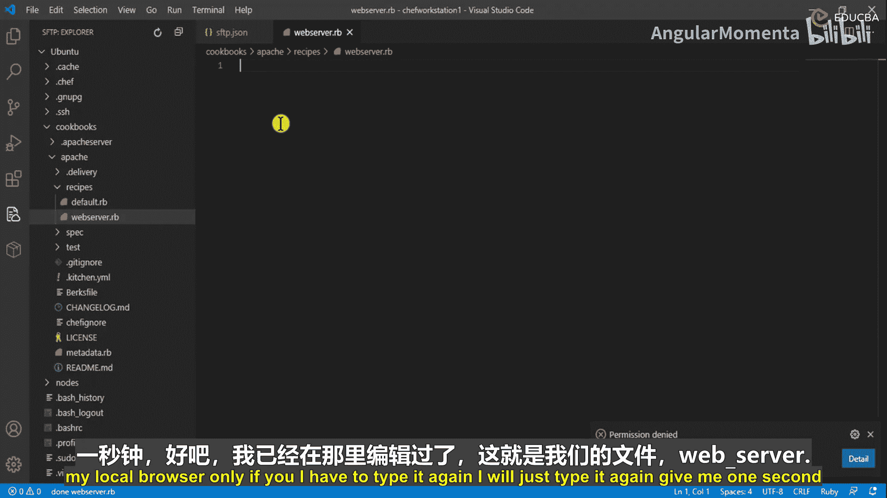
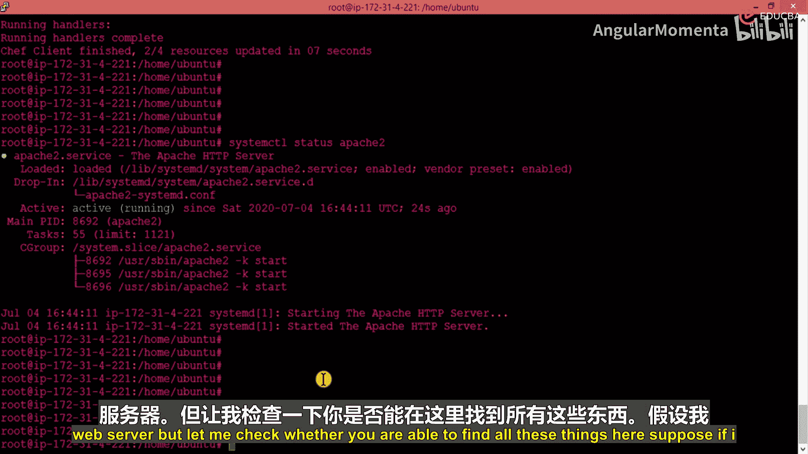
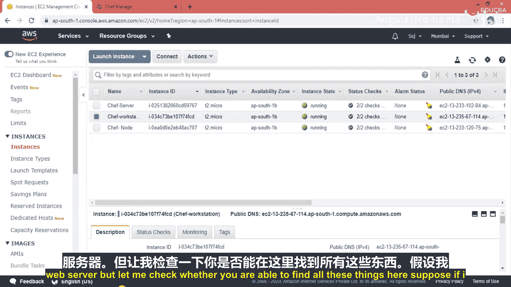
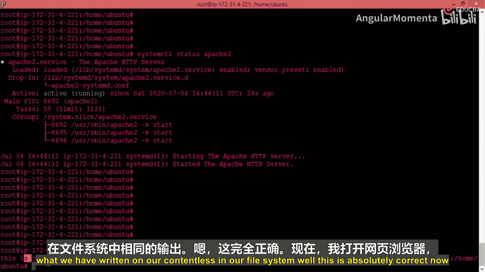
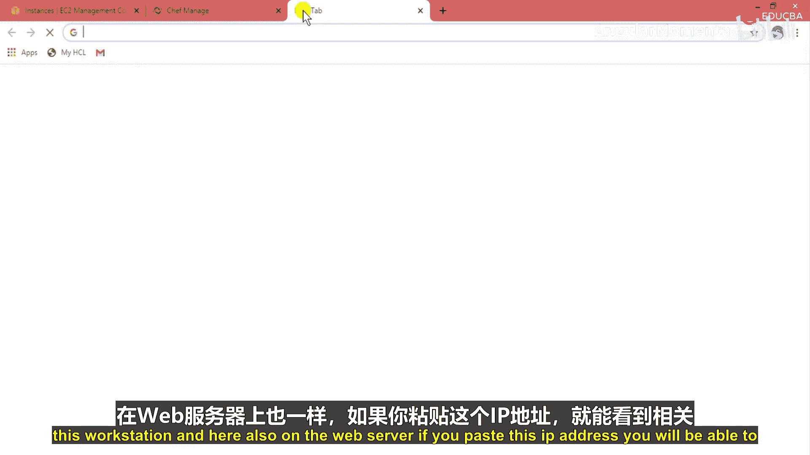
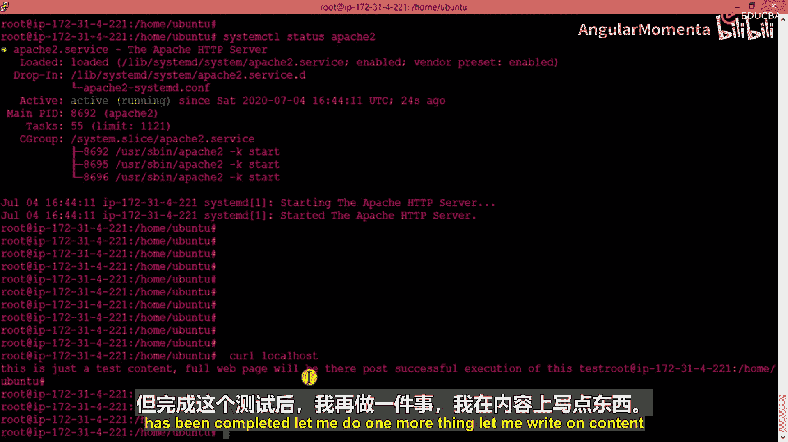

# 【EDUCBA】应用Chef实现云基础设施项目自动化 ｜ Apply Chef to Automate Cloud Infrastructure Project p18 03_02_02_配置Web服务器续 -BV134F1zaEdz_p18-

So let's edit this the first thing what I will do， I will be creating a package resource So resource type will be package。

And this guy should install your Apache。2， and we can optionally， give your action。

And they should ask him to install if you omit this package Also， there is not an issue。 Still。

 your rubby command and your chef will be able to do all the necessary steps to include this package inside your V and wherever you wanna deploy this recipe。

 Now， I am introducing your file resource。 So inside file resource， the location where。

The5 should be hosted。 The Webage should be there as this one， dot or。Totem。And。

The filing is indexed， Dot H Tml。And there I'll be initiating one loop。 That is two loop。

And there should be one action。Well， the action will be to create this file。

 and it should have some contents in it。 So the content will be that。Hey， this is just a normal。

Index file。For testing。I will create。Webs page post。Successful。Destty。

So I'm just checking because all the contents of your website you you cannot just put it here。

 either you have to choose the content or you have to just give the location where you want to copy the content to yourtl file。

 So your file resources is done and I have to in this end。The first second。

So you have to end this block， so this has been done。

 Now it's time to introduce another resource that is your service resource and what this resource will do。

It has some functions to do， like it will。Have some actions， actions in the sense， like。It will。

Be starting your server whenever this guy， your Apache2 is installed。

 and I will make this feature as enabled whenever your Vm goes down。Youra。😔。

Apaache should come up once your Vm is back。And here we go， enable。So what Ive done here。

 I have used loop array concept and inside array I have given parameters。Parameters in the sense。

 I have used two parameters here because if you are writing action here two times individually like you will be tempted to use。

 so this will result an issue why issue Because when your chef handlers run your compiler runs for each resource type it is expecting to have only one action type So whatever action you are giving to the first it will act on that and rest action it won't do So you are missing this in right you have resource type have one action and it should come from top to bottom So this is it guys we have created our web server and we have just given a dummy file here。

 a dummy contents and well be checking this out let me save this。

It shows permission denied however I opened this in now my local browser on afield。

I have will type it again。

I will just type it again。 Give me one second。 Well， I have edited this there。

 and this is what our file looks like。 Your F server dot are we。 Let's save this。

And we have one more file default dot RV where we have to include this package。

 include this web server dot RV thing。So let's go here and edit。Well。

 the common syntax here is like you just put in include underscore recipe。And your syntax goes like。

Then you put your cookbook name。Qualen， quain， Then you put your re。And that's it。

So similar will light it here。Include。Make sure you won't do some spelling mistakes。

 otherwise there will be syntax issues and we have to do this again。And here， it will be。佢。

It should be Apaache， as a cookbook。Apaache and Colin Collin。Web server。Here we go。

So this has been included， save this file too。Now what to do。Well。

 we already have bootstraped this command， so if you try to run this locally here。

You might get an exception。 So the idealle situation， what will be doing it。

 I will be just copy this cookbook into to your Web server or host， and then。

Through web server we bootstrap the node which willll be having where web server and through bootstrapping and asking your web server like web node where your web server will install it to get this recipe or cookbook installed。

 but let's try to do if we can do it here most really we won't be able to do。

And when I am doing for the first time in this situation， so you have to go here。

And you have to just run chef。So that my good self I inclined。

And then comes your hyphen hyphen local mode。 Let's try this as Z。

And hyphen I run list shot form will be minus R。 then the same thing recipe and inside recipe just put your Apache。

And Col， Col， your Web server name。So。If your client and server is not disturbing it， it should run。

 but ideally I I think it it won't be running it will just checking if it is running or not。

 so it is fine。Yeah。Oh， it is running。 So if we are good here。 There is no issues。 So guys。

 this thing has run on your D B server holy。 We were just testing this content。

 If you see here as Suu。System CTtl statusus。And the name of your package was Apache 2。

You can see this is enable and start running。So our recipes was is all good and a fine。

What you can do you can everything is there， what if you want to do Your Apache has been successfully installed。

 but we have installed in our workstation。 What you have to do is we have to just copy the recipe to your web server I mean your chef server and then your server will deploy this thing to your which server it will deploy the contents to the web server。

 but let me check whether you are able to find all these things here。

Suppose if I， because let me just do curl a local host。

 It should print the same output what it is supposed to what we have written on our content list in our file system。

 Well， this is。

Aly， correct。Now let me go to web browser since we have already opened the port for Web Stps request just copy this workstation and here also on the web server if you paste this IP address you will be able to see So this is all good。

 What you have to do is we have to just copy everything to your Che server and then surf server with upload this recipe to your Ui server and then through boottrapping you will be actually installing and。

Creating all those Web pages。 But once this test has been completed， let me do one more thing。

 Let me write on content。

