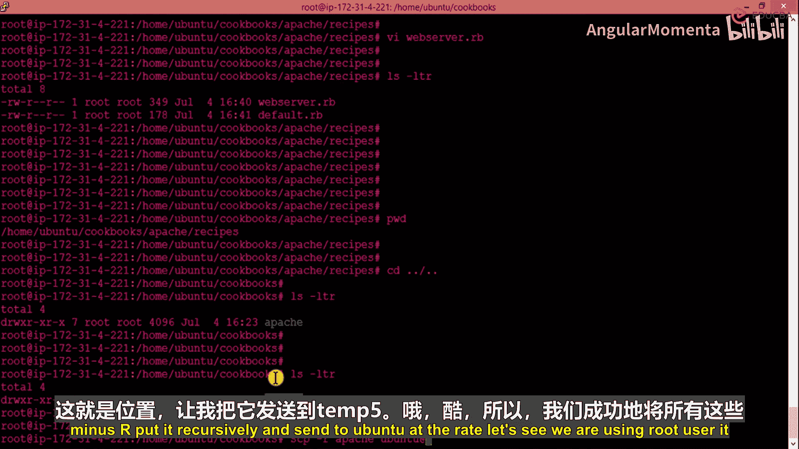
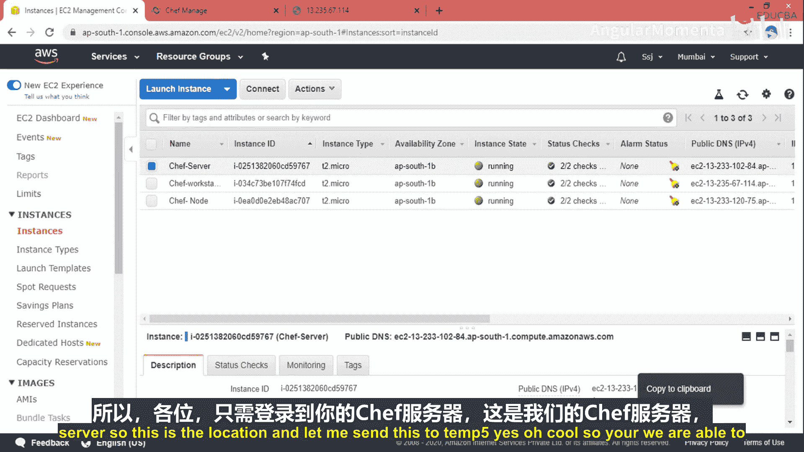
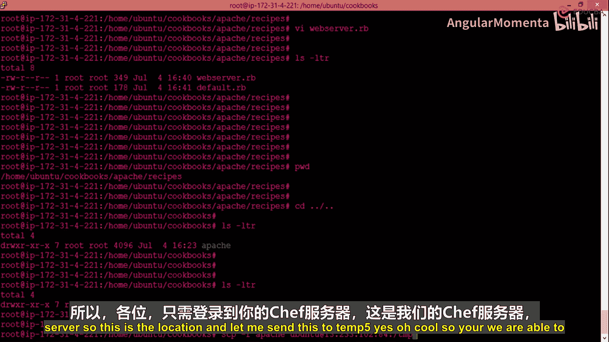
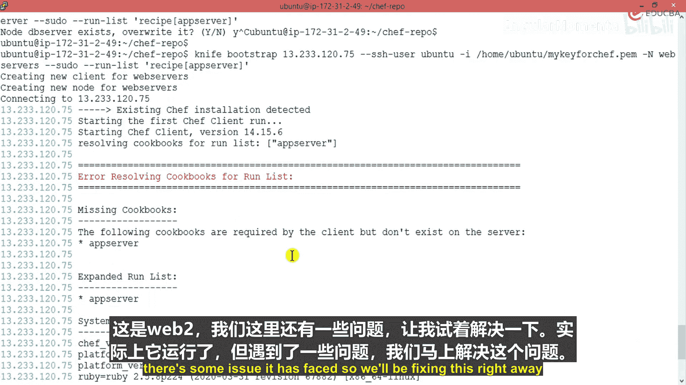

# 【EDUCBA】应用Chef实现云基础设施项目自动化 ｜ Apply Chef to Automate Cloud Infrastructure Project p19 03_02_03_更多关于配置网络服务器的内容 -BV134F1zaEdz_p19-

After we deploy to the web server well be editing the content of our HTMLml file because our HTMLl file will be your main file where your application will be loaded。

 So in this cookbook right go here。Apaache， and inside this。Recipes， di。

If you see this file web server。So here instead of content。

 you can just mention source from which source。This file will be copied and in the source， you can。

 because in the content， you cannot write the whole website。 This is completely not possible。

 It is not practical。 So in the organization what they will do， they will just mention source here。

And you can also do it but our architecture is only through architecture。

 we have only three machines， so although doing it at a later stage。

 I will just editing the content there only because if I do it here I have to copy it again to the web server and then so it will be a little tedious。

So first thing， let me S all those contents here。To your rub。ceptserv。 So this is。Here。

 you come out of recipe and。You should be actually sending。The whole directory Apache。

 So S P minus R put it recursively and send to U2 at the rate。

Let's see if we are using root here。 it should not give any issue， but if it gives issue。

 well change it。We will be sending this to our Web server。

So this is the location。 and let me send this to temp5 yes。

Oh， cool， so your you are able to successfully s all those contents from your workstation machine to your web to your chef server。

 So guys， just logging to your self server。 This is our chef server。Clear the terminal。 Go to temp。

And find onet failure about his over。So。I rank this I have two files here。

 so this is the current latest file。😔，What I will be doing it。Just go your rebel， chef rebel。

And just find a place where you can just copy paste this。

So inside we have replaced this cookbook inside this location。

 So this is the location go to temp now。Alice。C P minus R。

Remember if you want to copy everything from in a same machine then you must mention CP。

 if it is directory， then there's no issues you can just mention CP source and destination if it is directory。

 then you have to mention minus r because recursively everything inside directly should be copied。

If you are doing this bit machine， syntax would be same。

 but you have to just mention SCp and you have to mention the host I and the user through which you can access the host。

 So C pens are your Apache folder。And the location， so your location is this one。That's okay。

 it will copy。So let me cross check。😔，We have Apache here。😔，So， guys， everything looks quite good。

Go to recipes and find those files here。V I webserv dot RV。Cool， this is what it looks like。

 Save this。 And when I will be doing it， I'll be uploading this recipe。And cookbook to our so。

So let me upload this on my server。 This is cookbook。 and inside we have Apache。

 So that to connect to your Che server from your machine， you just you have to use knife interface。

 knife upload。Put your cookbook here。 There might be some other common things here。

 So you just before uploading， just change the naming pattern here。

 So I will be moving this Apache to your just mention a server。

So I move now you can just move knife upload。😔，Quookbook。To your。Bookbook app server。

 and this will be uploaded to your Che server， and there should not be any issue， I feel。

 So this is getting updated guys， so it has created app server there and is it has uploaded。

All right， if you， we have to be very sure， like， if you are a used knife。

 you have to do inside your chaffri only。Or in any photo of yourself Sari， if you come out of this。

Where I am。Am I still in this If I come out of this。Come off of Che repo。

 and if I use the same command what you have used it， it won't use。

 So knife is like it should be under Che repo directory。 If you use this， it won't work。C。😊。

Because all the architecture and knife structures depends on your room。Starter kit what install。

 So this is well。Now what I will do our web server is here。Chf node。

 and this is the IP address because we have made it down and we have started the IP address would be changed。

 However we have actually what we have done， we have actually bootstrappped at this。

 but this didn't happen， So we have to bootstrap it to add this to our node。

 So let's check this command of Boottrap。This is IP address。 Now， let's go into Serepo。

And bootstraap。So you have already know the command what is the command for that。 it's very simple。

 You have to just mention knife。Boott followed by I P， if you are not sure how to use bootsottap。

 you can just mention if and F and L。And it will show you all the possible。Options you can underqui。

 So bootstap after that bootstrap， you had to mention the IP address of your machine that is。

Correct here。And then。I'm even logging through SS this user， so as such user then comes here U2。

The user is open to。 then comes your password。 So password your dot Pm file。

 That is home location you have to give。Home Uuntu。And my key。For。Siff。Dot Pm。

 I think the serial name of the file。 You can check there if it fails， then I will check。

 I feel this is the correct name of my Pam file。And you just put minus n and create the node like web app。

Web 2， because we 2 P are already installed， Webb 2 then followed by hyphen hyphen。

 followed by pseudodo。Then goes your run list。 you can put us。Minus r 2。

 just put this minus run list， then comes your recipe。 and inside recipe。

 Just mention your recipe name。 That is Apache fill the v book cook book name actually。 So。

 but Ive changed the name， right。 So the name has been changed to。😔，Absolible， I think。Let's see。

 friends。Absolible。And if it fails， then we have to check it again。 The command。

 because the command is quite long。 Let's see if it passes。Oh， cool。

 So it has connected to the and it is creating。 It is logging to U to。rather than root。

 let's see if it passes everything。 Okay Kate is asking， please log in as U to rather than root。😔。

There is an issue like the user only and we check where I am。😔，Who I am first。

And let me fix this issue。 There's some issue with the command。 This is a slight thing。

 I will be fixing it right。So， guys， I in this command again。

If you see here the only issue what it was having， I was just checking there。

 Some naming convention issue was there for this file and。

I was worried about that only that that was the only issue。

 because if you are not providing correct user and。Then you might be facing issues in this。

 so this is actually quite easy。 you have to be just sure because it is long command。

 so you have to be very sure what you are doing here。So it has created a client here， webb2。

 this is webb 2。This is we have issues here。Theres still some issues。 Let me try to fix this。

 actually， Tran， but。Theres a issue it has faced， so。

Well be fixing this right away。