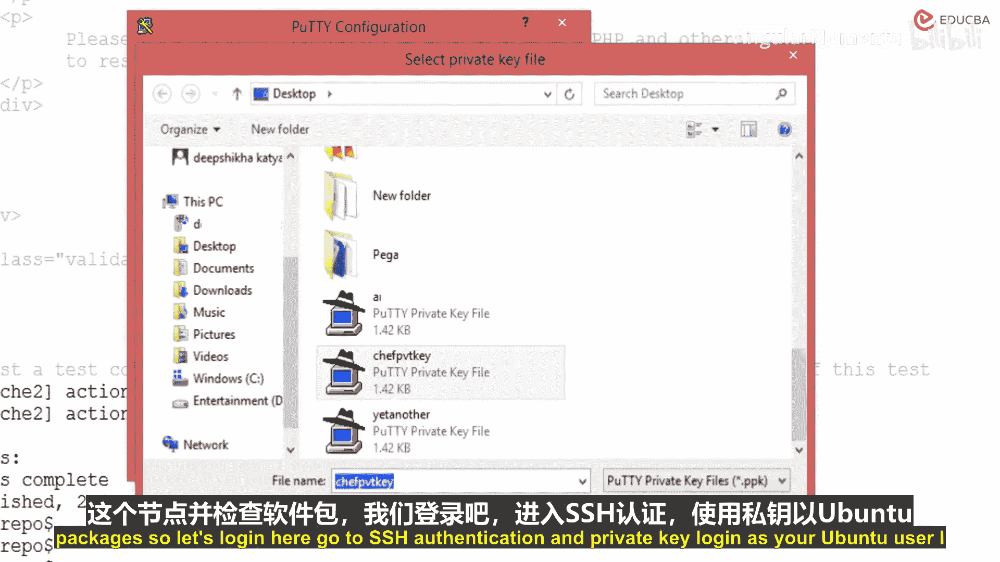
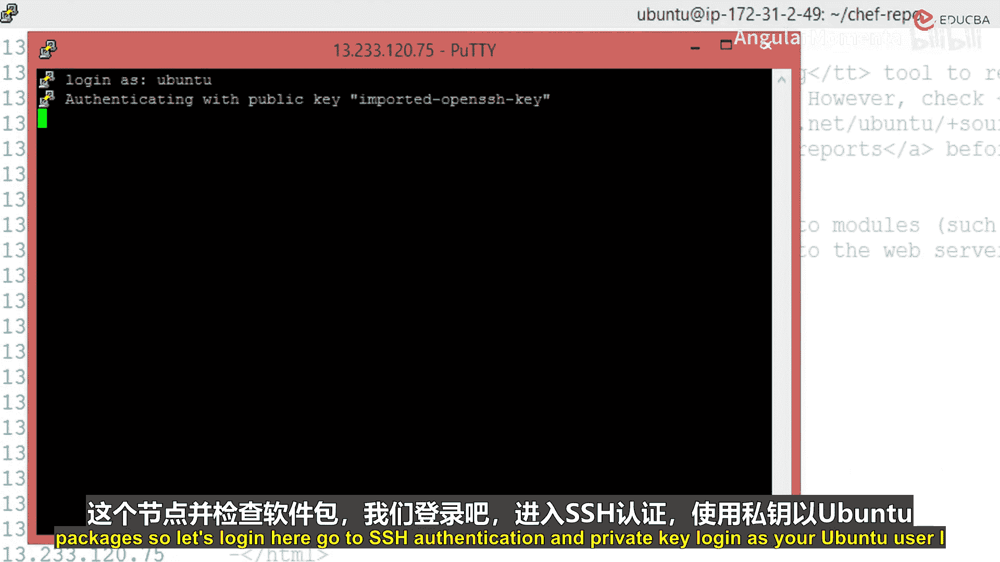
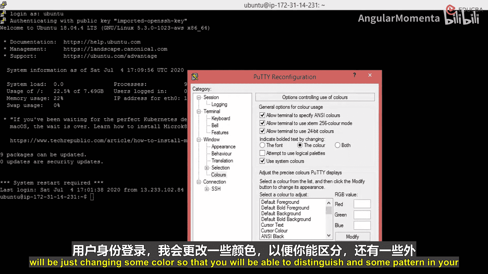
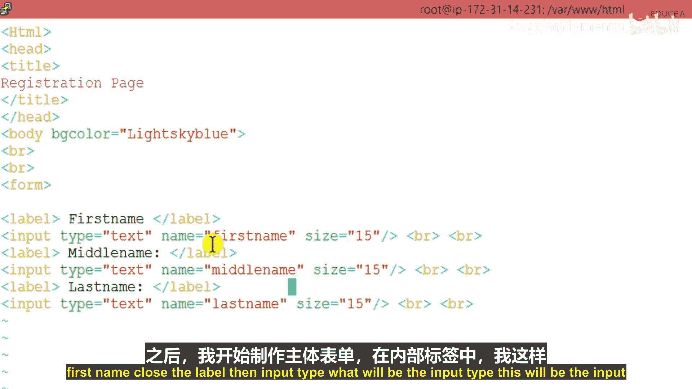

# 【EDUCBA】应用Chef实现云基础设施项目自动化 ｜ Apply Chef to Automate Cloud Infrastructure Project p20 03_03_01_部署注册 -BV134F1zaEdz_p20-

Well， the problem。Rides exactly with the serest apps server。Remember， we had moved this file here。😔。

A party server to app server。Because I thought there will be some naming convention issue on the server。

 So this has created some the same issue there。So， if you see here。

Bty path look when kind re us outside that。 But this is what this was one issue here。

 which we fixed it。So the main issue is error this one error is resolving cookbook for run list。

 missing cookbooks because。That was not when we compiled this cookbook。 So the name was different。

 So suddenly， we have changed this。And you can see。This client failed there。Pconditions failed。

So in order to fix what I did。I came back to this location， cookbook。

And I just renamed it back to the its original name。 So it was Abb servervo。

 The original name was Apache。So I just move this to Apache。So that whenever it compile everything。

 it compiled on the name of Apache。So， and。And then I used this command again same thing。

 There was no issue at all。When you get some issues like this you have to do some hidden trial method and to get these issues how it is done and how it is fixed。

 So there was no issue with the command。 I the grant the command again with the same parameter as this user with the same user Ubutu and I located this Pam file at the correct location。

 This was the name of the file。And created this web server。With run list as recipe Apache。

 the time was using app server and the。Thing was different。Now it shows because it ran first。

 so it shows the web server node already exists because that time it created the node but it was unable to execute or it was unable to compile your cookbooks。

 so that time it failed。Here also a client you remember that client will be installed right Che Dk so that already exists so it is asking whether to overwrite it or not。

 I just told yeah overwrite this。And after overwriting and then it created a new client for web server。

 every time you do this you have a selection like yes， overwrite or no。

 if you are sure if can overwride just put yes because it will be always installing the correct and latest one。

Then it create a new node for Web server， Then it is contacting our web server address what we are mentioned on our Botrapap command。

And it came to this location。Now， it is installing your Quickbooks。Now。

 after installing and getting all your cookbooks from your safe server。

 it actually converges your safe server。So this is your recipe at Apache。

 and this is your web server and。Then it has two task student。 The first task was to。

Download package， Apache。And this is what we have to install。So if you see the green message here。

 it means your package got successfully downloaded。 If you find any rating thing。

 this means there is some issue。 So if you see the two statics are there。

 So first statics did was to download the file and second was to。

Create the HTMLl file for the web page。 So this got contains。

 you can just see all those things what is happening in background。This thing happened in background。

 actually。And。This is what we have defined for our web page。 So this is just your HTML Tl page。

It just got completed， so you can just check the logs here。Now if you open your server there。

 you will be able to find your Ay server install on your node。So the last message is。

I is the contest content what we have written。And this is a successful message like service App to action start up up to date。

 This was a service。Package， not package resource， what we have defined on our recipe file。

And after that， we have made it enable。 So whenever we restart the Vm。Your server will be enabled。

 and the last message。Chef Klein finished two out of photos updated in 18 seconds。

 so this took 18 seconds to complete， and this got uploaded to your Che client。

 which we have name as your web service。Well now to validate， we will going to this server。Chf no。

Just copy this。And pace it here。So this is what we have mentioned in ouresttl page。 So this is fine。

 Now what I will do， I will just go inside this node now machine。And check the packages， so。

Let's log in here。Go to SS authentication and。Private key。

Log in as you U to user。

I will be just changing some colour so that you will be able to。😔。

Distinguished and some pattern in your appearance。All done。

 so now what you have to do you have to just check system CTtL status。

 whether the Apache has been installed or not。Stus and Apache 2。

So this is installed and now the content what we have given was demmi content。

This is the dummy content。So what we have to do， we have to first change the content here。

 so I will go to Cd or。Html。And inside Sml， we have index textual STml。

 I will edit the same index textual STml right now this is read only the file。 Let me first。

Be the real user for this Suro Su。And。Now I'll be able to log。😔，In and fix this issue。Now。

 just delete all those things。Now， you writing all those body tags and your print headers。

 everything which is required for your。Registration form。So the water fieldss it requires。

 I'll be just letting you know， so fill it requires is your it should pop up for your username。

Not use the name of your first name。First name， middle name。😔，And last one。After that， your email。

Address these old things will be writing it here， so I will opening in an HTMLl tag here。

And then comes your body type。 So in this STl file Ill be incorgurating all those CSss。

 all the font sizes， color things and everything will be done here。

So this is beyond the scope of this course， I'll be just telling you because it will take time to write all the T file So once this file will be bill starting and I will be composing it。

Periodically I will explaining you what I have done and there is no knowledge of SDl require here。

 you just need to have some novel syntax issues。 I mean you just know where the syntax is there and what type of headings and what type of columns we have to write so Im supposing the video and periodically I will showing you what light it well if you see this I came till here I have initiated a Tml tag then head inside title this is registration page and I have made background color as light sky blue you can change it to red or anything but I feel light sky blue is like you can it will be easy to write and it will easy to for for customation purpose after that I started body form and inside label I just label like this first name close the label then input type what will the input type this will be the input type。

