# 【EDUCBA】应用Chef实现云基础设施项目自动化 ｜ Apply Chef to Automate Cloud Infrastructure Project p21 03_03_02_Apache顶部 -BV134F1zaEdz_p21-

After that， I came to middle field， I have given the size for this。

 Don't worry if you have some confusion like we have defined some size in Db and this different。

 This is completely different it already depends on you how you want to navigate and how you want to fix this thing。

 So Ilaborating more things here So we will be paing again and I will let you know once this is complete。

Now I have edited this file and this contains your course。

 what type of course you have done if you are doing mechanical engineer and you get options if you are doing some CSC engineer like a computer science engineer。

 this is for information science engineering， this is for chemical engineering this is for。

You are E communication engineering This is Mt if you wan to do So this is what till now I have proposed I'll be showinging you more now。

 so let me pause and let me write all those fields because it is time to consuming me I'll let you know later Well I have completed writing a simple Etl file。

Till now you have seen this thing now I have created this email thing now then password here there is radio button to select either your male or female while registering for the call site。

This is a country code， this is a phone number， and it comes with your address， email address。

 password and everything is here。 So guys， yourestteml file is fine and there should not be any issue。

 so let me save this file here。And well run this file now。 So for running this file。

 your web server is not aware whether we have chain T in the index or file or not。

 So you won't be able to。

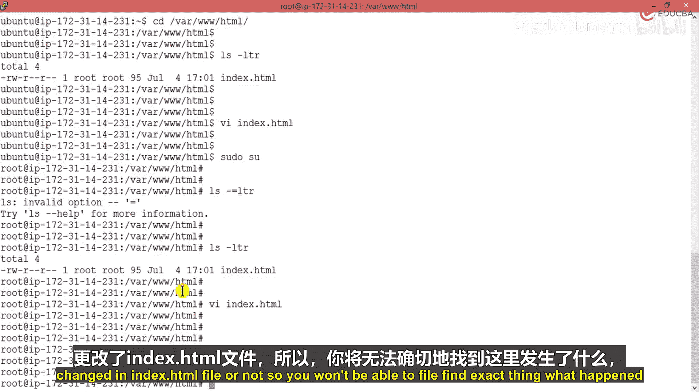

File， find exact thing What happened here， but actually it did。

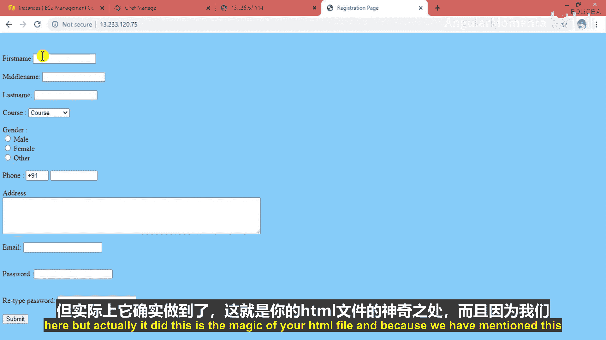

This is the magic of your HTML Tml file and because we have mentioned this thing right we have mentioned to start and enable so periodically it will do because of one constant what what we have added in Apache like start and enable so every time there is some change in your ST Tml file it will fetch the latest one and if you refresh the page。

If you refresh page here， you will get the registration form。

 so it has successfully gone here in case sometimes what I did right。

 sometimes if you don't see the page because your web server is not aware of your situation like your web server has got some update on。

 then the situation what you will do， you can just check the service here。AAbout it2。

First take the status， status should be running always。And stopped the soul。

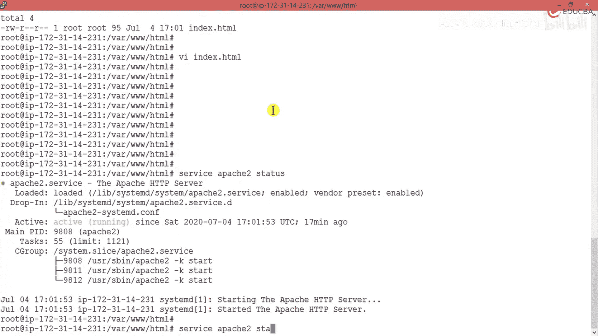

Now， this has been stop。 If you do this， you will get nothing。 It is refreshing， let it。

 It will take some time。

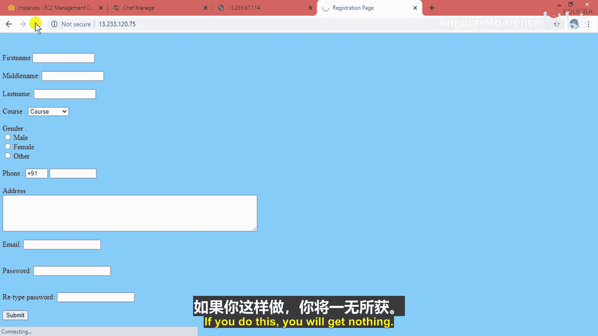

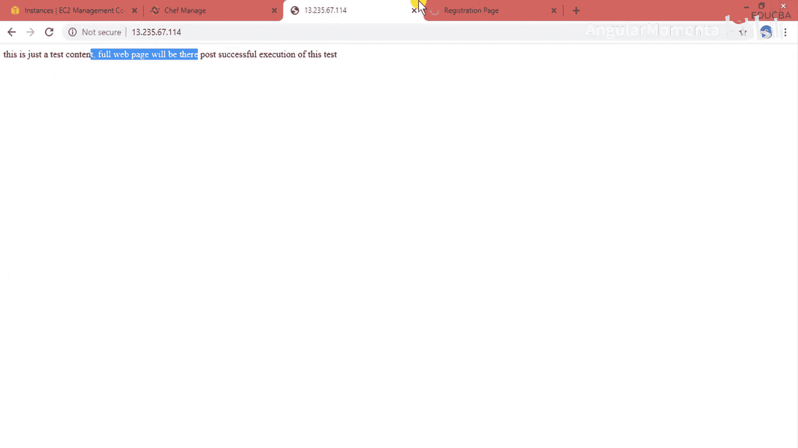

This has got stuck。 I mean， it is not refreshing at all。

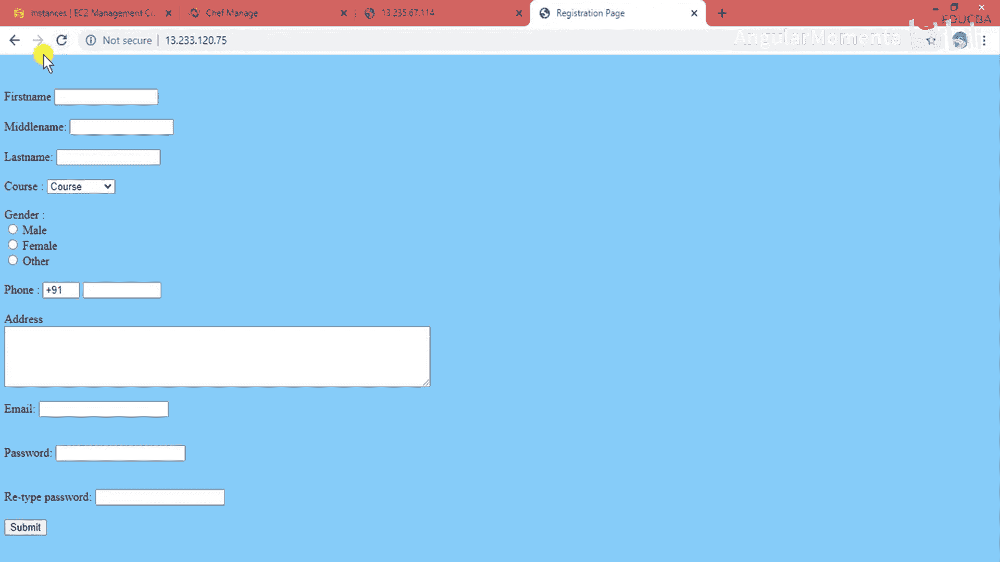

See。This will be the blank which you will be getting the site cannot be used。

 so just start the service again。

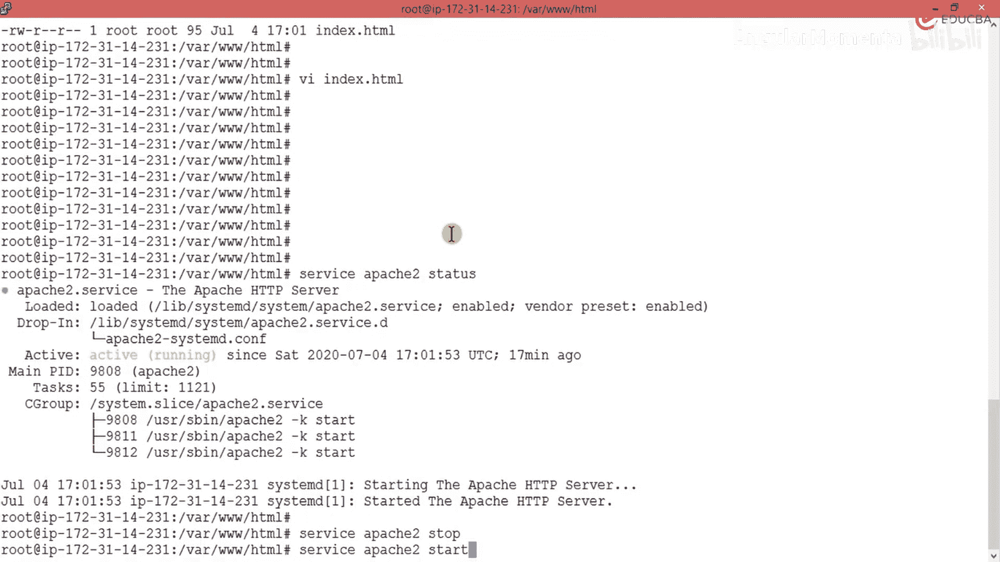

So once the server is started， it will fetch the recent file。

 which is their HTMLl file and this has actually my browser so fast is actually refreshed itself and bigger all the details。

 Now whatever we have set on your HTMLl file and whatever we have set on our D server Its all here you can just type your name here。

 you can middle name， last name， what course you wan to do。

So this is whatever I have installed like and if you wantan to do CS C IS C。

 you can choose what you do your mail， This is the radio button and your phone number， what you have。

 you can just put your address。Anything like you can just put your address and your email。

And3 Gmail dot com。Password and then reenter password and submitm。

So this is the basic gist of your summary so what actually it did so once your student comes for registration that is online registration。

This should be the page format。 I have made this a sky blue color， so you can just change the color。

 So the primary think what it has to do。 it has to write their name。

 It has to choose which course they w to do。And they have to choose their agenda。

 and they have to give their phone number， their address。

And enable to get all those video contents and study materials from the college or from any institute they should be providing though all those password and reap I mean they should be registering it so post submitting this button submitmit button what it will go it will go to your payment page so whatever is the fees for that course they have to pay the payment and once payment is done now you are all good so just doing your logging pages logging into web page youll all set youll get all the contents what your college has here so guys through this chef architecture。

We have accomplished this。 We did nothing。 We just created Web server。 We install our D B server。

And we wrote Stml file。 So from these things， our whole setup was done。

 but our Seph was like Seph is very difficult and its very typical thing。If you don't understand。

 it's not like ansibible or puppet。It has few nodes which I have to manage it。And it's very good。

 and it's very handy if you have grass on it， because it has centralized server。

 which is not there in other settingss。 So just like here， C safe manage。

 there are lot of you see notes here。 If you refresh， you will find two node now。

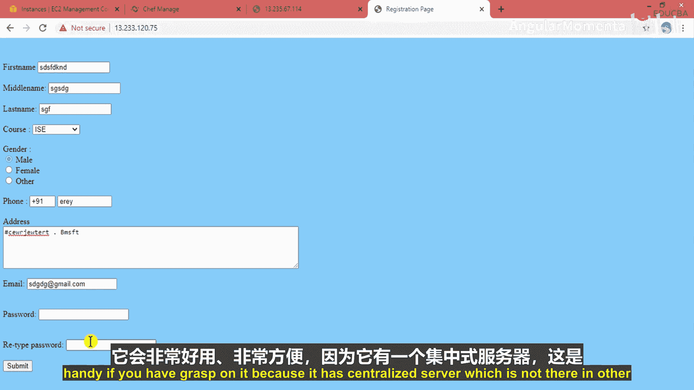

Well， it has three notes because it has not deleted actually it shows unknown because it is not phing it。

So suppose if you have 100 nodes， thousand nodes in our organization and you have to deploy this application。

 So each machine you won't go to each machine and you won't write the recipe and you won't deploy it。

So through safe automation， what you will do， you will have workstation here， this workstation。

 you create all your recipes， you create all your file and you dump this recipe to your serverer here。

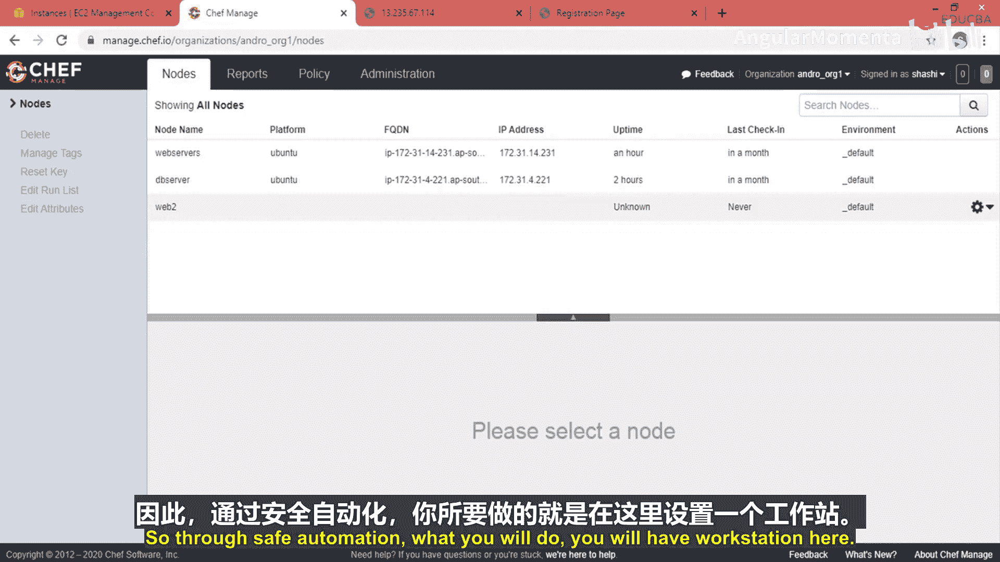

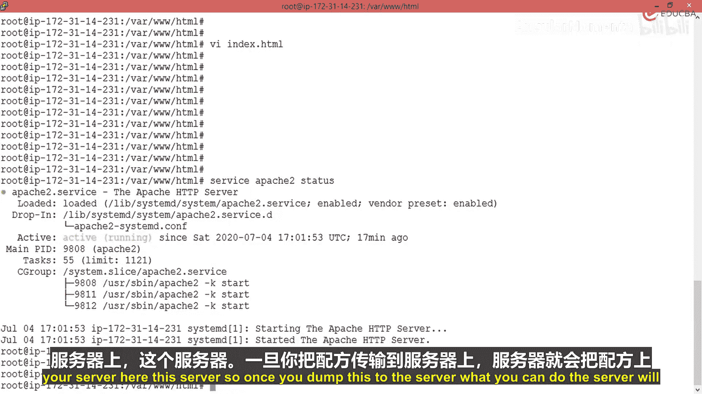

The server。 So once you dump this to the server what you can do。

 the server will upload the recipe here。Now， what it can do more it can if you are having。

 this is your server web too。Or you going to web server。

So if server wants like apart from Web server， apart from Apache。

 if you want to have some SQL query also what it will do it will just edit the run list。

 editing run list is like it is giving you more cookbooks to run so if you put this Apache web server here。

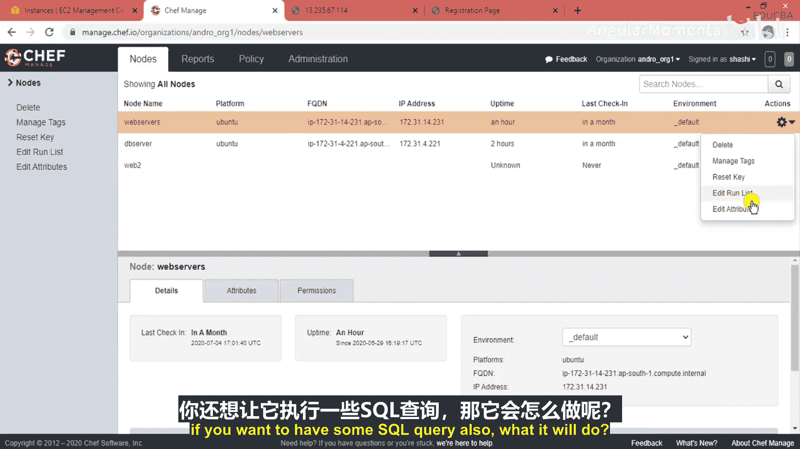

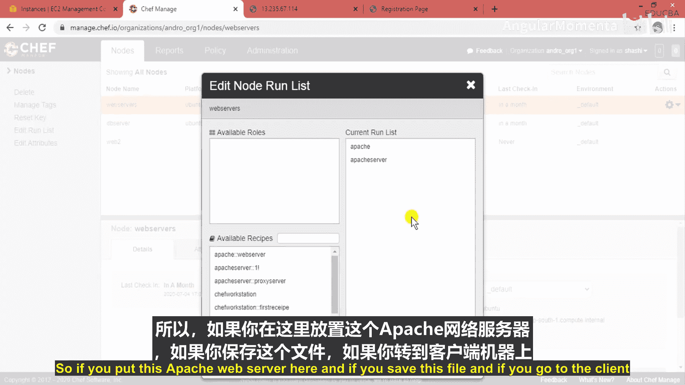

And if you save this file。And if you go to the client machine and just write chef client and you just could enter。

 and you have to put pseudodo because you have to be pseudo user or you have to be a root user。

 So everything will be installed。 So it's so easy， it's so comfortable， It's so nice。

 So within click and within one recipe file， you are accomplishing everything。

 only thing it matters is your a hierarchy。 It's architecture。 And the process it follows。

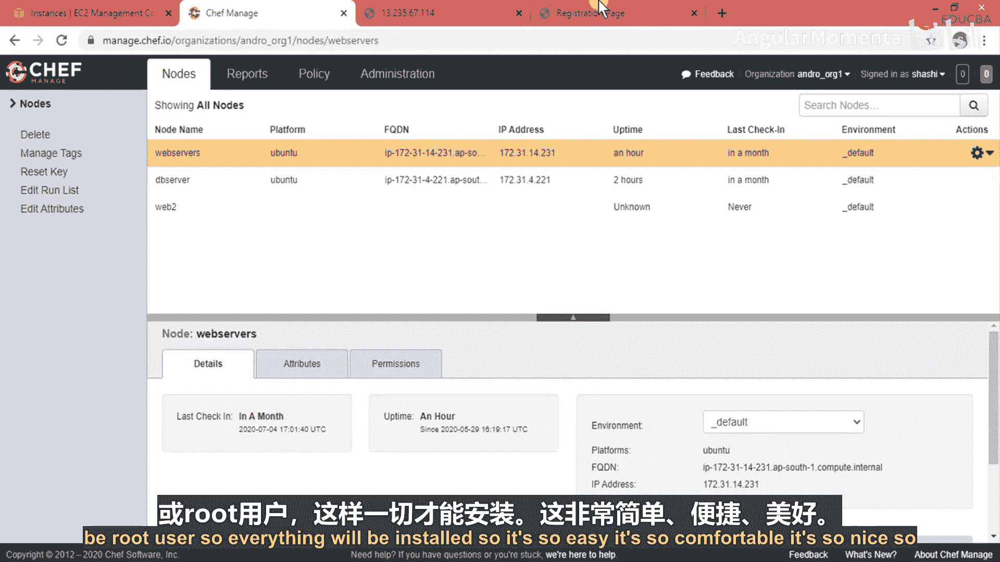

So we have to be very handy with how you are using knife command because it's very beautiful command line tool so as I told you I have demonstrated a lot of things like how you are changing the nodes。

 how you are seeing the node structure how you see the machine structure and through knife command you can upload you can download recipe from your marketplace so everything is there you just need to go there and find so we have in for our quick case study we have completed all those things and this is the output we were expecting and we are able to get this output。

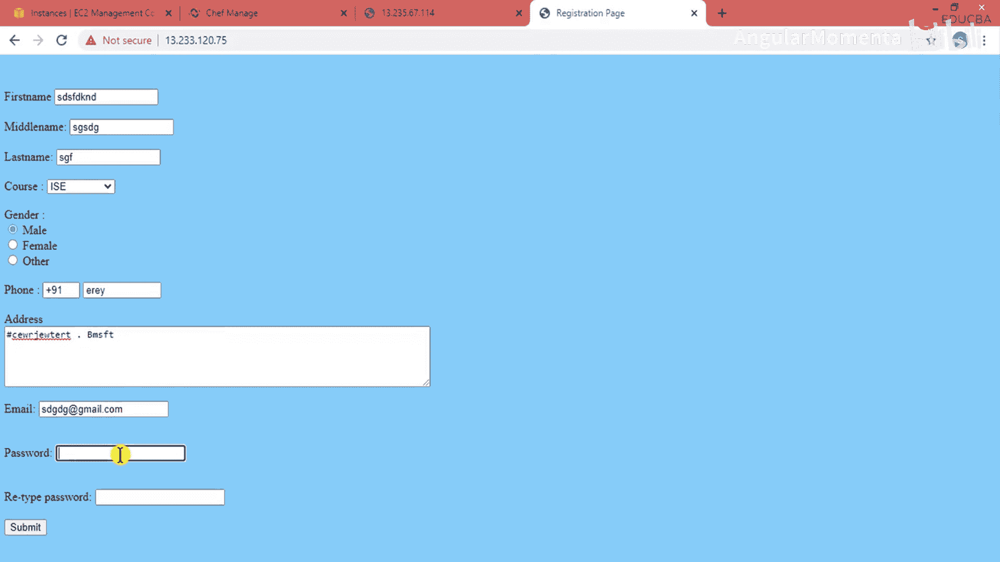