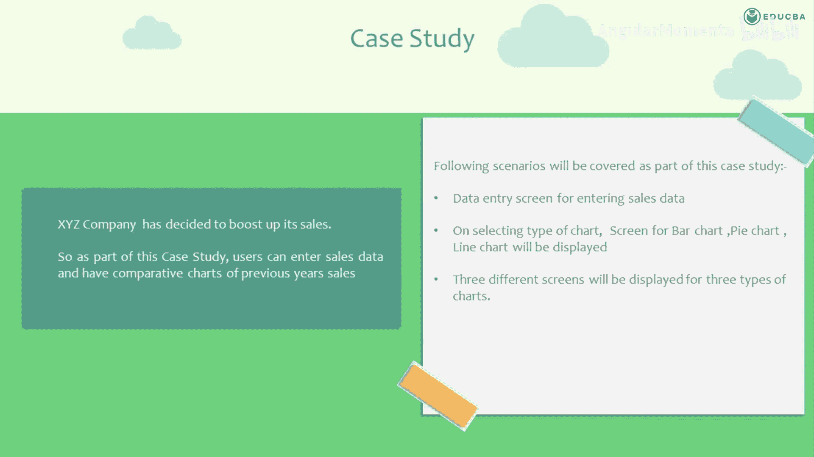
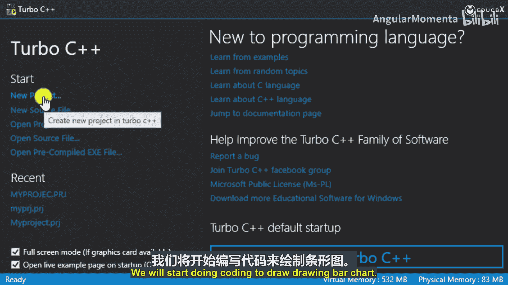
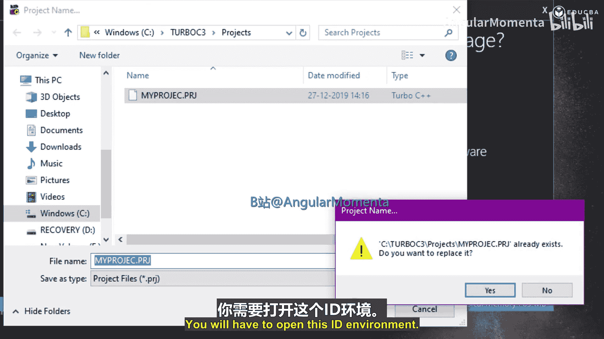
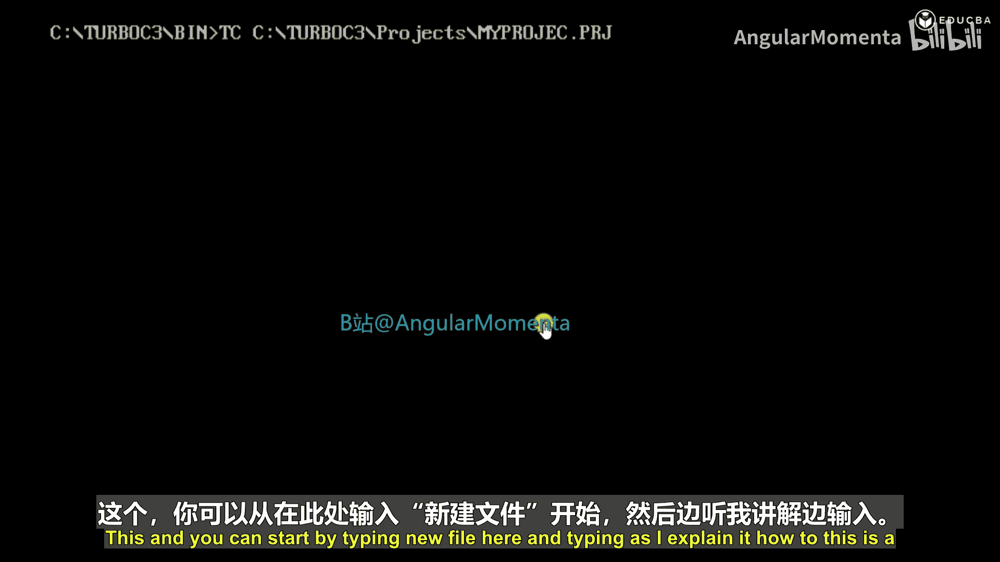
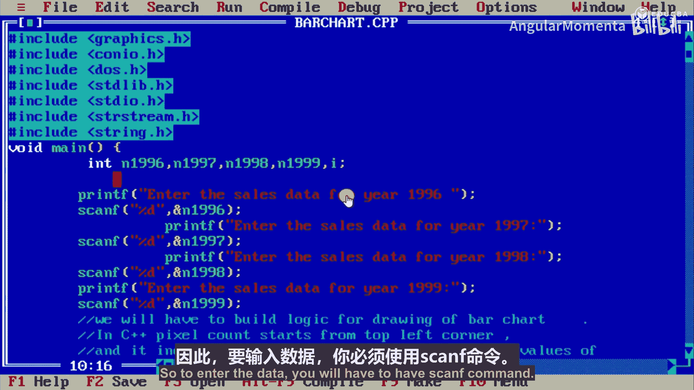
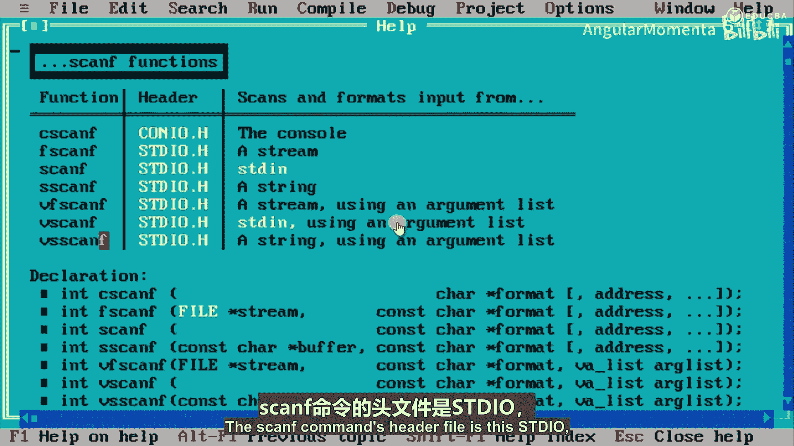
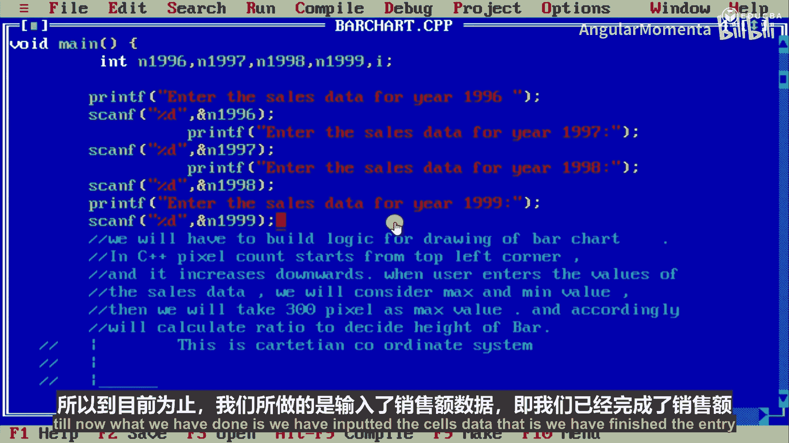

# 【EDUCBA】使用图形编程在C++中创建销售图表  Create Sales Charts in C++ Using Graphics Programming p01 01_01_01_项目四导论 -BV1rDFozyEuS_p1-

Today， we are going to learn a very interesting topic This how to draw charts that is bar chart by chart and line chart in C plus+。

 actually C plus plus is not application oriented language， Its a middle level language。

 but you can draw line chart bar chart and by chart in C plus+。😔，By using graphics commands。

 and we are going to。Develop charts Those are related to the cells cells management its a difficulty level is intermediate。

 so to do this project you must have following skill sets that is you must have a basic knowledge of C+ plus commands that is how to basic syntaxes of C plus plus then C plus plus graphics commands graphics commands in C plus+ are different from the basic syntax level commands that is and how pixel arrangement is on your screen that is this is this is your screen and how pixels are arranged this small small pixels means this a small small dots on your screen which will be highlighted。

With the colors。 So a single pixel。How this arrangement is done on the screen and how it will be helpful for you to draw a ball chart and all these charts。

 So you should have basic knowledge of cells also a picture that means we are going to create a chart these charts。

Which will be helpful for the sales part and also knowledge of coordinate system is to draw a basic coordinate system that is this is a X axis。

 this is a y axis。And how these pictures are arranged。In the context of this exists。

Project objective is。Participants must be able to implement a advanced C plus plus concept in project at college level。

And。Or at industry level， then to drop our charts and pie charts and nine charts。

How to enter data in C++ means what are the input commands and。

Input of data and do chart using Cartesian coordinate system。

What will you learn from this project is how to its very interesting project。

In the C plus plus graphics， how to use the dessert。

What I told you is the caration coordinate system how the pixels will be arranged。

Normally its this axis and this axis is and how we are going to use it。😔，To draw a chart， how to do。

 And we are going to do actual codinging of sayus plus。In simpleus b language。

 then what are the different charts used in sales management。

And also build logic for drawing bar charts and pie charts and line charts。

What are the prereuistic that is you should have basic knowledge of Cplus+。

 then basic knowledge of sales management and Cartesian coordinate system。

Who are your target students。That is with students who have basic knowledge of C++ and those who are learning C++ and C+ also C++ graphics developers。

At the end of this project you will have the following skill set It is a real time experience in developing logic of bar graphs。

 pie charts sand line graphs， then how to do。Enterries in the C++ program and。

You should be able to use graphics C++ commands， you should be able to build logic for drawing bar chart。

 pie chart and line chart in C++ and will be able to draw the same。

 Then you can gain knowledge of different charts using。Used in sales management。 That is。

 you consider a sales management system。In the。Company， company wants to boost up its sales。

 So it a company will have to draw comparative charts of the last years and this years and its previous years。

So its comparative analysis is always required in the companies。On the。

Their dashboards so that they will be very easily。 upper management will be very easily see how their sales are going from。

 Those are boosting or those are declining。 So these are the very。

 very important charts in the sales management systems。 Those can be represented in the。

Format of line jar bar chart and also in the format of pie charts。

So we are going to take the example of this。哎。Following scenarios will be covered as a part of。

This case study finally I have already told you that the data this screen for entering sales data on selecting type of charts。

 screen or bar chart by chart line chart will be displayed and three screens will be displayed for three types of charts。

We will start doing coding。To draw。

Drawing barchar。You will have to have Id of turbo C plus+， or you can used visual C plus+ Also。

 I am using this turbo C plus I。 You will have to open this I environment。

This are。

You can start by typing new file here and typing as I explain it how to This is a program I have already written down。

 I will explain to you step by step， and you can simultaneously write it。In your blank file。

 and you can use it as it is this is a program。So first you will have to add libraries from C++。😔。

There are in build library C plus+ will provide you so that you can use it as it is。

 These are the commands， and these commands are written in these header files。So Pri will。

 if you go on here and see this， these are the print， These are the help though。😔。

What are the edge header files used cornneio doage and Etio doage， and these are all help file for。

Prrintf command。 So I have used this print， so。This is the way I have shown you。

 you can either press F1。Or you can press right mouse click。 I have used right mouse click。

 and you can get the screen。So you will have to include this kio dotage and STDo dot to use this command if you will not include this the system will give you the error。

 so what are the header files we have used graphics dot ko dot dos dot， STB dot edge， STDo dot edge。

 STr stream dot edge and stream dot edge， so this is the syntax which is used that is hash include then your header files and this way you can type it and use it so then void main。

Curly bracket open， round bracket open， round bracket， close and curly bracket open。

 This is the main syntax of C plus plus here what I have used are these variables N。😔，1996 N1997。

 N1998 and N 1999 and I variable。Have used these as the integer variables。

We are going to input this data。Said that is the cells data in the cells of the previous years， 1996。

1997，1998，1999。To enter the data， you will have to have。

Scanf command scanf commands header file is。

This is tio， which we have already。Included in this。

Print F command we will write enter the cells data for year 1996， then scan F。

Percentage d this is the syntax D is for inputting integer if it is s then it is you are going to input a string。

 then you will have to use it as a s。This is a。Number， so I have used this。Suskev。

ARound bracket open。Apostropous percentage T， apostropphus close。

 commarma and person N 1996 round bracket clothes semiical， so this is the syntax of your scanav。

This print have round bracket open， then your string and round bracket close and。Semiccolon。

 this is the syntax of your print tab。 So this， this。

Keep in mind as this is the syntax in the whole program， we are going to use it。Great。So。

Print type enter the service data for year 1996， scan F Per D and Per N 1996。

 then enter the data for year 1997 similar syntax。As previous this one here， we have used it。

Then scanf， then round rack opened。 then percentage D， then。

We are going to import second year that is 1997 data This M percent is used to。

 This is a syntax that is this。 This is a variable， and this is M percent and。

Syntax of getting input of N 1996。So here what we have done is we have inputed data of N 1997 year。

 then print similar syntax。As of previous one， Prif enter the sales data for year 1998。Then， scanf。

Then。Third variable of year 1998。Scan a percentage D， then enter input variable of 1998。Then。

Rain enter the sales date of year 1999。And scan it of。E enter the data of 1999。Now， this is the。

What we have done is we have entered data。For the sales data that is what sales of if you take a particular exite company and a total cell that is in that cell of a company for the year four years we are going to compare on the same graph so management will be very easily check whether the sales have gone down or booming。

 so up till now what we have done is we have inputed the sales data。

 that is we have finished the entry of sales data。

