# 【EDUCBA】使用图形编程在C++中创建销售图表  Create Sales Charts in C++ Using Graphics Programming p02 01_02_01_条形图（第二部分） -BV1rDFozyEuS_p2-

Now， we will build a logic to draw bar chart。 So pixel count。Starts， this is a screen， right。

 This is a whole screen。 So pixelels count0 count will be start from here in C plus plus 0 is here。

0 comma 0 is here， so。And it increases downwards and。Left towards left。 So from 0，1，2，3，4，0，1，2，3。

4 like this。So， we will consider when。Increases downwards and when user enters the values of the sales data。

 we will consider maximum and minimum value， and then we will take 300 pixel as maximum value and accordingly we will calculate or 300 or 100 also you can take it and accordingly we will calculate the ratio to decide height of the bar so。

Or you can directly enter data and have it on the screen。

 So this is a logic that is logic means which is a simple thing that these pixel small small dots pixel is a small part of the。

Seen of that your PC， and。Those will be highlighted by the different different colors。

 so which color you will have to give is will be dependent on this graphic command for that you will have to count of Excel it is it will start 00 is here。

 see the cursory 00 is here and accordingly you will have to draw the barge。

 so these small parts these are the important thing there。In the s S split。

 you will need to take care of that。How we have pixels are arranged and how we are going to build a logic。

So， we will use。To go in the graphics mode this is a text modes， right。

 and graphics mode is different。 That is you will have to operate on the pixel level。

And this is not a pixel level。 This is a text mode。 When I type1 U。You will get you here。

 But if it is a graphics mode， you cannot have。This facility that means if you type you here you are going to get you here in the text mode。

 but in graphics mode it is not the case you cannot enter U in the graphics mode。

 it will be running in the pixel format。So far that。You will have to use the different commands。

 Those are the the graphic commands。 so and to initialize the graphic mode you will have。

ADifferent functions。 So this is an innate graph function。Which will initiate your graphics mode。

 Then what is the graphics driver is used and。What is the mode of your desktop that will depend on it will detect the C plus plus will detect automatically what is the graphic graphics driver you have used and it will initiate graphics mode accordingly。

 so we will have to。First， initialize these variables。

These variable names you can have any any variable names that is we have I have used this G D driver。

 then G mode and error code。Significance of this， I will explain you later。 This。

 why this I have used this variable add。Then， clear screen commanded。

If previously in the run command， obviously it is a command used to clear the screen。

 then G driver to detect detect is word used in C++ to store It is a private word that is preserve word in C++ detects you cannot use detect as。

General variable in C++ then in it graph G add then amperserson G driver amperserson G mode。

 and this is your BGI driver that is BGI directory path。Where yourre busy I。

Dot edge file is stored you。C plus will take help of Bji I file to detect the。Graphics driver。

 and this devil。Back slash is used。 too。 if you use a single back slash。

 A C plus plus will give you the error。 That is because if you use。Double。

 then only it will identify it as a directory。It then read result of。Initially。

 that is graph result is the command used。To detect the result of your graphics initialization and error code。

I have used。As a error。If any error。Is there， then it will be stored in the error court。

So syntax is error code is equal to graph result， ground bracket， open， round bracket。

 closed and semicolon。Then if a record is there。G R， O， then it is stored in。Then， print F。J O。

 J O is also。Sepless pleasant in her word。Then print type graphics error percentage S that is we are going to use this graph error message。

Function to extract。Error message from the error code。

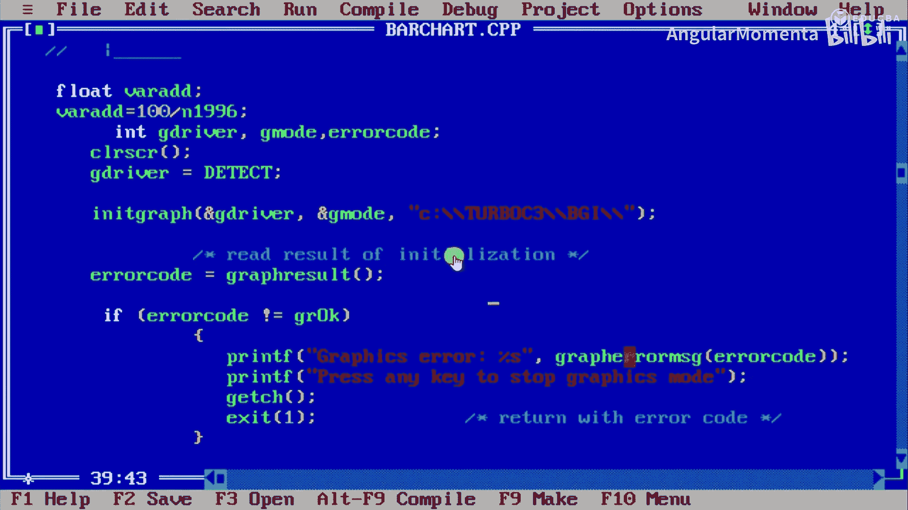

What is the edge file used graphics do。Here here it is graphics dot edge， so。

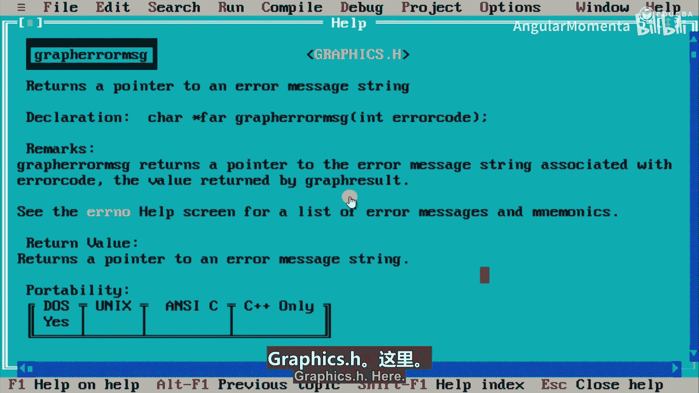

We have already included that， then。Press any key to stop the graphics mode， get C H exit1。Then。

 clear screen。Printing message for user。Outtex X， Y。10。

10 plus 20 programme to draw a bar chart in C graphics。

This is the first message we are going to print on the screen。When you initialize this， now。

 we are in the。Imagine that program is running and after this statement。In its graph。

 we are in the graphics mode now。Now， onwards， whatever is there， it will be in a graphics mode only。

So initially， now we will draw bar chart。For that， we will have to draw x axis x axis， this is a。

This horizontal line， you will have to draw horizontal line and you will have to draw a vertical line。

 so vertical line will be your y axis and horizontal line easier x axis。

 so we have used two line commands， line command prototype is in graphic start edge and。

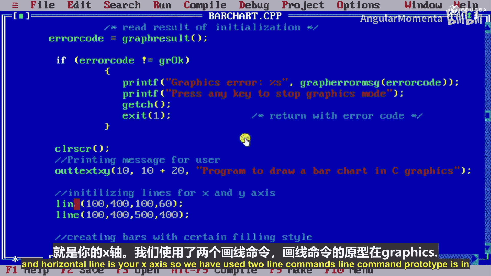

What command is line integer of x1 integer of y1， integer of x2， integer of y 2， that is x1， y 1， x2。

 y 2。

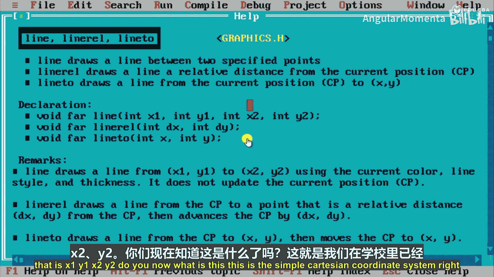

To you now， what is this。This is the simple Carteian coordinate system。At 8。

Which we have already learned in the schools。So， sorry。

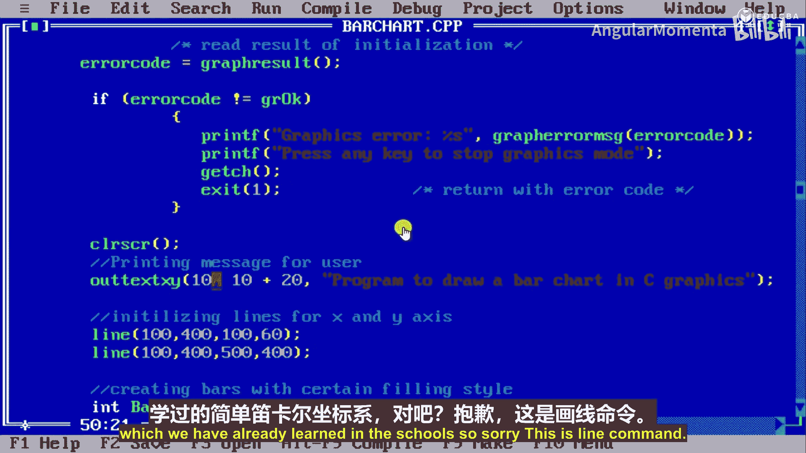

This is line command， line command is line in Tger x1 y1 x2 y2。

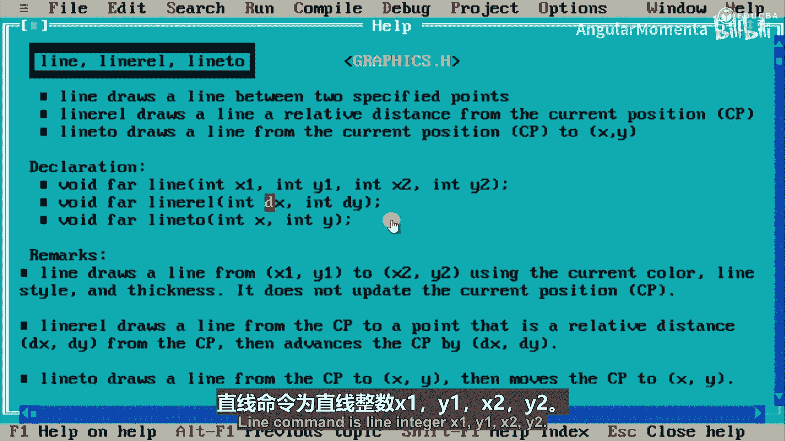

So the what is x1。Hundred。400， Y 2，400。Sorry， y1，400， x100。Y 1，4，6 p。X 1 is 00， y。My1 is 400。

Ex two E， hundredd。By two is，60， then line。X1 is00， Y 1 is 400。X 2 Es 500。By 2 is 400。

These are your x and y bar sorry， axis。No。We are going to。Doaw cha。Great。So， we will。

We drawingrawing cha now。The next。How we are going to draw a bar child。 We will see。😔，Up till now。

 what we have done is。We have initialized。 We have first。

Included each files that is those are the libraries。

 then we have entered the cells data on the screen。

 Then I have explained you how the pixels are arranged on the screen and also we have initialized graphics mode by using this innate graph method and。

We have used clear screen command， and we have drawn。X axises and Y axises。

 now what we we will be using。Bar command to draw bar chart on the screen for that。

 I have used integer bar add variable， integer text X variable and。Then bar add is equal to 3。

99 minus。Variable add into N 1996。 What is variable add variable add is。

This0 divide by N 1996 studies have used this a flow variable because。

It will be requiring decimal points if you want to add you want to have decimal points。

 you cannot use integer as data type you will have to use float。Then。

This is this reference point where you will add I have taken is。Is a reference。等。😊，Yeah。

We will multiply it by N 1996 and。どう？399 minus is。😔，Is your variable Add variable Add is。

What variable add is upper left。Why coordinate of the barorough， What does it mean。

See this about command。Okay， I will go and hell。

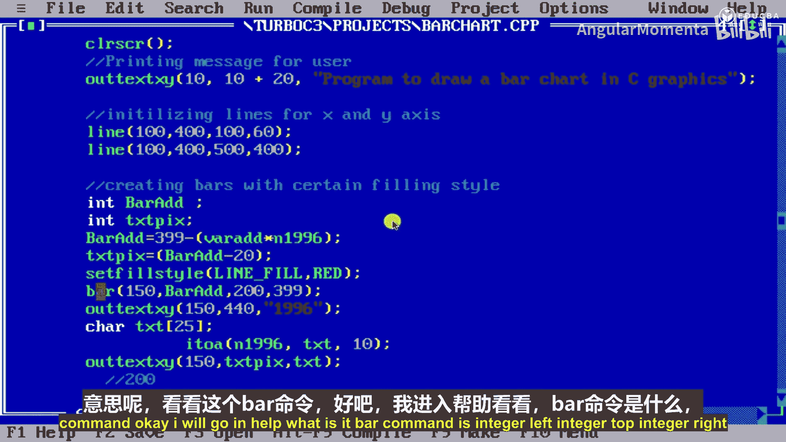

What is it bar command is integer left integer top， integer right， integer bottom。That is。What is？

Mdi these parameters， left top is the rectangle's upper left corner。

And right bottom is rectangles lower right corner。 What is the bar of this is you can see this。

 This is a bar。Gursary， I am moving this cursser。 It is a bar。 That is it Sir。

If I will place it here。Then， it's Sir。Tef， left， top corner and right bottom corner。

We are going to use it。😔，To draw a butt。These are the pixels coordinates are in pixels。And。

The beauty of C plus places， you can have。

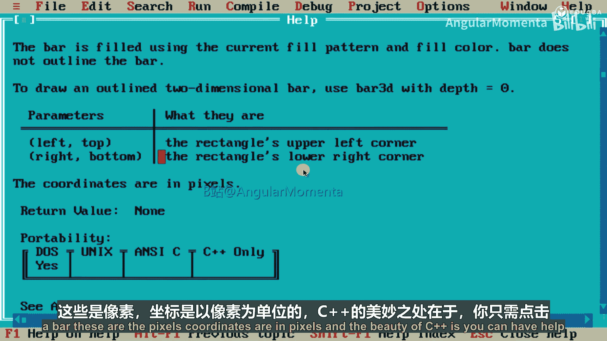

hiill。

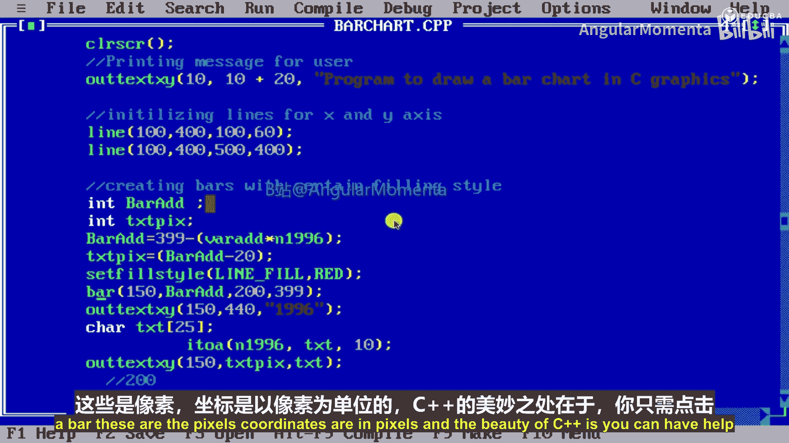

哦。A command just by clicking it， and you will get help of it。😔。

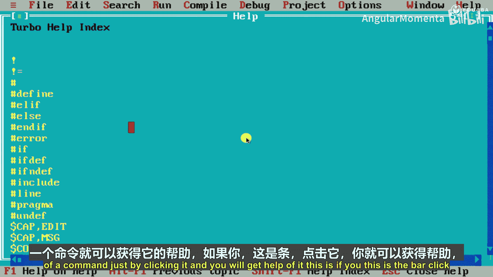

This is， if you， this is the bar。Click on it。 You can get get help。 So this is a left。

Upper corner of。Bar 1，50， bar a。This is a。Lower right bottom。Conner of Bard it is。Bar graph。

 So what does it implicates is a bar height。Why we have used this 399 is， see。

 this pixel starts from 0。0，😔，So to draw a bar， you will have to minus this， this whole height。

What will be the your graphics area height， you will have to minus these from your。😔。

To get the actual original coordinate。Normally， what is the Carteian system your。

0 point will start from here， this corner。But for C plus plus。Zero is starting from here， so。

That is why we have to use this 399 minus this， and you will have to draw a bar chart。

I have used this again， this variable that is text p variable is equal to bar add minus20。

 What is it if you want to write。text。On the top of bar， then you will have to minus。

You will have to find each pixel。 So that is why I have。😔。

Made this text pixel is equal to bar add -20。 Then you can have。Text。This is the tax coordinate。

To draw a text on the screen， this is a coordinate text ps。

 we I have used this here our text 150 comma text ps， comma text，😔。

So up till now what I have done is bar add is equal to3 in 99 minus where add in9 in 1996。

 then text pixel is equal to bar add minus 20 set fill style it is a。

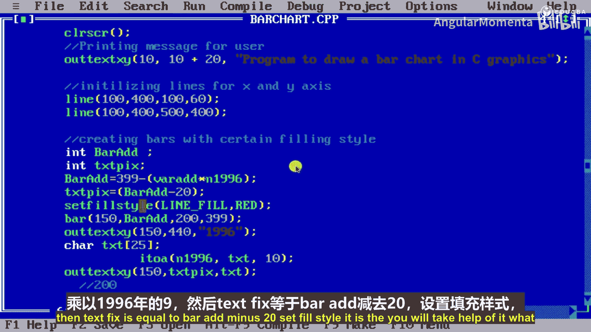

He will take help of it， Mo it sets the fill pattern and color， and these are the main。😔。

Are there specifications？What is it， text field sets the current field pattern of。

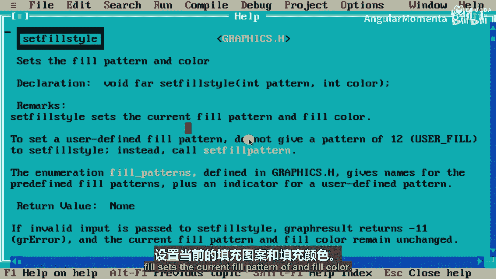

And fill color。Sline fill， and I have used colour as red。

 This red is also a reserve word in the C plus bli。

 It's actually a red colour pixelel will be highlighted with the red colour。Then， Bar。Again。

 the main bar command will draw a rectangle on the screen。Bar is nothing nothing but a rectangle， so。

150 bar ad is a upper left。20399 at lower right。Then， out textex。

At 150 outt syntaxes this outt display string in the viewport in the graphic mode and。

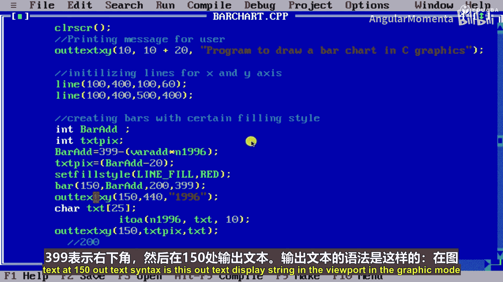

Outex X y is at X and y。嗯。You can。Print this text screen。Pissed。

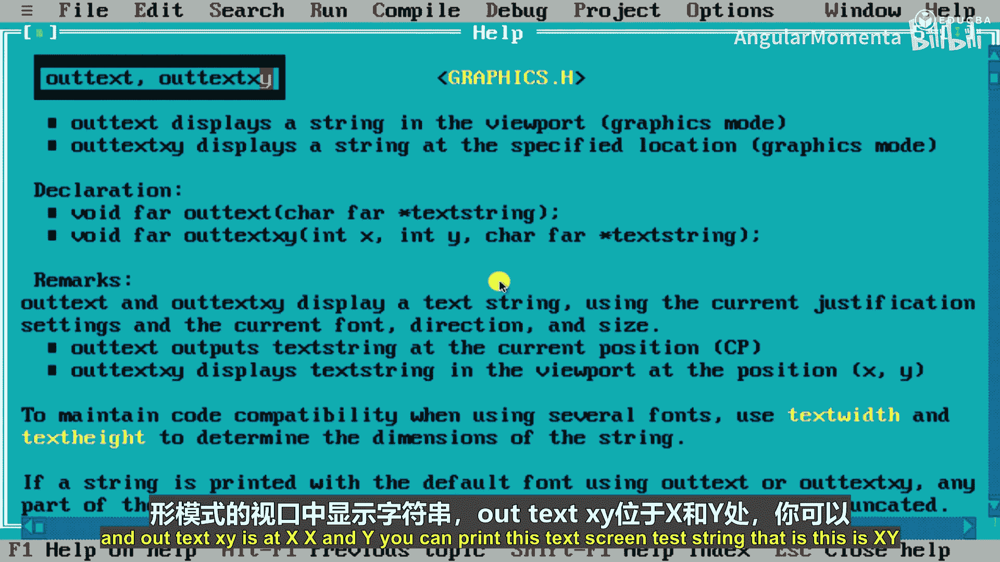

String， that is this is the X Y coordinate of the text string。And this is a text。Then。

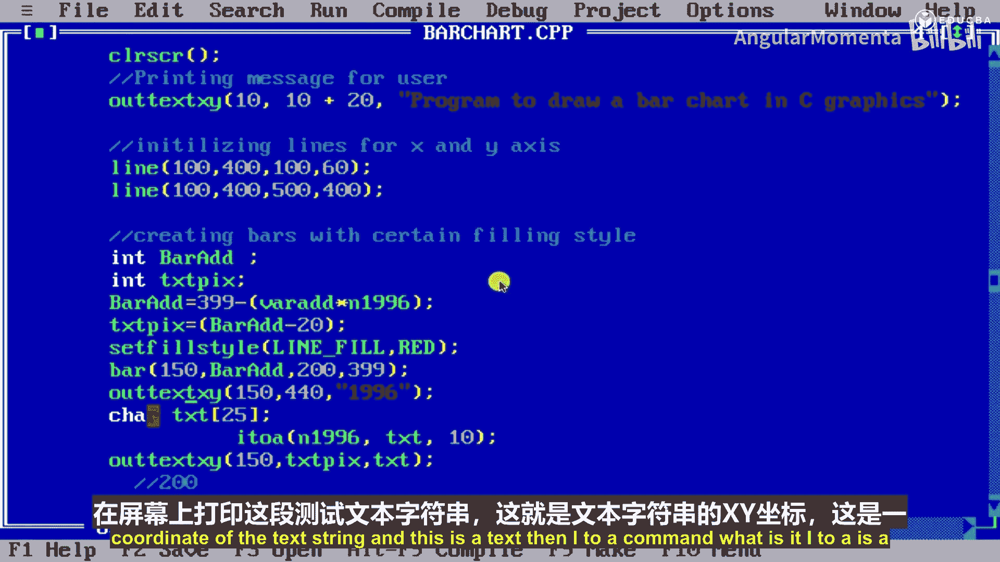

I do a command。 What is it。I do a is Sir。Conversion， variable conversion command。

 It converts integer to the string。 You cannot directly type integer in the graphics mode。

This text in the graphics more。In teacherger number in the graphics mode。

 you will have to convert to the string， because。

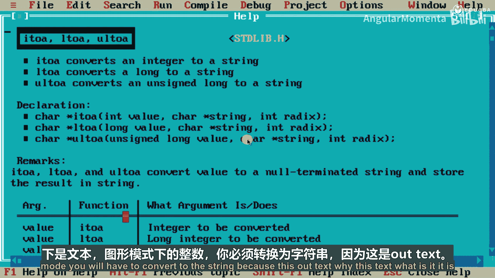

Thisis out textex why this text。What is it， It is a string data type variable just now。

 we have seen it。 we will see it again。 What is this character far point text string。

 that is this should be a character， either you can directly write this string or you will have to have character array。

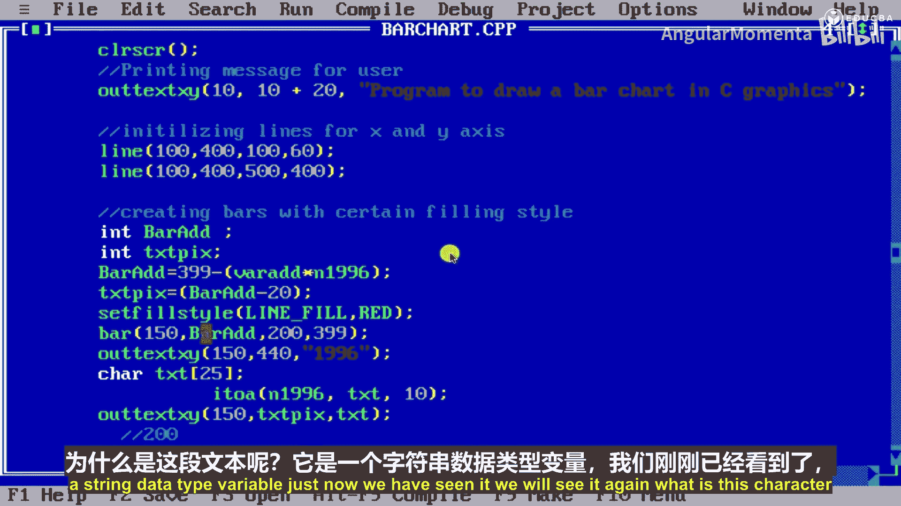

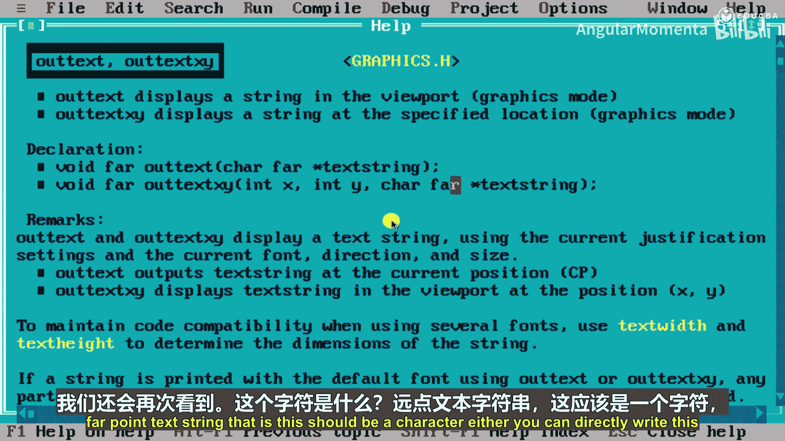

And you will have to convert this number to the string。😔。

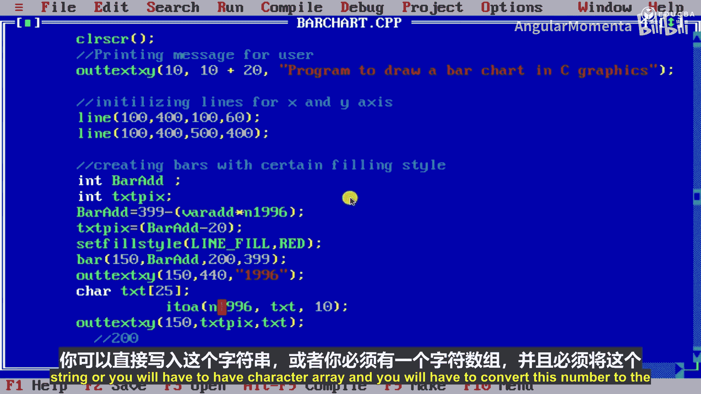