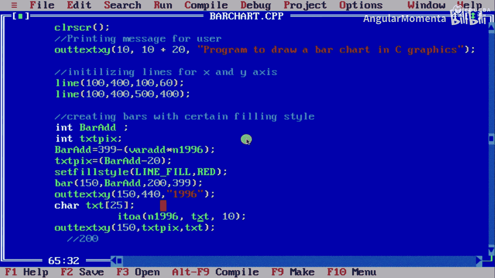
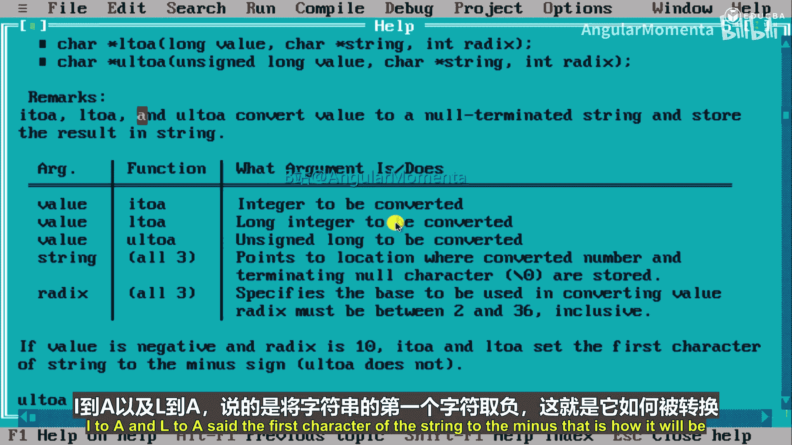
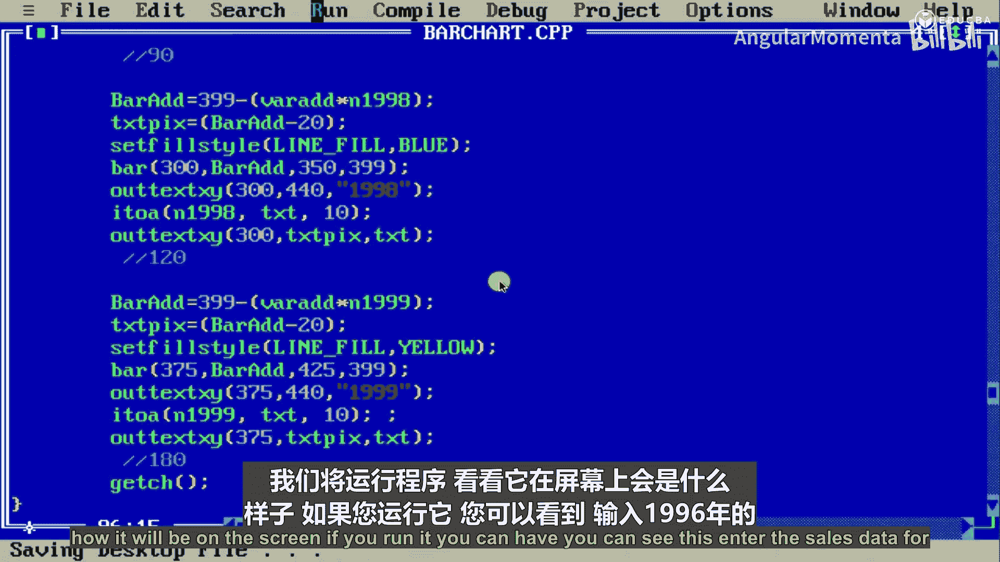
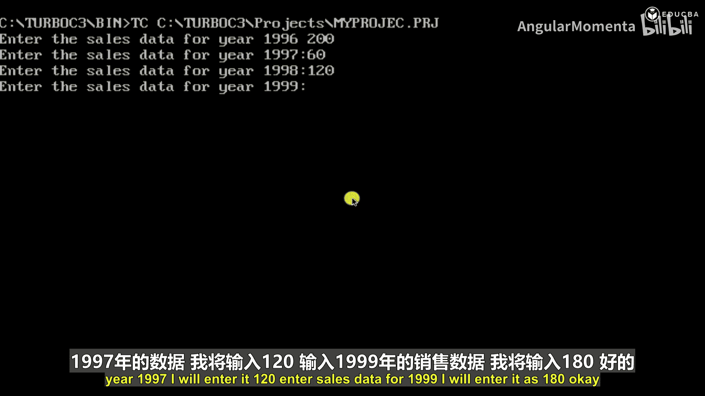
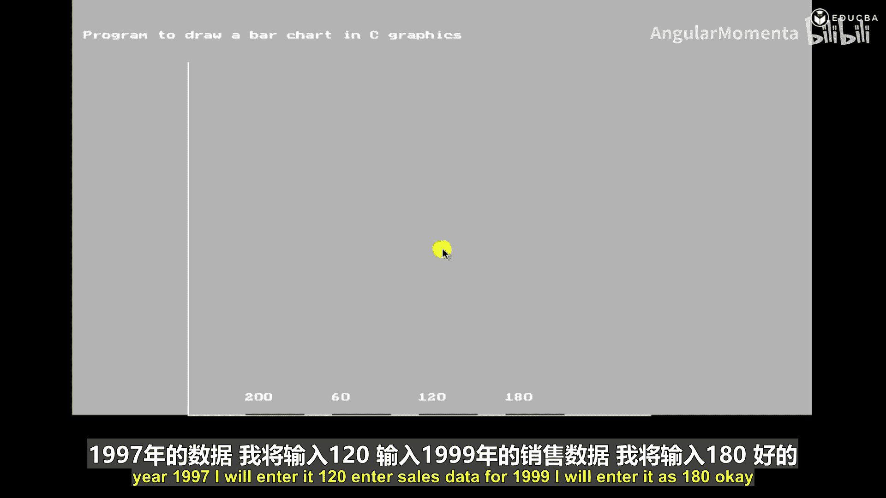
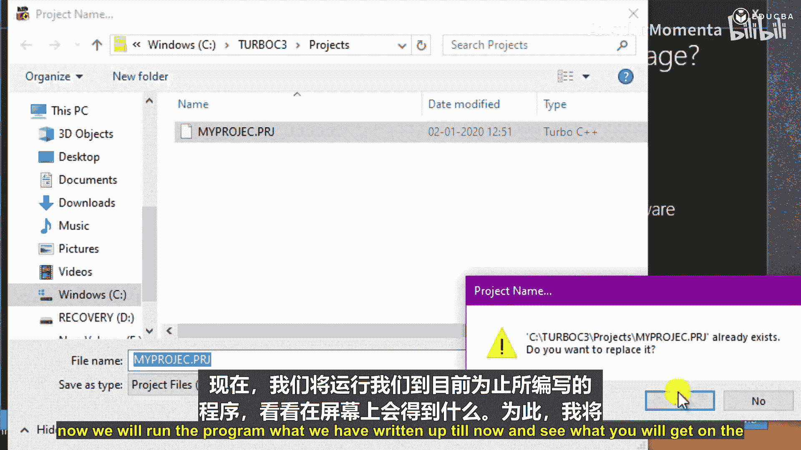
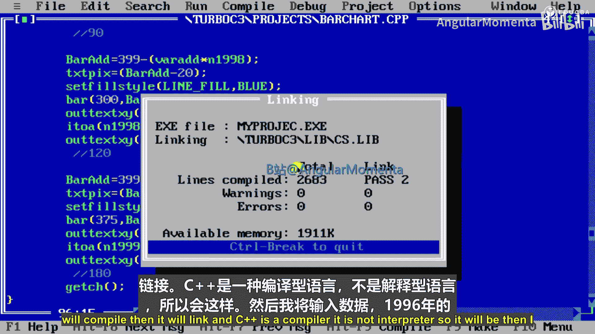
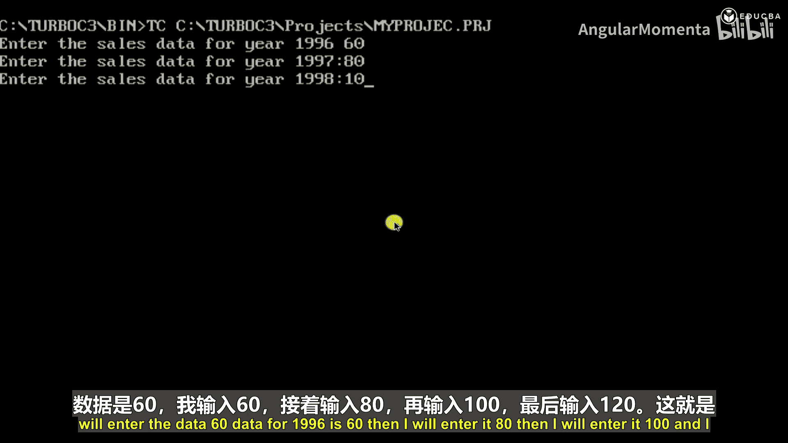
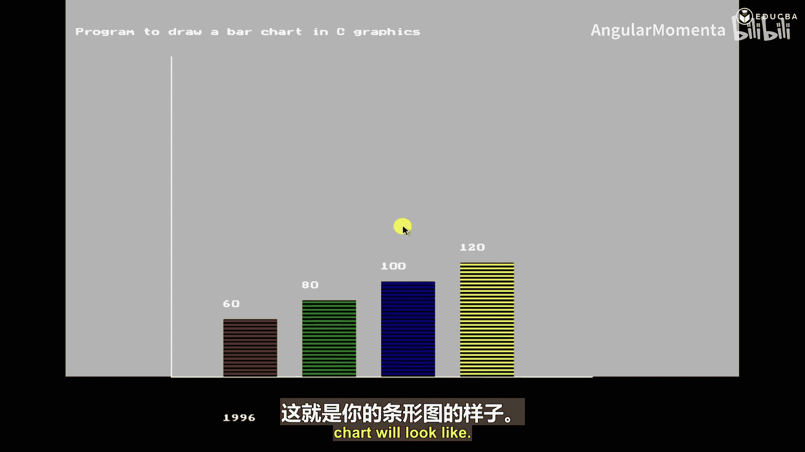

# 【EDUCBA】使用图形编程在C++中创建销售图表  Create Sales Charts in C++ Using Graphics Programming p03 02_01_01_条形图第四部分 -BV1rDFozyEuS_p3-

What is 10，10 is your integer raix， What is。

Radics。Rraics E is specifiedifies the base to be used in converting value Ras must be between 2 and 36 inclusive。

So this is the raix。 if value is negative and redix is 10。

I to a and L2 a set the first character of the string to the minus。

 That is how it will be converted into number will be converted into the string that is character and it will be displayed by using this out text command。

 right， so。

Up till now， what we have done， we have used。Bar command， then set fill style command。

 then out text commands are all graphics command。 Then we have。

Use this al text command to write string on the graphics screen。

 then also we have used this I to a command to convert integer type into the character type and we have used it here。

Right。So。For 1996 year sales data， we have。Drawn a bar chart on the screen。 Now， we will go further。

 We will do it similar way for 1997。I will just read it out bar add as equal on 399 minus。

Crowund bracket open were air into N 1997。Round bracket closed semicolon text pick is equal to round bracket open bar add -20。

A roundund rack closed semicols at Phil style  line filled。You can directly take this 1997。

 Also you need not have to。Take this variable add。Where art。Setfield style，9 fill。Comma green。

We will use different color for。A different year this 1996， I have used red Then for 1997。

 we will used green command。😔，Set fill style， round bracket open line filled， commma， green。

 round bracket， close， semicoant bar。Then we will move it further， because。First bar is here。

 Stricken bar is here。 Third bar is here。 full bar bar is here， So its Exor will change。

 This is the exor of。Second。But this is the first coordinate。First ex coordinate of the first bar。

 So this will be the your。TheExordinate of second bar， then bar add ti。Y了。

It will depend on your data。 That is bar height。That is a amount of cells。Actual sales quantity。

 then。This is a lower left corner。 That is 2，75 3，99。This will also change y2。From here， this is 200。

 this is 275 so。Bar width will depend on this， this minus this。

 This bar width will be same for all bars。 So 200-50，1，50 is 50。 So that will be your。Bar width is 2。

75 minus-225 is also 50。 So your bar width is。50 here。

Then this will be your bar height depending on your data and。This is a way， too。X2 white。

Then out text X， Y， round bracket open。2 to5a 440。 it is 1997。 This is U text。

Printing text on the in the graphics mode， then conversion。 that is inteigor to text。

In 1997 comma text comma 10， this we have already seen how it is it will be converted into the text。

 then our text x y to 225 text specs。Comt text is what is bar add minus 20 minus20 is used so that it will be。

Printed。On the butt。Then。We will similar way。 We will used for。1998， I will read out again。

 bar a is equal to。399 minus where at in in 1998 round bracket close semicoant text pick is equal to bar at minus-20。

T syntax， this syntax is similar。 Se fill style linefi。 we will use a color blue here。 then bar 300。

Now， it moves further what we have used here。Is 2，25 here。 We have used this 300。Hed。

What we have used is here is 150， so it is moving further。150 is here。200 is here。Then。

220300 is225 is here and 300 is here。 Now the bar width will be 50 we have used here also 50 and here also 350 minus-300 is 50。

 so bar width will be。50， this is a bar height Again。

 it will be dependent on your 1998 data or you have entered。399 minus were added into 1998。

This is a multiplication factor is same you can。If you don't multiply it。

 the bar will be in the small graphics area。 if a multiplication factor will increase the。

Youre a viewport。 That is your。Aa。Then0， this is x1 by1。Sorry not， tab top。Left corner。Right。

 bottom conduct。So bar 300， comma bar add， comma2 350， comma 399， then out text x y。

Round bracket open 300 comma 440 comma 1998， round bracket closed semicolon。

 then conversion from integer to text I to a 1998 text comma 10 round bracket closed semicolon。

Then out text X， Y 300， comma， text picks， comma text。This will be。 I have used color here， blue。

This will be the data of 1998 similar way you can have data of 1999。Bar add is equal to 399。Then。

The X is equal to bar at minus 20， set fill style 9 fill yellow bar D75 here also we have used bar width as 50425 minus 375 is 50。

 then bar add E0 1999 and 1999 data。It will depend on this data。Then。Left bottom corner。W。X 2， y2。

 x1， y 1。Out text X， Y 375，440，1999。Then0 I2 a I2 a is again。

 conversionver from this number to text comma 10。Text is your array character array our text text y is 375 text peaks text。

 then get C H to weight。So， now。We have from the start what we have done is we have included the libraries。

 then we have initialized variables， then we have entered data of four consecutive years to compare the sales of the company。

 then we have。Initialize here we have initialized your graphics mode。

Then we have clear screen command， drawn X Y graph。

 then draw bar chart one by one for entered data and now get C Now we will run the program and we will see it how it will be on the screen if you run it。

😔，You can have。

You can see this enter the sales data for year 1996。

 I will enter it 200 entered sales data for year 1997。I will enter it 60 enter data for year 1997。

 I will enter it 120 Inter sales data for 1999。 I will enter it as。😔。

Wen。8。

Okay。Now， we will run the program what we have written up till now。

And see。

What you will get on the screen。For that， I will open the program。 This is your our bar chart， then。

😔，We'll run it。Po it will compile， then it will link and C plus plus A。

Compilr， it is not interpreter， so it will be。Then I will enter the data 60。A data for 1996 is 60。

 then I will enter it  at0， then I will enter it 100， and I will enter it 120。

 so this is your graphics bar chart， you can see on the screen 60800 120， 1996， 1997，1998。

 1999 data programme to draw bar chart in the C graphics。

So this is how your bar chart will look like。😔。

