# 【EDUCBA】使用图形编程在C++中创建销售图表  Create Sales Charts in C++ Using Graphics Programming p04 02_02_01_饼图 -BV1rDFozyEuS_p4-

Now， we will draw by chart until now， we have drawn。Bar chart。 and also。

 we have entered a data sales data on the screen。 Now， we will draw a pie chart。

 What is the pie chart。P chart is a circular chart。Okay。In which we are going to show the sales data。

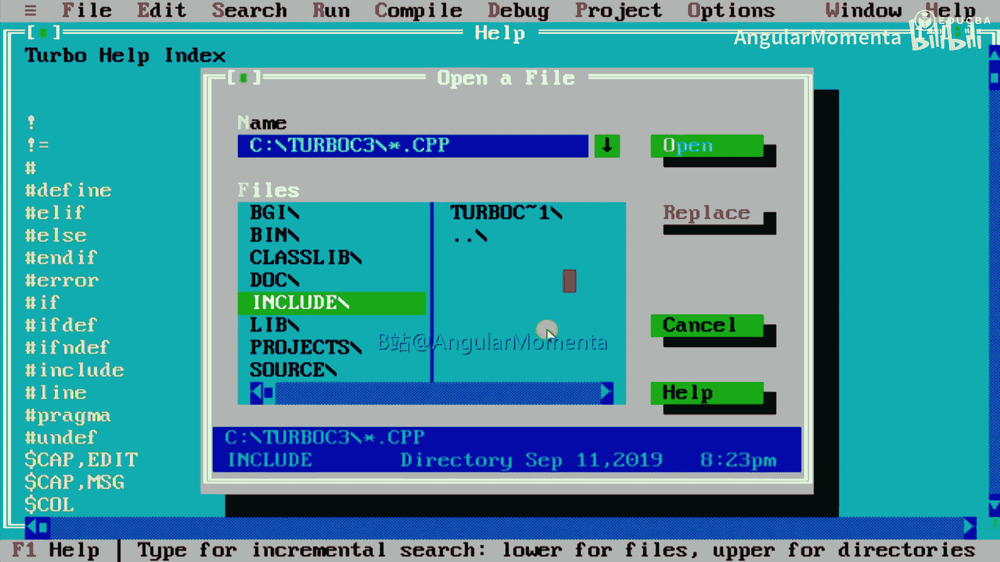

I will open the file， and I will explain to you how it will be。Gooded。And Sir。This is your。My chart。

First。You will not include a graphics library similar wave。

 whatever we have done in a ba bar chart that is include graphics do。

 include STDI do include STD IO doage， include Kio do include IO stream do include graphics do then this is your main C++ syntax in teacher main then we will declare variables in teacher N1996 in 1997 in 1998 in 1999 and I variable。

Then print F enter the sales data for year 1996 similar print F syntax， then scanf percent HDd。

And a percent of N 1996 printf enter the sales data for the year 1997， then scanf percentage D。

And Per in 1997， Prif enter the sales data for the year 1998。

 scanNF percentage D and percent in 1998， Prif enter the sales data for year 1999 scanNF Per D and percent N 1999 data。

Then， we will initialize。This， this completes this I have just rushed through it。

 as we have already seen in the bar chart how it will be done on the screen， right so。Printive。

Is the command， which will output string。In the text mode。Then scanf is the command which will input。

Variables。And also print on the screen in the text mode。Not in the graphics mode。

So your help will be here。You here to press F1， or you， you can。Al right click of the mouse。

We scan of command details here。Then。😊，We will initialize Gs mode by using G driver that is in a graph command for that you will have to declare。

G driver variable， G mode， error record， Then we will clear the screen by using CLR SCCR command。

 Then G driver is used to detect。Detect is the preserve word in the C plus plus2。

To store the graphics。G driver is equal to detect then in graph command。

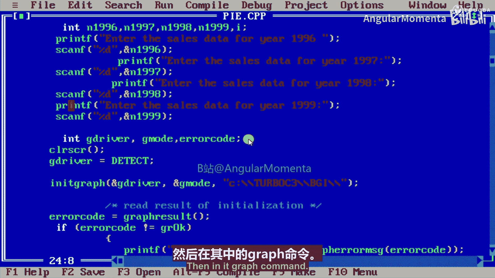

You will get help here， said。This is the help of in it graph command。

 which initializes the graphics system and it is the declaration is wide far in it graph in it。

Ity af。It is a far pointer integer far graphics driver in teacherger far graph mode。

And character far path to driver。 This is a syntax of your init graph command。

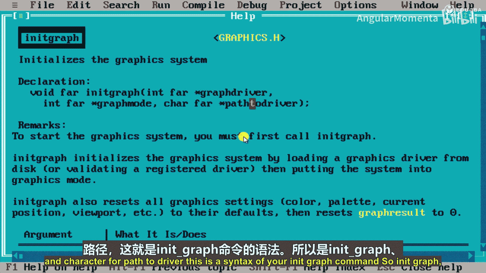

So in it graph ampers G driver， amperserson G mode， and this is part of your BGI CGI directory。

 also I have explained this significance of this double slash。If you use a single slash。

 you will get an error that is C plus+ will not identify it as a directory if you use a single slash。

Then error code is stored in the graph result。Weer code variable。

Graph result will give you the error code， if it is。Then。

If error record is not equal to GRO K GRO K is also reserved C++ variable。We will print the graphics。

Error message on the screen at the of error is percentages graph error message。In bracket error code。

 then we will print pressnicy stop graphics mode get Swsh exit1， return with error code。

These are the basic commands used to initialize the graphics mode， right。

Graphics mode in the C plus plus， if now what we are going to do is we are going to draw a pie chart on the screens to draw a pie chart will。

Just have to。Yeah。You will have to。Build a logic。 What is pie chart。

 pie chart is a cha drawn in a circle。 So to draw a circle， what we are going to used is a。Gmand。

Pie slice。 What is pie slice command， Pi a slice command is it draw arc or it it draw。

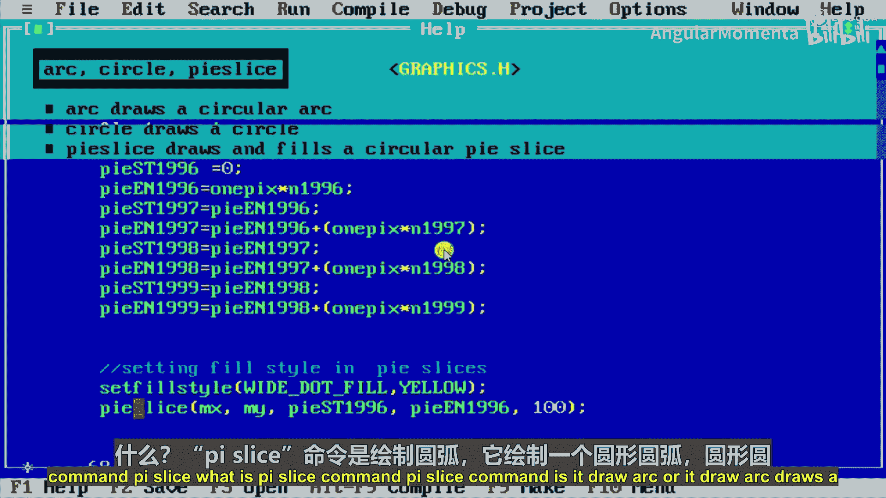

Arc draws a circular arc circular arc draws a circular。 It is a pie slice。

 What we are going to use is a pi slice command。

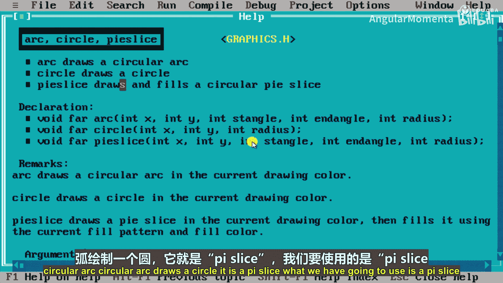

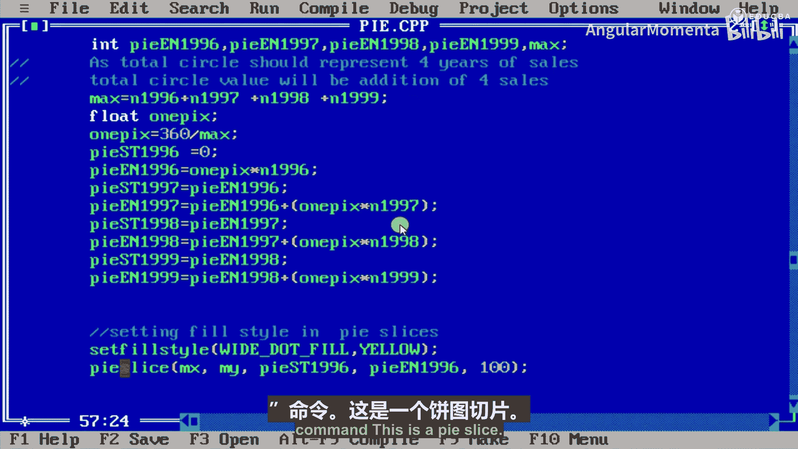

This is a pi slice。 What it is integer x， integer y integer S。T angle， interior。

 end angle and tior radius。S T An is's start。End angle is a end angle。

 that means in the circular archs like。Okay。Arckin a circle。X and Y are the center point of the arc。

 then。Which to drop I chart the your X and y should be fixed。Then startangle in degrees。

 endangle in degrees and radius of arc。That is integer radius of arc。Circle and pie slice。

The arc or slice travels from a start angle to end angle， if start angle is0 and end angle is 0。

 then your arc will be your circle， right？So this type of geometry you must be knowing you have studied in this type of geometry in the school。

 right？If S angle is equal to 0 and n angleng is equal to 3 is60， then your total。

Ark will be your complete circle。 So to draw up。By chart we are going to use。

 it will go counterclockwise。 So start angleangle is this endtangle is this。

 Then your arc will be from here to here， right， it will go counter clockwise from0 is here。

900 manate0 to 7s here。 it will go like this。It will end here。

So what we are going to do is we have data of four consecutive years that is 1996， 1997， 1998， 1999。

 so it will be converted into this angle。This angle。From start to end。

 it will be dependent on your data。 Then only you will get a pi arcov。Suppose 20 will be your。Deta。

Of 1996， then it will go from here to 20 here。 then from。

This for the second pi your arc should be this from start angle should be from here to if data ends here then it will be the start angle end angle of the second data and start angle of the third data。

 so this way it will go。You are getting and your total circular data should be your total data of four consecutive years in this way we are going to build a logic for drawing a pie chart。

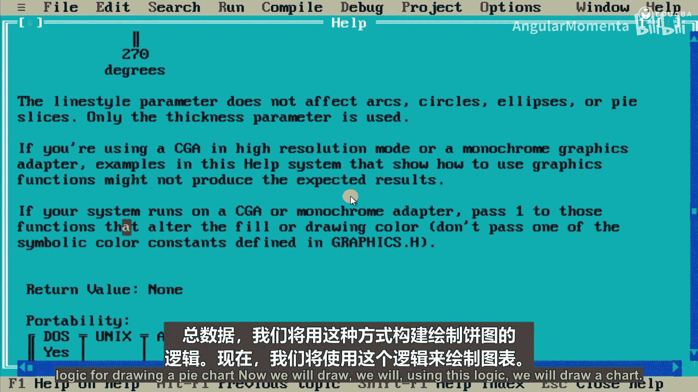

Now， we will draw， we will。Using this logic， we will draw a chart。Then print first。

 we will print a message for user。That is our text。Text X， Y，10 comma。

10 plus 10 programme to express the sales data into pie chart， then。Initializing maximum x and Y。

 we will get whatever the get max is the command used to。

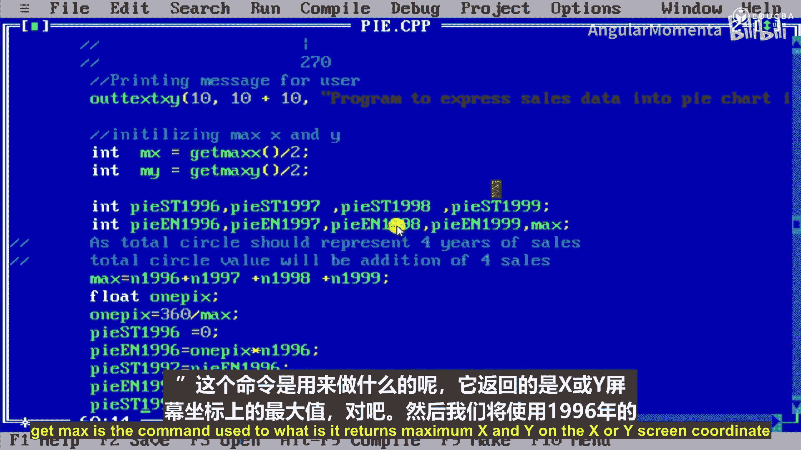

What is it returns maximum x and y on the x or y screen coordinate。Right。

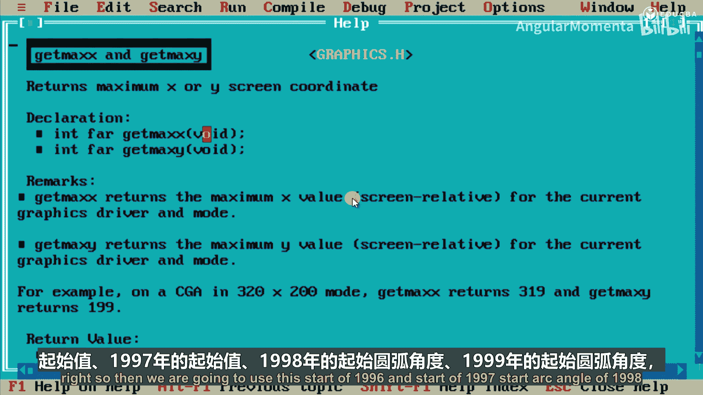

Then we are going to use this start of 1996 and start of 1997 start ourtangle of 1998 start ourt of 1999。

 then integer pi。1996 in teacher。Enangle of 1996， endangle of 1997 end of 1998 and end angle of 1999 and maximum maximum is your total of all your data。

Now， for simple case， we are going to use it below your total should be below your 360。

 We will be drawing the pie chart of that one float1 ps， then one ps is equal to 360 divided by max。

You get it。 so this 360 is your total count that is from circle circle is your 360。

 that is how we have seen。And so your one ps will be your 360 revered by maximum。

 then your pie chart。Arc first arc will start from pi as t 1990 s is equal to 0。Then， your next。

End of 1996 arc will be your one pi that is your this one in2 simply 9 in 1996 that is this logic works if the total of your all data will be less than 360 if it is more than 360 the logic will be different。

Then。Now， what will happen you have drawn first first pi that is pi s t is equal to 1996 equal to 0。

 then end of that 1996 angle will be。1 pi x into n 1996。 That is your first dark of 1996， then your。

Starting angle of 1997 will be your ending angle of 1996。 That is this one。

So this will be your starting of 191997。 then ending of will we your this。Plus，1 pi x into 1997。

This how it will go。So your first a will be from here to here， second a will be from here to here。

 third a will be from here to here and fourth a will be from here to here。So。

Then your 1998 starting angle will be ending angle of。

1997 and 1998 ending angle will be its starting angle plus1 picks into data that is in 1998。Date。

Then your starting angle of 1999 is equal to ending angle of 1998。Ending angle of 1999。

Will be equal to sorting angle of 1999 plus1 pes into n of 9 that is the data1999 data。

 so now we will for this this is the logic we have where we have。We have。

Calculate starting angles and ending angles of each year's data。 Now， we will start writing。

Actually drawing by slices。 First， we are to set fill style。

 as we have done in our bar chart set fill style。 What is the syntax of it is sets the fill pattern and colour。

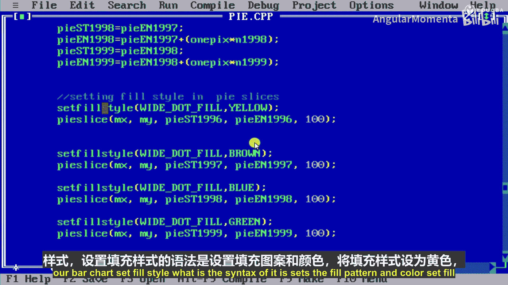

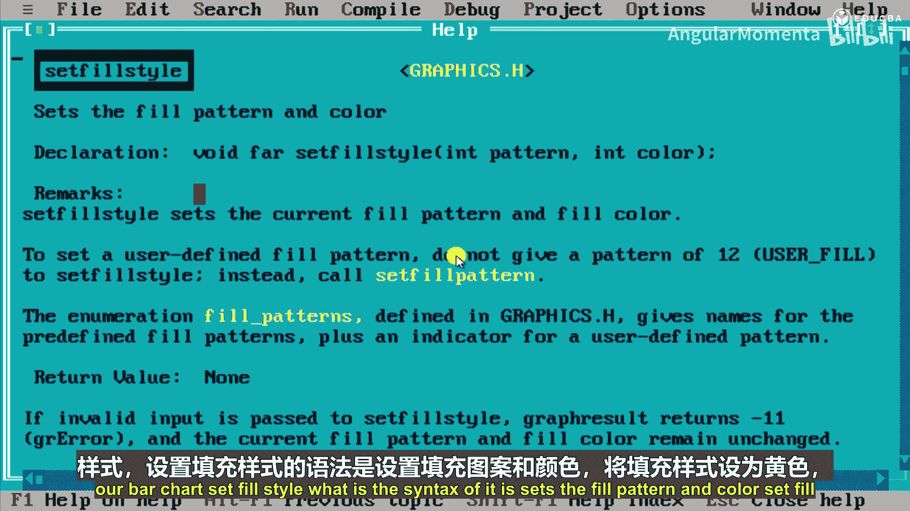

Seitfield style。Yellow， first， we will take it as a yellow， then。

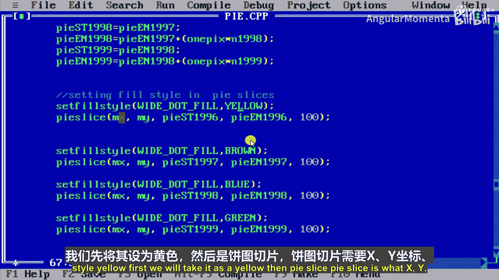

Pi slice pi slice is what x star angle and angle radius this parameter radius x and y will be same for all your pi slices。

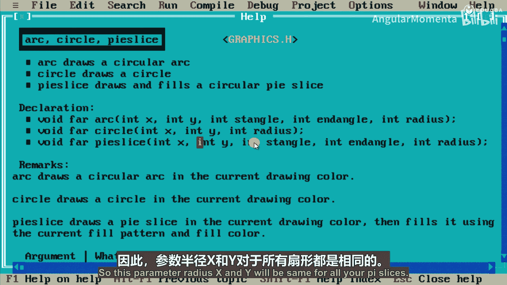

So your pie slice x， comma y， comma starting angle， ending angle comma 100。

Then this will be your first talk。These variables were already defined it here。Suc setful style。

 wide then。Brown， second pie， second arc， we will take it color as a brown。

 then pie slice x Y starting angle of 1997， starting angle of 1997。 and this will be the same radius。

Setfield style， blue， pie slice X， comma Y starting angle of 1998， ending angle of 1998，a00。

 Sefield style green。Then pie slice is x comma by starting angle of 1999 heading angle of 1999 comma 100 and get C。

 so this ends your pie chart。Now we will run it and we will see how it works。We will run it， Al R。

 run， then。😔。

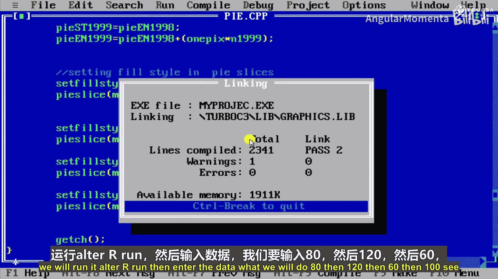

Yes。Enter the data。 what we will do。80。Then，1，20， then。60。Then。Hundred。See。So this is your pie chart。

Rightrite for four years data in the C plus plus graphics mode。

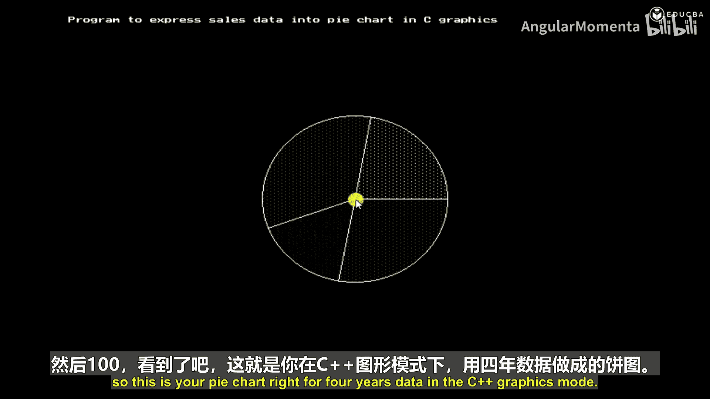

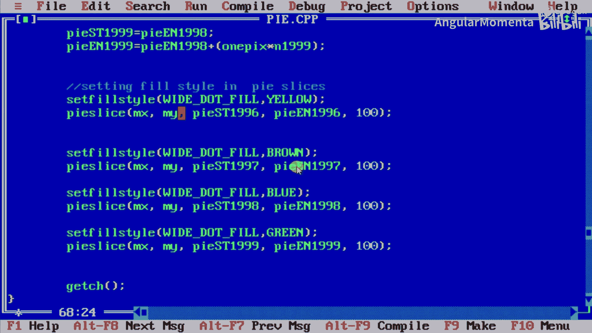