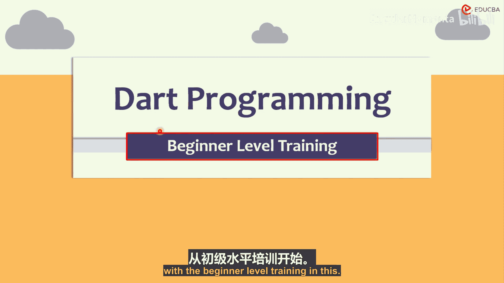
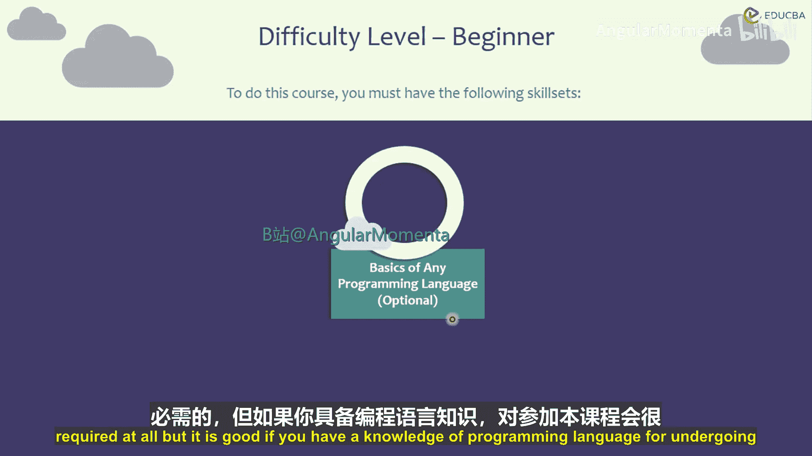
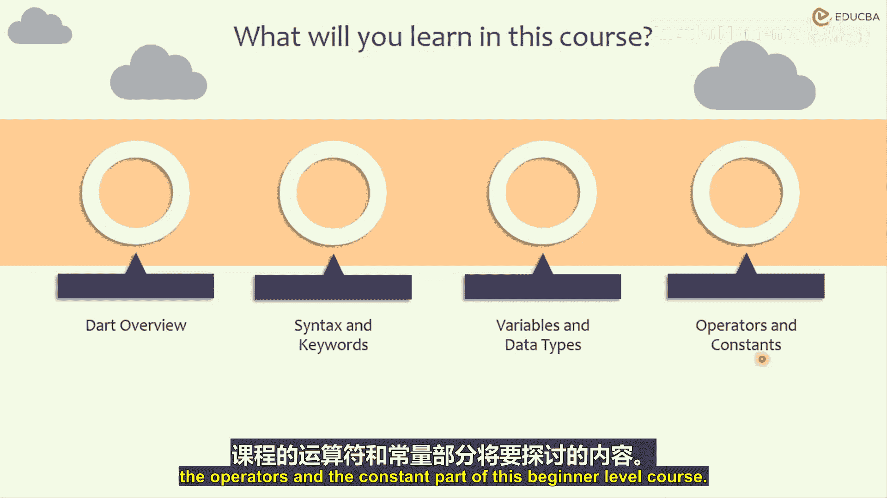
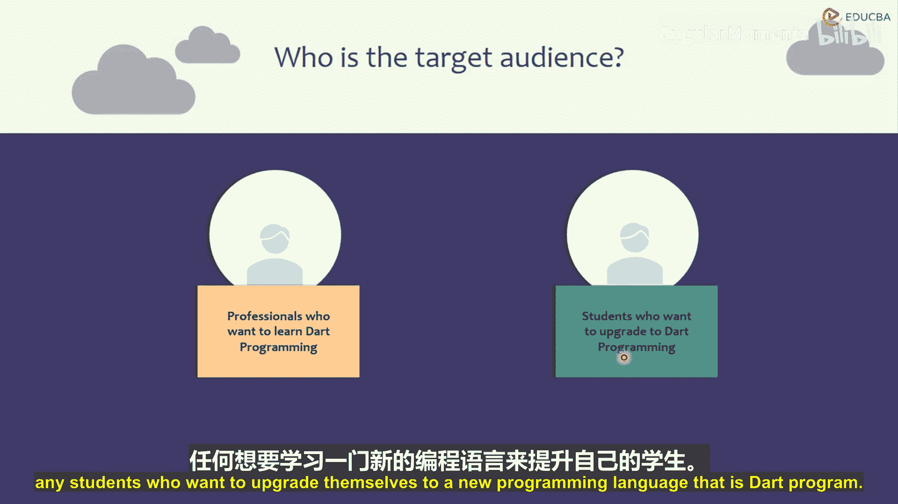
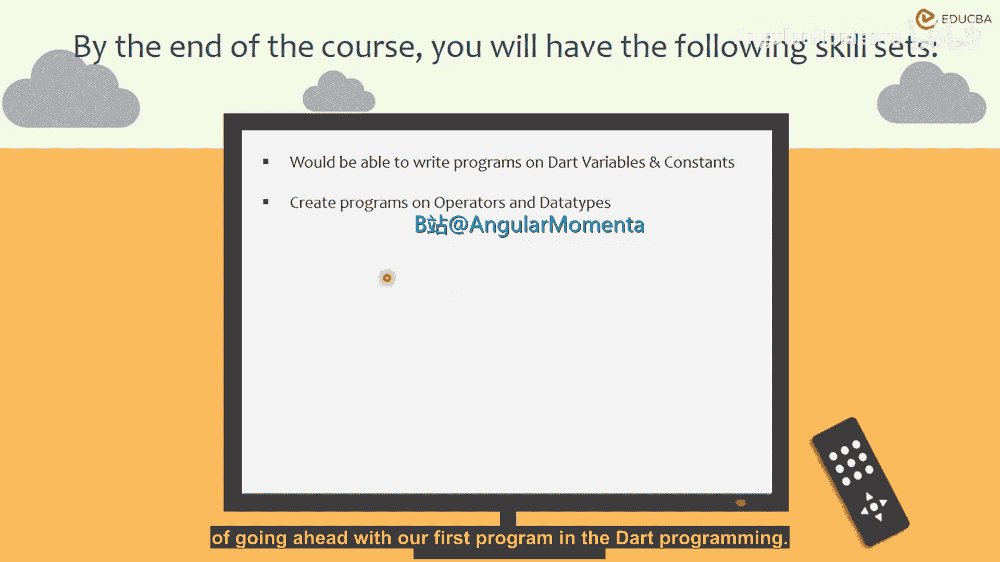

# 【EDUCBA】初学者应用Dart编程基础 ｜ Apply Dart Programming Fundamentals for Beginners p01 01_01_01_课程介绍 -BV13bF1zcEwj_p1-

🎼Welcome to the course of DarRT programming and in this particular course we are going to start with the beginner level training in this so let us first understand the difficulty level of this course is beginner level and for undergoing this course actually there are no skill sets required but it is good if you have any basic knowledge of programming language so this is basically optional one it is not required at all but it is good if you have a knowledge of programming language for undergoing this particular course。

🎼Let's see further now what are we going to learn in this particular Dart beginner level course first is we would undergo what is Dart overview so what is basically Dart programming language why do we use it。

 how do we use it and moral things that we can do inside Dart programming is what we would look at in the overview part of this course then we would go ahead with the syntax and the keywords which are there in Dart programming as you all understand that if you have any programming language it means it has certain proper syntaxes of its own it has particular keywords which you should know what they are used for and how they are used for so we would be undergoing that particular part in the syntaxes and the keywords part then we would move ahead with how to create variables what are variables。

 how to store values in variables along with different types of data types which are available in your Dart programming。

🎼And finally we would complete this particular beginner level with operators and constants so what is this operators。

 how do we use them， what are the different types of operators available in that programming also what do you understand by constants how do you use them and how do you create programs using operators and constants is what we would be looking at in the operators and the constant part of this beginner level course let us proceed for them and understand if there are any course requirements or prerequisites as discussed earlier there are actually no requirements but it is good if you have a basic knowledge of any programming language it could be any language starting from C C plus the C sharp J sharpp or whatever languages you are familiar with。

🎼Now let's move ahead and understand who is our target audience for this course now there are any professionals who want to learn that programming it does not required that they should have some basic knowledge about it or should know what is that programming anyone who wants to learn something new or some new programming language which is that then you can go ahead with this course Similarlyly any students who want to upgrade themselves to a new programming language that is that program。

🎼So let's proceed further and understand by the end of this course what is the skill sets that we are going to have so first is we would be able to write programs on various data variables and constants。

🎼Also， we would be creating programs on operators and data types。

🎼So when we would be completing our course， you would be capable enough of creating any programs into variables。

 constants operators or data types。So with this？🎼Well conclude and we would start by creating our of going ahead with our first program in the dot programming。

