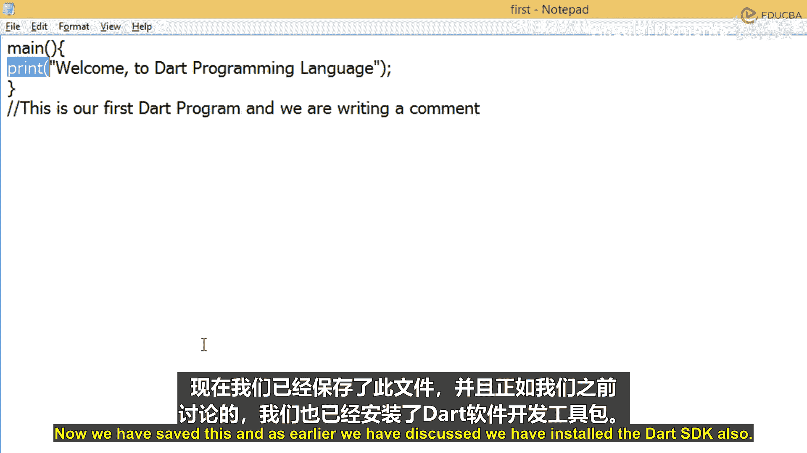
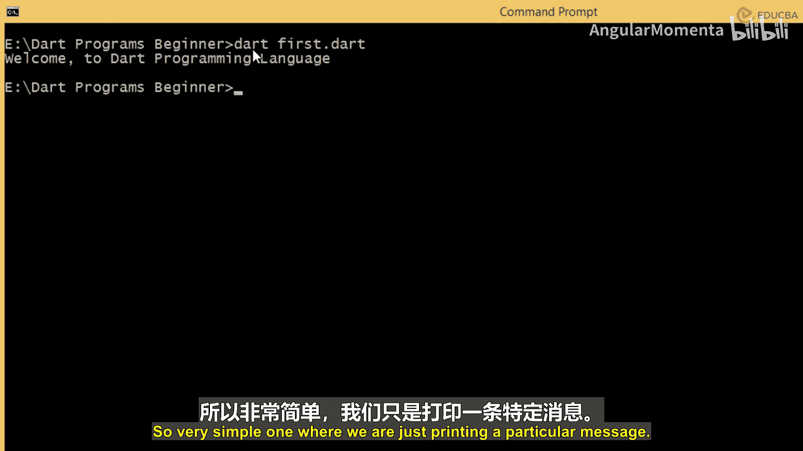
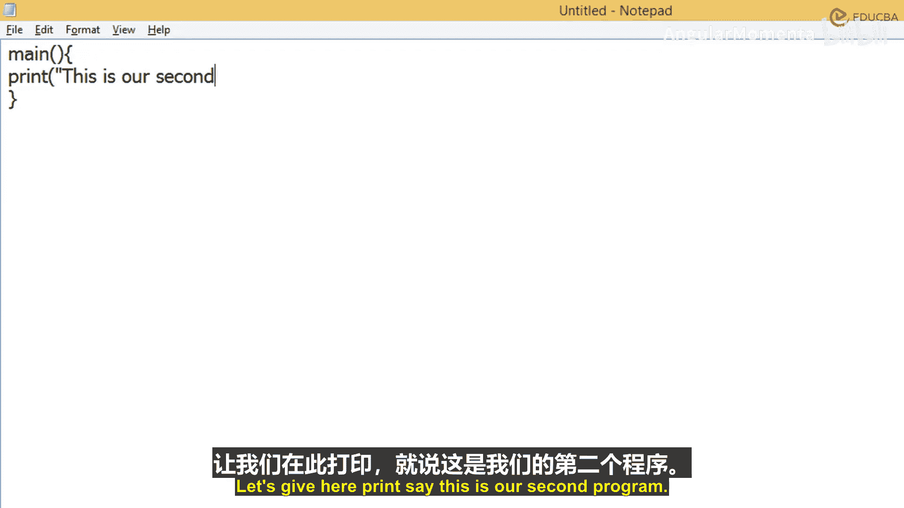

# 【EDUCBA】初学者应用Dart编程基础 ｜ Apply Dart Programming Fundamentals for Beginners p02 01_01_02_Dart语言基础 -BV13bF1zcEwj_p2-

Now let's begin with the beginner level course of Dar programming and let us first understand what is this Dar language all about。

 so just for your information it is basically originally it was developed by Google and we have the latest stable version of this language that is in August 2020。

Now， there are many versions which are there， but the stable one is thus one。

 which we would be using in our course Also now， basically。

 we all know programming languages are used for creating certain programs using the language specifications。

 So this is basically and。Open source， programming language。

And it was basically created for developing your mobile applications。

 You can also use it for building your web servers， desktop。

 mobiles app or Internet of things or Io devices also。

That was the basic intention of creating this Dart language。

 and it is also an object oriented programming language。

 So you have all the features about classes inherits， overriding。

 overloading everything into your Dart programming as well。 Here is basically a mixture of all the。

Object oriented programming ones， and it does synaxes of this look similar to your Java syntaxes。

 So preferably if you have knowledge about it， it is good or even you don't have it。

 you would be starting on with the beginner level cost So you would be knowing each and every syntax very thoroughly so no issues in that Now if we come across why we are using this dot programming language the one basic advantage of this is it is across platform language so it basically supports all the major operating systems which you have in currently active。

 that is it may be Windows Macs or any other O which you are using or even on the mobile applications like Android Apple or whatever platforms you are having it it runs on all the platforms。

And second important it is open source so it is available online you can just download the Dart SDdK。

 use your notads， create your programs run in the dot or you have various Is also available through which it can create using even Flutter you can use for creating the mobile applications using the Dart language so all this is possible because it is available open source and it is also very much table you can use it for realtime applications also plus another advantage it is supporting your object oriented programming features so if you are having knowledge to this particular concept of programming it is very much easy for you to develop programs using the Dart language so as we have or discussed we are having we need to install this dot SDK。

Wwhich is basically having the compilers into it which is or you can also call it a software development kit which has all the virtual machines standalone machines of that the command line interface environment all those is are already available you are supposed to just download it install it and thats it and start creating your programs together so it is very much understood what is the language about how it was developed by whom it was developed and what is the current stable version which we would be using into our codes。

So now lets quickly create one basic example about that wherein we are simply printing welcome to that programming language on the command form so。

We would be starting off with the main method here。

 just to tell you if you are not having any programming language background。

 main method is basically the entry point for your program through which the program would start executing so unlike we have this in all the other languages also we are having this as the entry point for starting our dot program so whatever you write inside this main opening and the closing bracket is only what is going to execute when you compile and when you run your current dot program。

So inside this we are simply using a method known as print and we are saying welcome。2 that。

Programming。Language now understand this syntax。 This print is basically an inbuilt method of that。

 which will print something on the commandrum what it would print whatever you give inside this opening double quotation marks and closing double quotation marks。

 So this syntax that you' are writing it need not be the same that we have written it could be any message which you need to give to the user which should be just printed on your dot commandron put that message into this double quotation marks and end this line with the semicolon。

 which means that this particular statements end here。

That is the end of line basically like we press enter to become on a new line or to come on a new line here we say to the compiler that this is the end of the line。

 what we want to simply do is just print a message for the user saying welcome to that programming language now one more we can also write down something like this for example say this is our。

First， dart。Program， and we are。Writing a comment。 Now， what do you understand by this。

 This is our first dart program we're writing a comment。

 This statement will actually not execute when you are executing and running your program because you have put this two batchlashes over here。

 which means this is a comment comment is only for the programmer to understand what he is writing。

 Now this is just one line of programme that we are writing。

 but suppose think about it if you are writing a whole application that you are creating using that programming。

 you should know what this methods are basically used for for your reference。

 So there you could use this comment， and you could put there anything that you want to make understand for the future that what is a particular method all about。

So there you can make use of this command spot。So， we have done with the first program main is the entry point for our program from where the program will basically start the execution so this has to be there print function is an inbuil function we have not created this it is there by default which is just going to display or print the output of whatever content you have written inside the double quotation marks。

So we will save this now we're going to save this in erive。

 we are having this dot program beginners and here we would save this as say first dot dot has to be the extension now we have saved this and as earlier we have discussed we have installed the dot SDk also so now what we would do is now let's go to our command prompt we are in the erive in the folder dot program beginner now we would execute dot what was the name it is first dot dot Now this dot means we want to compile using the dot SDK and what is our final name it is first dot dot you press enter it print the message welcome to dot programming language same thing that you have given in the print command so it is not printing main open close bracket print then open the round bracket double quotation marks and the text it is only executing whatever you have written inside。

Particular method of print。So very simple one where we are just printing a particular message now what we would do is lets go back here and let's create a new file and we would start again by creating the main method lets give your print say this is our second program。

