# 【EDUCBA】初学者应用Dart编程基础 ｜ Apply Dart Programming Fundamentals for Beginners p03 01_01_03_Dart语言基础：续篇 -BV13bF1zcEwj_p3-

Now， suppose we want to print multiple messages。 So simply again。

 we will use Europe print command on the next line and we are giving say this is using。Multiple。

Print。Functions。Again， we will use one more print command。And will give。 So here we have。

Printed three lines using the print。Function。Just a variation of what we have done earlier。

 we are using here three print commands and printing it now we would save this as second dot dart。

Don't forget to make here all files and then save it Now we'll go back to our command prompt and we will execute here second dot dot So it is printing three lines of code Now another option which we can use over here。

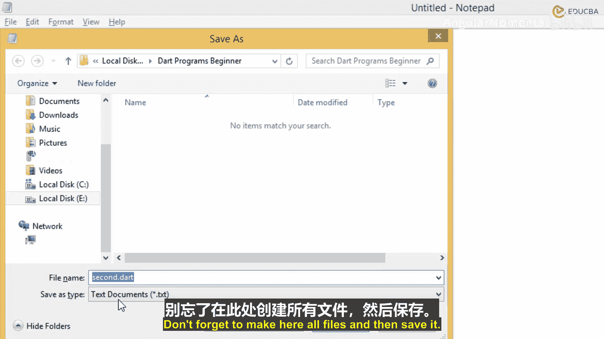

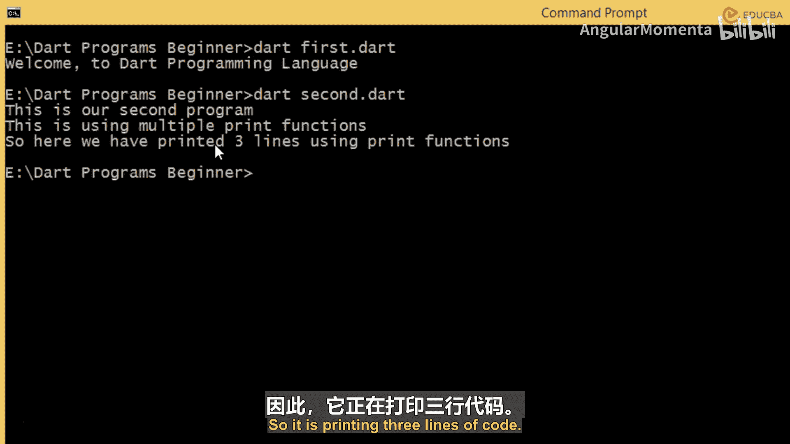

What we would do is let's create a new file。We are creating altogether a new file just for your reference so that it is easy for you to understand what is the variation that we are using it。

Now， here we are using ces， also using。Multiple print functions。Now， here we are using slash。

 and again， we are giving， but。Your。We have used only one print command。And we are。

Printing three lines of code。And now here we are ending this。

 So we are going to save this as third dot dot。And let us try and execute it over here seeing third dot dot what is the output we have only used there one single print function we have not used unlike the second one。

 three different print functions， but only in the one print function we have given here or printed three different lines using thislash and this per space is coming because after this we have given a space。

 so if we remove this all would look similar。

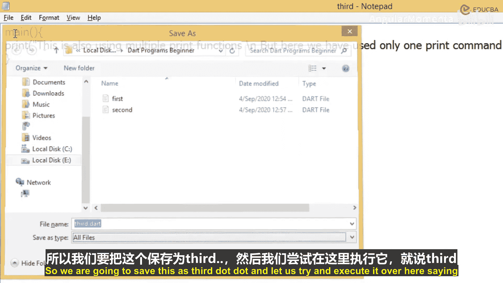

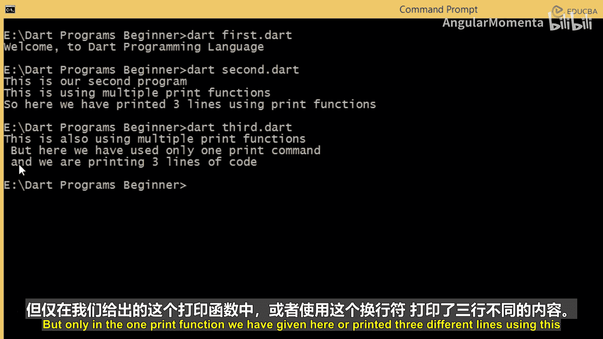

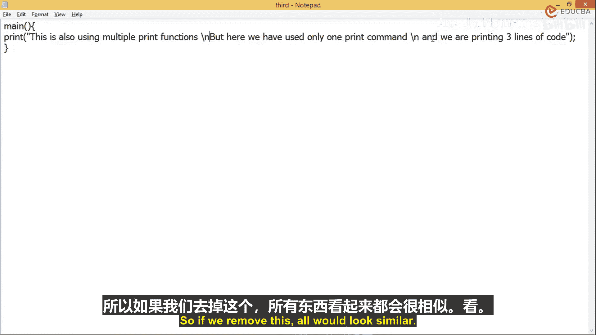

See， so this is also using multiple print functions we have given slash n so slash n basically acts like if you close this function by giving a semicolon and again in the new line you open this print right down this double quotation marks and again right down the second line so we are saving here those many functions instead of writing three different functions put altogether into one single print function but segregate those using this slash n that is new line slash and replicates your new line command Now there is another way in which you can also show this will continue below say this is using the。

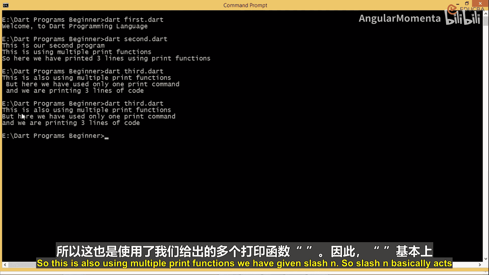

答。Key， and we are using here slash T。 Now here we have。UseD。Fort。Tab key and slash T again here。

 we used it again。Now close this。 we have saved this and again let's try execute see now this tab key is something like your having the tab key on your keyboard。

 once you press a tap， it gives a space but a bigger space， unlike an normal space bar space。

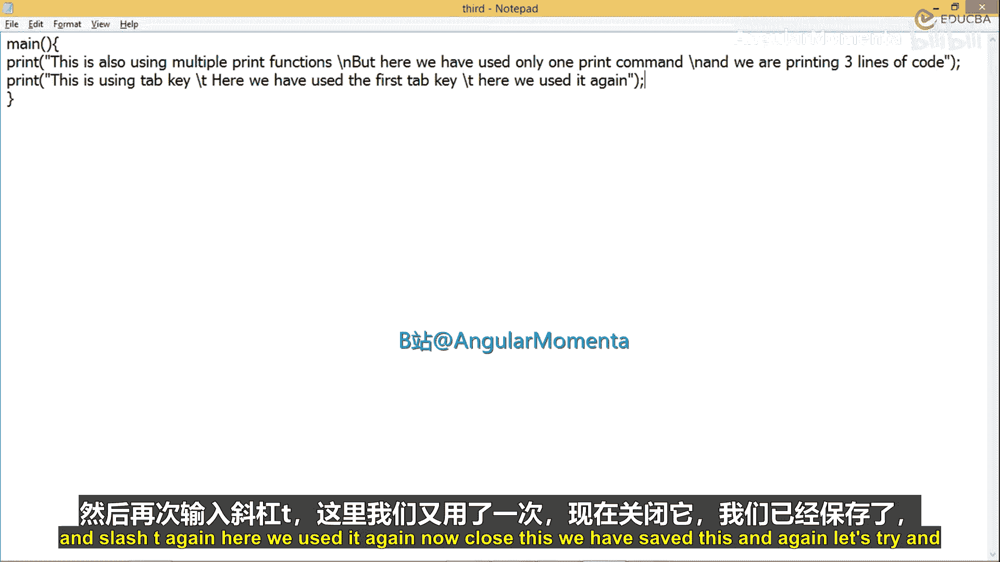

So you can use that also while creating or by giving some messages to the user using the do programming language that is using your slash T so slash T is basically for giving a tab and slash n is basically for ending it on starting it on a new line now there is one more thing in the first program we have seen this single line coming which is this two backslashes now what if I want to write something here said this program。

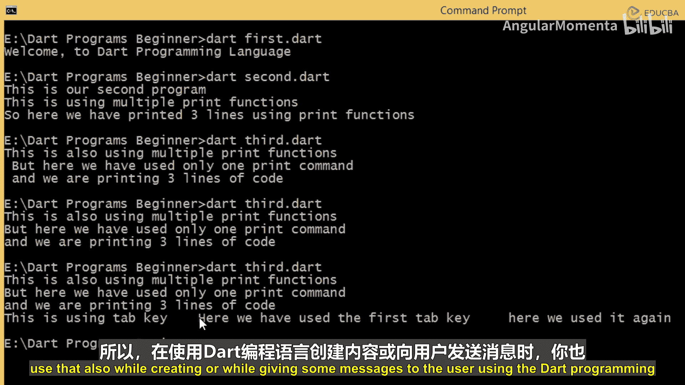

Explains。How to write new line and。Tap key in one single print， s function。Now， we continue below it。

Also explains。About the。Multiple。Line。Comments in dot。 And this is， and。Example of that。 Now。

 we have written these three lines of code， and we don't want this to execute whenever our program B bucks or gets compiled。

 One is you write down everywhere。 this slash。Which means you are commenting it。

 but if you are having supposed 10 line of comments which you have written。

 it is very tedious for you to go on every line and put this comment。

 So what you can do is you can start this comment over here using this slash and asterisk and here you can end it by putting asterisk and slash which means whatever you have put inside this two。

Opening and the closing comments is whole comment which you have put which would not execute whenever your program would compile If you want to check out you save this。

 go back here and again execute output remains the same because this has not executed suppose you don't comment this you give it as it is save it and you try to execute you get their whole lot of errors because it is not understanding what is this text which you have written because it is not having any synaxes which should execute them。

 It is a simple text that you have written and in the programme you have to use certain synaxes to print certain things on the or execute certain things on your command prompt so for that this is a comment so you have to give here that which make understand the programmer or the interpreter that this three lines of code are nothing but the comments in your dark programme which would basically not execute It is only for the programmer references。

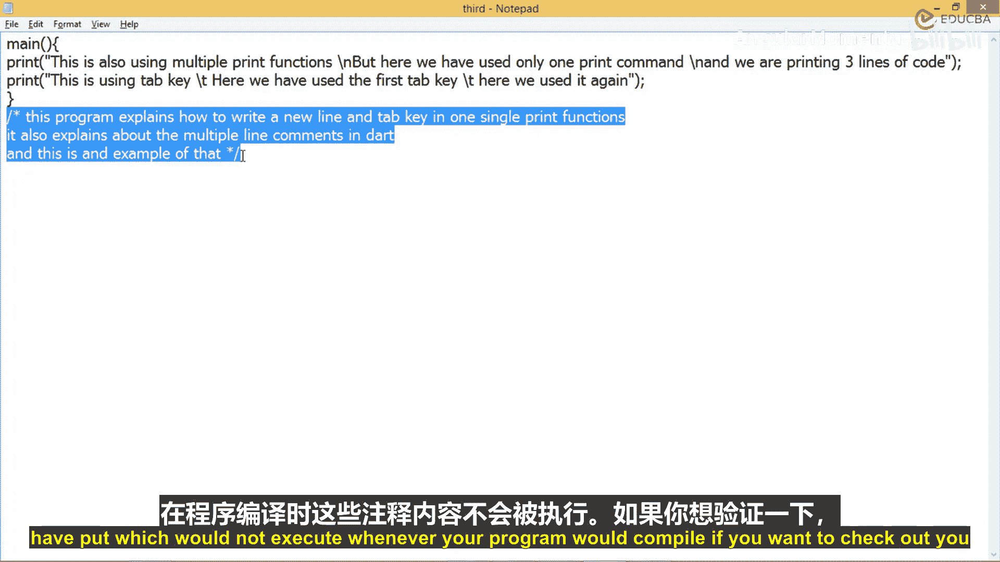

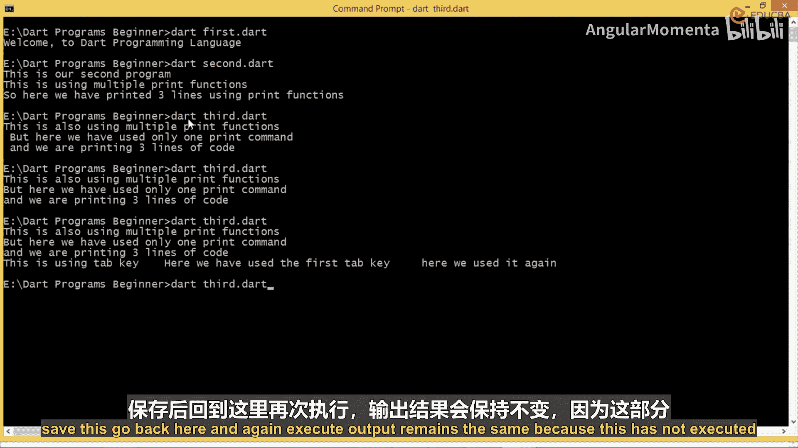

That they have written something sort of notes which you are writing about what program you're creating it。

 So that is about your multiple line comments。 So this we call them as suppose this slash as and as strict slash we call these as the multiple line comments and we call this as single line commentss So if you just have one single line which you want to comment put this but if you are having more than one it is better to use this instead of putting on individual lines this comments it would work if you put our individual line this comments。

 but it is a very tedious job to short term that we are using this multiple line comments option available there now so we have understood the use of what is main which is the entry point of the program how to print certain messages using the print method in print we have used variations by using print multiple times or using in one single print printing it on three different lines using s n or using tabs by giving。

lash T and printing it that way。 And similarly， what are multiple line comments and what are single line comments。

 Now we would also understand that if suppose you don't give this semicolon， we remove it。

 we save it and we try to again execute again， we are getting an error it is saying error expected semicolon after this where that line number two So this is line number one。

 this is line number two over here。 it says you have not it's also giving there the position This is one 37th position where you are suppose the error is coming。

 So it is very accurate in giving you the line number and the position number on that particular line where the error is occurring So it is easier for you to understand why the error has occurred because it is not understanding that you are using this print method。

 but you are not ending this statement by giving a semicolon over here and again using another print method So for that this statement has to end by giving a semicolon there So every。

Statements or every executiveecutive statement that you are creating has to end with a semicolon and that that is very much important。

 It is basically mandatory you can say that you have to put a semicolon at the end of the executable statements so otherwise you would get the compiler error That is how we have seen some basics about starting with what is data and creating some sample examples on data so now in the next session we would go one step ahead and we would understand the syntaxes and some keywords which are already there which you should be knowing because you are learning the programming language so there are certain syntaxes given that you have to follow them while creating the programs in a particular programming language so we would understand that in the next session and then we would go on further with variables data types operators and con So that's such from this particular session of understanding what is the data basics。

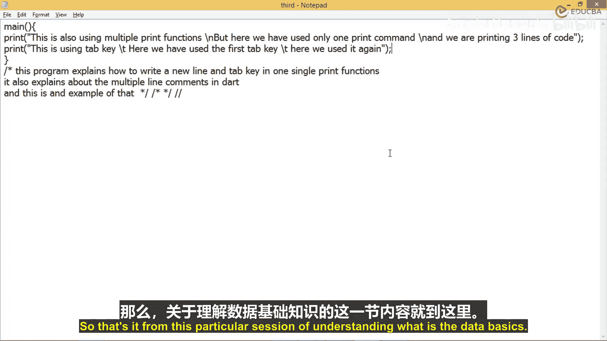