# 【EDUCBA】初学者应用Dart编程基础 ｜ Apply Dart Programming Fundamentals for Beginners p05 01_02_02_Dart语法continue语句 -BV13bF1zcEwj_p5-

Now， we will create over here by creating force the main method。Now。

 inside this we will create now for creating variables。

 this is a keyword which is used for creating variable where means now you are creating a variable。

Now we are creating a variable which will store， say first name。

 So this is the name of the variable that we are creating。

 So the specifications that we have seen or the rules that we have seen are for giving this name for this variable and this is a keyword so you cannot have a variable name with where as a name because that is a keyword。

 So we are creating this first name where first name and we are assigning here a value So let's give here name as richer。

 Now， unlike every statement and with a semicollonons here also you will have to end the statement with a semicolon Now we are create another variable name now that is last name and here we give the value of last name that is say Sherma and now what we want to do is we want to print using the print method。

 say welcome and here we will give。The we want to print here the value of first name variable。

 So here we are using this dollar sign curly bracket and putting the variable name as it is that we have created there。

Sa welcome Richa and we want a space there so we give a space again we use dollar and we print the value of last name and here again we put say welcome Richa Shirma say to dot program so we basically want to combine the text and along with the text we want to also put the value of the variable the which we have created that is first name and last name and along with that we want to print it on the command prompt。

So now， let us save this。And we will save it by the name。Sa let's give P1 dot dot all fines。

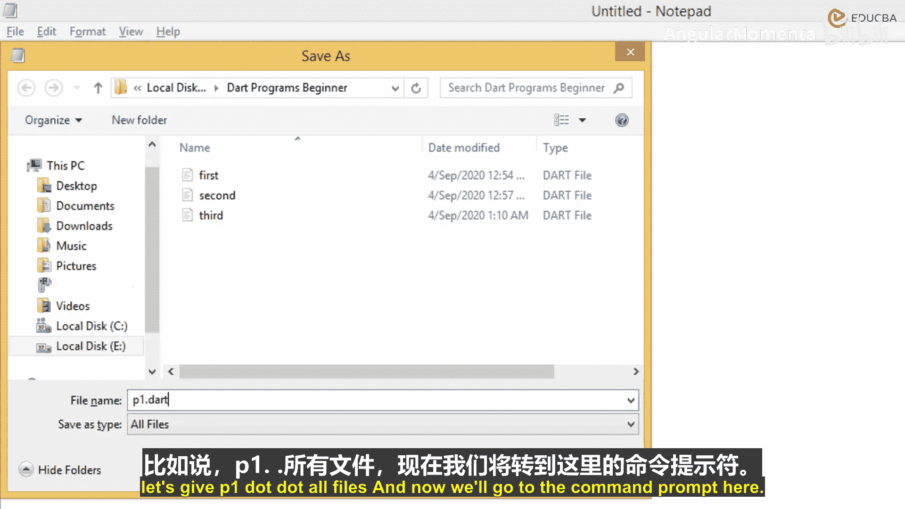

And now we'll go to the command prompt here， we'll write down P1。t do。

It says welcome Rechar Sherma to dartt programming。

 So whatever name you had stored in the first name gets printed here。

 whatever value you stored in the last name gets printed here。 And since we have given here a space。

 the space is coming If you don't put the space， the space will not come。 suppose we don't put here。

 let us save it and again execute it。 see， Now one other thing， suppose you give here a space。

 And now you try to execute。 Now， it is again coming。 even though you have not given space here。

 But while soing the value you have given a space。 and then you have ended the double quotation mark。

 But this is not the right way of doing it。 So it is better we put it like this。 And silly output。

 What if you want to print some multiple statements over here and print the values individually。 say。

 for example。

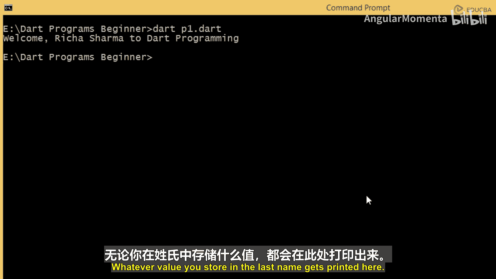

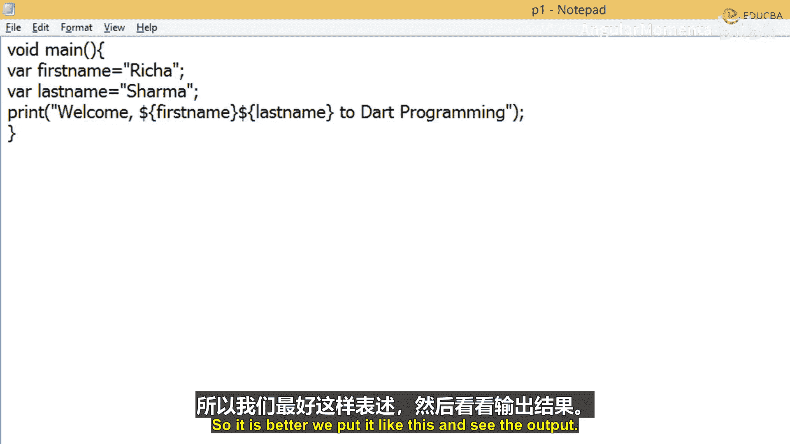

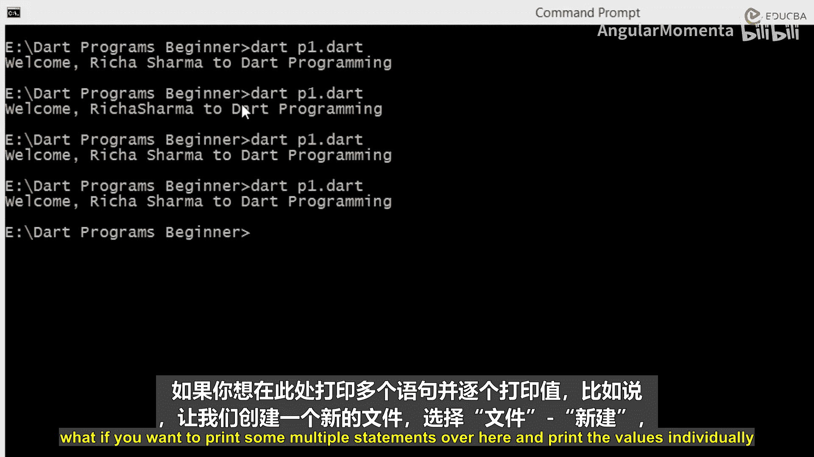

Let us create a new one。So well go for file name， we will create void name and inside this we will create so now let's use F name again we give here the same name。

With job and where El。And we use here Sherma。 And now we use a print command， we say。Welcome to that。

プログラム？Whats he say？Your。First name is， and now we print here dollar。E namem。And then we again， give。

Your。Last meaning we give here， see。And。Alice if we want to print it。 Let us save it as P2 dot do。

 And now let's try and execute this P2 dot dot It Prince。 We to dark programming。

 Your first name is Rcha。 Your last name is Shama。 Another way in which you can print the output。

 It totally depends on you。 how do you wish to give the output to the end users。 So now。

 let us create another program。 And over here， we will create a program which will have some more variables。

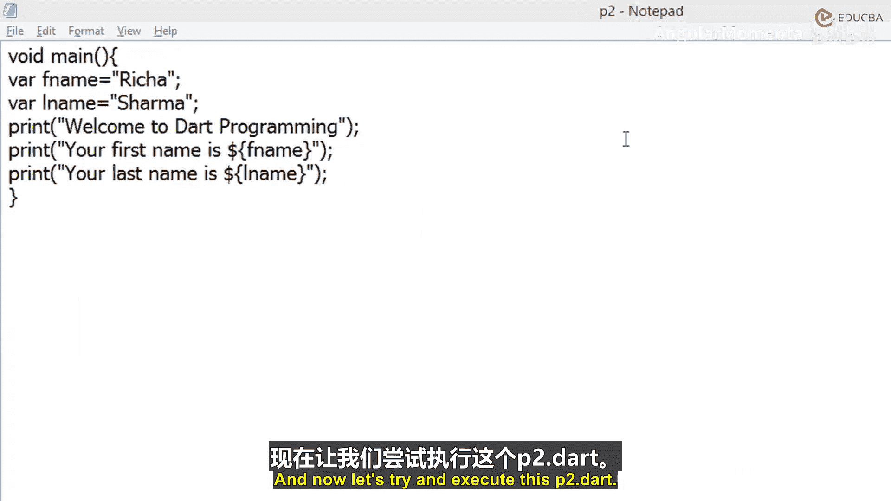

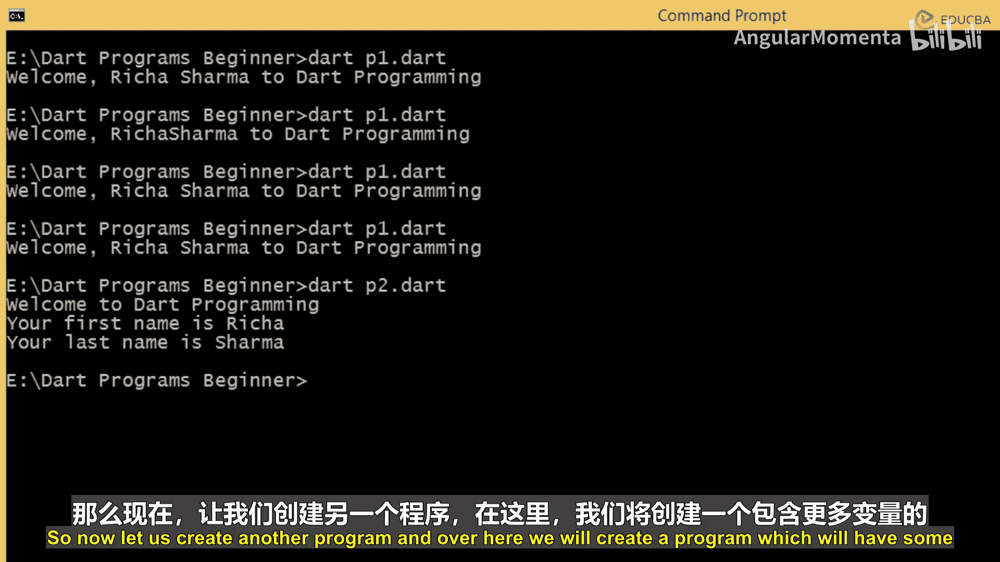

Only apart from first name last name we would create your name variable。

 we would create a variable we would accept or we would store the value for age Also the department name in which the employee is working or let's take employee name。

 employee age and employee department and then we would store the value then we would print the values and display to the end user So here we would start with world name and we would create variable and that is say EP name Now here we are st the name of the variable say John。

Goト。We store here， say EP H。 We give her a value of age in a numeric。

 So it would be any value or any variable which you are creating。

 It may store a value of type string or numbers。 whatever you wish to store there。 Similarlyly。

 let's create one more variables is salary。 And let's store here the value of salary。 Also。

 Then we create here the value of say department。Name， and we put this person in。Accounts department。

 Now we issue some bank command， we see。Welcome to ABC。Cooropporation。And we print here， say here。年。

Yes。We use your dollar and we put their EP name U R C dollar EP H。Yes。Old。😮，Coma。

 say your salary is dollar。Does EMB。Salinate， and。Your。Department bill dollar。Department me。

 that is what we want to print on the next print statute。Let us save it as P3 dot。

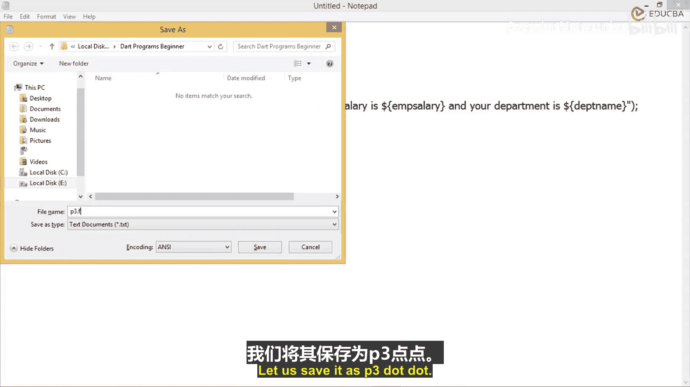

Dat。And let's try to execute here B3。t do it says welcome to ABC Corporation。

 your name is John Carter， you are 35 years old， your salary is 35000 annual department is accountable。

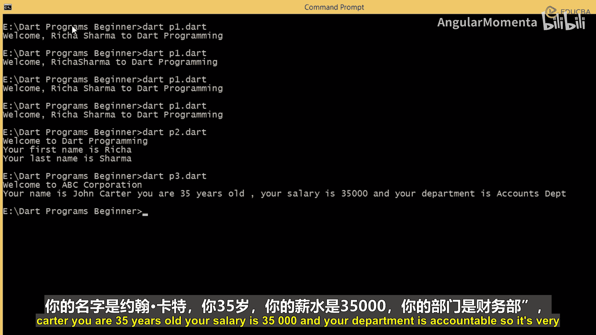

So its very much simple， you create variables whichever you wish to create。

 give names proper as per discussed in rules which are applicable for identifying or identifier names。

Then store the appropriate values in the variables and you can print them in whichever order you wish to you can print them all into one or print them separately。

 you can also use your the values suppose say youre giving your your name is an employee name and your。

35 years old。 Now we want to end here。 We want to give a new line， and we wish to start here。

 saying your salary as， let's say if this and let's execute it。 see。

 your name is John Carter you're 35 years old。 Full stop。 Come on a new line。

 Your salary 35000 and a department is accounts department。 So it's totally up to you。

 How do you create the print statements。

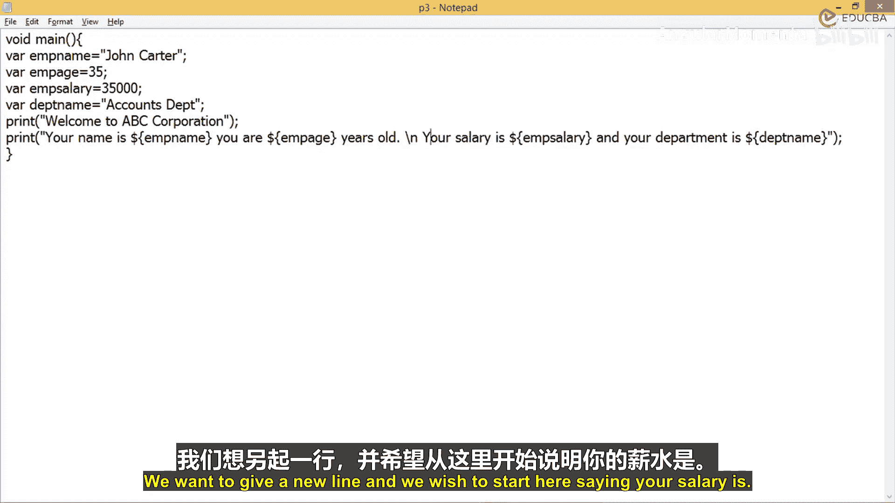

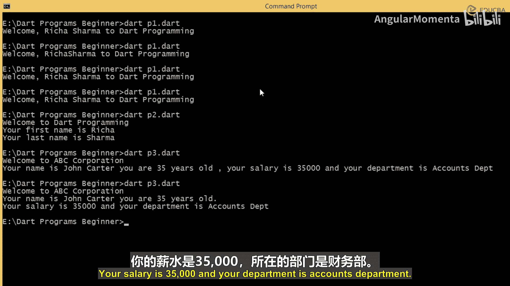

Using whatever commands you have learned are creating multiple print statements in that particular case。

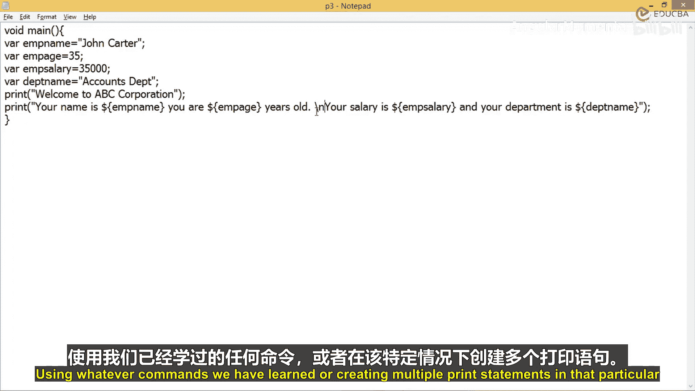