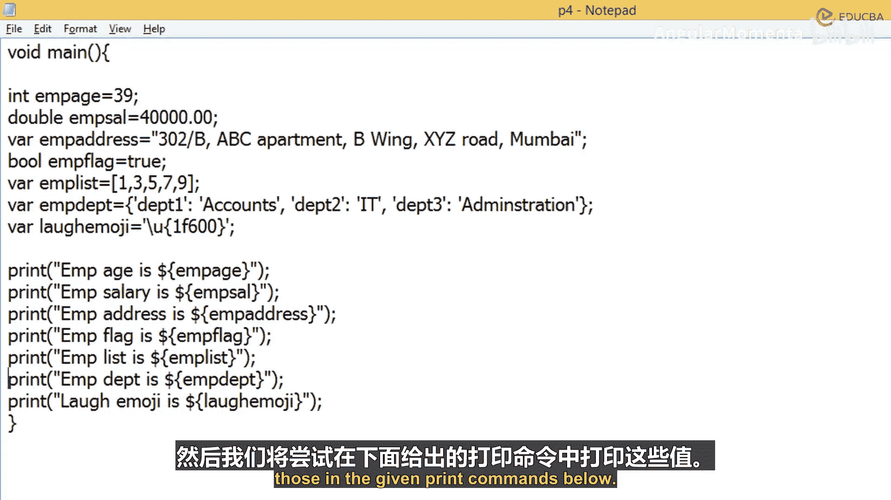
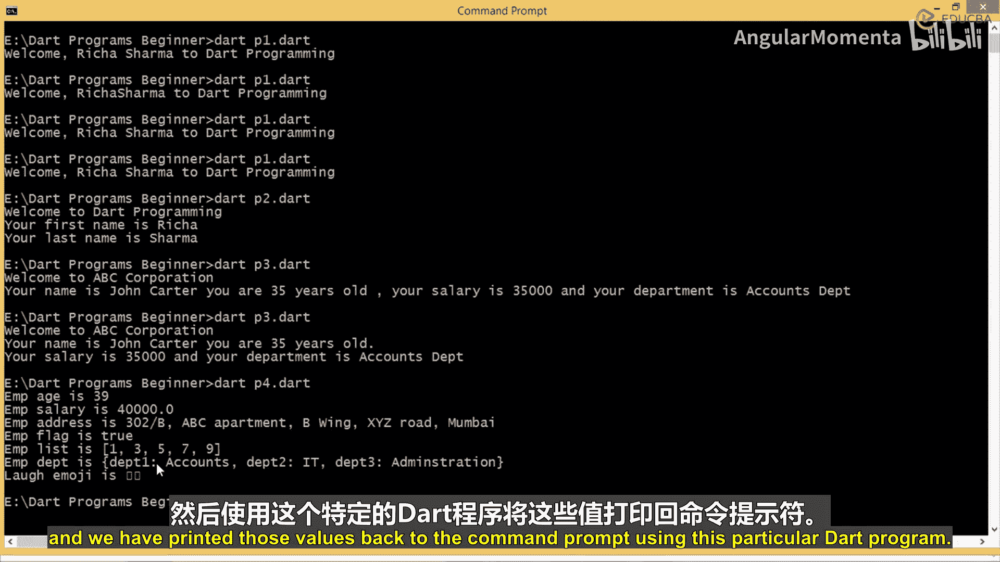

# 【EDUCBA】初学者应用Dart编程基础 ｜ Apply Dart Programming Fundamentals for Beginners p07 01_02_04_Dart变量续讲 -BV13bF1zcEwj_p7-

Then we go for the next keyN department2， and here we assign the value as a I T。 Then again。

 we create here department3。And then again， we give here a value。 and that is say。Administration。

 this is now we can create here a keyen value pair， which you can store the values there。

Now the next type of variable that we have now this is basically used to store some unicor code unit。

 Okay it could be a 32 bit unicor value which you can store Now， for example。

 we can basically use there， say we create hereer variable saying where。And see， love emoji。

And to store a smiley character。We use there to store a smiley character this two times or question mark that is basically used to represent a smiley emoji。

So sorting something like that， you can use this variable data type that is ruin data and data guide。

 Similarlyly， if you want to store some symbol there。

Then you can use there a variable or you can refer that particular object。

Create the operator by using the declaration using a hash and followed by the identifier name。

 Or for that matter， we can use here， say hash and create here， say symbol something like that。

 So we are creating their value of type symbol。 Now these are basically used if you want to use the Apis which refer to the identifiers by name。

 So there you can use this following type of data types。

 Now what we'll do is we will create a particular program， which would use all these variable types。

 We would store certain values and we would print those values using the print statement and then look at the output what it gives。

 So let's create a new file。Let's do one thing。Let's create another notepad。

 and we would start here by creating the main method and in this。

We would first create say in teacher E h， we would give here a value， say 39。

 we would create double E s， we would give here a value， say 40000。

00 just to identify it weor a double value there， then for this we use E address。

 and we store here some address say。B then AC。Apartment。Bing， say， X P head road Mumbai。

That is where we store the address， then we use here a EMP flag variable store there0。

 we create EMP list and we store there some values using a comma separated and in the square bracket。

Then we create the employee department and we give there a key that is a department one。

And they give the value for this， say accounts。Comma， then we have department  too。

And here we have say I T， then we have here we have department3。

 and here we have to the value of say administration。Then we create a where。Silna emoji。

 he stored there。Question mark。Symbols we don't create as of now we just stop create all these variables and now we simply in the print statement。

 we give here the variable names that is the print EP H S say dollar and we print E H。Now。

 similar to this。We write on the others， say EB。S sound salary is。

 and the name of the variable is A P Sam。Then， we have A。Adddres。And here we have the EMB。Addressses。

Then we have EMP。Llaag S。Say EP flag， then we have the EP list。So here we put E list S。

And then we have EMP department S the printerier EMP department。And finally， we have the AR。

 We have the。Now。Emoji。And print here。啲。Lo。Emogene this。F enough。

 now let us save this as P for thought that and let us try to execute。Now， before this， we have。

Some mistake here we have to use here like this， Savaf。😔，600 as the unicord character。

And here for this， we will have to use two or falses value。

 and then we will try to print those in the given print commands below。

 So let's go here and we will execute the。

Before statement， now， this is not displayed because it's on the command prompt and the emoji you won be display。

 but it is will display if you work on some separate IdeE。 and you execute there。

 you would get the output easily。So rest of the values are coming correct， we have the age。

 we have the salary coming in double the whole address with the commas。

 the slash everything is coming proper value of boolean is coming the list values which you have stored the map value which you have stored by giving a key value pair and the emoji value which you have stored you could get the list of these of all the symbol or the ruin type of values from the net and then you can see executing those on a separate IDdeE instead of the normal command prompt so that is where basically we have created variables and we have assigned values to the variables and we have printed those values back to the command prompt using this particular thatt program。

