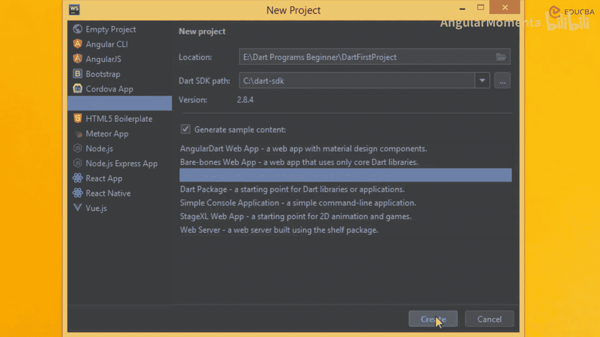
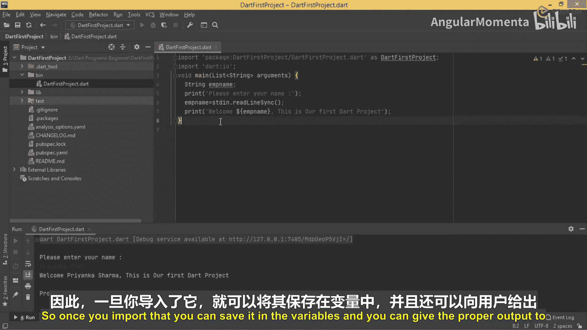

# 【EDUCBA】初学者应用Dart编程基础 ｜ Apply Dart Programming Fundamentals for Beginners p08 02_01_01_Dart 示例 -BV13bF1zcEwj_p8-

Now， let us start with the next part in this beginner level course。

 and now we would be using this webstr IdeE application for creating our tart project still now we were using Notepa and we were try executing those in command prompt So there are two different ways in which we can do it。

 One is we can use the given Ide。You can install them and directly create a dot project and add on how many ever files you want to add and then just quickly run those and seeing the same command prompt or else another way is creating it on notepad saving those and then go into your command prompts and executing the files through command prompts the one which we were doing till now So now we would start using this webstorm application which is the current version of the webstr is installed it is applicable on net you can easily download that and start using it so we would go for new project creation and here if this dot is not there then you will have to install that by going in the configuration。

So we will create the project in Eri dot programs beginner and the project name would be that first purchase。

We have to give here the path of the SDK， it will pi default pick up but if doesn not。

 then you will have to give the path and we are selecting here the console application that we want to create。

So then we can click on this create pattern and it would take some time for creating the project。

 adding all the default file which it gives us and one main dot file After that we can keep on adding that files and we can keep on executing n number of files from the project so there is no need of now shuffling between your notpa and your command prompt。

 it is very much easy if you use this webstrom application as such。

So let us create the project and then we would see how to create our first file over here。

So now it has created this and you can just verify that if you go to bin you get this first dark file。

 which is the same name as your project name。So now here we would start creating and whenever you execute you can see the command prompt is given below here onward give you the output as such。

 so there is no shuffling between two different softwares for executing a single datat application now what we would be doing is we will create a simple application or a project over here wherein we will create to accept the name from the user we will store that into the variable and we will print hello welcome to Dart project and we will print the value of name what has been inserted。

So for that， we will first have to use here another import statement。

 and here we will have to write down， say Dar。Colin， now this is。By default file， which is available。

 we are just using it over here and that dot Iio。苏。We import this particular dark packet。

 and now before we use this printprint command inside the main method。

 we will create a string variable， say。EP and now here we want to accept the value from the user。

 So we are going to say here EP name is equal to say standard in dot we use here， read line sync。

 and here we give。Dot。Or we just use the same method red line sync。

 So the value would be accepted there。 number four。

 we accept the value we have to give a message to the user。

 so we use a print command here and we see。Please， enter your name。

And then we asked to accept the value of name here。 And once we have done with that。

 then we again give a print command， say。Welcome and here we want to print so we will use here dollar in bracket the value of EP name say。

This is our。First。Data project。Lily close this here。So。

 that is how we have created a simple application first one wherein we are accepting the name of the user and we are printing the same back to the console。

Now， before executing this， you can see there is some。 it's not actually an error。

 It is just a warning。 It is saying use a double course for string only containing single course。

 So now what we can do is we can just replace this string with the single quotation marks。

 So you can see that warning has been disabled。 So before even executing your program。

 you can get to know if there are any errors over here。

 There is no need to execute the program and then find out where you have the errors unlike you do it in notpa。

So this basically gives you all only one shot。So now how we have to execute this。

 we will go to run here and we would say run or the shortcut key for that is all shift plus F time。

 So let us execute this and it will only execute the file which is currently we have working on or it will ask you over here so we can just select the file which you want to execute and that particular file would get debued it would get compiled and then we would get to see the output after it has been successfully compiled Now as there are no errors file compiled properly it ask me enter your name so we enter here say John。

She。We press enterom。 it says， welcome John C。 This is our first start project。 Now， suppose again。

 you execute this。Again， it will execute。 again， itll ask you name。 This time we enter， say。

Prianka Sherma， Now it prints。 welcome Prianka Shirma， This is our four start project。

 So now we are not giving any solid value for EP name in our program。

 What doing is we are keeping it dynamic。 So we are accepting it from the user storing that in the variable。

 which we have created using this standard input dot redline sync。 Now。

 the standard input this particular class is available in this iio package。

 hence we will have to import this。 For example， if I comment this。 I am getting here an error。

 It is saying undefined name standard in which means it is not able to find from where are you using this。

 So what is the option it is giving over your import library tart dot colon Iio。

 So hence I have commented this comment means it it won't be executed。

 Hence it is giving me the error。 But if I remove the comment， which means now I have imported this。

 So now the error would not be there。So， if you want to accept something or input output means basically avoid accepting something from the user and giving the output to the user。

 so for that you will have to use this Dar colon io package。So once you import that。

 you can save it in the variables and you can give the proper output to the users。

So this was a very simple one。