# 【EDUCBA】初学者应用Dart编程基础 ｜ Apply Dart Programming Fundamentals for Beginners p09 02_01_02_Dart 示例续篇 -BV13bF1zcEwj_p9-

Now， what we would do is we will have to create another file。

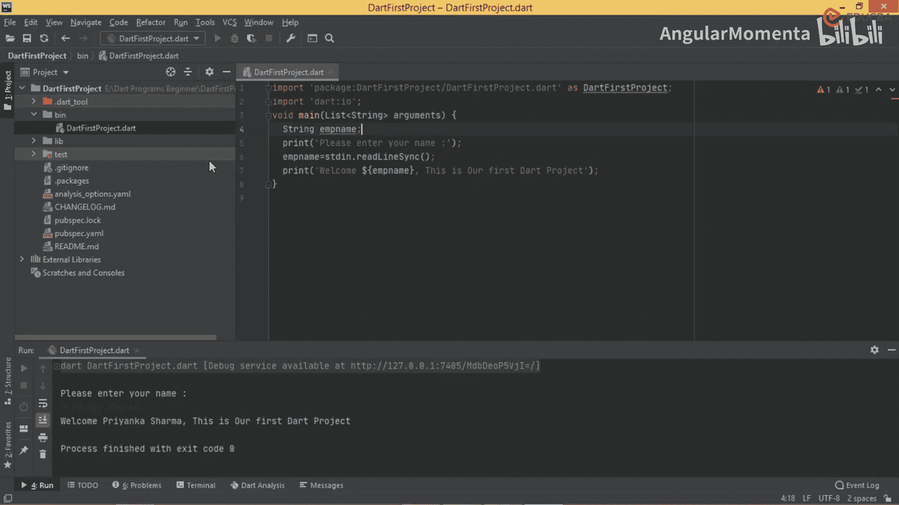

So let us create over here now。We will right click on this bin and say new Dart file。

 and we will give her a name， say second file。

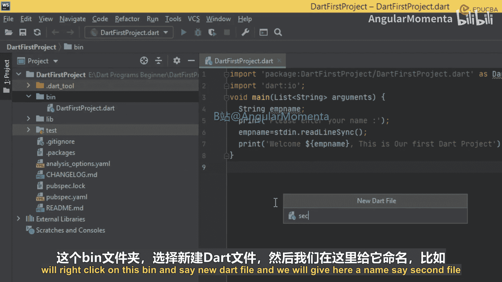

Pres enter， it will automatically create another file for us and give it to us。 Okay。

 so now here again， first thing we will have to do is say here。

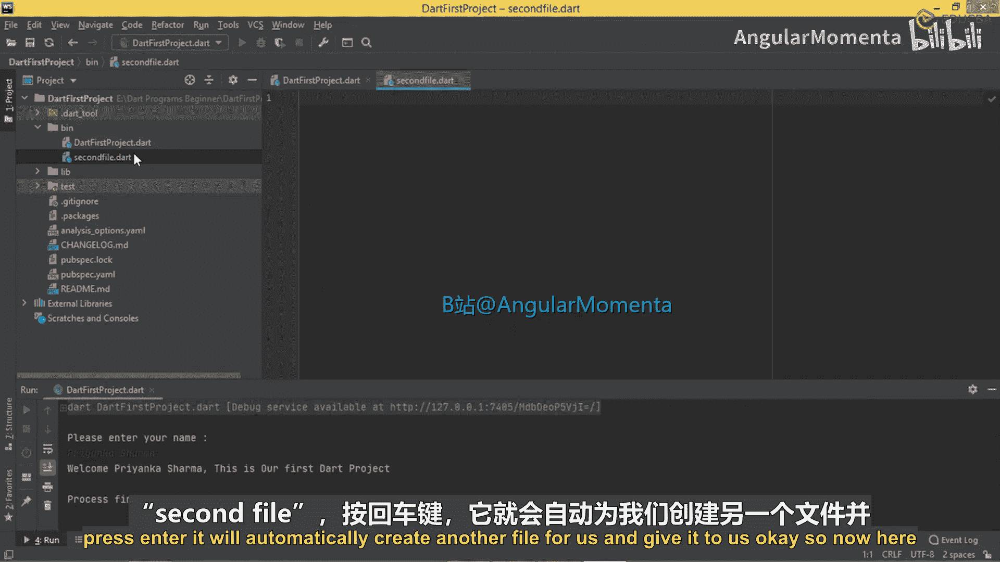

Import。Dat calling。Are you。And after that。We will create your void main。😔。

Open the brackets and in this now what we will do is we will create variables for accepting first name last name H salary。

 and then we will print the values， whatever the user has entered so we will have to also take their double variable integer variables and string variables。

 but there is a trick in doing this so first what we will do is we will create string variables for F name comma L name Also we will take it for E cell AM H。

And we will also take here integer variables for A sal int。

 We will also take here a double variable that is。EB。8 int， N E MPP cell， double。Now。

 what we would do is we would first give a print， say， say， please。Lets say， please enter your。First。

Name。And after that。We will accept the valuing F name by saying what SDD IN dot redline sync。

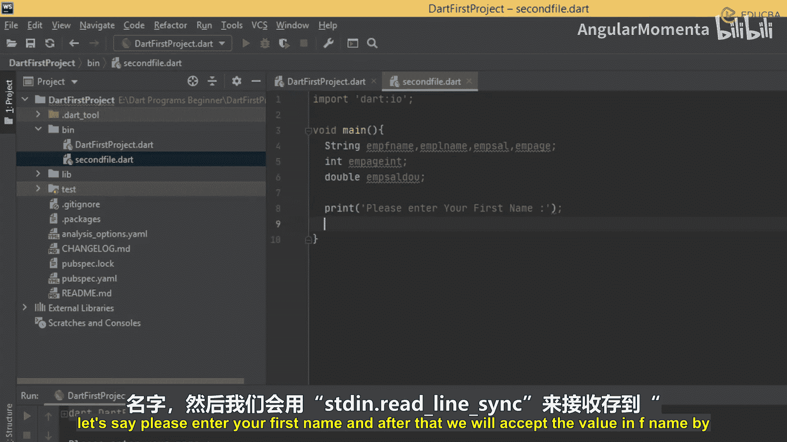

Now， similarly， we will give another message， say。Please。Enter。Last name。And then。Again。

 we will end this with the semicolon and now we will use AL name and again we will give standard N dot grid line sync。

 then we will give print。Say， please enter。8。And then we will save this first value in h sorry h which is of type string by here we would be saying read line sync。

 but now once we have saved that of type string there。

 what we would do is we would do here E H into variable is equal to we will say into dot pass and we would put here Eh。

 so now we are transferring the value of this string variable into integer variable by saying int dot pass。

So accepting would be in string types， storing it in a string variable initially and then passing it on to the integer variable by converting the value of this string type to integer。

 Similarlyly， the next thing we will have to do is we will say here， please enter。Salary。

And we will say here E sal is equal to STD ion dot red line sync。

Then we will give there again E s double is equal to again we will have to say now double dot parse value of E s。

 so till this we have created the variables， we have accepted the values of the variables and stored the values in the variable whatever the user have entered。

Now， let's proceed further。Yeah。So now what we would be doing is well have to print the values which are。

Sted into our variables。 So we will give here the print command， saying， say your。

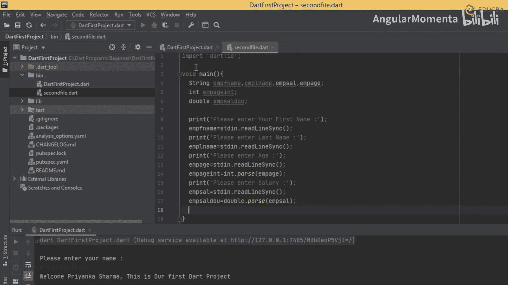

First。Name is。And we print here dollar and the value of EP。Hefn。Then we give another print command。

 and we say your。😔，Last。Name is weprint here using dollar， EP， and name。Then， we print。Say your。

Age is ho。Dollar and we print EV8 into variable here。Then。We will give here a print command。

 saying your。😔，Salary is。And weprint dollar and EP sell double。

 So now let us execute this second file that we have created。So let's go for this。And O， sorry。

 it has executed the same first file itself。What we will do is go to run。

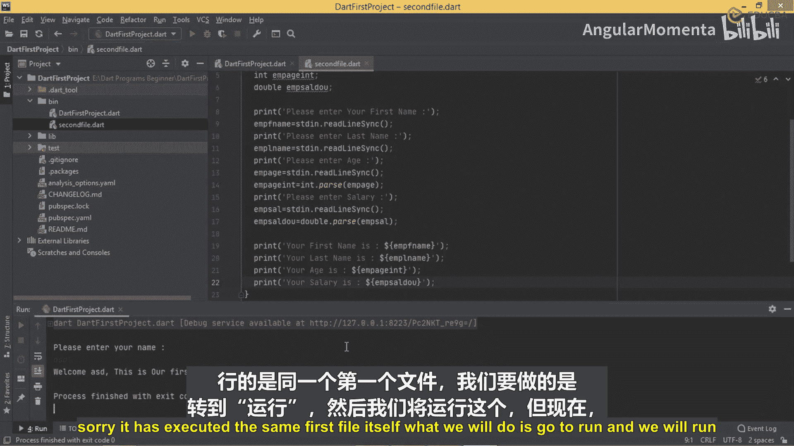

And。We will run this， but now。Okay' give one second。When we run this。It gives the second file do dot。

 So now the second file is executing and asked your first name。 Let's enter here， say。

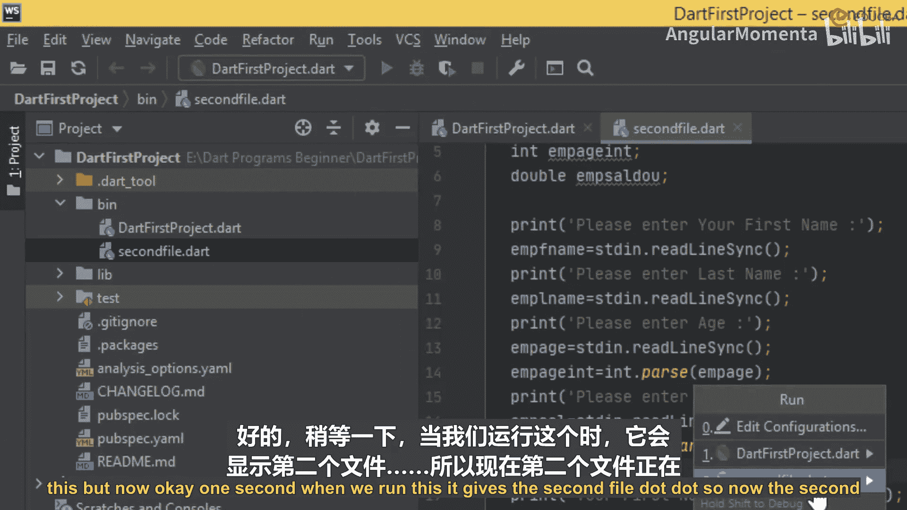

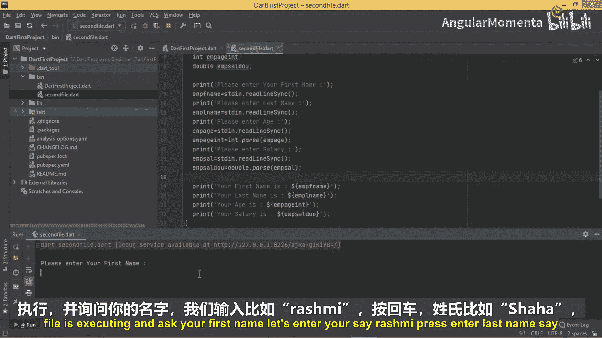

Rush me。Psentto last name， say。Sha， we enter the age， say 40， we enter the salary， say 45000。

 It gives us all the values back。 Your first name is Ru me， your last name is Shaha。

 your age is 40 and a salary is 45000。0 because this variable is a type double。

 So by default you will have a double precision inside your double variables。

 not for integer variables， right， so there is a trick while accepting the values of integers and doubles。

 or for that matter apart from strings， you can enter the values using this par method。

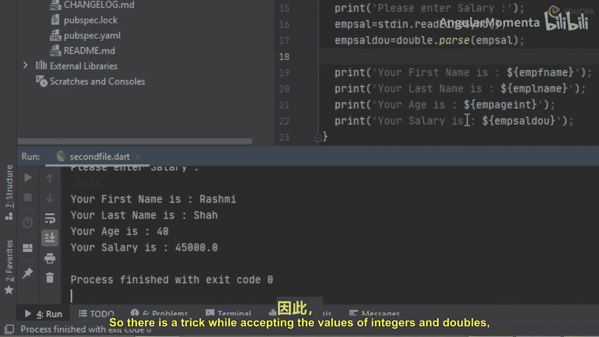

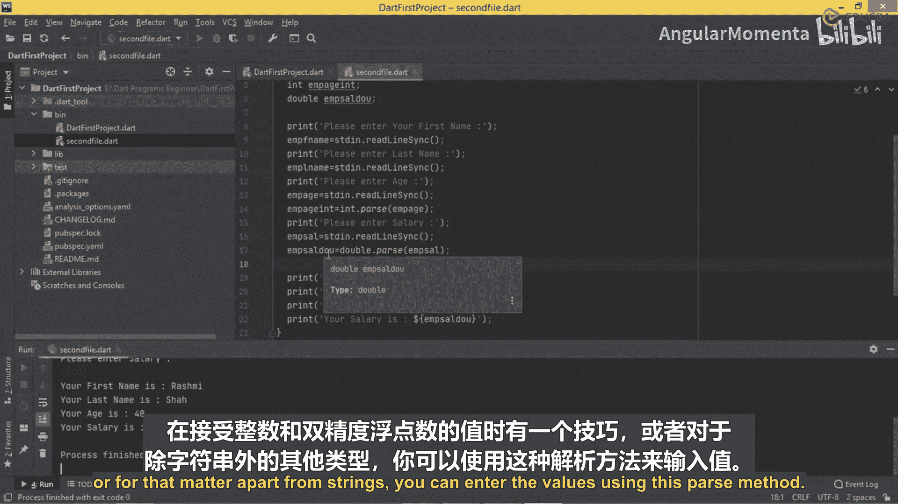

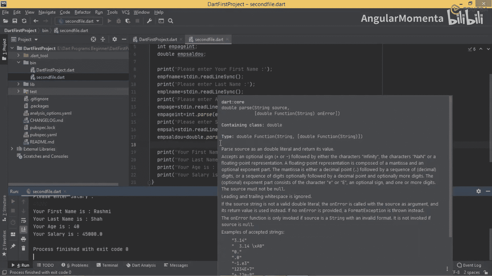

So that is how we have created the second file and now instead of giving some constant values over here or static values for the variables when we create toast now we can accept any value from the user store them in the variables and easily print or access those values back for the user as well so this was very much simple as compared to what we have done in the last sessions right。

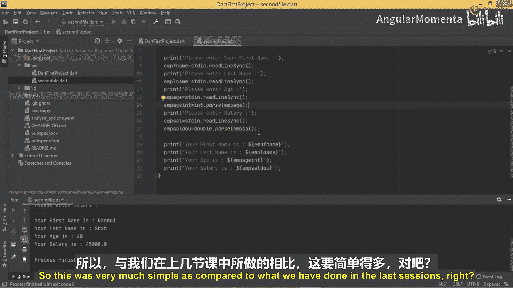