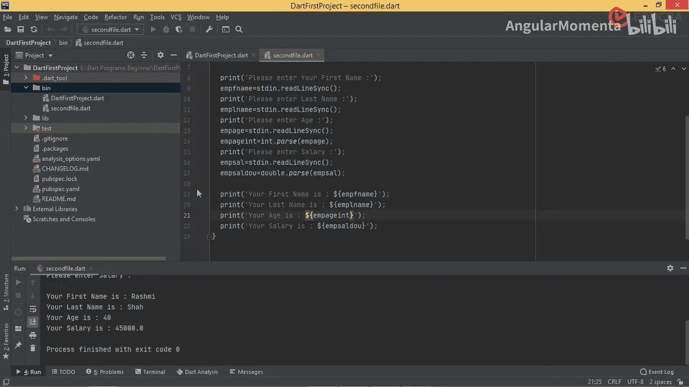
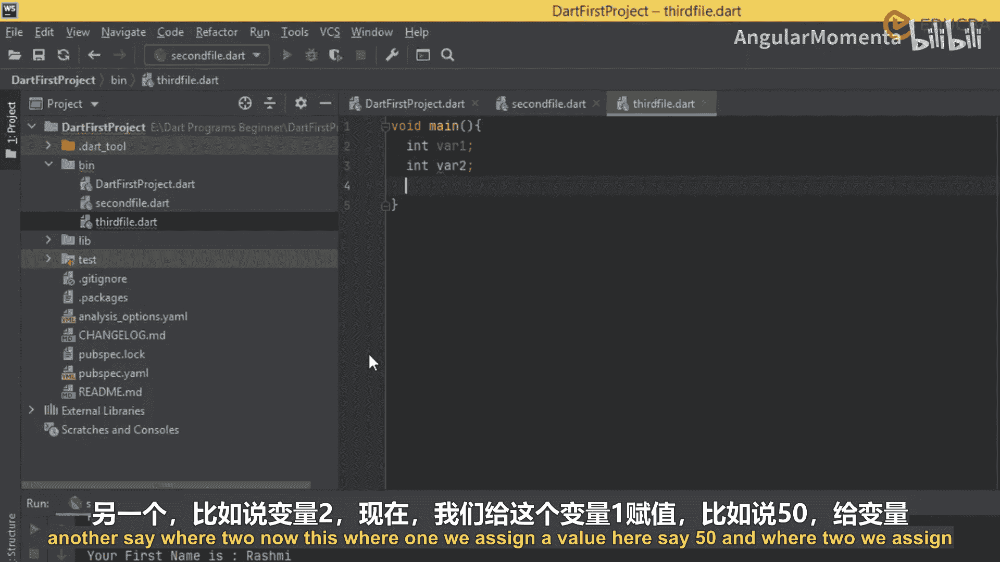
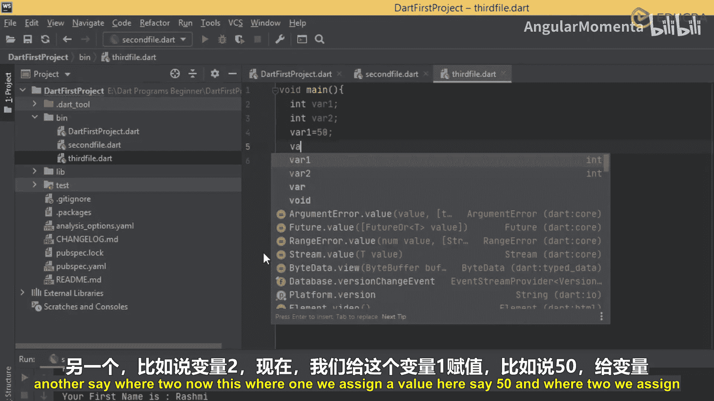
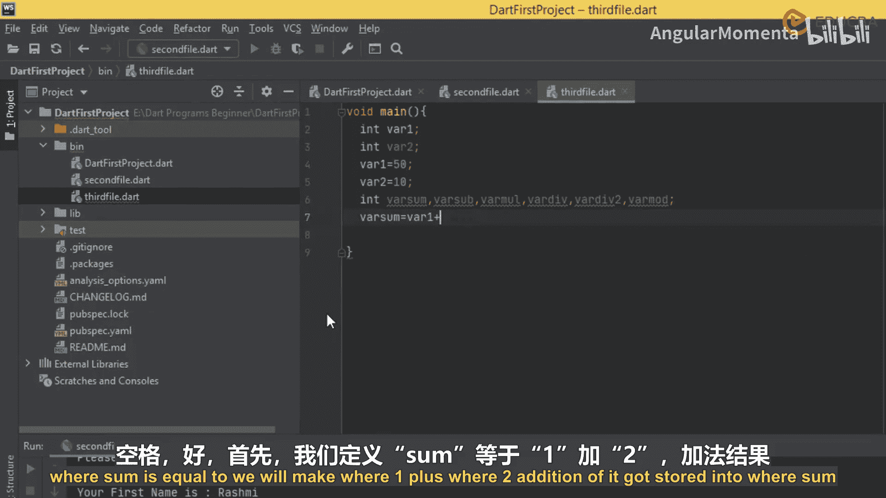
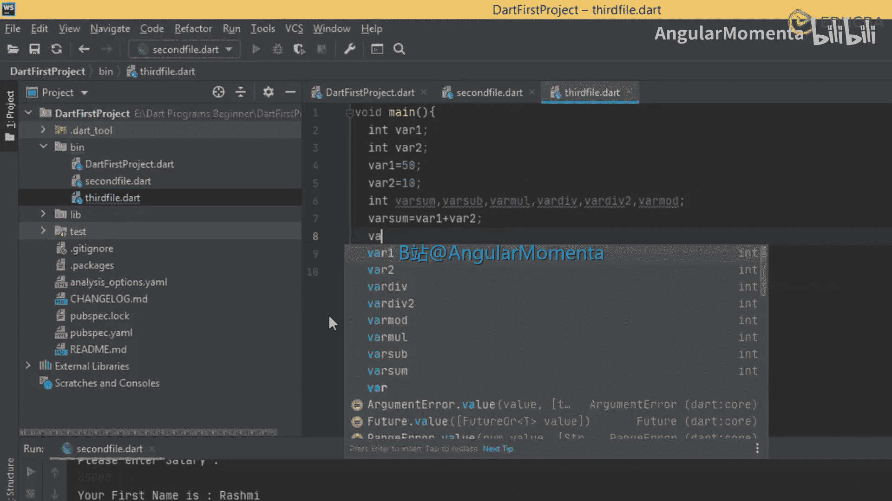
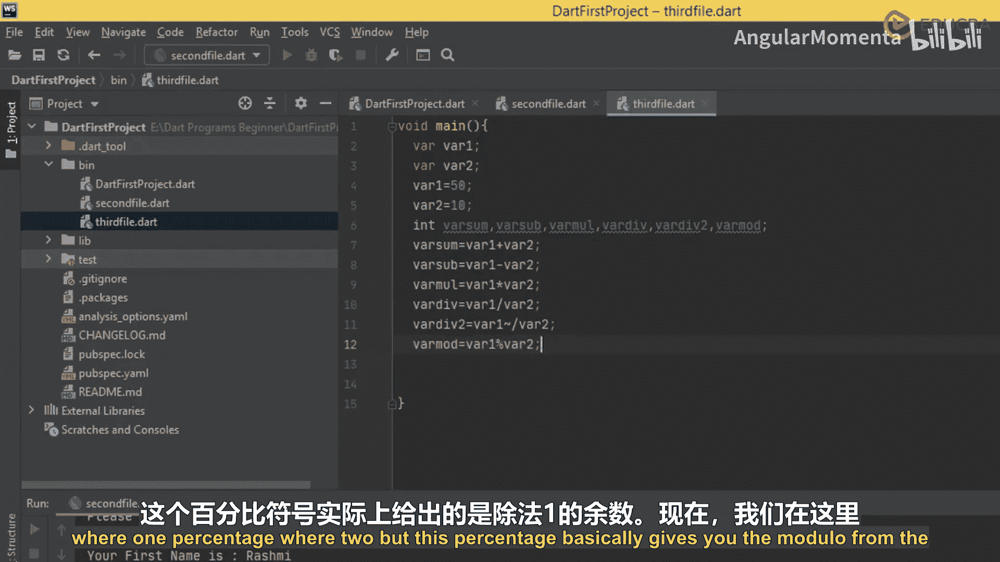
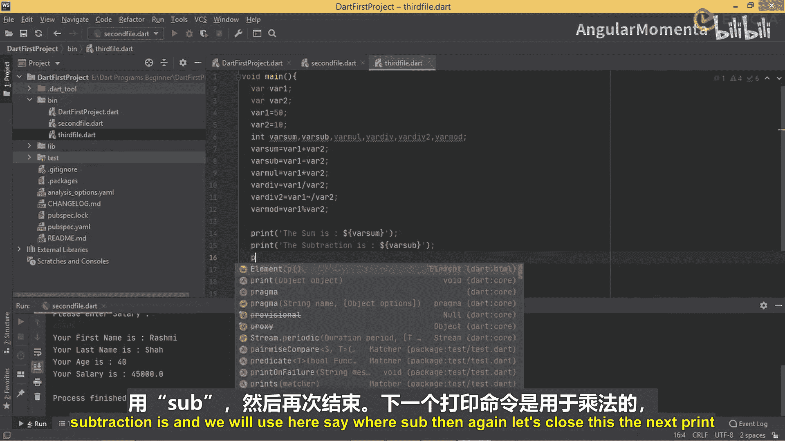
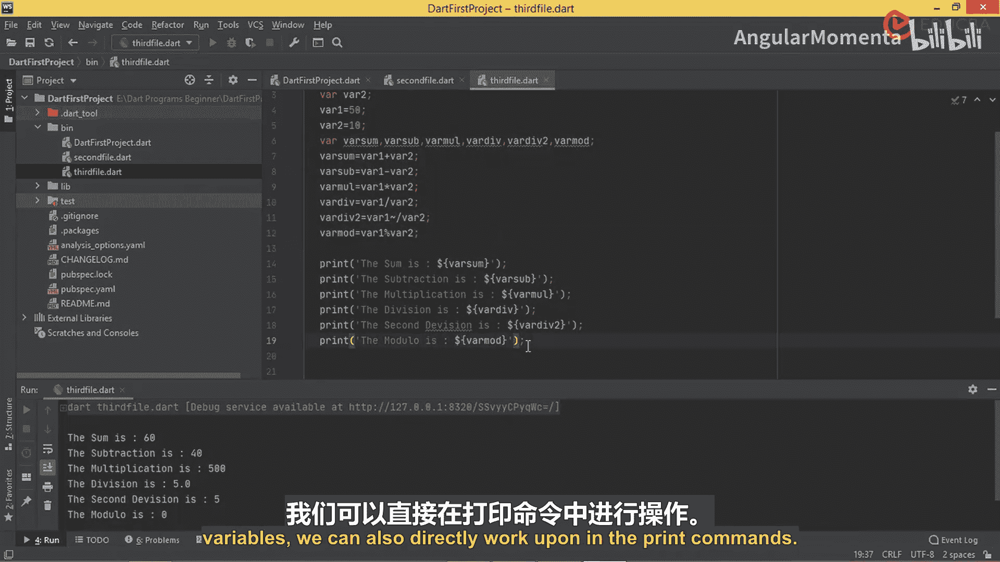

# 【EDUCBA】初学者应用Dart编程基础 ｜ Apply Dart Programming Fundamentals for Beginners p10 02_02_01_Dart运算符与算术运算入门 -BV13bF1zcEwj_p10-

Now let's start with the operators。 and in that we have the first operator。

 now which we would be looking at will be your arithmetic operator。

 now arithmetic operators as discussed， we are having a lot of subtypes in that in that the first thing we have is the plus which is basically for addition purpose we have minus for subtraction。

 we have the ExPr， which is basically the unary minus， or also we can call it as a negation operator。

 which will basically reverse the sign of the expression or example。

 if we are having a positive number， it can change it to negative negative number can be made it positive。

 we also have multiply， which is an asterisk。 We have a slash which is for divide。

 then we have there。Divide returning an integer result if you want so that you can have the operator similarly the next operator that we have is the percentage sign which is used basically for the getting the modo from the division in division we basically have two things we have the remainder we have the modo so to get the normal remainder you will use divide or for that if you want you have that sign with a division sign for getting a inte value also or also you have to get if the modo operator you can use it if you want to get the modo of the division and the next thing that we have is the plus plus operator which is basically used for in crementing part now what we would do is let us create one simple example wherein will take two variables and we would work on all these operators and produce the result and give it to the end user and then we would see some more examples on the same operator part。

What we would do is let's create a new dot file， let's give your name Sa third file。

And we will。Now， here， we won't import anything as we are making a simple example by passing the values then and there itself。

 So we take here end， say where a。As one variable or where one， we take another， say where2。

Now this where1， we assign a value here， say 50 and where2 we assign the value here as say 10。

And now we will give will create some more integer operators， say one we will create for where some。

 then we will create for where sub for subtract， so one in addition then subtraction。

 then where multiply， then well take where divide。Then we will take where divide2。😔。

And we also take where more。 fine。 Now what we would do is。There is no space here。 Okay。

 first thing is we would say where sum is equal to we will make where 1 plus where2 edition of it got stored into where some。

 Then we have sub which is subtraction。 So here we will use where 1 minus where 2。

When we will use multiply， we will say where one multiplied by where2， similarly for where division。

 we will use where one divide by where 2， these are all the normal operators which we have。

Wherein we are also using the division operator and trying to store the value there。AndNow。

 what we would do is it may be off type。Integer also， so let's create this of type variable。

 instead of giving integer values， and then we can work on this。 So we have worked with that。

 Then we have the second division operator that we were talking about。 That is the still design。

 and then you have this s。 and then you have say。Where to。

That is the another division operator which you have and for more will have where one percentage where to。

 but this percentage basically gives you the modulo from the division one。

 and now we will give here the print command saying the。

Some is。And we will use here dollar。In bracket， we will print where。Some。Similarly。

 we will give the next print command the subtraction。Is。😮，And we will use here， say where s。

Then again， let's close this。 The next print command we have is for multiplication。

 So we will give the。

Multiplication is。Use your dollar， save multiply。Similarly， we will use the next print command the。

Division。I。😮，And we will use here where division normal 1。 Then we will use here the next the。Second。

Division is， and we will use here the dollar s de2。😔，And the last one we have is the modo so the。

Modulular is。And printier where。Mother。So we are printing it also over here， let us save this。

 and now we will try to execute this， so let's go for run command and execute the thorough file there。

There is some arrow double is not a subtype of type in teacherjo。

Let's take this also of type where and。😔，Let's try and execute。😔。

So we have got this somewhere 60 for 50 plus 10， then you have the subtraction there。

 then you have the multiplication there， you have the division which gives you a normal double value。

 but the second one， if you use it gives you a whole number。

 So that is a difference where you want to use this till design and a division operator or a normal division operator。

And modulo gives you the remainder， so that is or gives you basically the modo not the remainder the remainder is what you get it from the normal division sign。

So that is how we can use this arithmetic operator。 This was a very simple example。

 but now what we would be doing is in the next example we will accept the value from the user and we would give the appropriate output back to the user and there is another way instead of creating all these variables and storing the values in the variables we can also directly work upon in the print commands let us see that also how can we do it so let's see one by one。

