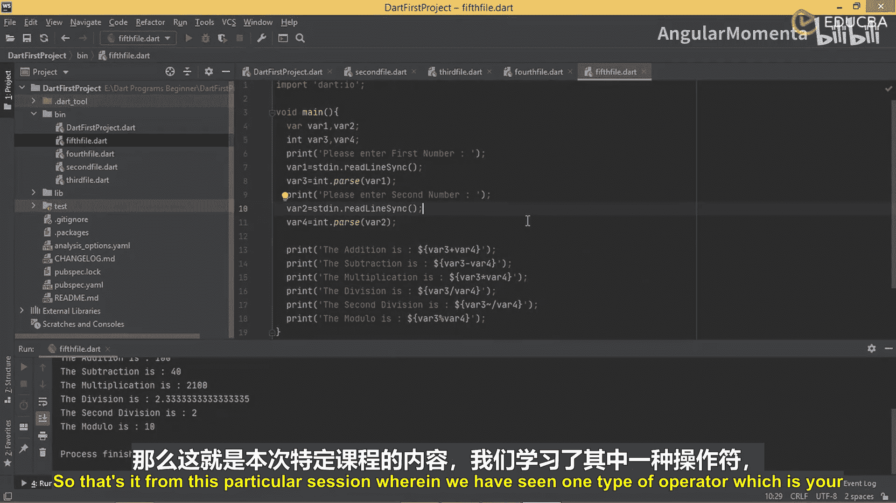

# 【EDUCBA】初学者应用Dart编程基础 ｜ Apply Dart Programming Fundamentals for Beginners p11 02_02_02_使用算术运算符进行计算 -BV13bF1zcEwj_p11-

So the first thing what we would do is let us add here a new dot file， and here we will name it。

 say fourth file。And here also， we will take void main。And we will take the where variables。

 say where1， where2， we will assign the values to where1， and we will assign the values to where2。

 Now， instead of creating those many variables and st the values in the variables and then is showing up in command。

 another simple statement would be， say here we are given in single course。We give here and say the。

Addition is colon and here we use dollar sign and we give where one plus where to。

This is a very simple one you don't need to store the variables anywhere。So similarly， here。

 we will give thee next， said thee。Subtraction is。And we use dollar in bracket where one minus where to。

😔，Close this here。 Okay， the next thing we will give here the。

Mulplication is whole dollar in bracket， where one multiplied by bare2。Similarly。

 the next print command， thee。Division is and will use your tall say where one divide by where to and another division operator also we will see So the second。

😔，Division is Poland US dollar， where one。Till the signs s， whereto。

And then we will use the next one day。Modulular is。And dollar where one percentage where two。

So now there is no need of creating those many variables and soing the values instead directly we can do it over here。

 so now if we try and run this fourth file over here。

 output would be the same because there is no difference as such what we have done only think the difference what we have done over here is instead of those many variables we have saved our time and created a very short program in that case。

So now the next thing that we would be doing is we would be creating a program for accepting the value from the user and giving the appropriate result to the user。

Okay， so let us create another new dot file。 and here we will name it say fifth file。 Now。

 here we will have to go for。Import that。Call in， a。

 because now we would require to accept the values from the user。

So inside this we will create a variable and let's take it where one and where two Now first thing is we will give a message to the user。

 say please enter first。Number， and then whatever the user enters， we say here。

 ST TD I dot read line sync。Similarly， then next， we will give a message please enter second number。

😔，And whatever the user enters， we say where two is equal to STD I dot red line sync。

 Then what do we do we say here print， say the。Addition。Yeah。Is and we use your dollar。In bracket。

 where one。Plus。Where to， Similarlyly， next， we do the。Subtraction is。See。We 1 minus where 2。

Then we give the next print command。😔，你。Mulipplication is。Holllen and Viprinter were one。

Multiply it by where to。The next thing is， we will print the。Division is。

And use here where one divide by ver to。 Then let's also use thee。Second。Division。

I and we lose again where one， but this time till signs s division to be given。Next。

 we will give thee。Modulo is。And dollar，7 percentage。😔，Where， let's save this。Subtraction。

So now let's go to run and execute the fifth file nowob。So it is asking me the first number。 Now。

 let us enter the first number as 70， second number as a 20。 Okay， some error over here。Addition。

What we'll have to do is。We have accepted the values over here。

 but now what we will do is we will take another variable。Sawhere。3 and where4。

 And after accepting this， we will do where3 is equal to say in dot。Pas， and we will give here。

Where one。Then similarly here we will do where 4 is equal to n dot pass where 2。😔，And now。

 let us try and execute this if this runs proper。Which one which did we execute。😔。

Ne to check5 finally， we want to execute。Okay， this one。So we enter say 70 C20。😔，Still。

 the edition it has given us， but it is not able to find out this。All right。 Let's check out this。

Myistake is well have to make this subtype in teacher and while we are doing this over here。

 we are only doing it with where one way do so that doesn't make any sense。

 we will take this three and4 here， so everywhere we will make this change quickly and then we will try to execute this now it should not have any errors because now we have handle everything。

So we have changed this。 and now let's run this fifth5。We enter 70。Tt the。See。

 we get the values Ed of this as00 subtracta comes to 40 multiplication comes to 2100 division is coming in a recursive number second division which is your normal since now this is 2。

3 it would by default make it to 2 and the modo comes to10 So that is how we get the values accept it from the user and then do it so this is another way。

 a proper way actually， because if you don't accept the value from the user then nothing of creating such programs in that。

 So only if you have to give some static value and execute those doesn't make any sense So this is how you could accept it from the user and it you could make it an un interactiveteractive one that the user enters the value for which he wants to execute a particular program and then accordingly the particular program gets executed。

So thats it from this particular session wherein we have seen one type of operator。

 which is your arithmetic operators。

