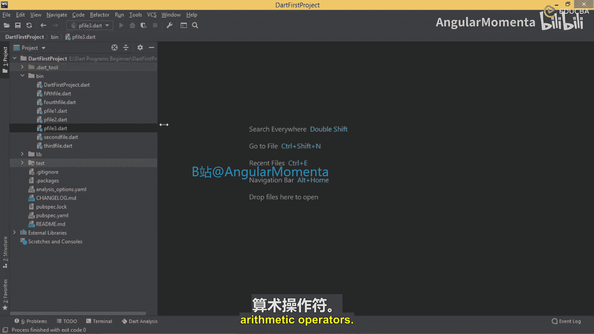
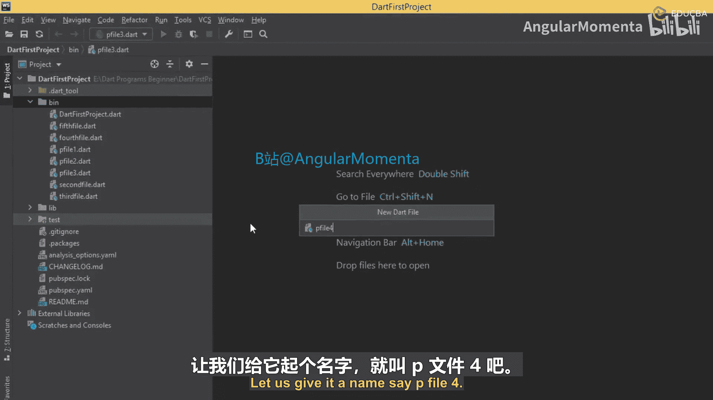
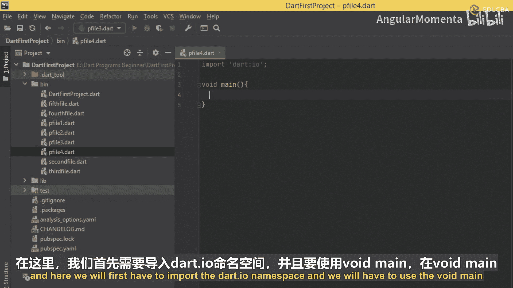
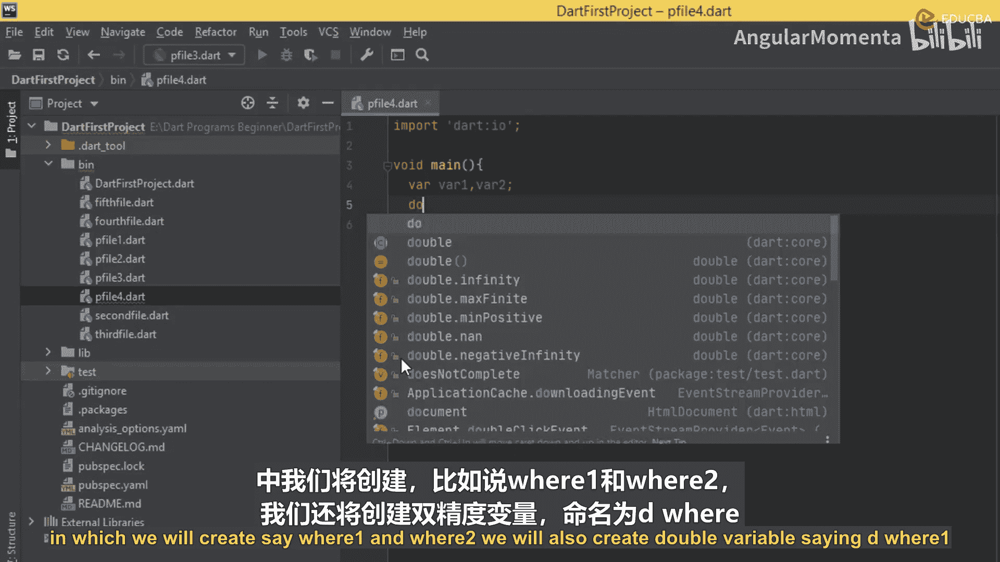
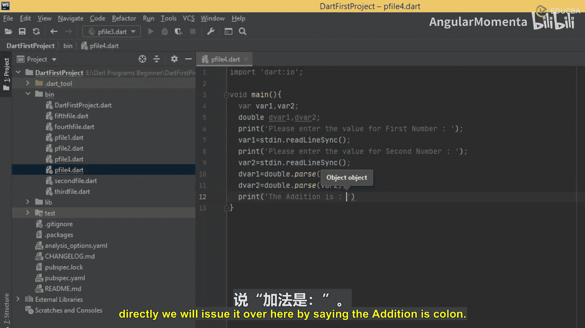
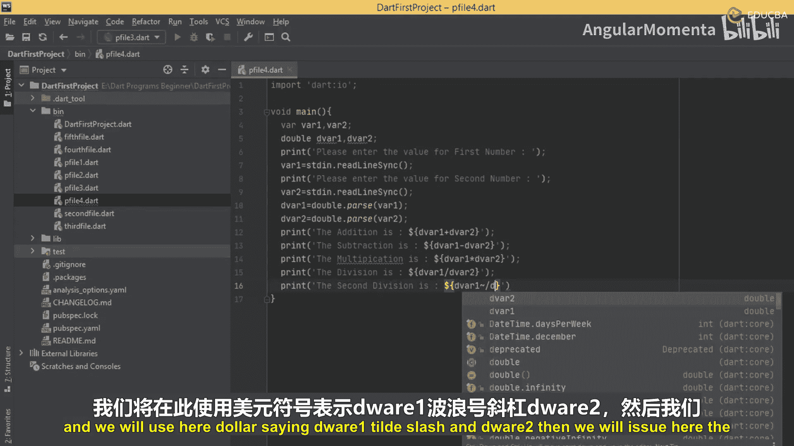
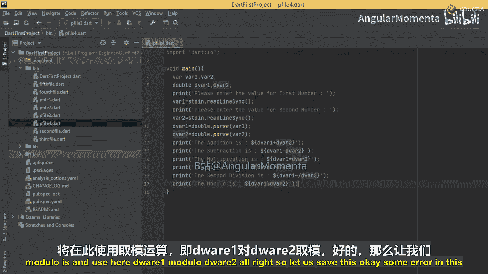
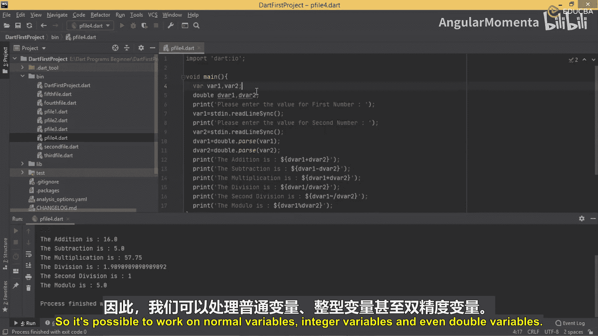

# 【EDUCBA】初学者应用Dart编程基础 ｜ Apply Dart Programming Fundamentals for Beginners p12 02_02_03_使用关系运算符比较数值 -BV13bF1zcEwj_p12-

Now we will also work on using double variables on normal arithmetic operators。

 so we have seen an arithmetic one working on or assigning the values to the variables there in the program itself and just using the operators and printing the results。

 also accepting values in the integer variables working on the arithmetic operators and printing the results。

 but now we will also work on double operators or double variables rather and work on the arithmetic operators。

So let us create here a new dot file， let us give it a name say P file 4 and here we will first have to import the dot dot ion name space and we will have to use the void main in which we will create say ver1 and where 2 we will also create double variable saying the ver1 the ver2 and we will first accept the value so here we will say please enter the value 4。

First number。And。We will accept it in where 1 by saying SD ion dot read line sync， Similarlyly。

 the next print command we will give， please enter the value for the second number and here we will accept it in where2 by saying STD ion dot read linecing Now we will say d where 1 is equal to double dot par the value of where1 Similarlyly d where 2 is equal to double dot par the value of where 2 so we have converted the values for into double and we have stored them in the double variable next instead of creating another result variable and storing it into the result then printing directly we will issue it over here by saying the。

Addition is colon， we will print here in dollar sign using D1 plus Deer 2。

Similarly， the next print command the。Subtraction is we use de 1 minus de 2。

 Then we will issue here the。Mulipplication is。Use here de were1。Multiplied by。We were to。

 Then we will issue here the。Division is。Colon， and we will use here the 1 First。

 we will use normal division。And then we will issue the another division that is the。Second division。

A colon， and we will use here dollar saying we were one till slash and we were two。

Then we will issue here the。Moulo is。And use here， we were one。Modulular de were 2。All right。

 so let us save this。😮。

I'll some other than this。Multiipplication。So， let us try and execute。Before file。

And now we will enter the value because we want to also subtract so so the first number we will enter say 52。

8 for example， second number we will enter a or lesser number say 12。6 for example。

So here you see everywhere we get it in double format addition。Subtraction， multiplication division。

 second division would be automatically a whole hour because it it gives you the integer value and then comes the modo。

 Now， for example， suppose while running this program， say you give some exact values like， say。10。

5 and 5。5 wherein it is expected you get exact results。

 but as we have taken the variables of type double you will get it 00。

 even if you don't have any decimal there or the decimal value is not available but still since it is a double value you will get their 00 print wherever it is you will get the numbers wherever it is not you would get their 00 printer so that is how we can work on the arithmetic operators even on double variables So it is possible to work on normal variables in teacher variables and even double variable。

