# 【EDUCBA】初学者应用Dart编程基础 ｜ Apply Dart Programming Fundamentals for Beginners p13 02_02_04_运用逻辑运算符进行决策 -BV13bF1zcEwj_p13-

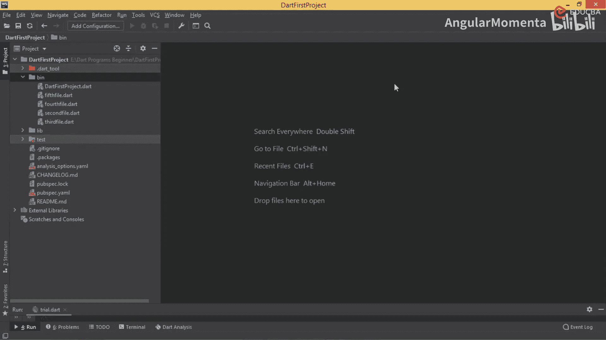

Now， let us continue with the next type of operators that we have in that。 So first of all。

 we will create here or that file and let us create here say。

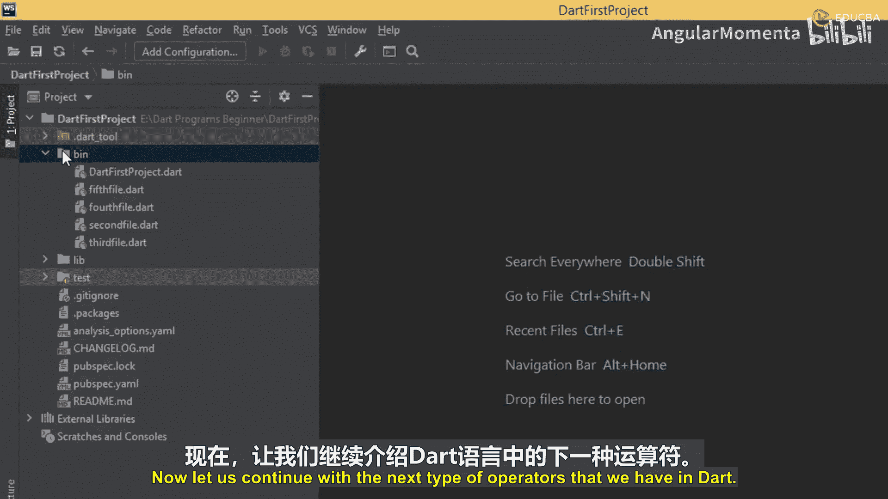

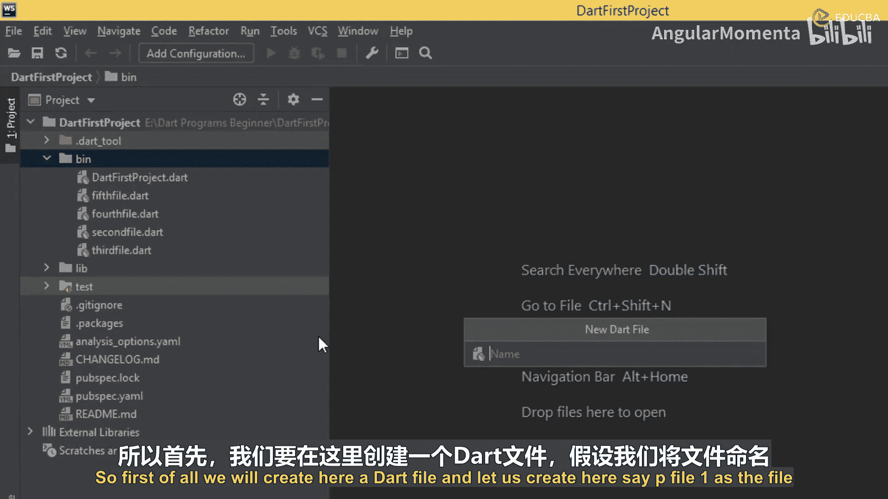

P file1 as the file name and before actually creating a program we would understand what are these operators first of all。

 So the next type of operator that we would be looking over here is the Dar assignment operators Now when the word says assignment operator Okay so assignment operator normally in our minds we have is an is equal to sign which is basically。

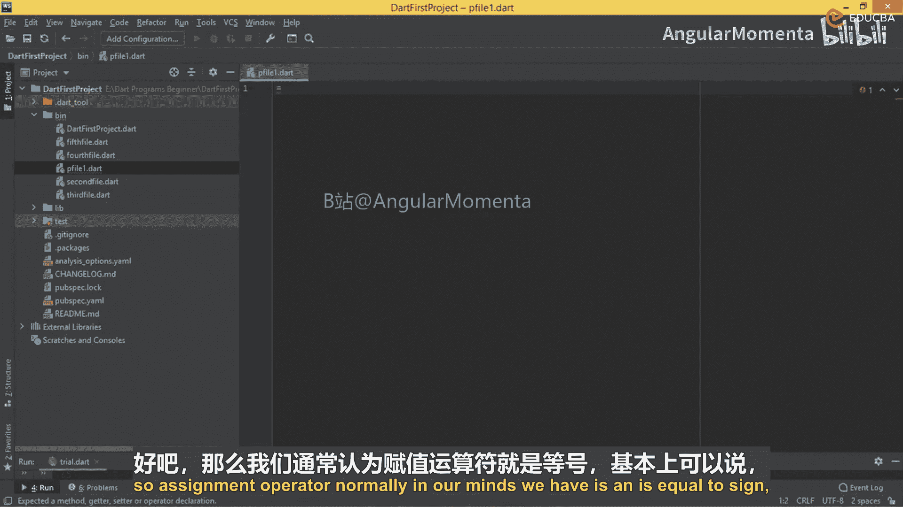

Say， for example， we are creating a void main method。

And here we are creating a variable and we are assigning here some value。 So in this case。

 this is equal to is for us an assignment operator。

 but apart from just and simple is equal to sign we also have barriers kind of assignment operators and those are。

 for instance， we create another variable。 and here we want to say number one。Or for that matter。

 we give here。Numbto is equal to 40， and we say。Numb 2 is equal to number 2 plus 50。

 So what are we doing here， we are trying to assign plus。40 plus 50 in the same variable， num2。 Now。

 the same equation over here could be written as num2 plus is equal to 50。

 which means that this equation is equal to。难度。iss equal to basically nu2 is equal to nu 2 plus 50。

 So you write it in this particular manner or in this particular manner using the arithmetic assignment operator that is plus is equal to So only not just is equal to but using an arithmetic operator with that is also making you a another kind of operator that is your assignment operator So there are various kind of assignment operator out of which first we have looked at a simple assignment operator which is an is equal to sign you also have here something like double question mark is equal to which basically will assign a value in the variable which you have created only if you have the value as null not other than that。

Then we have the next assignment operator as we have looked out as add assignment operator。

 so it is add and is equal to。Now similar to add is equal to we have also minus is equal to which works something like nu2 is equal to nu2 minus 10。

 for example， or we can write it nu2 minus is equal to 10 similar to subtract assignment operator。

 we also have multiply。Assignment operator。 what else you would have a divide。Assignment operator。

So we would look at one example which would allow us to create all these or to use all these operators and create a particular program there。

😊。

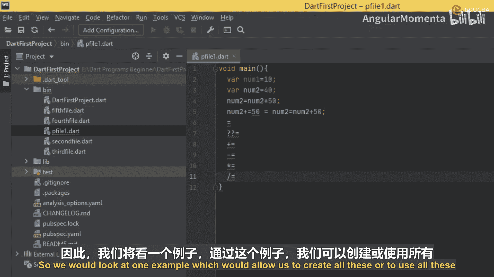

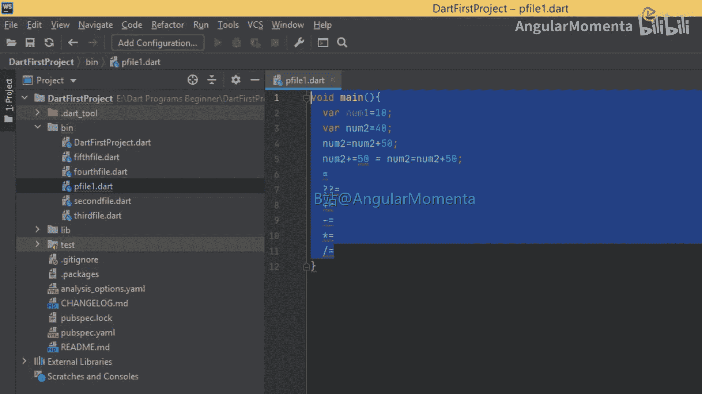

So let us start by creating this void main first of all。

 and the first thing that we would be doing is。Now here we won't be accepting any value from the user we would be creating variables。

 assigning the values in the same program and printing the result using the arithmetic assignment operators so for that we will start by creating the variables first saying in number1 and number2 and we will assign the values in number2 let's give say 50 in number1 let's give 50 and number2 let's give 40。

Now， we will first say number1 plus is equal to number2。So。

 we are basically saying nu 1 is equal to nu 1 plus nu 2， so we want to add both the operators there。

That is what we want to do so after doing this we will use a print command and we will say the value of say number1 plus is equal to nu2 is colon and here we will print dollar the value of number because that is what the value of number1 is now assigned to right similarly we will say number1 minus is equal to number2 and then again here we will issue a print command saying the value of number1 minus is equal to number2 is colon and we will print here the value of number1 again then we use number1 now this time we are going to use multiply is equal to number2 and we are going to give here a print command in single courses we will say the value of number1 multiply is equal to number2 is and here we will print dollar。

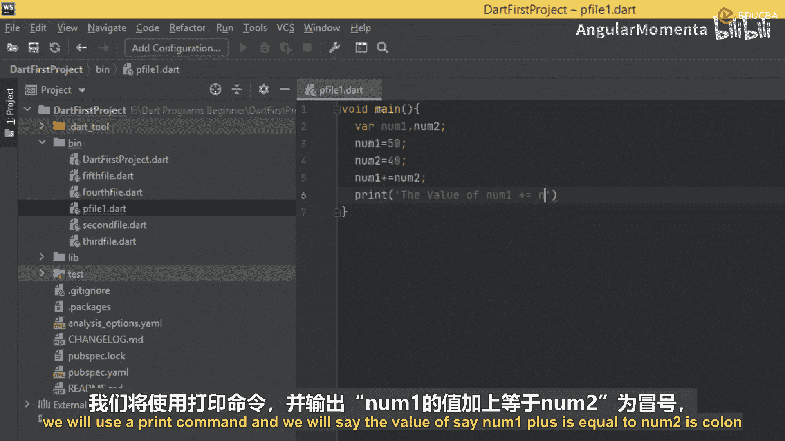

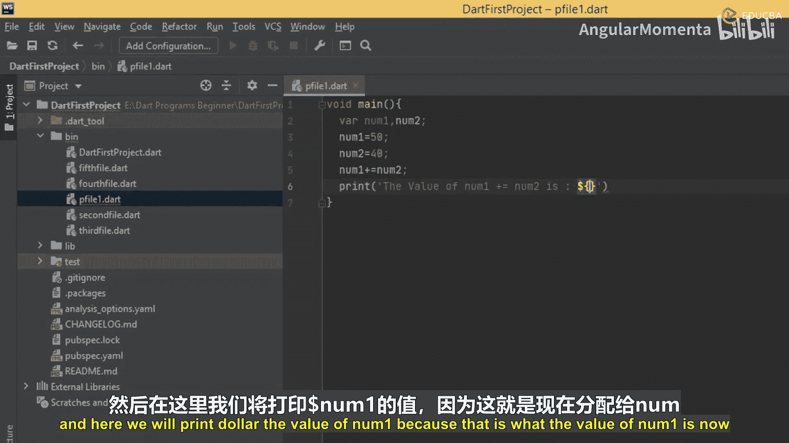

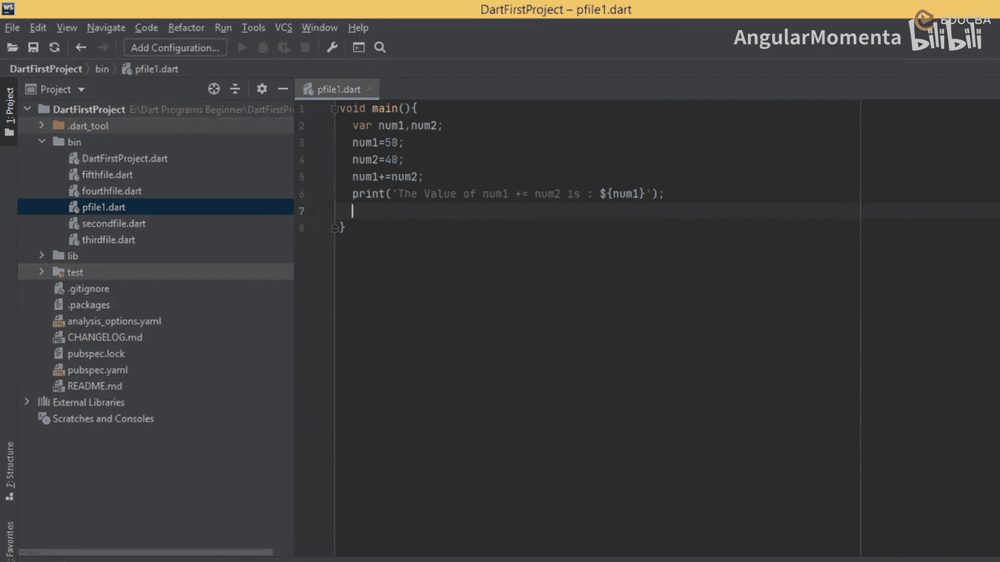

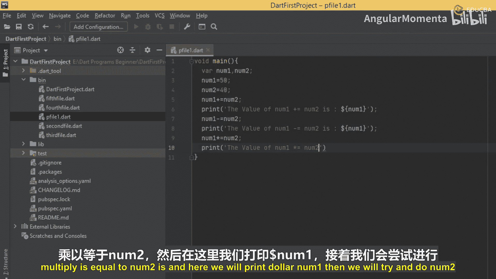

Number。Then we will try and do Namtu。Divide is equal to nu2。

 and then we will try to print here in the print command the value of nu 1。

Using the division operator is equal to nu 2 s。And will print here dollar， the value of。numb one。

And what remains number1 we say modulo is equal to nu2。So we'll finally print this also。

 saying the value of。Numb1 modo is equal to number 2。Is and print your dollar number。So。

 we are done with this call a simple one where we are not accepting anything from the user。

 simply creating the variables assigning values here and trying to print the values using the print command。

😊，So we will try and execute this and we will run this p file 1 do dot and let us see what is the output here。

 see value of number1 plus is equal to number2 comes to 90 because 40 plus 50 comes to 90 similarly minus will come to because now what are you doing what was the earlier value of number now it was 90。

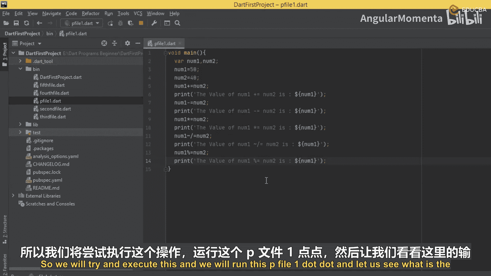

Now 90 minus if you do 40 it will again become 50。 So now the value in number one is 50。

 then we are trying to multiply 50 by 40 so that it comes to。2000。

 then we try to divide it so it comes back to 50 and then we try to get the mod wave of it it comes to 10。

 So you have to every time remember what is the value of number one because number one is what getting changed over here。

 every time we try to use the arithmetic assignment operator over here Now just to make your concept clear。

 after we have printed this we will before that or rather we will give here print command。

 say the value of number one is print here number one。And。Value of num2 is print here。

 The value of nu2。This we will do every time before we issue this print command so that it is clear for us what is the actual value of number and then what is we are getting after executing it。

So now let us try and debug this。See， now it easy for you to understand value of number one is 90 value of nu2 is 40。

 Hence it is coming 90 here。 value of number one is 50 value of number2 remain same 40。

 So now if you try to do 90 minus40 youre getting 50 Similarlyly now you try to do 50 multiplied by 40 you get 2000。

 you try to divide this 2000 by 40 you get the value 50。 you try to get the quotient of this。

 then you try to get the value as 10 that is how it is basically executing itself。

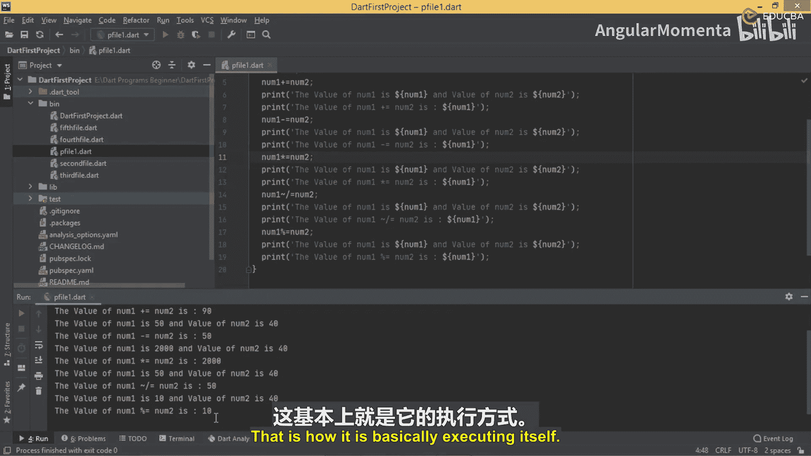