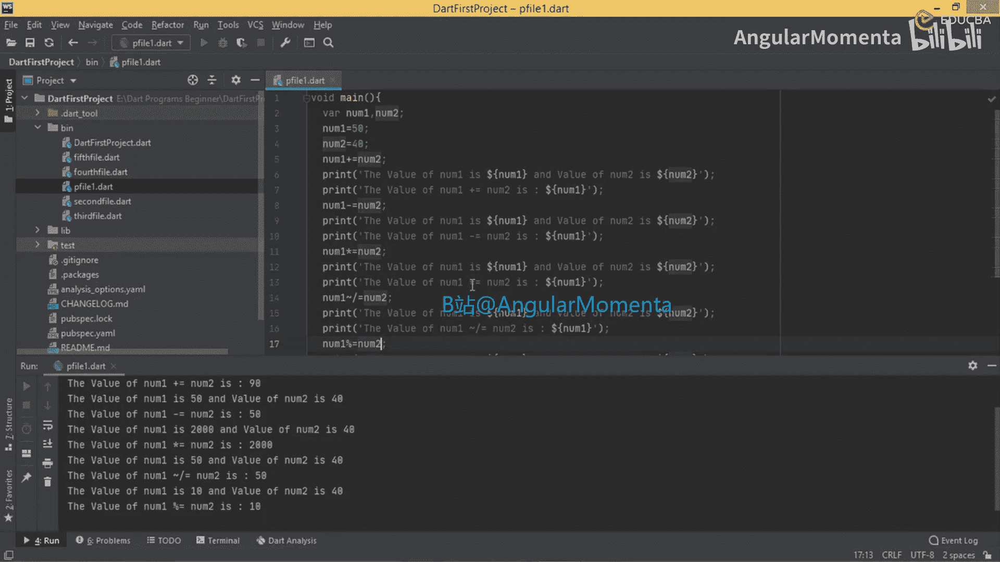
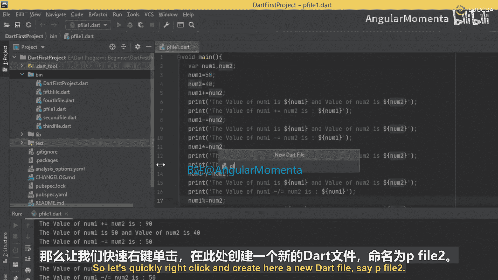
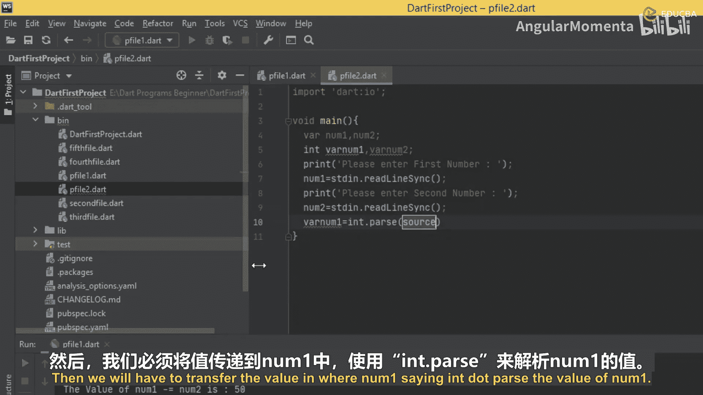
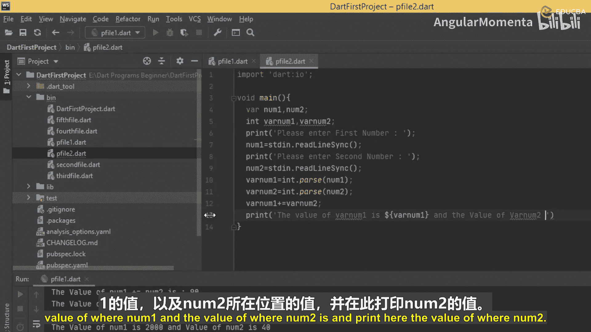
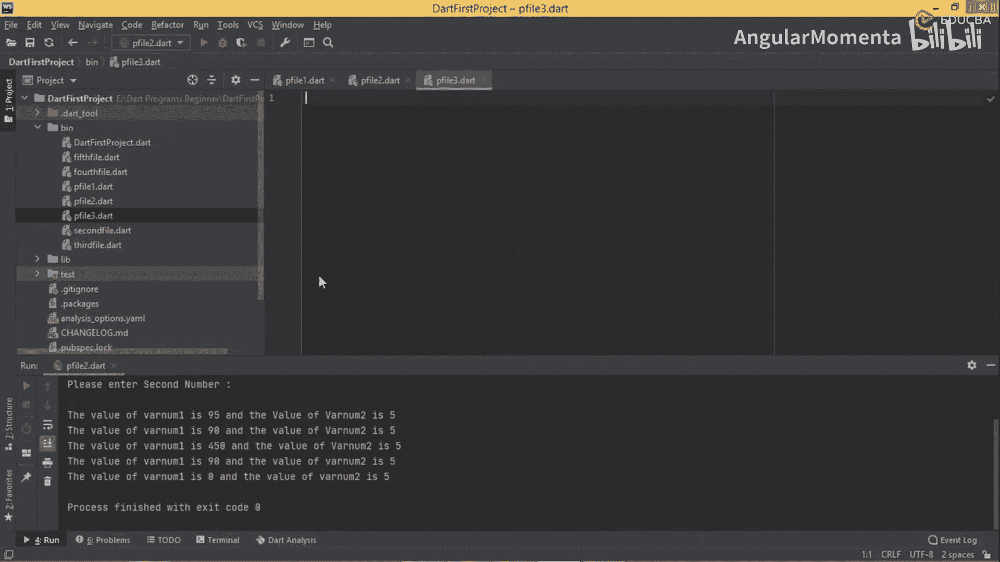
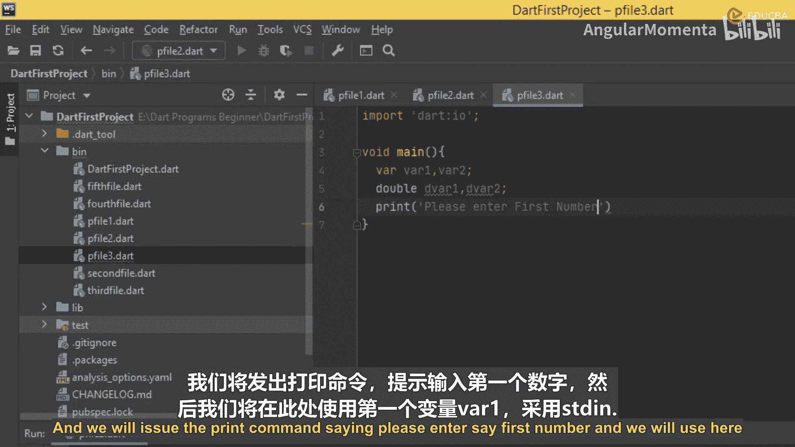
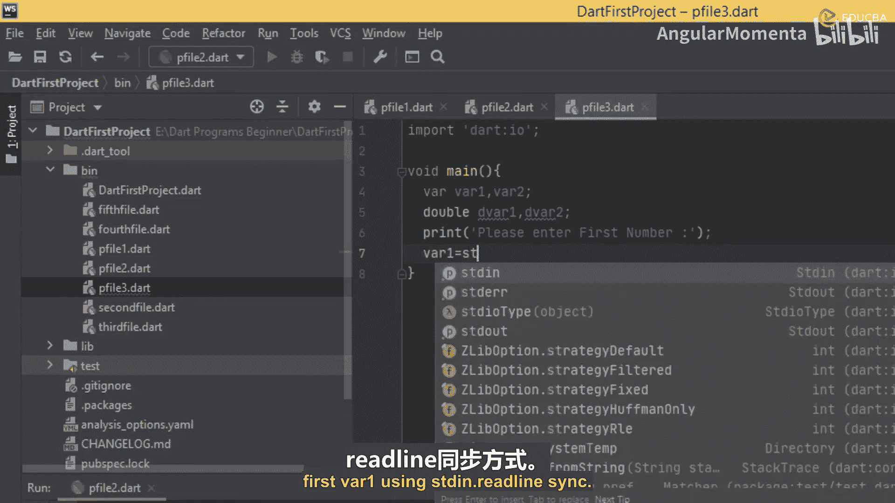
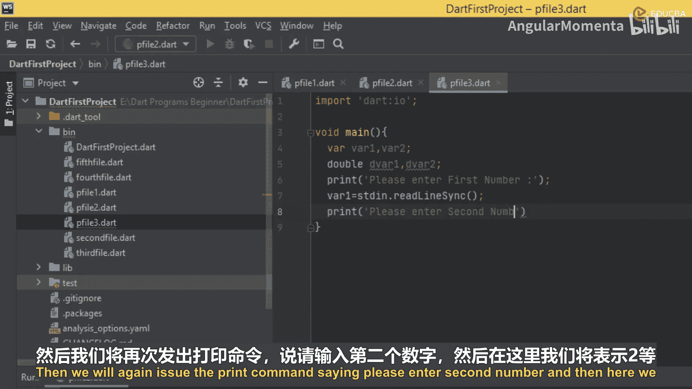
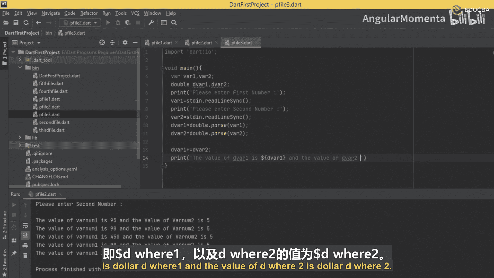
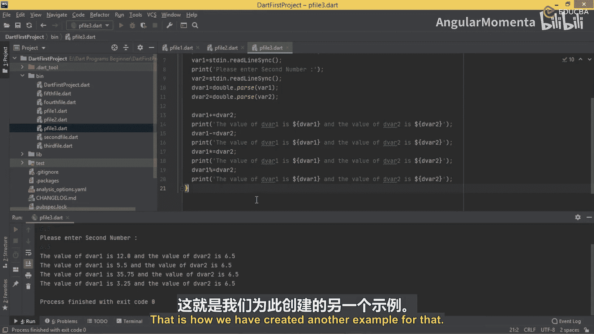

# 【EDUCBA】初学者应用Dart编程基础 ｜ Apply Dart Programming Fundamentals for Beginners p14 02_03_01_理解相等与比较运算符 -BV13bF1zcEwj_p14-

Now what we will do is we will create another program where we will use all the same operators。

 all the same statements but we will accept the value from the user for what 42 variables that is number1 and number two and then we will try to operate on both the variables using all the assignment operators so lets quickly right click and create here a new dot file C file to and here as we want to perform an input output we will have to import thatt dot I name space and then we will have to start with the main method here。

In this， we will first create variable num1 nu 2， and we will also take integer verm and we will take integer veram 2。

Now， after this， we will issue a print command， and we will say。Please。En。First。Number colon。

 and we will accept the value in number by saying ST D I dot read line， sync。

 Then we'll again issue a print command saying， please enter。Second number。And now we will use nu2。

 we will give STD ion and red line sync， then we will have to transfer the value in where number1 saying in dot par the value of nu1 similarly where number 2 is equal to in dot par the value of nu2 here and once this is done then we will work on using where number 1 plus is equal to where nu 2。

 and this time we will issue the print command saying the value of where number 1 is print here the value of where number 1。

And the。Value of。We number2 is and print here the value of ver number2 this much statement would be insufficient because then we are also trying to print the value of verm again that we don't have to repeat that statement again。

Then the next thing we will do is we will say ver number 1 minus is equal to ver number 2。And again。

 we will issue the print command seeing the value of。Where number one is print here。In brackets。

 ver number one and the value of。Where number 2 is。Again， print here the valley of ver number2。

 then we try to do ver number 1 multiply is equal to ver number 2 and again issue the same print command。

Value of where number one is。We print here We number one and the value of。Where number two is。

We print here the value of verm 2。 Now， once we have done with this multiply。

 what remains is division and modulo。 So we come to verm 1， we say divide is equal to verm 2。

And ver number 1， we use modo is equal to veram 2。 in between this， we just issue a print command。

 saying the。Value of。Where number one is。We print here the value of ver number one and the value。

Of Vietnam 2 is。We print the value of verm  too。 And then here we give the print， saying the。Value。

Of where number one is again。Print here。 The first variable。And the value of。

Where number2 is we print here。왜南度。Let us save it and now let us try to execute this P file too。

So now we enter it say 90 and 5。 So when now1 becomes 95 because we are trying to add 90 plus 95 then we again try to subtract from 955 so again it becomes 90 Now we try to do 90 multiplied by 5 we get 450 Now we try to do 450 divided by 5 we get 90。

 we try to get the modulo of this this is exactly divisible hence we get the remainder as0。

 So that is how we have now accepted the value from the user So every time if you enter a new value it would calculate according to the value what you have entered in the number and number2 variables on the print statement Now let us do one more variation in this let us create another dot file CP file3 dot not need to give the extension it automatically give we'll also give here the import statement。

Dot dot I O， and we will create。Vid main method。 And now we will try to work on the variables using double variables we have seen working on integer variables We also see working on double variables。

 So here， what are we supposed to do， we will create the variables。

 say ver 1 and where 2 we also take here instead of integer the double variables， say D were 1 and。

Dware to。 and we will issue the print command， saying， please enter。Say， first。😔，Number and。

We will use here first veron using STD iron do red line sync。

 Then we will again issue the print command， saying。

Please， enter。Second number。

And then here we willll say where2 is equal to STD I dot read line thing。

 Now we will try to transfer in the double variable saying double dot parse and we will pass here where 1 for parsing similarly we willll say D were2 is equal to double dot parse where2。

 So now we have converted the value into double for where1 ver2 and stored them in the double variable。

 So now what are we supposed to do， we will say d where 1 plus equal to d where 2。

 and we will use here a print command saying the。Value of。Dware1， let's give it as it is is。

Dollar de1 and。The value of。They were too。I。

Dollar。D were2， lets end it and then we will try and do will just3 to four operators de where1 minus is equal to。

De were to。 So similarly here， we will issue thee。Value of de where one is。

We will use here dollar and E1。And then well say here and the value of thever2 is and will print your dollar and div2。

梳。Letters。Save time by just putting here Multiply is equal to。Divide is equal to and also。

The next thing we will try down over here， and that is。Say， modo is equal。Why is this coming。

 Let us just check。Well have to divide it with an integer， so we will not try out this。

 Let us remove this， because for division， you have to have an whole number for dividing it。

So okay for that， we will try on all the other operators and we will try to run this P3 now。

And we will enter say 5。5 and say 6。5。So 5。5 plus 6。5 it becomes 12 and 6。

5 again you subtract it becomes 5。5 then you try to multiply it becomes 35。

75 you try to modulate it and get the remainder that comes to 3。

25 so you can work on these assignment operators not just on normal variables not just on normal inte variables even on your double variables that is how we have created another example for that。

