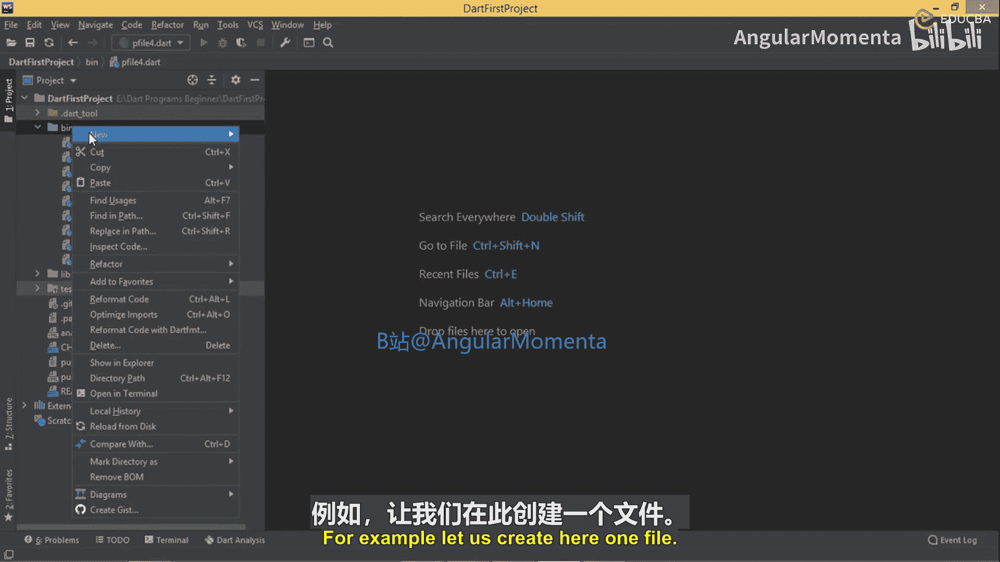
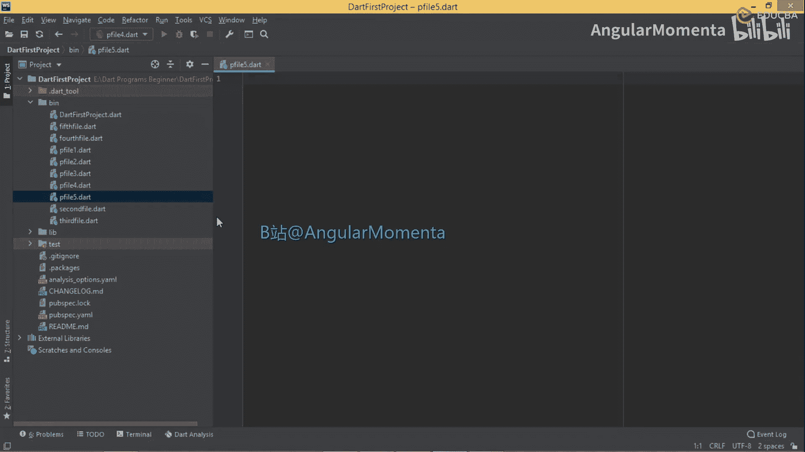
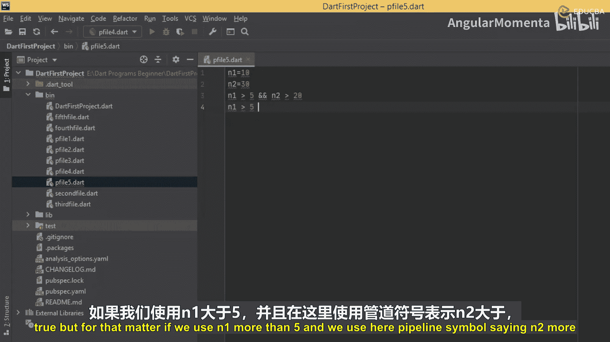
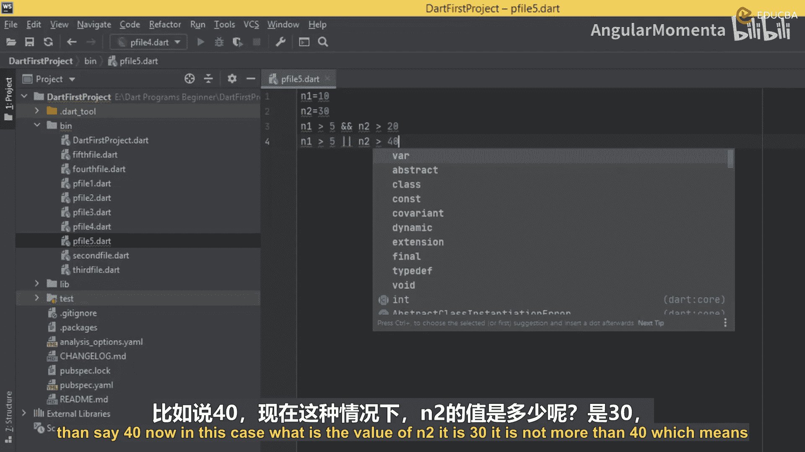
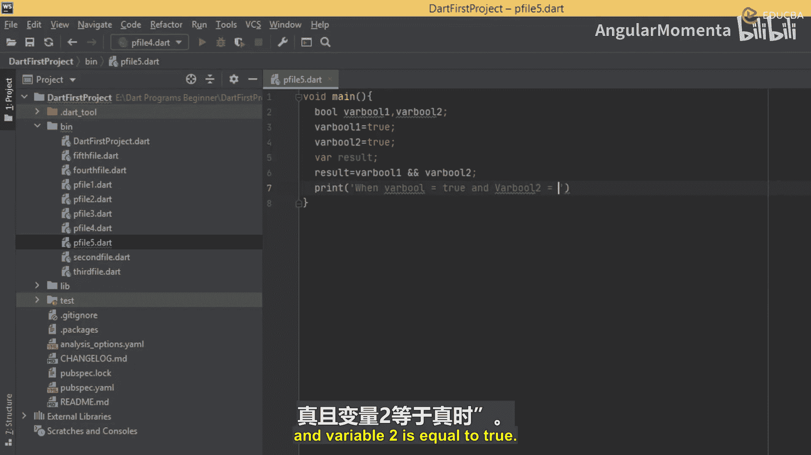
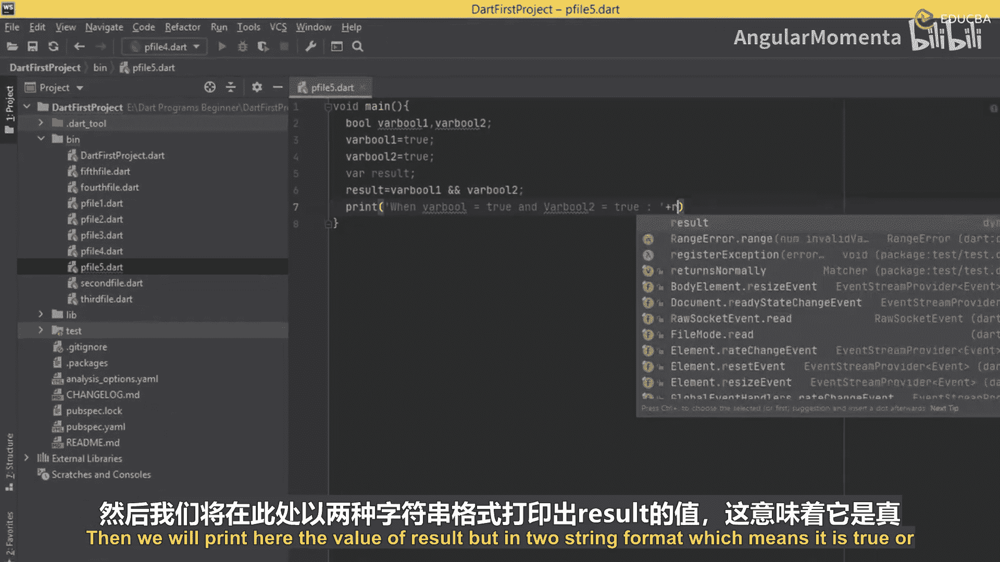
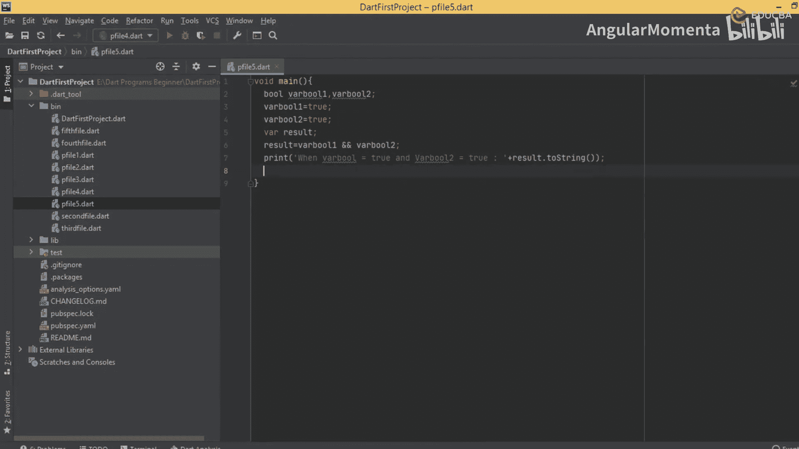
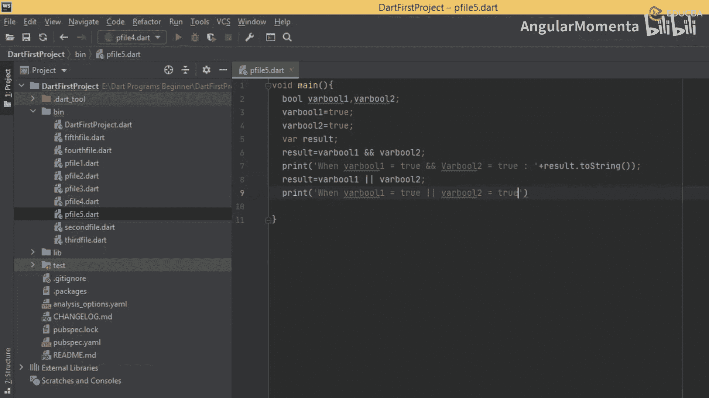
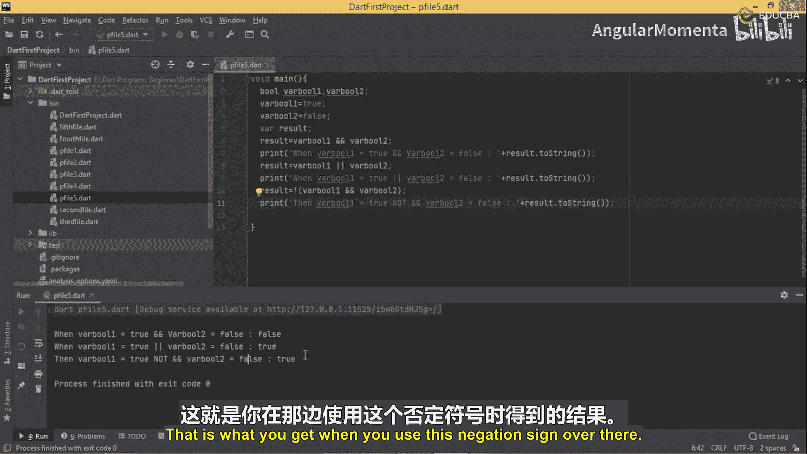

# 【EDUCBA】初学者应用Dart编程基础 ｜ Apply Dart Programming Fundamentals for Beginners p15 02_03_02_使用递增与递减运算符 -BV13bF1zcEwj_p15-

Now we will work on the next set of operators， which we have， and that is our logical operators。 Now。

 logical operators， as the word says logical means a combination of certain expressions。

 we using some statement or conditional statements So for example。

 we have and or and not are basically your logical operators。 how this basically operate for example。

 let us create here1 file let's create it as P file say5 Now， for example。

 we are saying something like say n1 is equal to 10。 assume this n2 is equal to say 30。

 We are just setting it to assume what are we giving the values for Now。

 if we say n1 is more than say5 and we use here and we say N2 is more than 20。 Now。

 if we use this particular statement using this and operator it means that over here。

 N1 should be more than。

5And N2 should be more than 20 to come the whole expression to become positive。Like， for example。

 if n1 is not more than 5， but n2 is more than 20， the whole expression will evaluate two falses。

 or for that matter， if n1 is more than 5， but n2 is not more than 20， again。

 the whole expression becomes false。 So when you use and operator both the expressions given before and operator and the after and operator。

 both expressions should come to true so that the whole expression comes to true but for that matter if we use n1 more than 5 and we use here pipeline symbol。

 saying N2 more than say 40 Now in this case， what is the value of n2 it is 30 it is not more than 40。

 which means this will come to false。 but N1 is 1 to 10 is more than5 So this is coming to true。

 So one expression is false， one expression is true。 but since we have used here or operator。

 it means either either expression 1 has to be true。

Or expression2 has to be true to get the whole expression to be true。 So only if， for example。

 we say here if n1 more than 15， which is not and n2 more than 40 which is not in this case。

 the whole expression will come to false because both the given expressions are false in that。

Whereasin and both have to be true if anyone is false， whole expression becomes false。Similarly。

 the next operator， which is not， for example， we use here， say not in bracket n1 is more than。Ffe。😡。

Here it will reverse it。 like if it is more than 5， it will make it false。

 or if it is not more than 5， it will make it true。 So whatever the value you have of the expression。

 if you use this negation sign， it is basically not so negative。 If it is positive， make it negative。

 if it is negative， make it positive。 That is what is your logical expressions all about。

ological operators we can say all about so now what we will do is we will create a program wherein we assign some boolean values and we will try to get the output as we have discussed it over here。

 so in the same program now we are not accepting any value from the user we are simply doing it over here by creating the bo variable say whereable1 and the next variable variableable2 then we will assign here verable 1 becomes true similarly verable2 becomes also true so both we have given the value true in this case we also take here a result variable and here we say result is equal to。

Wearable one。And verable， too。 So here we have used and operator。

 which means both have to be either true or both have to be either false。 And now。

 if we try to print it over here， saying。😡，We give here， say when。Wherearable is equal to。True， and。

Varable2 is equal to true， then we will print here the value of result button to string format。

 which means it is true or false。

Or rather than this and here， we will use this and operator。

 So the next thing we will try here is result is equal to。

Whereable one。Or。Varable 2。 and here we will use， say when variableable1。

here also is equal to true or variableable2 is equal to true。

Then we use here result dot to string again， and then we will try result is equal to we use n。

 and then we will say verable1 and。Varable 2。And then here we will print again， say when。

Varable1 is equal to true。😔，Say not。And。Is what we have used is equal to true。

Then we'll try to print here n plus result dot2 string。

A simple one just to print the values by what we have already assigned it。

Let's execute P file and here what we get both are true， true， both are true， still true。

 Now we will just try to make it one false。And now we will try to get the output of the file 5。 Now。

 you can see if it is true。It is coming false。This is true。 This us sorry。

 we have printed this wrong Vaable。 One is true。 Vaable true is false。This is false。

Let's execute it again。This is true， This is false， so the result comes to false First is true。

 but second is false， but any one of it is true， so the result comes to true。 and when this is true。

 this is false it comes to true because a whole is coming to false。

 so false will negate it will make it true。That is how it is negating the thing。

 whatever the value you actually get， just do a reverse of the particular value or the opposite of the particular value that is what you get when you use this negation sign over there。

😊。

