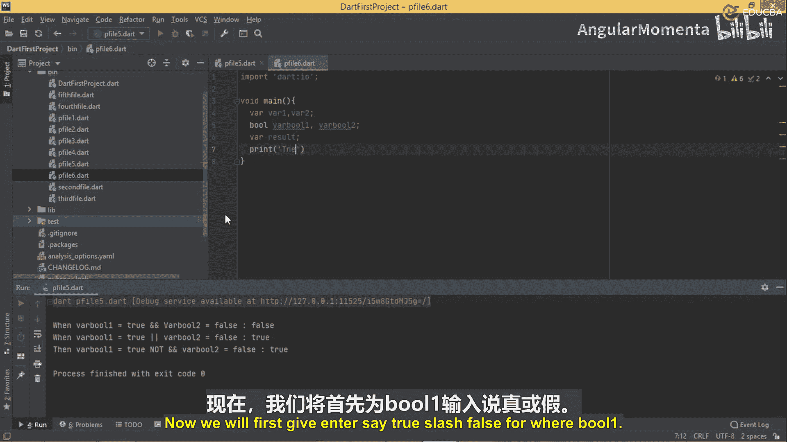
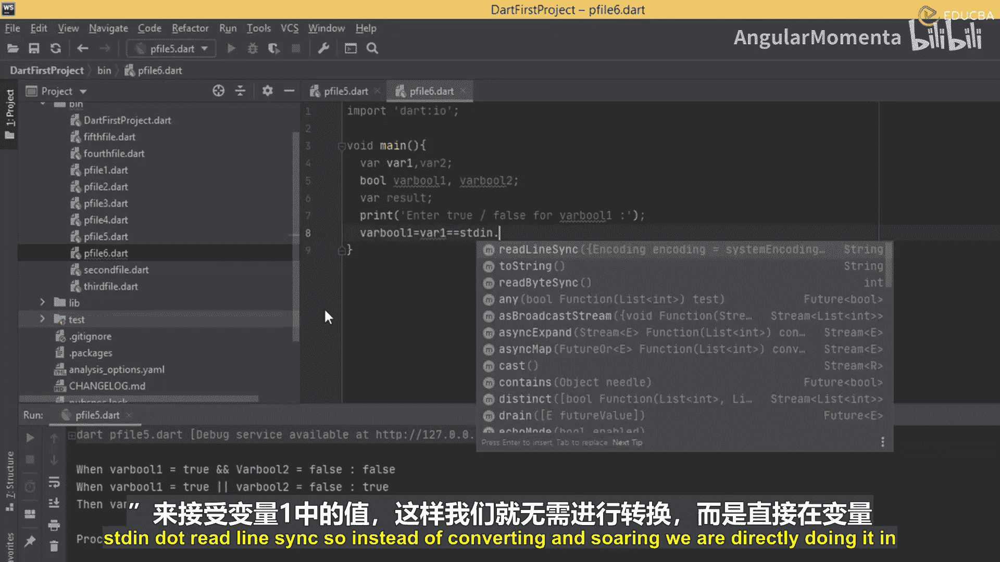
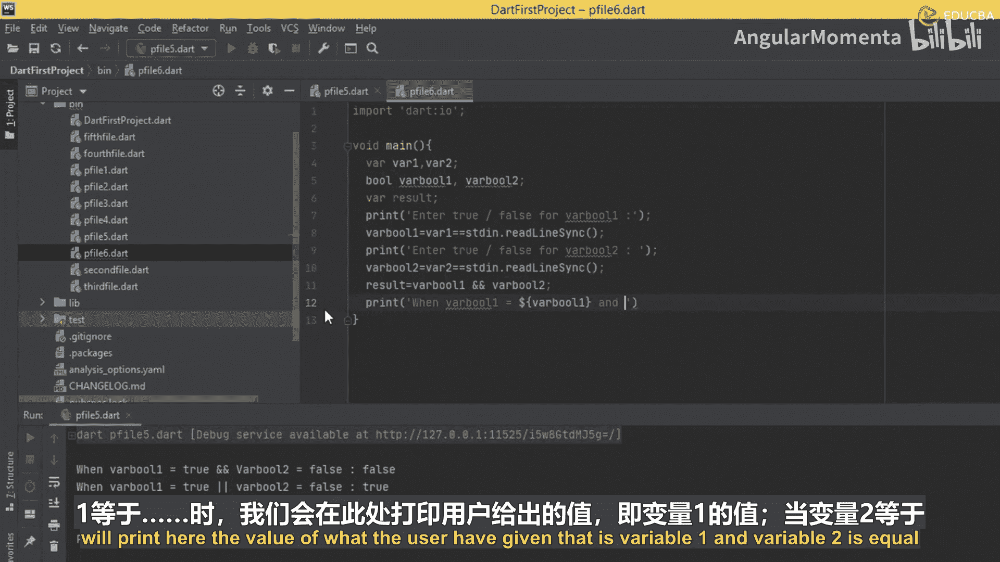
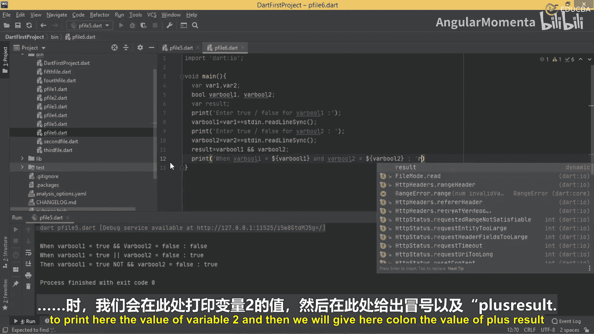
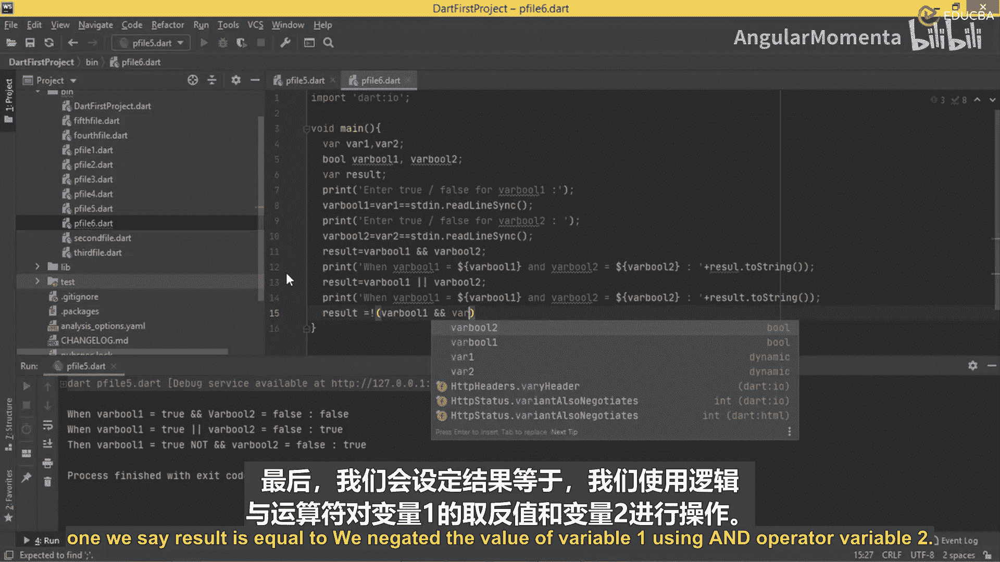
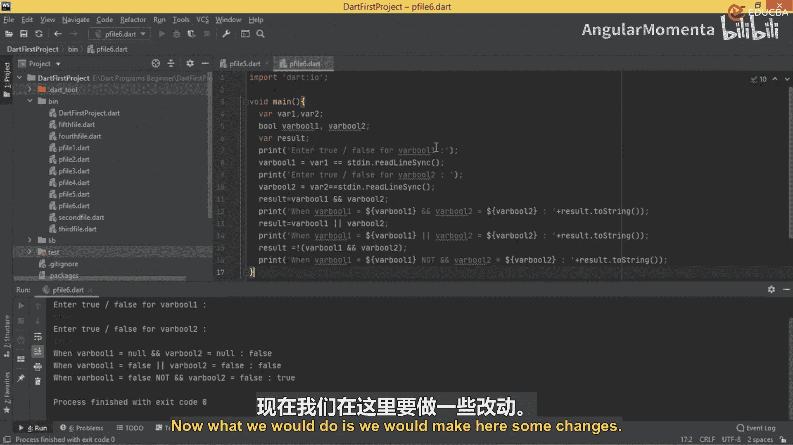
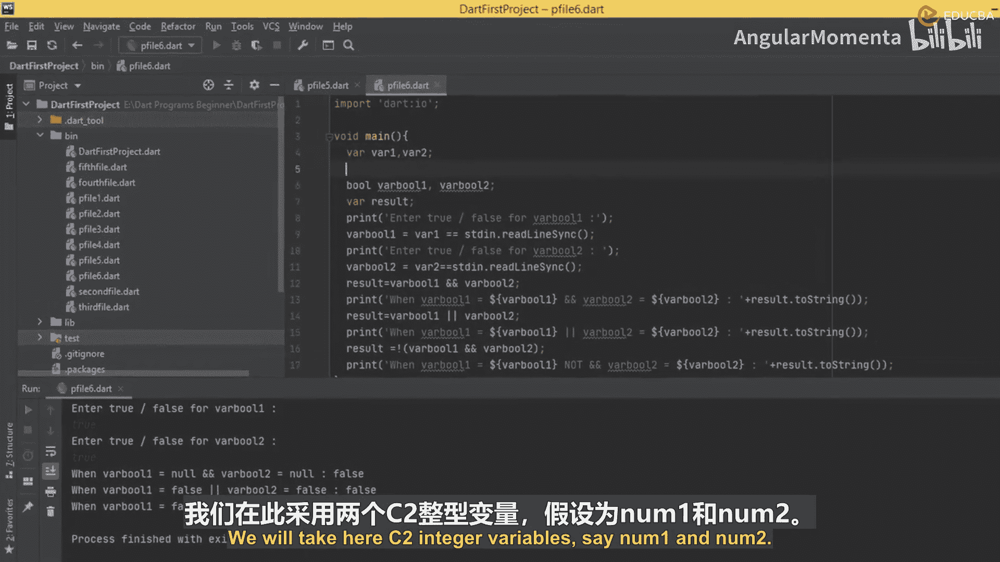
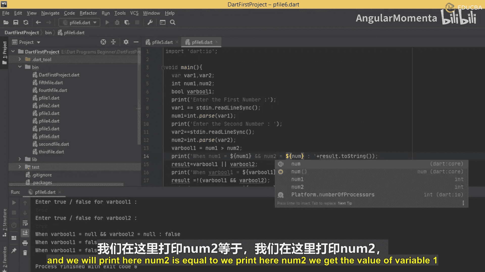
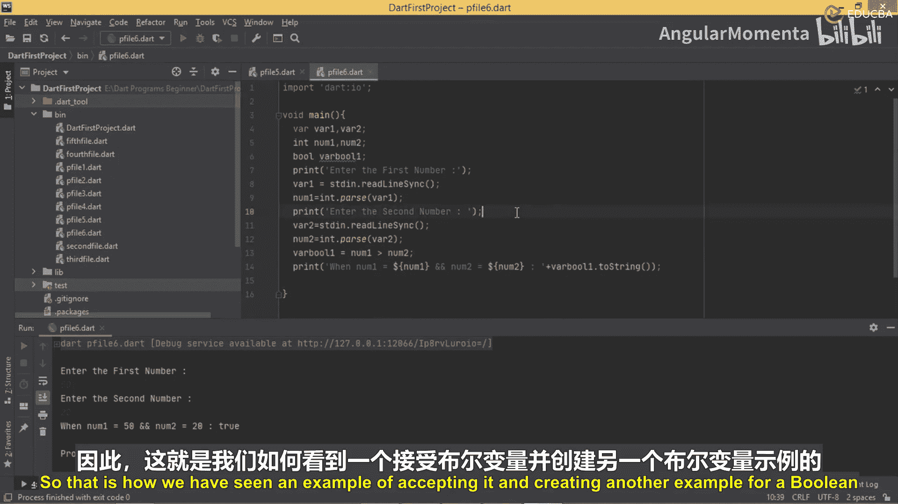

# 【EDUCBA】初学者应用Dart编程基础 ｜ Apply Dart Programming Fundamentals for Beginners p16 02_03_03_使用逻辑与和或组合条件 -BV13bF1zcEwj_p16-

Now the same program we will work on， but we will accept the value from the user that is the value what he wants to enter for say variable one and variable to we will ask the user to enter the value and then we will give appropriately the results being printed。

 so let us try and create another Dar file。Seppi file 6。

And the first thing we will have to do is an import of that Io and create a void main。And in this。

 we will create where1， ver two and bull variable。Where bowl 1 and where bowl 2。

 and also we will take where result。Now， we will first give enter。s。

True slash。False for。😔，Whereable one。And we will first of all accept the value in verable 1 by saying this where 1 double is equal to STDIN dot redline sync。

So instead of converting and soing， we directly doing it in variableable1。 Now， after that。

 we will again issue a print command saying。Enter。True， false for。😔，Vable 2。

 And here we will say verable 2 is equal to where 2 double is equal to standard input dot read line。

 think。Now， we will say result is equal to。 we will first do it as a variableable 1。

And whereable2 using an and operator， and we will print here。When say， whereable one。Is equal to。

 and we will print here the value of。What the user have given that is variable1。And。

Varable 2 is equal to print here the value of variableable 2。And then we'll give your colon。你万了要。

Plus。Result dot 2 string。 Similarly， then we will say result is equal to where bull one。Or verable。

 too。And similarly print here the values when now we don't know what the value of wearable one would be hence we are using here to actually print the value of verable one what the user have entered is equal to dollar variableable2。

 then well give a colon and print here result dot2 string。

 and then the last one we say result is equal to we negate it the value of verable1 using and operator variableable 2。

And after we have done this， then we will again issue a print command saying when。

Whereable one is equal to dollar。Whereable 1 and whereable 2 is equal to dollar。😔。

The value of wearable 2。Ive not closed it。Then we will use colon。 and here we will use result。

Dot to string。 Now， here we are using the and operator。 Here we are using the or operator。

 Here we are using not and operator。That is the difference while printing the commands。

So now let us try and execute this piece file6 over here and we will have here some error okay， fine。

 a spelling mistake that is result dot2 strength。Let us again debug this。

So now well enter false statement as false， even second as false。 What do you get， Both are falses。

 It becomes false。 Both are falses will be false。 And when it is false， this comes to true。 Now。

 if you again try to execute this and you give some variation in that by giving。

 say the false statement here。As true。 and the second is false。 So when one of it is true。

 it is not accepting the value over here again， because we have given here the values。Let us try to。

 again。Debug the file again。And enter true false。Now， this is not coming out to be proper。 Now。

 what we would do is we would make here some changes。

We will take here say two individual variables in number 1 and number 2。

And we will just take one boolean variable here。And donate of this result variable。

 Then we will ask the user to enter the。First number， and we will store that and where one first。

 and we will transfer it Numb one is equal to in dot pass the value of。😔，Where one。

 then we will ask the user to enter the value for the second number and we will store that value in ver 2。

 and then we will say number2 is equal to n dot pass。Where2 after that。

 what we would do is instead of this result， we will take variableable1 and here we will check。

 say if nu1 is more than nu2， that is our another operator which we have which will give you the value of true or false。

 so here we will print when nu1 is equal to the value of nu 1。And we will print here。😔。

Numb 2 is equal to who print here number2， we get the value of verable one。

Similarly， the next thing here we will do is。We will check if that is now。

 a only one would be sufficient enough。Just to give the output。 So now here。

 what are we going to do is execute this file and accept the value set 20 and。Made a mistake here。

Sos must not mean nu。We are saying enter the first number。It is not double is equal to。

 but single is equal to。And then， sting it appropriately。Let us again execute this P file 6。

We enter first number 50 second number 20 when number is 50 and number2 is 20 it becomes true because the value is number one more than number two。

 so is 50 more than 20 true that is what the value you get here for variable one so you cannot directly store a value as true and football basically what boolean variables are just to get the value to evaluate a particular expression。

 So those expressions will have to be of some numbers or double types which you can evaluate to either true or false and then that value gets stored into the Boolean variable that is how we have used this boolean variable over here。

 so that is how we have seen an example of accepting it and creating another example for a bull variable。

