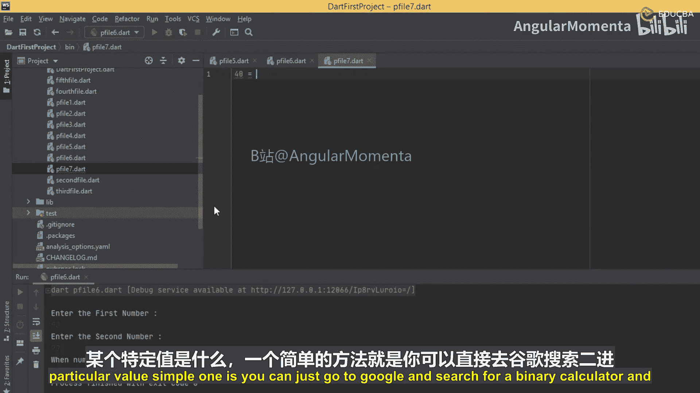
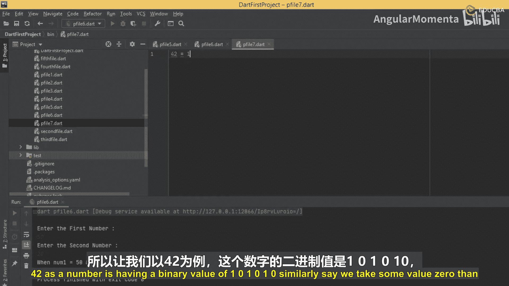
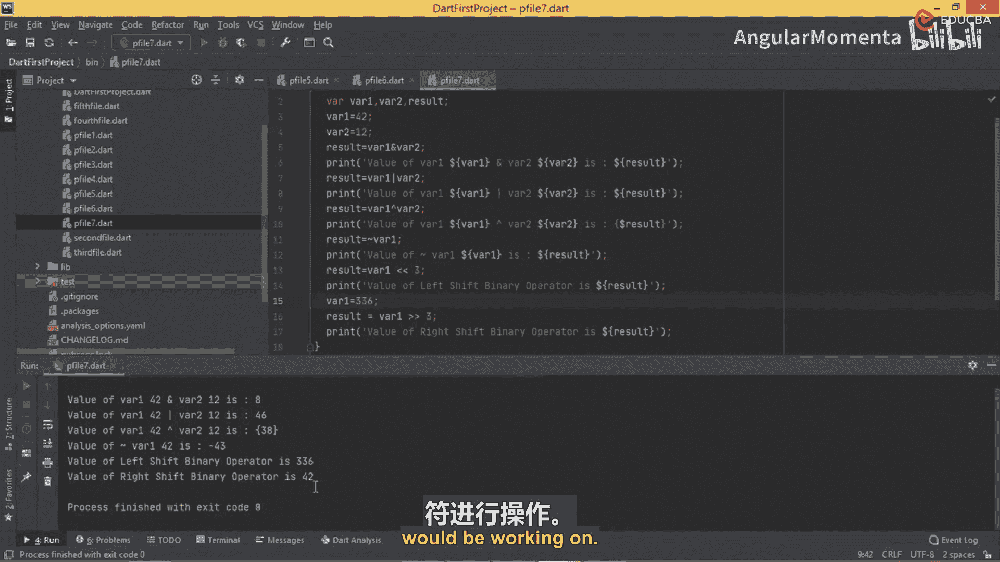

# 【EDUCBA】初学者应用Dart编程基础 ｜ Apply Dart Programming Fundamentals for Beginners p17 02_03_04_使用三元运算符应用条件逻辑 -BV13bF1zcEwj_p17-

So now let us move on to the next set of operators that we have as the bitwise operators。

 Now bitwise operators means you' are basically performing some bit level calculations or operations on the operators So for example like let's create here a new file first or that file say file 7 Now say for example。

 you are giving some value say 40 Now this 40 value is having some binary value of0 and1 Now if you want to know what is a particular value simple one is you can just go to Google and search for a binary cculator and let's take some。

Put some binary value。 try to convert it。 It's coming to 42。 So let's take this。

 say 42 as a number is having a binary value of 10，1，0，1，0。 Similarlyly， say we take some value。

0 then1。 So 0，0，1。

1，0，0。Now this comes to 12， so if we take another number 12， the binary value is 00，11，00。

 so every number or any alphabet for the particular matter is having a binary value of its own in the memory。

So， we are working on that particular binary values using the bitwise operators in that。😊。

So now what on operators do we have for bitwise we have the and operator which will basically work on a binary and between two operators。

 we have a binary or bitwise or operator we have the bitwise x or operator for example we can use there some variable x or another variable then you also have the shift left binary operator and shift to right binary operator which would shift the bits of the values which you have passed on to the operator。

 the the binary values basically and you also have this tilled operator which basically means your the complement for okay for example like making it a negative one so if you have to create one example on this bitwise operator which we have so let us create one simple example first wherein we assign the values in the variables。

We assign some integer values in the variables， and we try to get the result using the bit wise operators there。

 So the first thing we would do is start with a main method。

 and here we will create the variables server  one where  two and。Result。

And then here we will put the value of where1 say 80， we will。

Or rather let us put the value say 42 and where to the value as say 12 and then in the result one we will store the value as say first where 1 and use the and operator where2 then we will use here print command and will print value of。

Where one and where2。Is you print here using the dollar sign the result。

 So we are putting basically there the value of。Only result， but also we can put here where one。

 say where one。And where to， where we print the value of where to。And then the value of result。

 Then we will try to make result is equal to where one。

Binary or operator that is one single sign and where to。

 then well again try to print here saying value of where one print here the value of where1。Or。

We use here the value of where to print here， the value of where to missed the number is。

 and we print here dollar the value of result。Then we will try to put in result， where one。

Exponential where to。And pur。Value of where one is。And we use your exponential。Where to is。Where to。

And the result comes to the value of result variable。 Then we will try to put this where one。

 and now we will use this operator for or rather we will use here。

Before this operator till the and where one， and here we will give the result as a value of where one printer here the value of where one。

And before that， we will use here this till design。Is。😮，We will print here the value of。Result。

The next thing we will try to do in result is we will try to put where one shift it3。

And then we will try to print here the value of。Say left， shift。

Bineary operator is and print here value of。Result then again。

 will to result is equal to where 1 write shift 3 and finally prints a value of。Right， shift。

Bineary operator is printer here， the value of result。Let us save this。

 and we will try to execute the P file 7。 All right， this is how you get it。

42 and 12 becomes the value that comes and is 8。The value of 42 and 12 or becomes to 46。

Made a mistake here。 We have not closed to this track。Again。

 we'll have to execute as the output would change。And then， this becomes。Exponential part of it。

 This becomes nege43 left shift 3 to 42 becomes3，3，6 and again， right shift it it becomes。

5 because now the value has changed the value suppose， for example。

 after doing this and after printing the value here， we again make where 1，2，42 Let us save this。

And then try to execute this again。 So now the value will again change。It now with that。

Already been shifted。So the value becomes here，3，3，6。

But now what you will do is instead of this result。

Let us do one more change here we will make where one is equal2，3，3，6， for example。

And then we will try to do it for。Crite shift。See。😊。

42 left shift 3 becomes 336 we have assigned 336 now to where 1 and now we try to do our right shift 3 batch to 42 that is what we wanted to show it that is how we have created over here one bitwise operator example hope that is very much clear now the next one that we will be creating will be as simple excepting the value for the two variables from the user and then working on those bitwise operators in this next example which we would be working on。

