# 【EDUCBA】初学者应用Dart编程基础 ｜ Apply Dart Programming Fundamentals for Beginners p18 02_03_05_使用Dart类型运算符检查数据类型 -BV13bF1zcEwj_p18-

So now we will create here a new dot file， and that is the file 8。😔。

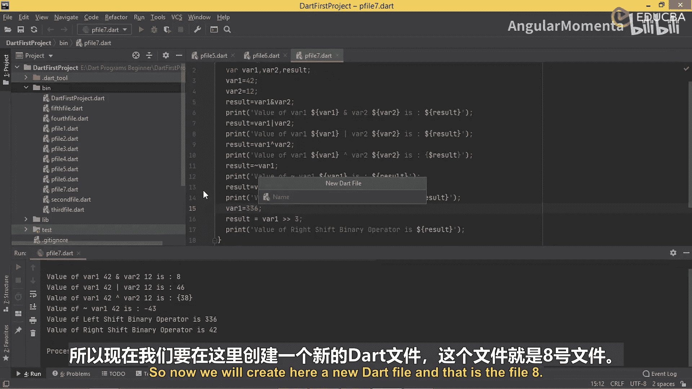

And here we will start with the import of。Thatt I。And void。men。

Wherein we will create first normal variables where too， then we will take in。😔，Where one。

 and in where2。And we will also take here one more variable。 And that is for a result。

 So then we will say here， print， say please。Enter。Value for where one。

And we will say where 1 is equal to STDI and dot red line sync， Similarlyly。

 we will repeat this process for even our where 2 variable and save the value n。

 where 2 as well after we have the values we will transfer it to n where 1 by saying is equal to n dot pass where 1 and in where 2 is equal to n dot pass where 2。

After converting this， then we will work on the saying result is equal to in 1。And inch where 2。

 and then we will go for a print command where we will be printing value of in 1 dollar print the value of in 1。

And use here the operator， say in to wherein we print the value of。And where too。If。

And we bring the valley off。Result。So now we will simply copy down these two statements below。

And quickly change here first it is。 And then it is or。 So here Also， we will change it to R。

Then the next thing we would be doing is the exponential part。After the R1。

 So let's change here also to exponential part。 And then we would be changing it to the till the sign。

 And now till the sign operator， we will be only working with。Not the second one。

 And before the variable will have to give。 So here it is， till sign in1。

And the value is printed there。That is what the value we get it for in where1。

 or you can simply print instead of inward 1 the value of a result there。

And we have work with the tilt sign。 Now， we'll be working with shift operator。 So let us shift it。3。

Shift your。Two times， and here well be giving say value of。Left。Shift。

Binary operator is and the value of result。 So similarly， then we will make it。

And just change here to right shift。And print the value of research。It's that much simple。

 So let us execute this。 P file 8， the new one。 or there are some issues。

 We have missed some statements， Yes it is over here。 And it off semichoin was missed out。

 And let's rebu that again。

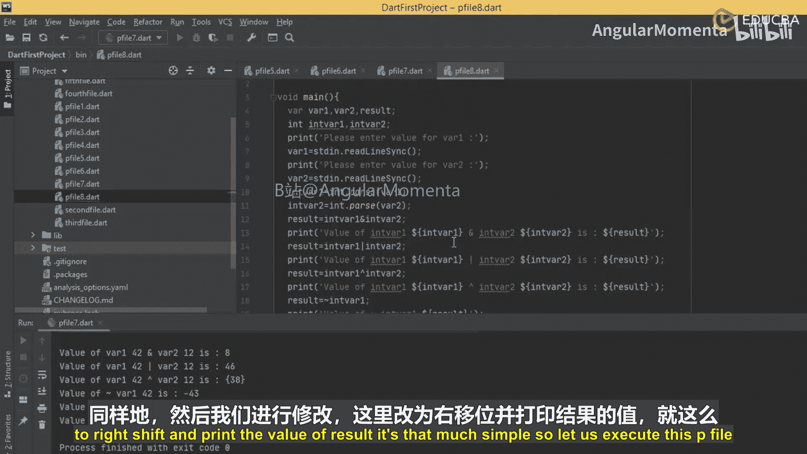

And lets enter the value， say 4212 we get the same output over here because we kept the values same as the values were already known to us because bitwise then you will have to calculate what would be the bitwise value or or the binary value for the particular value which you have enter so it is very easy for you to calculate what values you are getting at there。

So that's that so much simple of using the operators there。 Now。

 let us move on to the next set of operators that we have。😊。

And that basically is our conditional operators now conditional operators are also of multiple types。

 for example， let us first all create a new file CP file9。

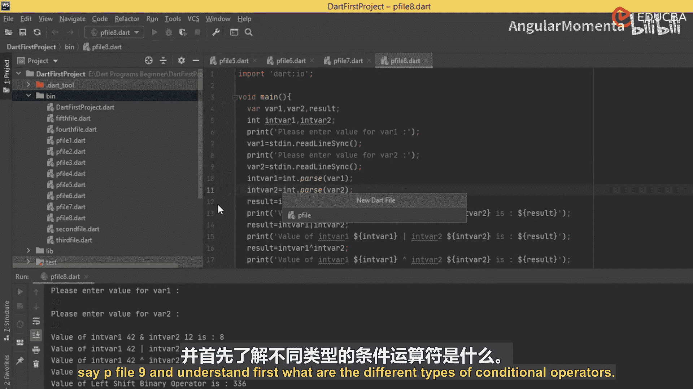

And understand first， what are the different types of conditional operators？

So the first one we have is a question mark colon。 This is basically known as your ternary operator。

 Now， what does this basically means， we would be learning in the next course about the f statement。

 Basically， it means that if a particular expression is true。

 you' are supposed to evaluate something。 Now this operator is a short form for using the f statement。

 That is why we call it as a ternary or a conditional operator。 It basically evaluates like。

 for example。If the condition is true， then the expression will be returned。

 which is the expression after your question marking， for example。

 say we just write down over here and expression 1。If。We write on this in bracket， if。This is true。

Then， the value。For true would be printed if the expression is false value for false。

 so this you can use over here any expression this question mark value given after the question mark is the value when the expression becomes or evaluates to true and the value given after the colon is the value if the expression evaluates to false so it is a short form operator known as a conditional or aernary operator using question mark colon sign。

So we will see some example also on the same and similarly you have another kind of。

Conditional operator that is and that is your double question mark Now this is basically a used for a nu null value to be evaluated。

 for example， if you are having two variable out of which one variable value is null and one variable is having some value assigned and if you check there between these two variable because one is a null variable and you put there that variable double question mark。

 the second variable， if you are having a null value there， the second expression is the value。

 what is been written， if it is not a null value， the expression value for the first expression would be returned。

So let us quickly see some examples on both of this First we would be working on examples of the。

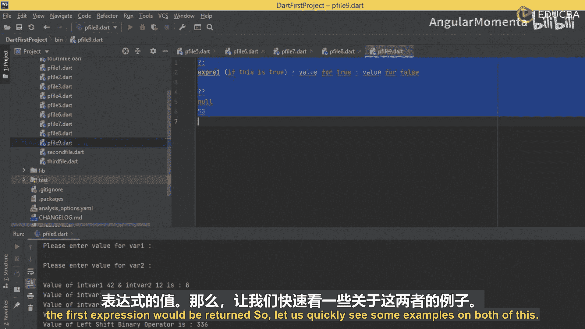

Tary operator。 And then we would be moving on with the example of the second conditional operator。

So let's quickly start by using the void main and here we create result variable。

 we take some integer variables and we assign some values here say 40 and number2 is equal to say 30 and then we use result is equal to if number1 is more than number2 question mark you are going to print here higher。

Number。Colen you're going to print here， says Molo。Number。That's how you want to evaluate it to。

 And then you are going to use your print command and say the。Result is。Co in。

 and you will print here the value of dollar， say result。

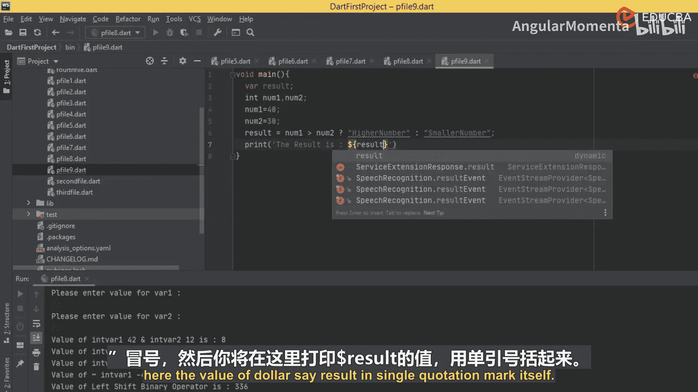

In single quotation mark itself。 So let's quickly run this。Reile 9。

See wait because first number is 40， you try to evaluate a 40 is more than 30。 So yes。

40 when 30 evaluates to true。 So what is the value which will be printed。

 the value after question mark， which is higher number。

 if suppose we have assigned this 20 and then second is 30。

 which means the expression evaluates to false。 So the value after colon has to execute。

 So here if we debug this again now the value would be smaller number。

 because now it has evaluated to fourth， Similarlyly。

 suppose you want to accept the number and perform the similar operation。 Now。

 let us copy down this and create a new dot file， which is。

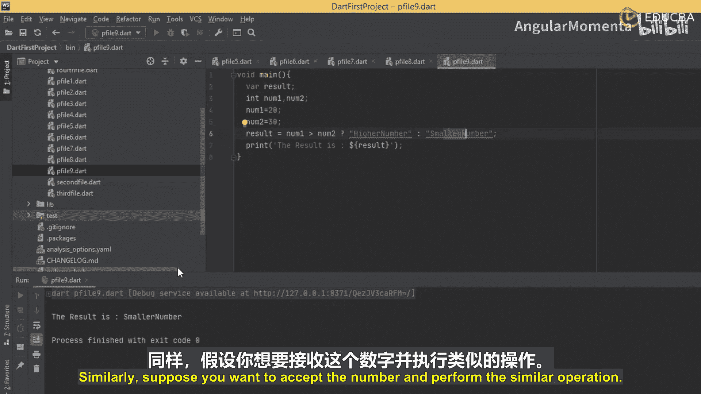

P file 10。

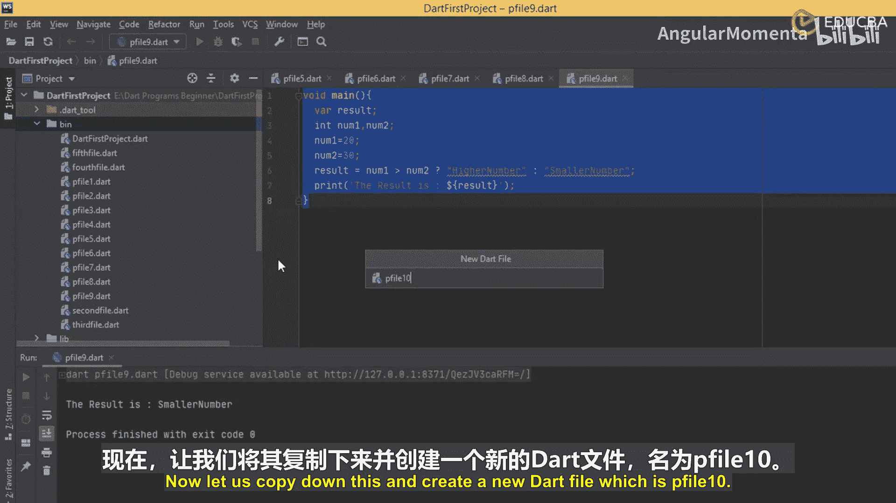

Let's paste it here and we'll have to first import that colon Iio。

And here we'll have to make certain changes。 Let's accept some。Variables minus number2。

 and also we will create in teacher we already have say number and number2。

So here we will first give separate， saying， please。Enter first。Number。

 and then we will use Y number1 as steady the iron red line sank。 Similarlyly， let's give here。

Please， enter second number。Signed there， except that in number 2。

 So now here we have number1 is equal to n dot pass。Y number1。 And here we have in dot par。Say V 2。

 and then we check it over here about the particular value and again print the result that that will remain as it is。

 So let us save this and try to execute P file 10。So now the numbers we are going to enter suppose we enter 90 we enter 5 we get higher number again we execute this。

 but this time we enter total opposite we enter 5 and 90 we get the result a smaller number。

So let us also create another Dart file say file 11 and lets also see the use of the last set of operator which we have that is a double question mark so here we will use the word main。

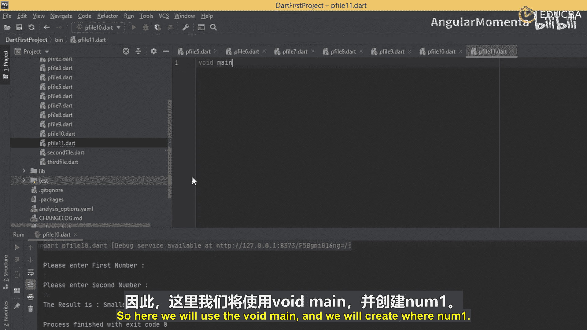

And we will create where number1， we will assign this purposefully null value initially。

 and another variable will assign a in teacher value。

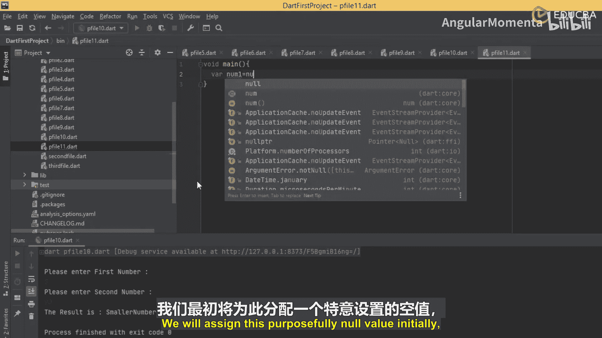

Then we will use this result， and we will check if number1 double question mark nu2。

 then we will print here the result is and the value of result to be printer。

 Now we have assign number1 null。 Hence it should give the value 40 over here because number1 is null。

 So let us try and execute this and check what is the output we are getting。 it gives 40。

 For example， number1 is assigned the value say4， it is not null。

 So now let us check what value we get if we execute。

 we get the value if it is not null value of nu1 is returned。

 if this is null value of nu2 is written。 a very simple one， Similarlyly。

 suppose we will try to accept this from the user and try to create a program。

 So let's create P file 12。

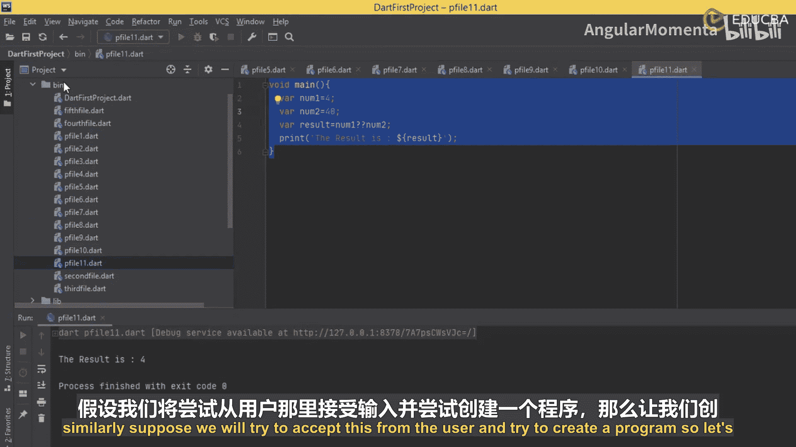

And we will have to， first of all， go for import that goal in I O。 And here quickly。

 we will first of all， accept number one。

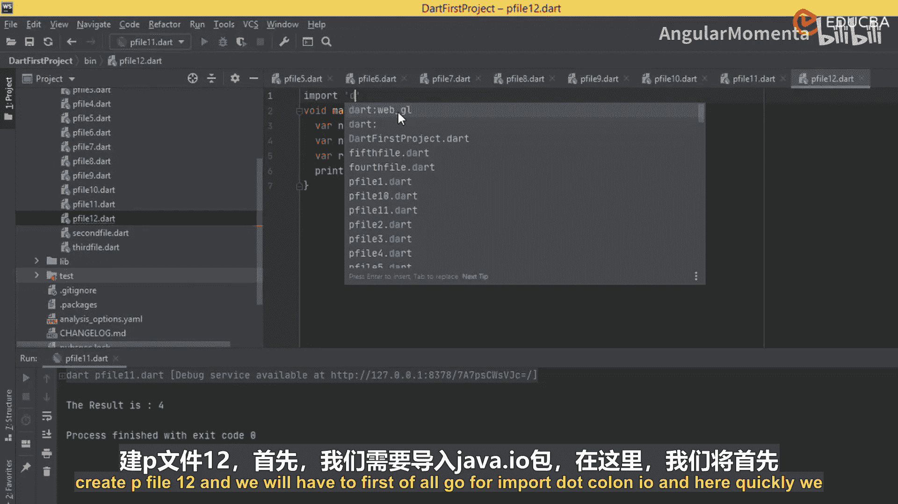

Namtu。And。Result we already have。Let's take it on one line。So we will remove all this。

And we will also have an in variableable， say int number1。So here in this case。

 we will purposefully make， say。南湾。To null and then we will enter using print command set please enter the second number and we will accept that in number 2 by saying STD ion or red line sync and then we will say nu2。

Or rather， we have thee。Int。Numb 1 is equal to in dot par the value of number2。

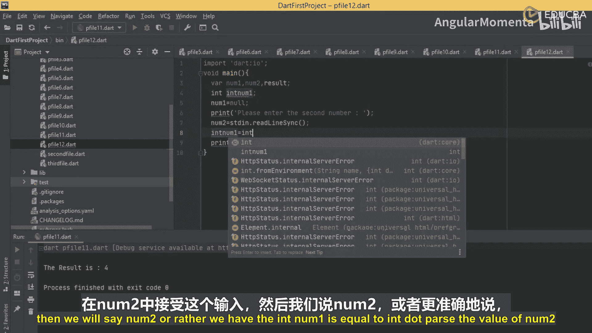

And then we will use in result is equal to。

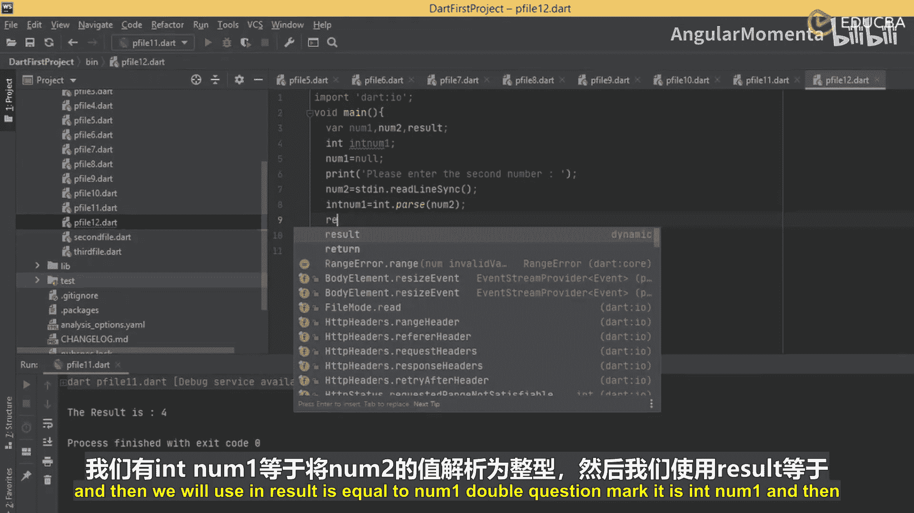

Numb one， double question mark。It is in number one。

And then print the value of result so again here purposefully we have given null value hence it will only accept the value suppose for the second number and the result would be returned for the second number as such。

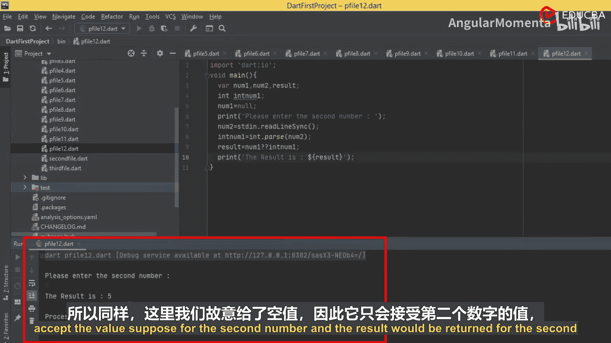