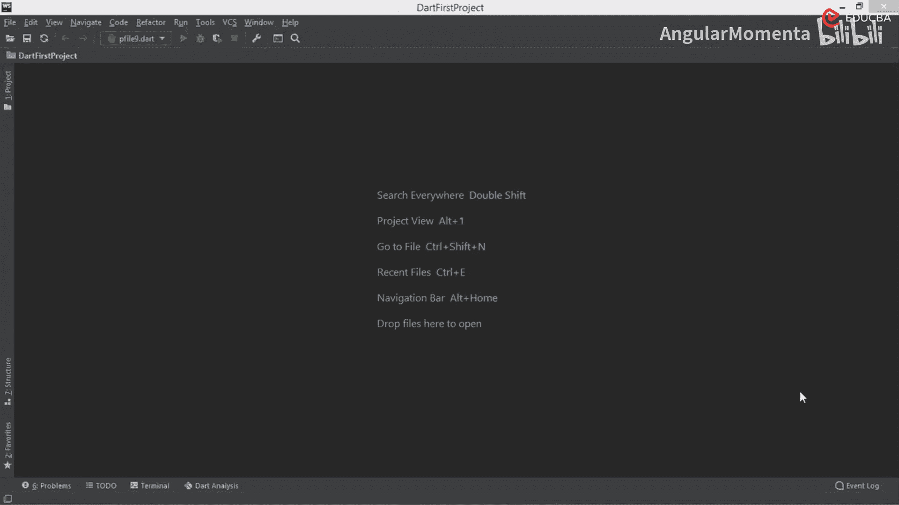
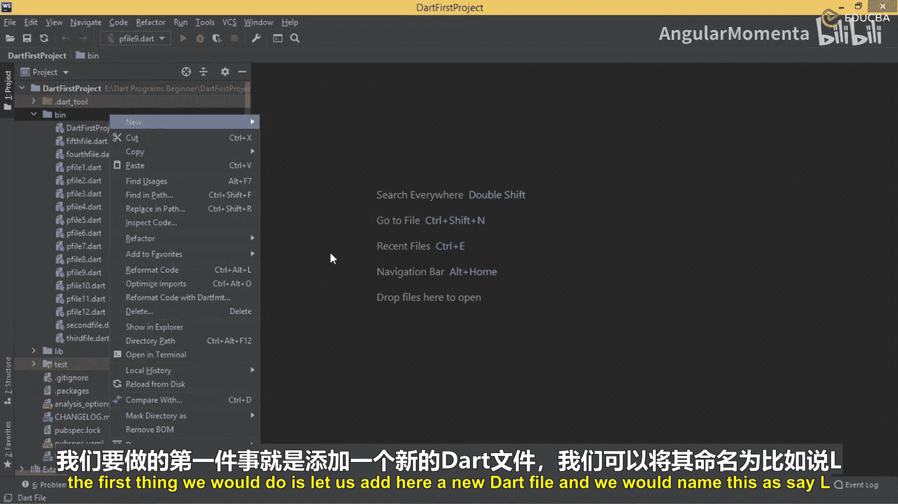
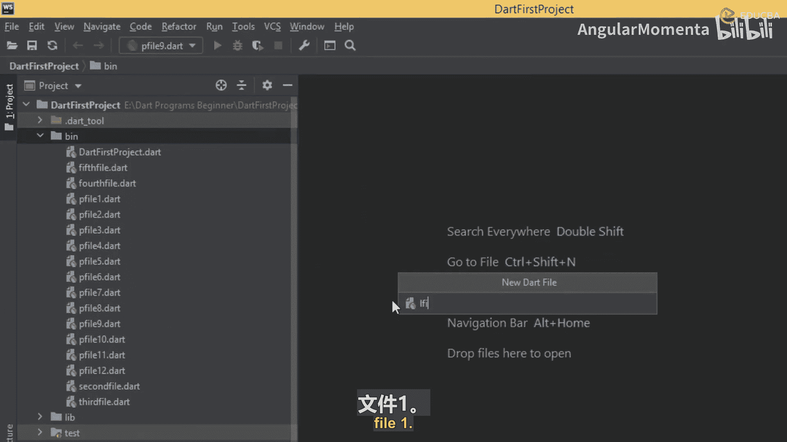
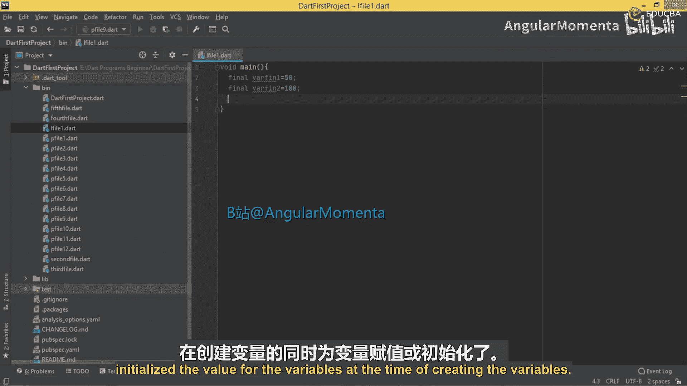
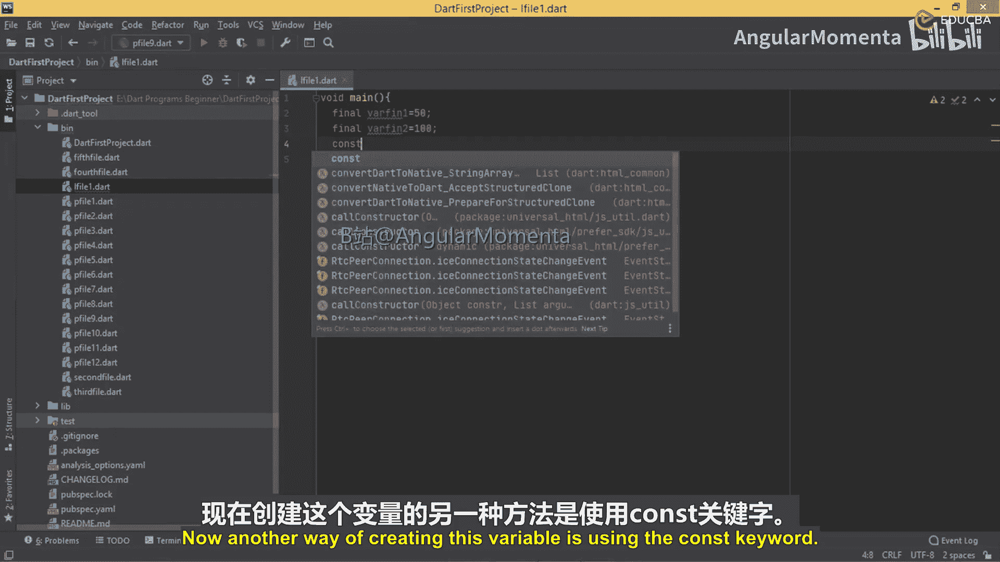
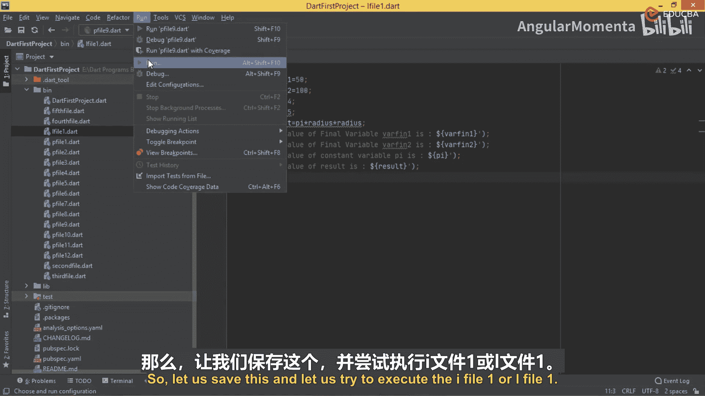
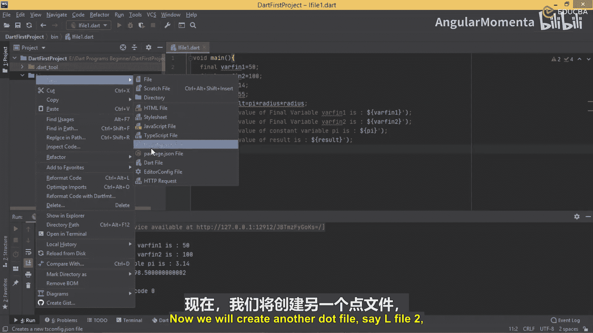
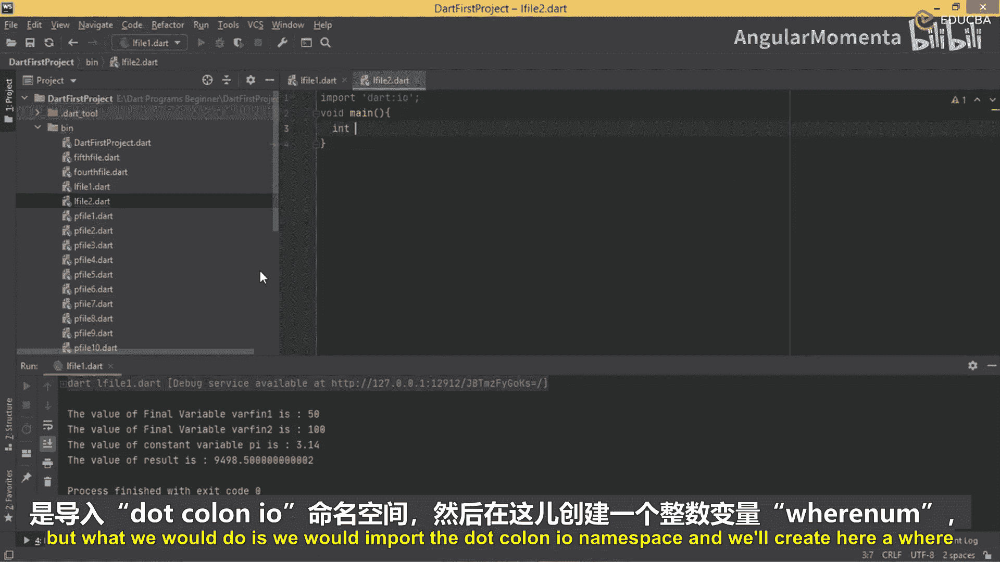
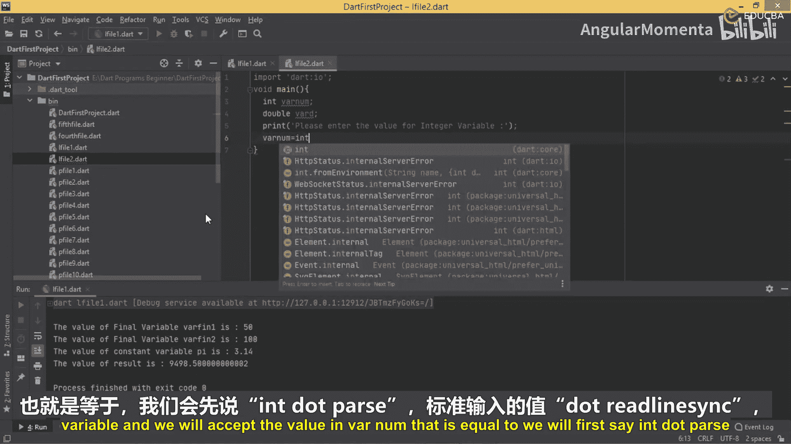
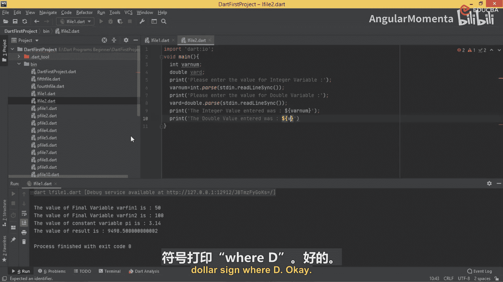

# 【EDUCBA】初学者应用Dart编程基础 ｜ Apply Dart Programming Fundamentals for Beginners p19 03_01_01_Dart常量 -BV13bF1zcEwj_p19-

The next session in our Dar beginner level course and in this session。

 we would be dealing with the dot constants。 we would see what are constants like we have also constant variables。

 we have final variables， how to create them what is the use of those variables。

 how to put values in those variables。 Also how to retrieve the values back from the variables。 Also。

 we would be looking at in detail about creating our array of values wherein we can store some different types of values or similar app of values。

 but various values in one single array list which we can create。

 There are a lot of data list or dot list， which we can create into dot programming again there。

 we have various classifications of the listing we would see that also in detail。

 but let us first start with understanding what are constants Now。

 constants in any programming literally means that the value which you can。Not shape， which means。

 for example， you are as creating a particular variable and you are assigning a value to the variable。

 that value could be changed in later purpose for some other reasons。That could be a normal variable。

 but when you are creating a constant， it means that you are putting a value in the variable。

 which will remain as it is once it is defined。 the value will not again change to some different value。

 So keeping a value constant in a variable by creating that variable of type constant。

 So we would see an example also， not similarly， there are two ways in which you can use this constants in that programming。

 One way is creating a final keyword or using a final keyword for creating the variable。

 and second way is using the consed keyword and creating the variable。

 Both are used for creating your constants into that programming synaxes different。

 So we will see one by one。 first of all， we will see creation of final variable。

 and then we will see creation of a const variable using the consed keyword also。 So over here。

 the first thing we would do is let us add here a new。File， and we would name this as， say， L。

File1 and here we will create save main open the main method there and there will create the final we are giving the variable name as where f 1 and assigning here 50 Now there is another way I will show you for example we are creating another variable and I am not assigning a value to it I am getting here an error。

If you look at it， it says the final variable variable name wherein2 must be initialized。

 which means you cannot just declare the variable of type final if you are declaring a variable of type final。

 you will have to assign a value while declaring the variable itself。

 that is have to initialize the value for the variable there itself。 So now， for example。

If we say here is equal to say 00 now you can see the error has gone。

 so now the error is not there because we have created the variable and we have also assigned or initialized the value for the variables at the time of creating the variables。

 Now another way of creating this variable is using the constant keyword so for example。

 let's calculate a formula at pi r square where the value of pi always remains constant which is 3。

14 so we'll create here a constant variables say pi and willll assign here a value 3。14。

Which means this value is not going to change further in our program。

 It' is going to remain same as it is。 And let's take a。

In radius variable and assign this value as a 55， then we will take a double variable that is result and here we will give it as pi into。

Radius into。Read this。That is what formula we have assigned for the result variable and now we want to print all the values on the command。

 so here we willll use the print command and save the value。哦。Say， final。

Variable variable name we are giving is， and here we print the value of where fin 1。Similarly。

 we issue the next print command， the value of final。Variable， where Fin 2 is。

And we will put here the value where fin 2。After that， we print here the value of。Constant。Variable。

And the variable constant variable name is P is colon。

 and we print here using the dollar sign the value of P variable。After that。

 we also have to print the value of results。 so will say the result is。😊。

And here we will print or will give here thee。Value of result is。

 let's give her colon and we'll print here the value of result。

So let us save this and let us try to execute the I file 1 or L file 1。

So we get here the final variable value is 50 for wherein 1 wherein 2 is 0 pi value is 3。

14 and the result that is pi into r into r comes2 that is 3。14 into 55 to 55 comes to 9498。

 sum decimal value So this is how you can use the final variables and constant variables and create the constants into your data programming。

 which means the values once assigned will not be changed For example。

 here you again tried to give a value to pi some different value won't allow you to give because it will not recognize what is the pi as you have created this constant it says constant variables can't be assigned a value So once you have created the variables then and there itself you will have to assign the value for the variables After assigning or one assigning the value is done again reassigning is not possible that is what is the meaning actually of constants mean in that program。

So now let's proceed further with the next set of。Values in our that program。

Now we will create another dot file， say L file too。

 and we will look about number of methods or properties we have for numbers that is for integer variables。

 double variables we have certain properties which we can use along with that we also have certain methods which we can use for example。

 let's create a simple example over here， but what we would do is we would import the dot colon Iio namespace and we will create here a ver nu as a integer variable and also we will create say where D as a double variable along with that we will take here normal variables that is or rather known need for normal variables。

 we will just use it like this and we will use a print command here saying please enter the value for。

Integer， variable。And we will accept the value in ver now that is equal to we will force say int dot par the value of standard input dot read line sync。

And similarly， we will give another print command。 say please enter the value for double。Variable。

 and we will accept that into where D by saying double dot passse S T D I dot red line sync。

So after this， let us first give the or print the original values so the。

In teacher value entered was。And here we will print the value of where none。And similar to this。

 we will give here the。Double。Value。Entered was， and we will print here。

Using dollar sign where the okay。

