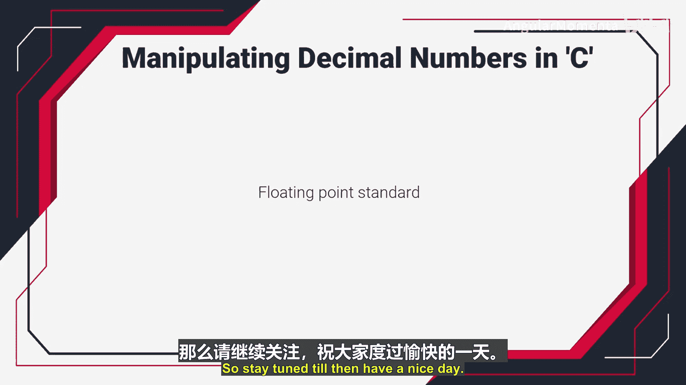

# 【EDUCBA】构建嵌入式系统 ｜ ARM Cortex (STM32) Fundamentals： Building Embedded Systems p01 01_01_03_C语言中的十进制数值操作 -BV1KjcTzUEeY_p1-

Hail earners， welcome back。 Now， in this particular video。

 we will first fall start with understanding about manipulating decimals in C。 Let us explore this。

 Now， first， we need to understand what is a decimal number。

 decimal number is on any number that contains the decimal point。 let's say， for example。

 I have a number 170 point34，5。 Now this is a decimal number and we also call these number as real numbers。

 when computer memory， some of the real numbers like real numbers which are too small or too big or have some real number having some fractional part to it。

 those are stored according to the representation standardized by Ie 754 standard。

 Now this is also called as the floating point representation of a real number。

 which is an appropriate representation of real number。

 All the computer systems and macrocontrolls nowadays use this standard to store the real numbers in memory。

If you are working with numbers that have a fraction part or in case you're using the integers that do not fit into your long data type。

 then we can use floating point representation till now we have discussed more about the integer data types those are not stored according to this standard remember can basically consider a number which is too small in nature for example。

 let's say charge of an electron。 how you can represent this in your Cs program use that as an integer data type instead of float if you have to use something called as floating point data type。

 then those are called as float and double we have two in this one is float and the other is double data type。

 let's consider very big real example， let's say the distance of between earth and let's say some galaxy the number between this would be a very big number you cannot fit that number into a normal integer type because the number is too large and it cannot fit into integer we will have some fractional。

Part also to the number so this can be represented using floating point representation data types like floatta or double we have understood in this particular session as to what is floating point representation why are they used because we want to store some big numbers and memory have which are having some fractional part。

 So now in the next video we'll explore about the floating point standard to store the floating point numbers So stay tuned till then have a nice day Thank you。

