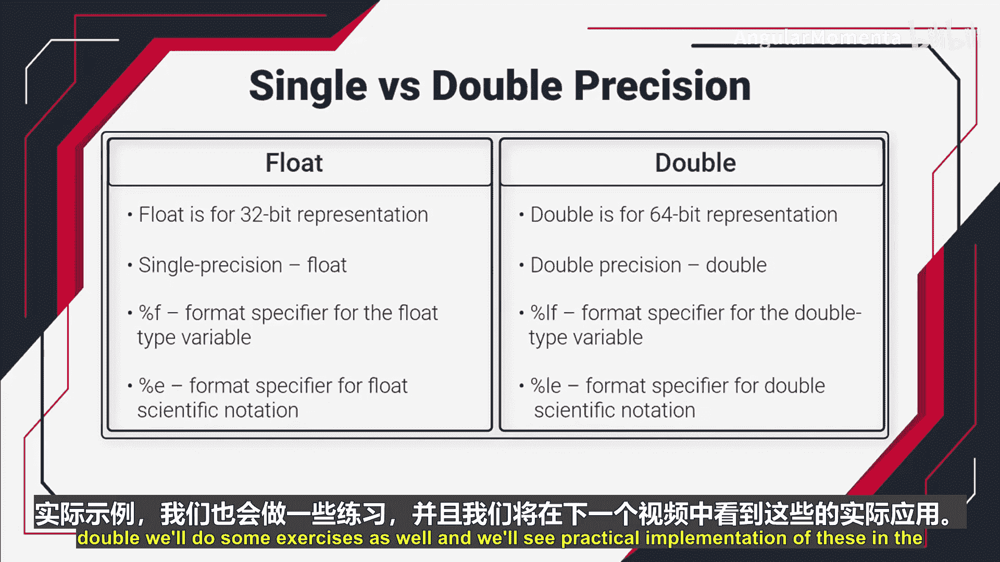

# 【EDUCBA】构建嵌入式系统 ｜ ARM Cortex (STM32) Fundamentals： Building Embedded Systems p02 01_01_04_单精度与双精度 -BV1KjcTzUEeY_p2-

Hey earners， welcome back。 And now in this particular video。

 we will learn about the Iee 754 floating point format to store the real number to this format。

 The Ie 7，54 is a standard as I told you earlier for representing and manipulating floating point quantity These are followed by all the modern computer systems and microcontrollers。

 Now let's consider a particular example。 If I take a particular number， let's say for example，8。

435 into 11 race2 say49。 Now this is quite a big number。 how do you save this number in your memory。

 you can save this number in your memory by converting this into a binary equivalentvalent that could consume a lot of computer memory。

 That's why this standard says do not store this number as it is Instead， what you can do is。Of that。

 approximately like this number can then only store the required information such as you know the sign the exponent and the mantea part that is we call it a significant this particular if I have to show you the plus sign would be representing the sign the mantea or we can say significant is this particular number exponent would be this particular number Now the next question in your mind would be how many bits are required not to store all these things there are two format one is single precision format which consumes 32 bit to store all this information such as the significant the exponent and the sign the format you also have which stores 23 bits is given to significant if I have to bifurcate this I can say 23 bits is given for the significant then8 bits are given to the exponent and one bit is given to sign This is how。

We store it as into a 32 bit integer value This is basically what we call it as single precision representation now there is also one more representation which is called as double precision this one was single precision and next that we have is double precision and there is one more representation that as I said it is double precision now this double precision basically consume 64 bit of data okay double precision does a higher level of approximation what we get from double precision implementation is more accurate if we compare it to single position implementation right or we can say single precision storage here you can basically have in the 64 bit you can say 52 bit are for the significant then 11 bit are given for the exponent and again one bit is given for sign if we consider one let's say inteja number let's say。

567。89 for example。 Now this has an integer part integer part is 567。

 and it has a decimal or a fractional part， which over here is the point that is the decimal point and this becomes your fractional part then let's see now and see programming。

 how do we make use of the single precision storage and double precision storage for that you have some special types of data types for example。

 if you want to store this number， you cannot use integer type because this number is not only integer it has a decimal point it has a fractional part as well So you cannot use integer type your in character long these three cannot be used So if you use integer car long to store this only the integer part would be stored so you will basically lose the fractional part of the particular number So instead of that you can use here data types which are used to represent the decimals that is float and double So here we have next two types of data types that are available。

Now float is for your 32 bit representation and double is for 64 bit representation as we have known we have two parts one is single precision one is double precision so for single you have float for double you have double type of variable so now let's explore the format specifiers for float and double as well when we do inputting or outputting these decimal numbers through C we basically use the percentage LF that is a format specifier to read or write double type variable and we use percentage F which is a format specifier for read or write float type variable we also use percentage E or I can say percentage L now these formats are used to read or write real numbers in scientific notation again percentage E is for float scientific notation and percentage L is for double scientific notation。

All the constants with the double points are considered as double by default by the compiler in the next video now lets look out at some practical examples of how to use this float and double we'll do some exercises as well and we'll see practical implementation of these in the next video till then have a nice day Thank you。

