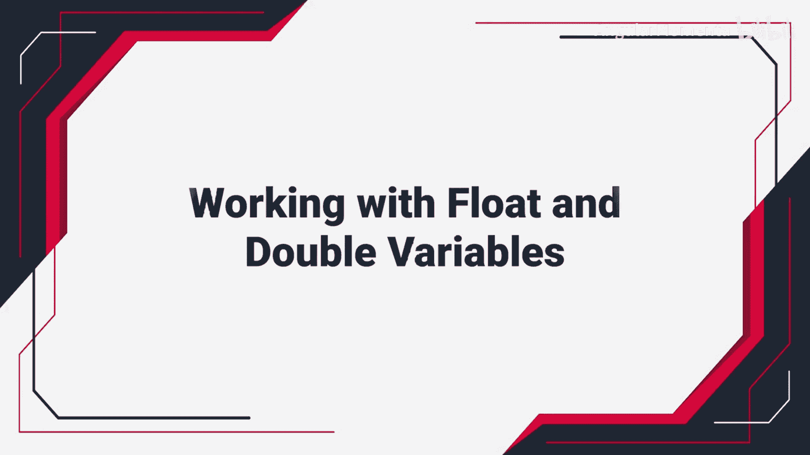
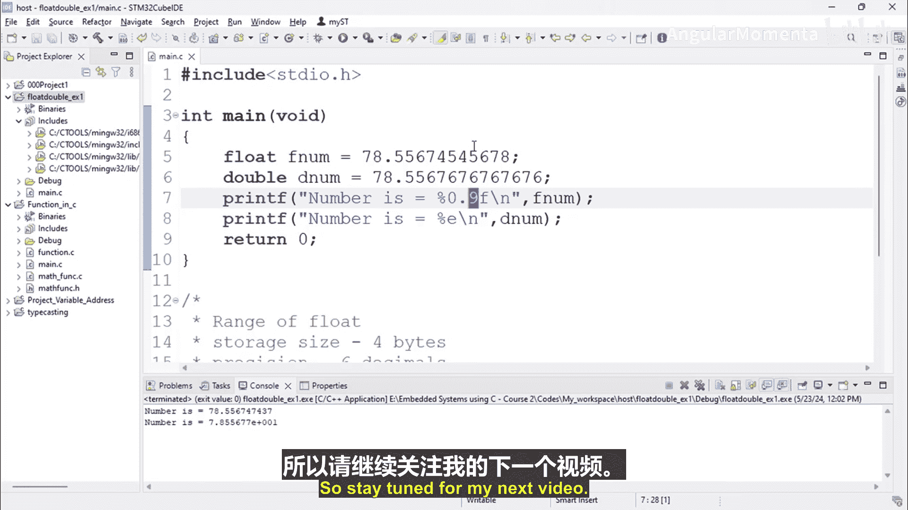

# 【EDUCBA】构建嵌入式系统 ｜ ARM Cortex (STM32) Fundamentals： Building Embedded Systems p03 01_01_05_使用浮点型和双精度型变量 第一部分 -BV1KjcTzUEeY_p3-

Hey earns， welcome back Now in this particular video。

 we will take a look at float and double data types。

 We take a look at the practical examples of how to use that。

 or let me create here a new project This time I'll create a CC plus plus project。

 I'll create here manage build。I'll create Ming GW Jcc。

 Let's give your a project name as let's say float double E X。 and let me click on。Next。And finish。

I have this project ready here。Now in this particular project， let me create a new。Source file。

 I'll give it a name as main dot C。Finish， and in this， I can create。

First thing is I have to use hash include STDIio dot， let me use int main。And let me create here。

 say， F nu。And I'm going to give you some number， which has a decimal decimal point and a fractional point also。

 And I can say your return 0 over here， the float storage sizes 4 B。

 and the precision you can store is up to 6 decimal places。 You need to remember that。

 So what I'll do is I'll just put this inside the comments over here。 that the。Range of floaters。

 the storage size is of four bys and precision is up to 6 decimals。

 And if you have to come for the decimal point。 Now this was for your float。 If we come here。

 the next is our range for let's say double。 So for this we have the storage size of8 bys。

We have a precision of up to 15 decimals， we can say decimal places。

 thats the major difference between float。And double， double is actually a double of flu。Now。

 in this particular program， we have a variable named Fnum and the value assigned to that variable is 78 point。

This particular value Now over here we have used float data type now lets see how can we print this number。

 so I want the print over here， so I give here print F， open the bracket。

 I say here number is I use here a percentage F slash in for a new line and I give here F nu。

That is my variable name。 Now let me right click this and built project Once the built is done。

 we have to just go to run a and local CC plus plus application and that is how it is executing but now if you take a look at it the precision was given over here which was prox 1。

2，345，6，78，9，10 precisions but as the float take only six precisions it has rounded off to6 remember if you are storing a high precision format Now what I'll do is let me copy this put it here。

 create it as double Dum give let me give this value here and here I will give a smaller value。

And I'll print F number as well， and I'll print the value of D number as well。

 and Dum we are supposed to print not in F， I'll see here LF， and I'll print the value here。

 let me again build the project。And let me go into run and run this。

Now here also by default it is giving that what you can now do is you can say here you have to mention it 0。

14 and here you have to mention let's say 0。9 I give here as well and here as well I just increase the value and now again Ill build this and again I will run this。

Now， see here it's giving you。 I made a mistake。 It is not like this。 It is 0。9 F。

I wrote it on a wrong side， So again。You have to go and build and then run this。

 Now what exact you have given， This is 9 precisions and the second one it is coming to 14 precision。

 so this is 4，5，6，7，8，9，10，111213 and one more added， giving you 14。

So remember the way you have to print your actual number values or the variable values if they are float or if they are part of double that's how you can basically utilize the format specifier and you you can basically print it now similarly what you can do is that the result if you want to print it in the better precision then the result should be if you say you know it is it should be identical with the fractional part you can print this using the scientific notation as well so for that what you will have to do is you will have to use here percentage e format and then you try to print it so I again build this。

And again， I run this。It's coming in the scientific notation format。

 So the result will come in this particular， meaning this is the power of or the 10th to the power of one。

 Now you can ask the printer to print with respect to let's say to decimals if you want。

 So if you want that， you can mention here 0。2 in that It will basically rounded it to the 0。

2 precisions and then that would be printed。 These are the all format specifiers that you will basically use and create。

 now we will continue the rest of the remaining topic and the next video so stay tuned for my next video till then have a nice stay。

 Thank you。

