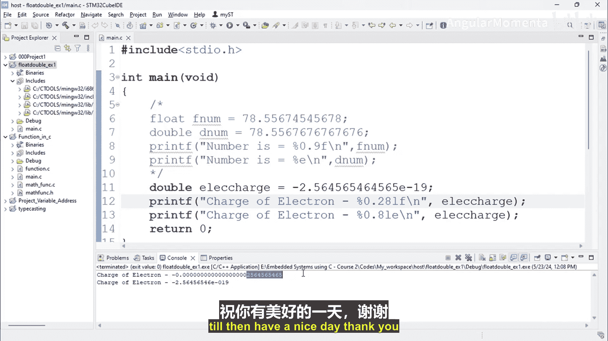

# 【EDUCBA】构建嵌入式系统 ｜ ARM Cortex (STM32) Fundamentals： Building Embedded Systems p04 01_01_06_处理浮点型与双精度变量 第二部分 -BV1KjcTzUEeY_p4-

Nail owners， welcome back。 So now let's discuss our next topic in this particular session from where we have left in the earlier video。

 so I'll continue it from the same。 Now we'll modify this program to let's say store the charge of an electron。

 Okay we have to create the appropriate variables。 I will just commend this part as of now Okay so let me put everything in this format。

And let me write here another program。 Let us first create a float variable。

 I want to create it for charge of an electron。Sa electron charge and that Im going to give here some value。

 let me specify the sign as well， let's say to a point some number， then x10 s 19。

This is what is my number， let me end this here， or you can basically remove this and what you can do is you can type here E9 E minus 9。

That is the value that you have given， so it is 10 to the power of minus 19。

 okay now lets print this number and see using percentage f I will use here print f。Let's say。

 charge。Of electron。Is。Okay， let me use percentage F。And slash n。Then， let me give here。😔。

Name of the variable。 and also。Let us print this using。s。😔，0。2 E。

Or what we can do is we can use just percentage E。 So I have saved this。

I will again build the project。 I will again， go into run and execute this。😔。

Now the first output printed as0 because that makes sense because it's a very small number and then look at the scientific notation it actually printed almost correct for the fractional part it has printed here okay with 6 decimals then that's why we basically created this particular number and printed it over here that mentioneder you cannot use a floating point to print this particular value because that it will not be able to store or give you the exact value because there is a precision loss let's say your requirement is to show the data with respect to 8 decimals and after that the decimal point so for that you can mention basically before percentage f as you know 0。

8 so if you do that you can right click this build this and again check the value here。And similarly。

 you can also give here as well。0。8。Try and build this also， and run it。Now instead of this float。

 let's try and make it as。Double and let us try this as LF and this as L E， save it and execute it。

So now you can see here the precision is proper， the reason for that is in double you can obtain precision up to 15 decimL places for decimL point。

 so when you are trying to print it in LF format you can see that it is printing all zeros over here because it's a very small number so if you want to get the output we will have to introduce more decimal places give you here you can display it as it should be not just8 let's say 28 so if I mention it that and now if I try to。

Run this directly。 See， It gives me the value over here。

So that is how you can print this in the fractional part with respect to 28 decimal places after the decimal point that set from this particular session。

 stay tuned for more such videos。 till then have a nice day。 Thank you。

