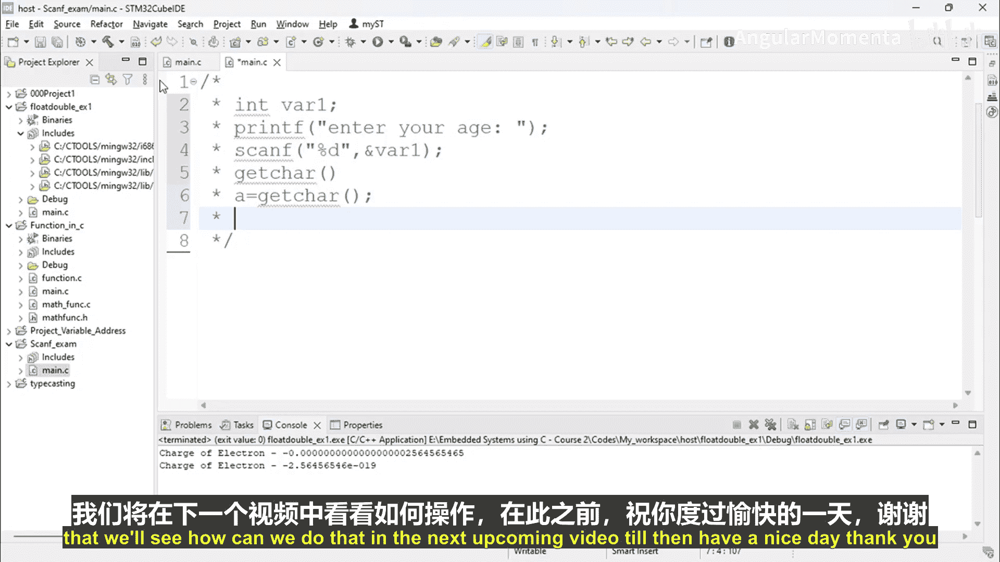

# 【EDUCBA】构建嵌入式系统 ｜ ARM Cortex (STM32) Fundamentals： Building Embedded Systems p05 01_02_01_scanf 函数简介 -BV1KjcTzUEeY_p5-

Hey earners， welcome back。 Now， in this particular video。

 we are going to explore about another important C library function。 That is Canf。

 Canf basically stands for standard library function that allows you to read input data from the standard input standard input in for us as generally a keyboard if you are working on a personal computer。

 then usually standard in means is the keyboard If the embedded system then it may not be a keyboard。

 It may be the touchscreen or it may be like keypad like that by using this canf library function。

 You can read both characters and numbers from the keyboard。 Okay， now。

 let us explore this how to use canf and how can we use this into a code snippet。

 and I'll first of all create here。Let's say a new project。 Let me create a C C plus plus project。

 C managed。And this is， I'm going to give。Scanf。Example。Okay， next and finish and inside this。

 I will create a new。Soce file。Let's see。Main dot C， okay。Let me mention it over here。 Now。

 if I give you an example， let me create a variable。 Sa 1。 I am just writing this in comment format。

 If I give you a print， I am giving here say in printf。Enter your。This is indeed， Let's say age。

And then whatever the user enters， I can store it using scanf and since this of type integer。

 I will have to use the format specifier as percent HD and I have to store the variable in the where one value by specifying at the scanf reads an integer that is a number which the user enters and thats it reads and it put it into the am percent where one which is the address of your ver one variable over here actually we are asking the user to enter the H and now this is how user data is read inside the particular program so these are the two things basically the first thing over here is we give a format specifier that you have to read an integer value and once you have read the integer value you have to put that value into the variable that which is am percent where one in this particular case that's the reason you have to mention the address operator or we can say the address of H format。

important because the type of variable you have the similar。

 the same format facifier has to be mentioned Okay so let's say you know you enter some number of know something like  in whatever so that number will be stored at the address of this particular variable because we have mentioned there am ver and not just ver a number will be stored into the particular variable like suppose over here if I use the ask for ask C then the ASi equivalent will be stored in the particular variable So whatever I enter there that would be converted to an ASi and then that would be stored there that's how you should actually you should the particular variable you can decide the format fifier what formatted should be So if it's a character you have to use C if's an integer you have to use percentage and there is one more library function in this particular case that is known as get care open close bracket and this is also used to read the input from this。

in if you just want to read one single character from the keyboard in the ASI format。

 then you can use this getca function over here。 it's basically used to read only one single character from the keyboard getca function will take no arguments and itll just return an integer value that happens to be the ASI value of whatever key has been passed it let's say for example。

 you say here a is equal to getca open close bracket semico over here what is happening is the program will hang on till user enters some character there then whatever user enters that would be fetched and stored into a and then the program would exit so with see practical example of this in the next video you have to create a program that takes let's say four integer numbers from the user it computes and print the average of those numbers back to the user you have to input or accept four different values from user So you have to use canf to perform that。

 We'll see。Can we do that in the next upcoming video till then Have a nice day。 Thank you。

