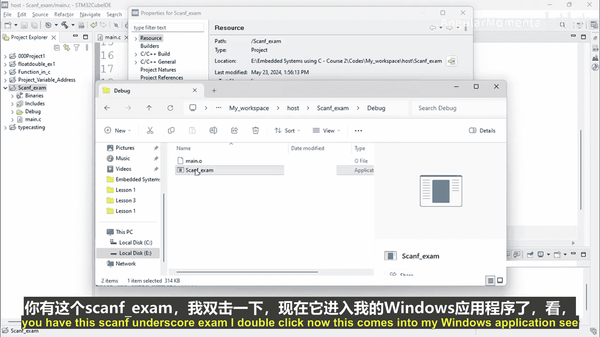
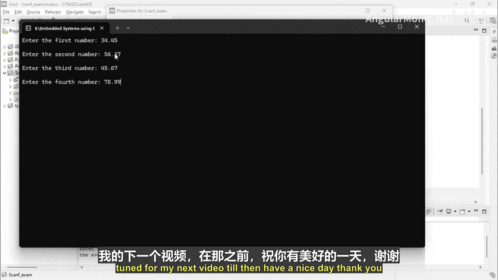

# 【EDUCBA】构建嵌入式系统 ｜ ARM Cortex (STM32) Fundamentals： Building Embedded Systems p06 01_02_02_scanf练习实现第一部分 -BV1KjcTzUEeY_p6-

Hello ons， welcome back。 Now， let us create the practical example for using Scf into our particular project。

 in the earlier video I had told you that we would be creating a program which would calculate the average of phone numbers for that now I am into my main dot C which is I have created under scanf underscoreco example This is the project in which I have created this particular file I'll continue in this as well you will have to basically go ahead。

 create a new project which will be C plus plus project give it a name。

 create add a new main dot C file and then create here。D。Main method。 Okay， now in this。

 well have to create three integer variables。 So I'm going to create variables as let's say number1。

 number 2， number 3 and number 4。 Since I want to make an average of phone numbers。 Now， over here。

 it's also possible if you take instead of integer float because you may have the average into decimal A cannot be always like a whole number。

 I have made it of type float。 Similarlyly， Ill take one more， say。A V G， which is for average。

 You can take any variable names that's up to you。 How do you want to take it。 Now。

 let me ask the user to enter the first number。 I'll give your printf。

 I will say enter the first number semicolon， and I'll give you a slash， O。

And not give alashing because I want on the same line。 It should enter。

 I don't want the cursor to move on the next line。 It has to be rather there in the same line over here。

 And then I want to use the next statement as scanf in scanf will have to give the format and the number K that I want to save the value windows。

 Once my cursor is over here。 whatever number the user enters。

 I want to store that number in a percentage F， which is a float format and that value has to be stored inside the variable nu1。

 which is the first variable。 I've given here percentage F and nu1 over here。 Similarlyly。

 you will do it in a similar manner for all the。3 numbers， as well。

I'll give your enter the second number。 enter the third number。Ento the fourth number。

Let me save it into number 2，3。And4， I have this。 Now。

 let us compute the average here I take average is equal to I'll put in bracket number 1 plus number2 plus number 3。

Plus number 4， and that is I want to divide this by4。

 That is the average that I will get total of all divided by the number of numbers you are supposed to take。

 Now， one more thing that we have missed out over here when I enter this。

 whatever value user enters after this space would be stored here。 But when I start this printf。

 I want to put it on a new line。 So I'll put here a new line， Similarlyly。

 for the next print statement， I want it to be on a new line。

 Similarlyly for the last one as well I have given there slash n for the other print values。 Now。

 let's quickly build this。Right click， I'll built it。 Okay， I have not。Include it hash。

 include S TDI O dot H。Save it。Build this。Well successful。Okay， it is float average。Okay。

 this is a warning。 It is not used since， you know， we have not printers。

 What I'll do is I'll give here a printer。 I'll say the。Average is。

 and here I will print in percentage F slash n the value of。Average variable。Now。

 let me build this again。 Okay， and let me run this Now when I'm running this over here。

 we'll have to do it in a bit different format because once over here。

 there is nothing like a command from screen that appears。 What I'll do is we will over here。

 there is a particular reason that the message that we are trying to print over here is not reaching the console。

 That means that this message is actually buffer inside the operating system that is not pushed or we can say flush to the console problem like you may encounter when you see this。

 if you know use some different kind of consoles as well。

 since we are using the console of an eclipse software。

 there may be a console buffer okay when you execute print if actually what is happening。

 the content will not be directly displayed to the displace it actually buffers inside the output buffer。

 that is the actually the software buffer and then your application returns the content of the output buffer will automatically be。

Fluush to display in our program。 what's happening is we are waiting for the user input。

 There is no trigger for output buffer to flush the content In the earlier program。

 we were just returning the function。 There was a trigger to flush the content of output buffer to display here we have to give explicit command for output buffer to flush the content to display。

 Now we can do that by using the function， which is called as a flash a flash is actually an API which is used to clear the output buffers of the output stream When you use the a flash。

 the content of the output buffer will be flush to your display。 Now， let us see how to use that。

 Now， when I'm using this particular print over here。

 I will write down after this F standard outD out。This has to be in bracket。 Now， over here， when I。

Save this。 I built this。 I have have cleaned it。 Let me build this again， and let me。

Dry and run this。Now， here it says， enter first number。 I enter something。 Now， again。

 this is getting halted。 not proceeded further over here。

 what we will do is well have to do the a flush after every print。 Let me just stop this。Okay。And。

I'll just give this after。Every。Printf。Save it。B this。Run this。 Okay， first number， enter。

 let's say 45。65 I press enter， then say second number。Then， I have pressedto。Then， third number。

Then I again press enter。 Now I get the averages。 This is the value of average。

 adding all the four numbers and then dividing it by4 and giving me the particular value。

 That is how we are able to see the particular output on our console screen。 Now。

 as you saw over here when I was pressing and termaccoa was remaining over here instead of this position。

😊，This eclipse environment is not that great or eclipse console we can say probably is not that great for this kind of scanf statement instead of this what you can do is you can directly execute the average dot E X as a Windows application for that。

 what you will do is you will right click here。😊，You will just go here。In。Say properties。

Go to this location。 Open up this。😔，This is the project。And inside the debug。

 you have this scanf underscore exam。 I double click Now this comes into my Windows application。

 See my cursor is over here right now， I enter some number。

 Now see as soon as I press enter next print gets executed and my cursor is over here。

Now， I enter again。 I enter again the next number， the fourth number。

Now we'll continue the rest of the remaining topic in the next video。

 so stay tuned for my next video till then， have a nice day， thank you。

