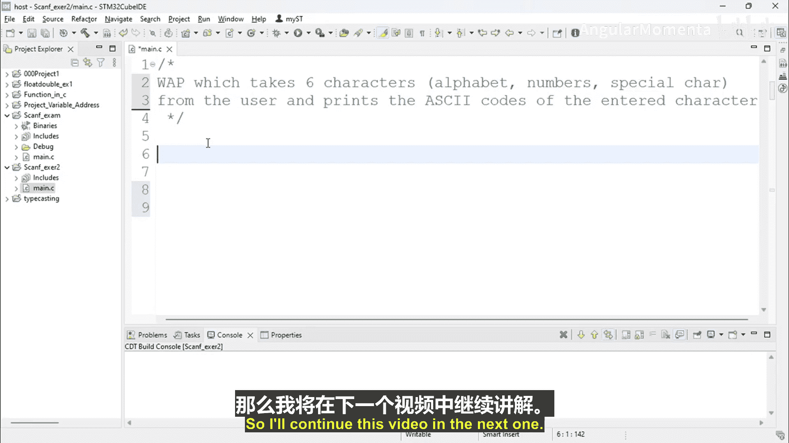

# 【EDUCBA】构建嵌入式系统 ｜ ARM Cortex (STM32) Fundamentals： Building Embedded Systems p08 01_02_04_scanf练习2第1部分 -BV1KjcTzUEeY_p8-

Hey earns， welcome back。 Now， let me create a new project。 to creator C C plus plus project。

 I'll go ahead to give it a nameme as let's say。Scanf andasco， excise，2。

And I click on next and finish。 Then let me close this and let me add a new source file as main dot C。

 And I mentioned thee。To do over here that you are supposed to write a program。Which。Dicks along。

 in06。Characters。Now， the characters can be your。Alphabet， it could be your numbers。

 It could be any special character。Except this from the user。 and you have to print the。

Askky courts of thee。Entered。Garicto。That is basically the exercise output should look like into a numerical format。

 You will have to enter any six characters except from the user using the getca or the scanf statements and then whatever you have entered you will have to as soon as you press enter you can basically see the result as the ASI values of those characters which have been entered。

 So if you enter， let's say small small ABC D， let's say12 the value that you basically should be getting is all the ASI chs of those select small a know 97 the ASI code is those value should be dis Well accepting you have to accept it into a variable which can be printed into the ASI format as well。

 let us try and create this in the next video so I'll continue this video in the next one state tuned then have a nice Thank you。

