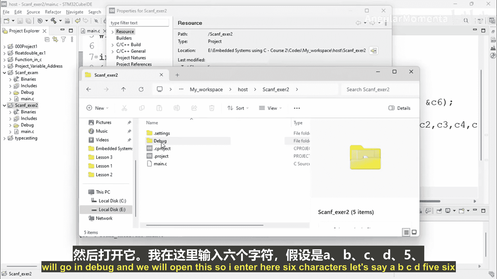
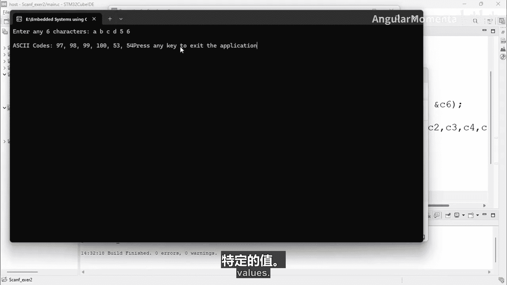
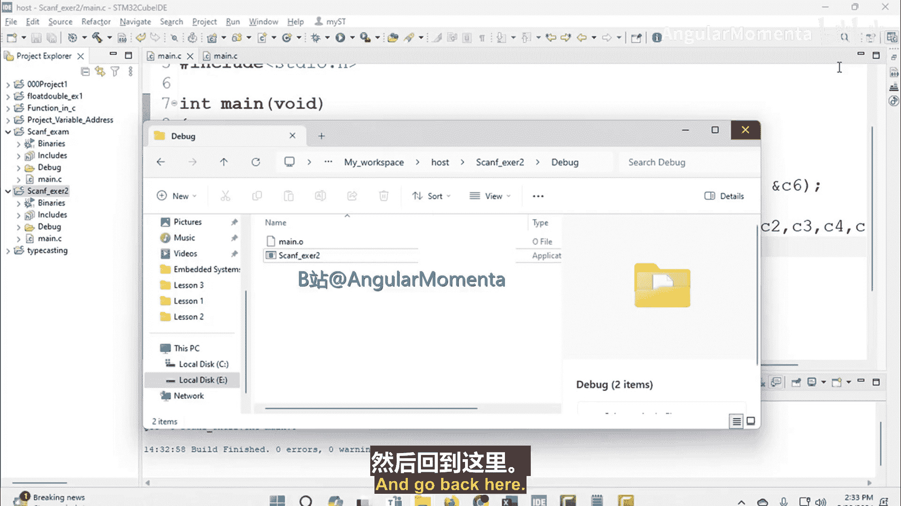
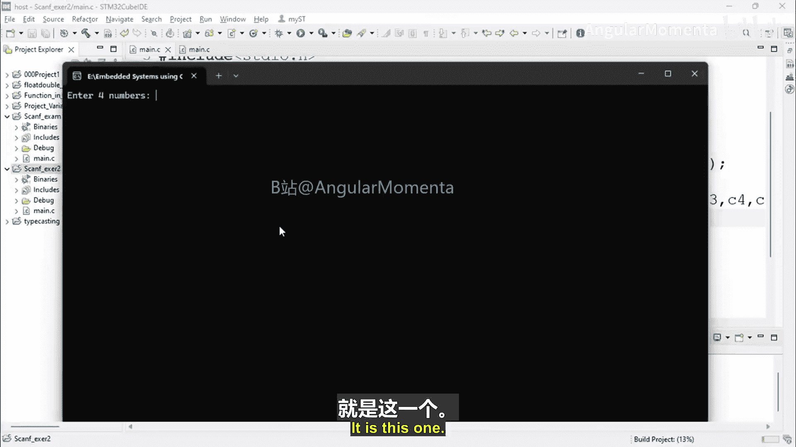
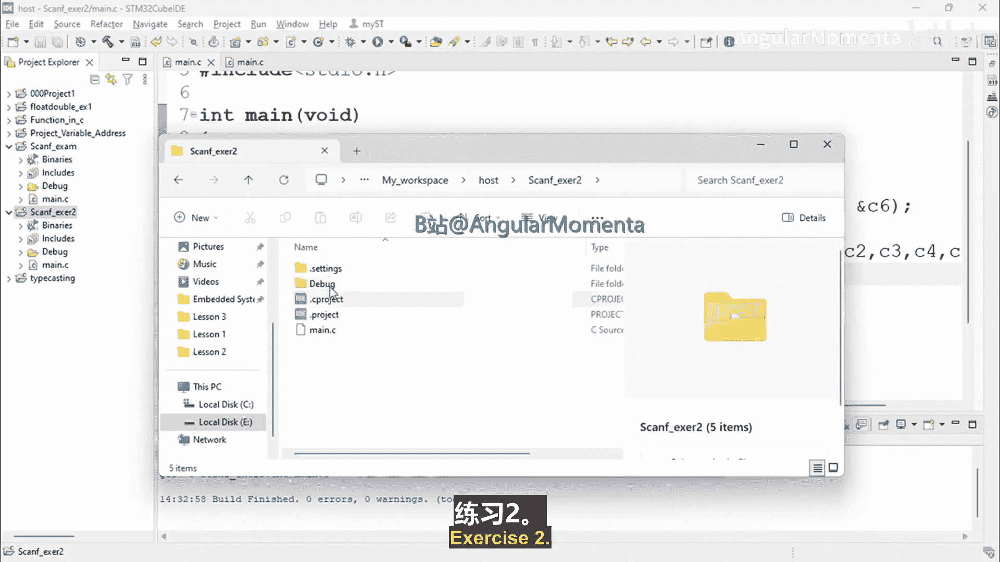
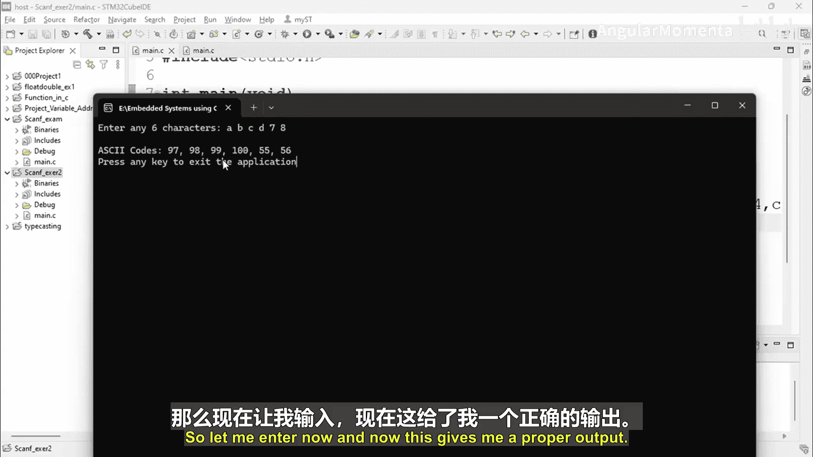
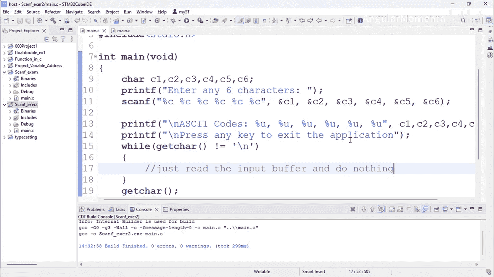

# 【EDUCBA】构建嵌入式系统 ｜ ARM Cortex (STM32) Fundamentals： Building Embedded Systems p09 01_02_05_scanf练习2第二部分 -BV1KjcTzUEeY_p9-

Hey Erers， welcome back over here。 As we have created this in the earlier video。

 the project is ready。 first thing that I would do over here is I would use SDDio dot edge。

 I will create main。And now let's start the to implement our previous exercise。

 a Postes will use a print to send a message to the user where I will write down， say enter any6。

Characters。And。Then I use a scanniff statement。We use Perate C for characters。

 so we have to enter six characters。We give it six times。 Basically。

 Now we would need here the variables。Let me first end this with a semicolon and let me create variables。

 say C1， C2， C 3， C 4， C 5， C6， and let me accept the values over here using C 1 then。See2。C 3。C，4。C。

5。C 6 Now over here after we accept it， we have to go in for another printf and print the ASI chs for them。

 So the ASI chs equivalent now over here to print the ASI ch， which is ASI code will be a number。

 which format specifier will be used to print a number。

 you can either use D that is for signed integer or percentage U if it is for unsigned Let us used O over here percentage U and give the outputs there after this I will give here percentage U comma percentage U comma percentage U。

Similarilly。More one time。I have given all the percentage U values here I will also give a new lines。

 I have to print this on a new line and after this then I want to print the values of the variables till C6。

And then what I'll do is Ill go back over here， and I will just copy down this command。

O all these lines of cord over here， as well。Cassra， we don't have to write it again。

 It's already there。 We are just executing it。 Let us just save this and go ahead and build the project。

 And once the project is ready， we will go here， Open this。

 we will go and debug and we will open this。 I enter here six characters。 Let's say A BC D 5，6。

 And I get there equivalent。 Aski courses as well。 So you can see here I'm getting the particular values。

Once you give this， you can also give here a new line。 I enter this。 Okay， I go back here。

And here I will give her a new line。 Let me just build this again， and go back here。

Okay， not this Ram。 It is。This one， let me execute this。

Exercise，2。

So， let me enter now。And now， this gives me a proper output。

What I'll one more thing that I'll do over here is just mention in this。That this is。Just read the。

Input。Buffle and。Do nothing。This is just the statement that I want to display to the user that why this loop for S as that。

 So you can also remove Scf and use get care function in this case。

 because get care also gets a single character， but I prefer using Scf。

 Hence I've created this using Scf statement。 See you all in the next video till then have a nice day。

 Thank you。

