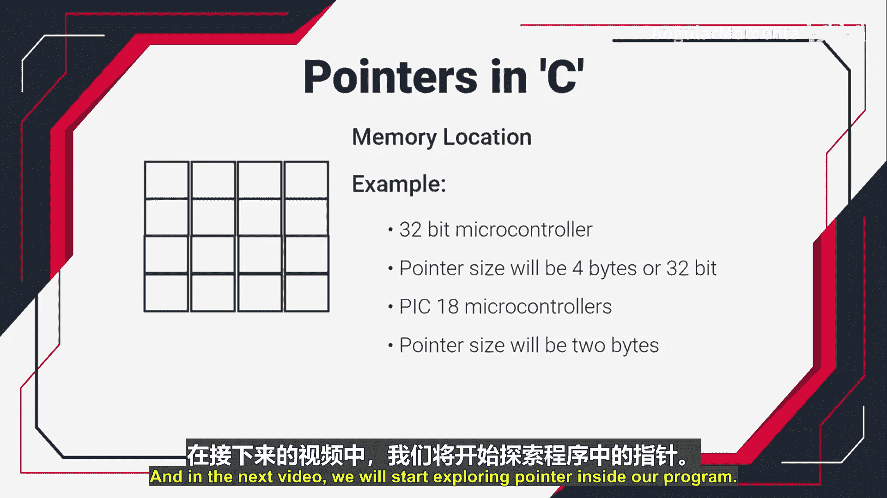

# 【EDUCBA】构建嵌入式系统 ｜ ARM Cortex (STM32) Fundamentals： Building Embedded Systems p10 01_03_01_C语言中的指针 -BV1KjcTzUEeY_p10-

Hey on us， welcome back。 Now， from this video onwards， we will start exploring about pointers in C。

 Now， pointers are also a very important， or we can say essential programming feature which is available with your C programming language pointers make you C programming language more powerful weancy Also they are heavily used in your embedded C programming in order to talk to perifers。

 even read data from the perifers write data to the perifers or configure to store data in some ram locations everywhere basically we use pointers in embedded as well。

 Let's study about pointers step by step over here from this particular session。 Now， first of all。

 let us understand what is pointers。 Let's explore， consider let's say over here， we have some。

 Just assume these as your memory locations like this you have various memory locations。

Available which you know can hold， let's say1 by of data These are addresses we can say even unique address that is given to each and every memory location。

 So every memory location in your memory or in a computers memory will have a unique address to it memory location address is basically is called as the pointer pointer is nothing but the memory address or memory location address The reason for that is actually it points to the data which is stored in the assoator memory location So whatever data would be stored over here。

 it will point to this particular data directly to address point to the data this is called as pointer by using pointers you can do various operations What all things you can do is you can write into pointers that means you can write a new value to the memory location you can read from the particular pointer that means the value can be read in program by using the pointer variables you can increment this pointer you can also go to the next。

Memory location。 So from here， basically， you can move on to here。 Hence。

 you know a memory location address is pointer and a 64 B machine。

 The pointer size is the size of pointer is 64 B。 For example。

 if you consider 32 B arm microcontroll。 the pointer size will be 4 B or we can say32 B。 Similarlyly。

 if you consider your P 18 microcontrolls， then the pointer size will be 2 B。

 So the pointer is nothing but the memory location address。

 And the next video we will start exploring pointer inside our program。

 Stay tuned till then have a nice day。 Thank you so much。😊。

