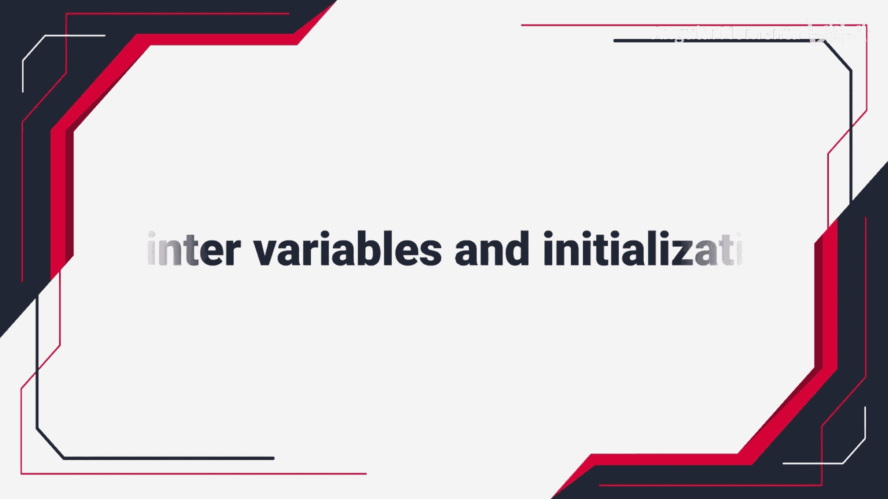
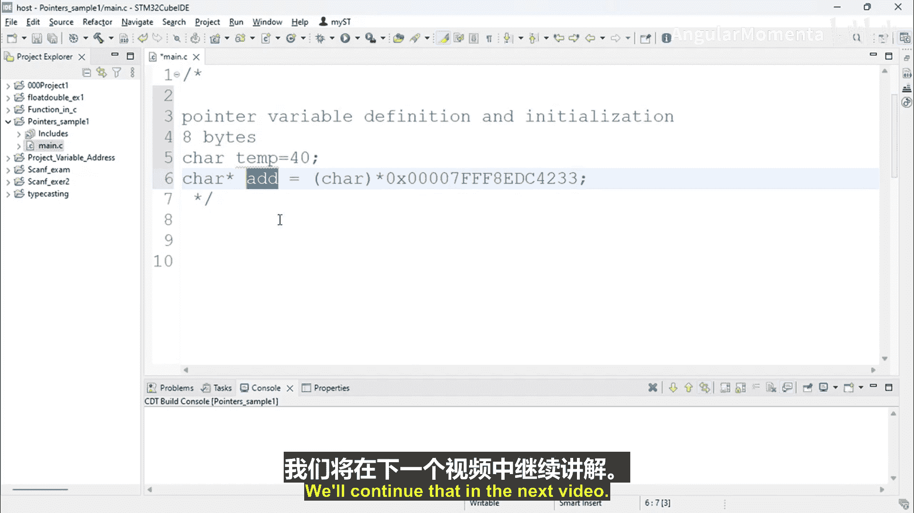

# 【EDUCBA】构建嵌入式系统 ｜ ARM Cortex (STM32) Fundamentals： Building Embedded Systems p11 01_03_02_指针变量与初始化 -BV1KjcTzUEeY_p11-

Hey learners， welcome back。 Now， let me create a new。Project。And let me name it as。Poin third。

Example 1。Let's say sample one okay。I create this， and then in this， I add a new source file。Now。

 in the previous one， we have understood what is a pointer variable or what are pointers Rather over here。

 we will understand about the。Pointer variable。Definition， and。Initialization， for example。

 if I create a point of variable， something like this is equal to my converted to character。Astch。

 and I give her some value。Something like this。This is called as the pointer variable。

 This is for me is the pointer variable over here。 Now。

 let's understand more about the pointer variable definition。 Let's understand about this here。

 this asterisk means that this is a pointer variable。 The moment compiler sees the definition。

 compiler allocates 8 byte for this variable to store this pointer When the pointer variable is created。

 let's say the pointer variable in our case over here is add。

 So when this gets created8 p of memory will be reserved for this variable because in 64 B machine a pointer sizes of 8 by。

 That is why irrespective of the pointer variable type compiler will reserve an 8 byte of memory to store it。

 And here we can see the initialized pointer is actually stored inside of variable itself。

 This is actually the address of the pointer variable and the value is what exactly is hold by the variable。

 The created pointer variable and it's initialized。To the pointer variable。

 the address of this variable is the pointing to some data into the computer memory doesn't matter which pointer data type you use for pointer variables compiler by default reserves 8 byte of memory to it irrespective of the data type compiler will always reserve this because the machine architecture actually 64 B is the pointer data type doesn't control the memory size of the pointer variable。

 The purpose of mentioning pointer data type。 It's basically a normal definition but when you write character lets temperature is equal to 30 when you compile this it reserves 1 by for the temperature variable let's say if you have another variable of type temperature and that is equal to 40 so it reserve1 by for this temperature variable and irrespective of the pointer data type 8 by will be reserved for the pointer variable What is the purpose of mentioning pointer data type then this particular。

The operations up read， write， increment， decrement and so on。

 So the pointer data type is used to control the behavior of the operation When you perform on this particular pointer variable here you have a couple of pointer variable that you can define it like you can define it of type integer long long integer characters like the point of variable is defined using the asterisk symbol So the meaning of the variable definition is when the read operation is performed on the variable that is add over here then the read operation yields1 byte of data out of this point actually this decide how many bytes of data can be read from the point sometimes it applies to right operation。

 the increment operation， even the decreement operation If you consider the definition when the read operation on the pointer is performed。

 operation is going to yield 4 byte of data out of this point So read operations on variable in this case yield 8 by of。

Data that's why in the case where you know the variable is also called as a pointer variable to care type data or a care type pointer we'll see an example of creating this variable in the next video will create pointer variables will create normal variables we' try to assign the values in the pointer variables and then it will make your concepts of pointer variables very much clear we'll continue that in the next video till then have a nice day。

 Thank you。

