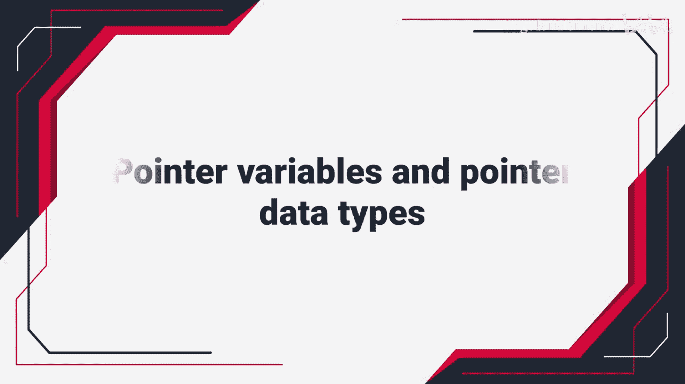
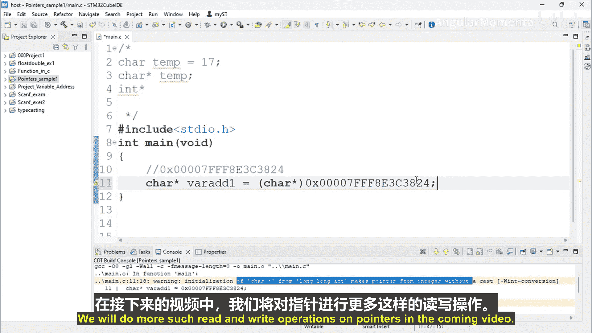

# 【EDUCBA】构建嵌入式系统 ｜ ARM Cortex (STM32) Fundamentals： Building Embedded Systems p12 01_03_03_指针变量与指针数据类型 -BV1KjcTzUEeY_p12-

Hey， learners， welcome back In the previous video。 we have come across that memory location address is pointer。

 Now， let's take one example。 Let's see how to store this pointer inside the program before that。

 how do you store data or a value inside your C program Let's say if I have to save a value for temperature。

 What actually I do is I create a variable for that。

 Let's say I'm creating a variable of end temperature。 or let's say double a float temperature。

 Similarlyly， I will first have a data type。 And after that， I'll create a variable。 let's say temp。

 and after that， I will initialize that。 let's say to 17 for example here 17 is our data。

 and we have stored that data inside a program by using a variable name that is temp So the variable will be used to manipulate this data。

 I can compare temperature I can increase temperature I can decrease temperature。

 I can print the value of temperature。All these things can be done with the help of this variable。

 So the purpose of variable is to manipulate data。 Now， in the same way。

 if you have to manipulate a pointer， you have to create a pointer variable first。

 So once you create a pointer variable you can use that variable to manipulate the pointer can carry out various operation If a variable is pointing to a particular variable。

 you can read it from that pointer variable， you can write into the pointer variable。

 you can also increment that pointer variable or decreement the value of pointer variable。

 All these are various operations that you can do with pointer variable as well。

 How will you declare it， you will first have to define the pointer data type and then the variable name Let's say over here I have to define a pointer variable The first thing that I will mention here will be a data type。

 let's say I want to declare a point of variable for temperature。

 So Ill declare here a car then I will declare the place there the variable name。Similarly。

 I can also do it like I can say here， care asterisk。 And I can define here。 Let's say temp。

 So this becomes my pointer variable。 asterisk is used to differentiate a normal variable and a pointer variable。

 So instead of a normal care， I have used your care asterisk。 So instead of a normal int。

 you will use int asterisk。 if you have to use some unsigned。 You can use that as well。 Now。

 let us see this in our particular program。 What I'll do first is， let's say I am。First。

Doing SDD I dot include。 Then I have the main method。 Now， in the main method。Over here。

 let's say I have some memory address。 I' am basically storing this over here just for your understanding purpose。

 This may not be exactly what it is currently being displayed。

 Obviously the memory address of my machine would be different。 your machine would be different。

 So I'm giving here some hypothetical example。 this is a pointer。

 and let's see how to store this pointer in a particular program。

 So from the compiler point of view from the point of view of this particular number。

 well have to select a suitable data type for this。

 this number seems of very big number of let's say8 p we can use here a long。

 long type can use here long long end。 let's say and I'm giving here the name as address where and here I am。

Saving this particular value。 So now what I have actually done is I have created a variable。

 and I have initialized that variable with this number。 I this a pointer variable definition。 No。

 it is not because for you or for the compiler， this is just a number。

 It is not a pointer and you have stored that number inside a variable of type long， long inte。

 there is nothing special about this particular statement as of now if you look in through pointer perspective。

 Now you may be thinking that this is a pointer， but for the compiler。

 it is absolutely not for the compiler， this is just a number unless you tell that the compiler will not let you treat that as a pointer and will let you like know that this is a particular pointer variable you can still work on this variable。

 you can do some read right increment decement operations over here as well。

 So now you have to tell the compiler that this is not just a number。

 but it is a pointer Basically it is。Memory location address。 So for that。

 you will have to use the pointer variable definition。 I'll go on the next line。

 And now here I'll create a pointer variable。 First again， you will have to select the data type。

 So let's randomly select one pointer type Let me select here care asterisk for the pointer one。

 and this is my pointer data type。 Now let me create a variable name。

 Let me create here where address one this time And after that。

 I'll initialize the variable to this particular number。 again， for the compiler。

 this is just a number。 This particular number is of type long， long end。

 but the type of variable is pointer variable typing to a care variable。

 We'll basically tell the compiler that this is not just a number。

 but this is a pointer by using an explicit casting。

 We can use here a casting by giving your care asterisk。

So now we are telling that this is not just a number。

 but it is a address which is converted to a pointer。

 and now this is having stored into a pointer variable。

 So now you can use this a pointer variable to manipulate the pointer。

 Now this is still not valid pointer variable can basically remove this and just keep it like this。

 So remember if I remove this explicit casting， then the compiler will give me an error。 Now。

 if I just save this and I go here and I try to build the project。

It is just giving that this is not used， but it is not giving me any casting warning。

 But if I remove this， I am just cutting down this。

 And now I am trying to build for here you can see it is giving me a casting error。

Because this is a huge number， even though this is a pointer variable。

 which can easily store this number， but still we'll have to cast this and tell that this is a pointer variable。

 This is not just a long， long number。 We'll do more such read and write operations on pointers in the coming video till then have a nice day。

 Thank you。

