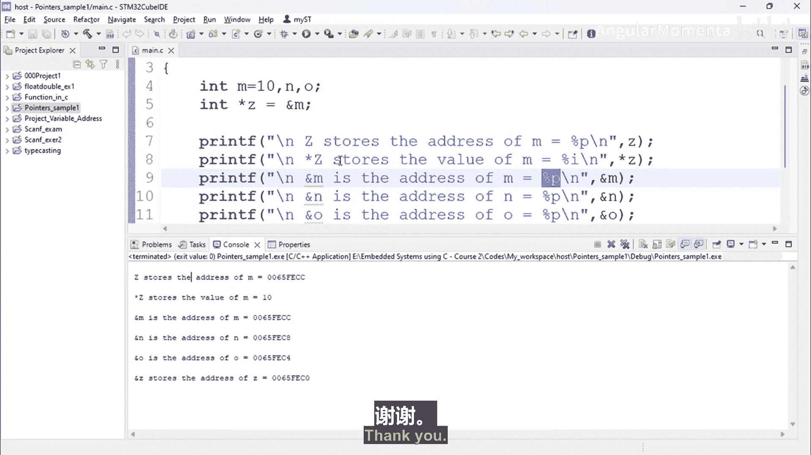

# 【EDUCBA】构建嵌入式系统 ｜ ARM Cortex (STM32) Fundamentals： Building Embedded Systems p13 01_04_01_指针读写操作 -BV1KjcTzUEeY_p13-

Hey on， welcome back。 So now in this particular video。

 let us understand how to read data from a pointer。

 All you have to do is you have to dereference the pointer。 Now， over here， if you are looking at。

 we are creating here a variable。 Now， if you have to read data from a pointer。

 what you have to do is you will have to create here， a character variable。

 let's say and here I am saying where add one Now this is known as dereferencing a pointer to read data。

 that is one by of data is read from the pointer and store into the variable named a data。

 Now in this particular pointer context， this symbol is also used or we can call them as the address operator over here。

 So the compiler will fetch one B of data from this pointer and this it will store that data into the given variable。

 why compiler will just fetch one B of data because it is of type character asterisk。

 So that's why only one byte will be fetch now。Let's go ahead and let's take one example on this particular pointer we'll create a practical example on this now what Ill do is I'll just remove this content from here。

And this as well。 And keep this as it is。Now， what I'll do here is I will take here。

3 integer variables。 let's say M。 I have assigned a value 10 to M。

 I've created another variables N and O， but there is no value assigned to it。

 Now Im taking here an integer pointer variable I' am creating a pointer variable like this and I am assigning the address of M to the pointer variable Declar of pointer variable and assigning the address of M to the pointer variable。

 Now I will only use the printer of statements here， and I'll just print first， let's say。Z。Storesby。

Address of M is equal to。 I will use here percentage P。

 This is used to print the address that is stored in said。I will print here the value of Z。

The next I want to show is the value that is there。 So here I will say Z asterisk。

 or rather I will give like this asteriskt set stores thee。Value of M。

 And here now I know it is of typeteger。 So I am using here just I and for printing the value I am using here as。

 Similarlyly， the next statement that I want to print is the address of M using m percent M。

 So here I will just say M percent M。Is the address。Of M is equal to。 And again。

 here for printing address， I'm going to use percent P。 but this time。

 I will use here M percent M to print it Now to print this， I will use here back slash。Now。

 the next print f that Im going to use is I will print the value of n and O。

 the address of N and O as well。 So again， I will give here。And。Let me copy the entire thing。And。

Paste it here。 Now， this is N。 Similarlyly， I'll do it for O variable also。Is the address off。Or。

And I'll print here， also。Now， the last one， let's say printing address of the pointer variable through pointer itself。

 So now here I will print。Zed。Stores。Address of Z again， I'll use your per P。 And this time。

 this will be Z。 Let me save this and let me build a project。

There is no need of giving the back slash over here。Add this can be printed as it is。

 So let me build the project successful。 and now let me run it。 Let me expand this over。 Now。

 you can see。Z is a point of variable。 The address of M is this。

You can look at the address of M and address of Z， they both are different。

 So if Z is also a variable， it is stored at this particular location。

 but currently it is holding an address of variable M。

 which is this If you look at the memory address of M through M itself this will be also same。

 This both the values are same。 This is the value of M through Z address of n is also different because it is also a separate variable。

 Similarlyly address of O is also different than what we have over here。

 So each variable basically have their own addresses and they can be viewed using this m person sign and the specifier for that is percentage P the format specifier。

Over here， you can have a look at the output on the console screen directly。

 That was about simple example of what the data。 How can data be stored into it。

 How can data be read from your pointer variables， So stay tuned for more such videos till then have a nice day。

 Thank you。

