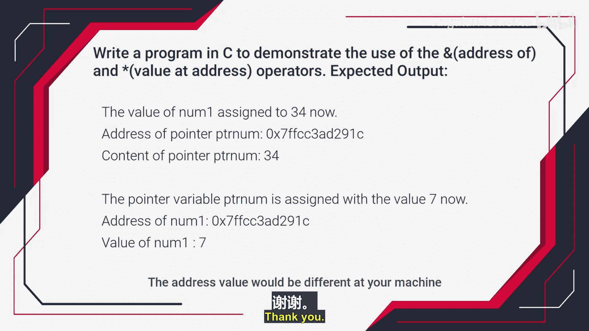

# 【EDUCBA】构建嵌入式系统 ｜ ARM Cortex (STM32) Fundamentals： Building Embedded Systems p14 01_04_02_指针练习1与练习2理解 -BV1KjcTzUEeY_p14-

Hey earners， welcome back。 Now， in the coming two videos， we have to create two pointer exercises。

 This is our first expected output。 You have to print the address of the variable。

 You have to print the value of the variable。 Now， using the pointer you will have to assign the variable number one to it and print the address of the pointer and the content of the pointer variable。

 Now you can change the value of the variable to some different value and print the address of the pointer and the content and the pointer variable will be assigned with a new value using the pointer variable Here we have change the value in the initial inte variable here we are changing it in the pointer variable。

 and then we again， print the address and the value and see the difference。

 This is our first exercise to do。 this is the expected output that is required once you complete the exercise。

 The second demonstration is like this will have this particular output。

Will have three different variables。 One is of type andteger。 One is of type float。

 One is of type character。 These are the initial values。 Val could be any other values as well。

 Then using the ampers operator， you will print the address of three variables using the ampers and the。

Asric operator， you will print value at address of number one is equal to whatever it is。

 Then using the pointer variable， you will print the address of the three variables。

 which means we'll have three different pointer variable as well one pointer variable for integer variable。

 Another pointer variable for float and the third one for the character and then using only pointer operator you will print the value at address of the variable is what this will be our second exercise This would be our first and we would start with this particular exercise first in the next video and then well complete this one in the upcoming video。

 stay tuned for the next video till then have a nice。 Thank you。

