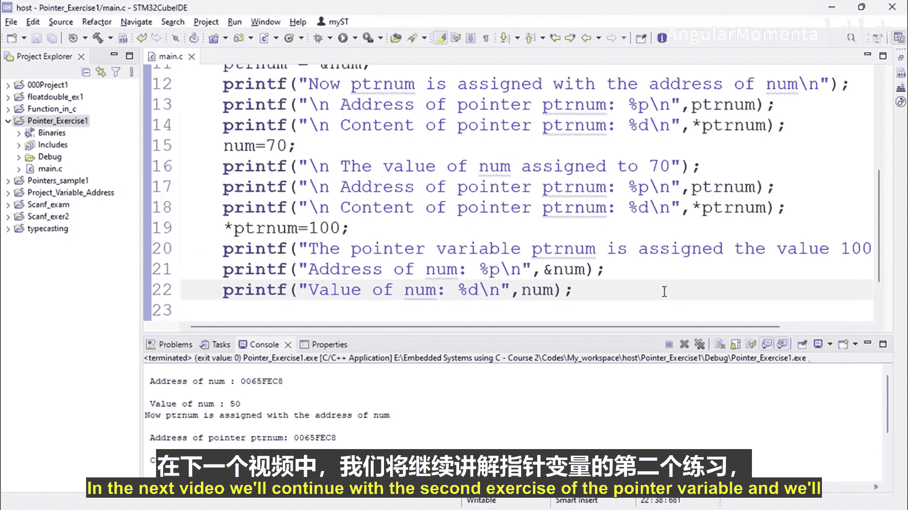

# 【EDUCBA】构建嵌入式系统 ｜ ARM Cortex (STM32) Fundamentals： Building Embedded Systems p15 01_04_03_指针练习一实现 -BV1KjcTzUEeY_p15-

Hey Erus， welcome back so as in in the previous video we have understood what is supposed to be done in this particular exercise now I'll quickly switch over to my IDE and I'll create here new CC plus plus project manage build I'll give here say pointer underscore exercise1。

Let me create this using min GW next， and finish。And then in this， I will create new。Source file。

 I'll give it a name。 main dot C。 Remove everything and start with hash in。S T D， I O dot。

 Then I have the。Main method inside this。 I create a point of variable。 Let's say P T R nu。

 I create a normal integer variable， which is num。 I assign the value in this variable。 Let's say。

 50。This is done。 After that， I am using the printf and first of all， giving a new line。

I am giving here。Say address of num。Co in， I am using your percentage P slash。

 and I am printing using the variable itself。 that is am person nu。

 Then I am printing the value of variable。I can say here the。Value of nu。

 I have to only change this to Per D。 and here I have to only remove this and print the value of the variable itself。

 Then I want to assign this variable in the pointer variable。

 So my pointer variable is Pr nu is equal to M% nu。

 So here I have assigned the address of nu to my pointer variable， Pr nu。 Now， again。

 I am giving here a printf。 Now I am saying now the Pr nu。Is assigned with the address of nu。 Now。

 after this， Ill print the address and the content of the pointer variable。

 So let me copy the two statements printed here。 And here I will give address of。

Pointer Pr nu is equal to print here the value directly without any m percent。

 just give the variable name to print the value in the pointer variable you have to use as strict over here I am giving the content。

Of pointer Prum。Coin percentage D and asterisk Pian。 Now I will change the value in them from 50。

 I'll make it 70， for example， and now I will again print the address and the content using the pointer。

 Let me copy this。And I'll copy one more print here。 And here I will give just the command。

And saying the value of nu。Assigned。2，70。 And then I'm giving her address of the。Pointer。P T Rnam。

And printing here。PTrum， similarly， to print the content of this。

I'll print your same way content of the pointer after changing the value。

 I want to look if any address of the pointer is also changing or only the value is changing。 Now。

 what I'll do is after this， I will say as strict。P T R number。

 and I am assigning this time a value of 00 in the pointer variable。 Now。

 if I am giving a printer statement here， saying the pointer variable P R nu is assigned the value00 now。

 and now I want to print the。Address of nu percentage P slash。

 And I want to print here the address of nu variable。

 I want to check if the address of numb is changed or not Similarly。

 then I want to also print the value of it。 So I want to give here。Value off。Num， colon。

 percentage D slash n the value of nu variable。Finally， I'll put here a return0。

I have saved everything I will build my project。And I will。Run this project。

I can just expand this above。 Initially， you can see here we have printed the first statement that is address of num using the variable itself。

 Similarlyly value of the variable printing proper。

 Then I have assigned the variable to my pointer variable。 Now， after assigning。

 I print the address of pointer variable。 So the address of pointer variable。

 you can see this is over here。And the address of nu address of nu is getting stored in the address of pointer variable。

Similarly， the content of the pointer variable through pointer is coming to 50。

 That is the same value。 Then I change the value of nu I made it 70。

 Now I am printing again the value of nu is assigned to 70 Now I am want to print the address of the pointer Pr nu Now if you look at the address of pointer pr nu this is still the same but the content of the pointer variable has changed Now it is showing 70。

 Now when I put the content of the pR variable I make it here as0。

 the pointer variable is now assigned a value 00 and address of nu over here you check it。

 it is still 0，06，5 f C8 that is still the address of the nu variable I have not given here a s N that is why it is coming on a same line。

But the value of the nu variable have also changed now， even if I change in the pointer。

 this is reflecting in my variable as such my address of the variable is not getting changed。

 What is getting changed is the value of the variable。

 And when I change the value of the variable through the variable itself。

 the value of the content of the pointer also gets changed。

 The address of the variable is assigned to the pointer variable。

 So the address is never changed in my entire program， you can see that。

Even if I change the value of the number through the variable or through a pointer variable。

 this was the solution to what is what expected C of variables， assigning of values。

 printing the values through the variable， printing it through the pointer variables。

 Similarlyly changing the value of variable and checking if any change in the point or address or content。

 changing of the value in the pointer variable and checking if that is making any change to the variable address or variables value。

 It does change the variable value， but do not have any effect on the variable address。

 The next video will continue with the second exercise of the pointer variable and will complete that。

 So stay tuned till then have a nice day。 Thank you。

