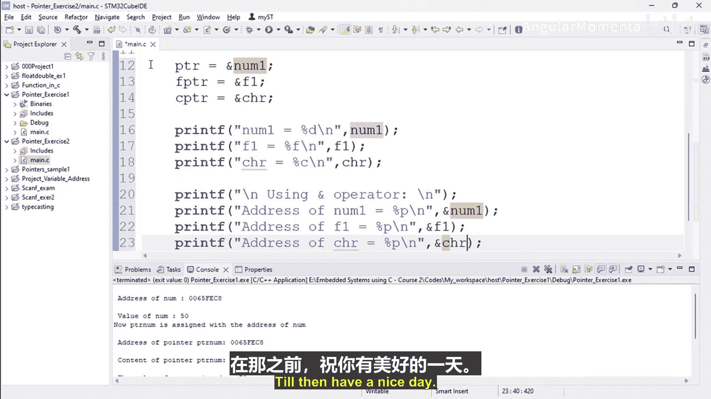

# 【EDUCBA】构建嵌入式系统 ｜ ARM Cortex (STM32) Fundamentals： Building Embedded Systems p16 01_04_04_指针练习2实现部分1 -BV1KjcTzUEeY_p16-

Hey learns， welcome back in this particular video we'll complete the second exercise on the pointer variable again I'll create a new CC++ project I'll give this name as pointer andaskco exercise2 rest everything is same and I'll create in this new source file。

Main dot C。And start with my coding。 So the first thing， as usual， have to be S DI O dot edge。

 Then I have end main。And inside this。Let me complete with the return statement。

 and I'll create three variables。 First is of type integerger。 A value assigned as say 400。

 Next variable is of type float value assigned is decimal value。

 and the third variable is character variable and the value assigned。 and this is F。

 I have declared an initialized an integer variable float variable and a character variable。 Now。

 I'll create similarly pointer variable of type integer float and character for creating that I'll use int asterisk。

 let's say Pr 1。For float， it is float at the rate F PTR。And for care。

 I'm giving you asterisk C PR can give any names of your choice。 absolutelysolutely fine。

 Let me give this as PtR itself。 So this is an integer1。

 This is the float and this is the character variable。

 Now I have to assign the address of the specific variables to those pointer variables。

 So the first is Ptr。 This will have the address of integer。 It is ampersant number1。 then for F PTR。

 it will hold the address of the float variable that is F1。 then for C PTR。

 this will hold the address of the character variable which is CHR。 these three statements。

 assign the address of the variables to the specific pointer variable。

 Now will print the values of the variables using the variables itself。

 So my first printer goes like this。 I give。Here say nu is equal to percentage d slash and the value of number 1。

 Okay， let me give you a number 1 instead。Then I have a next print F。

 which is having which will print your F1 is equal to percentage F s and the value of。A fun， then。

The next print of statement， I am saying here。C， HRR is equal to per C slash and the value of。C。

Now I have printed the values using the variables now what I have to do next is I have to use the amperscent operator and then I have to use the amperscent and asterisk operator booth。

Let me first print here a statement， as。Here I' am printing， say。Using a。Operator， again。

 giving her a new line。And then， I am printing here。s。Address of。南an one。Ass equal to the value of。

Numb one， similarly。I will print a dress off。F1， I will print address of C HRR。

Here I will just replace this with F1 and this with CHR。

Now we'll continue the rest of the remaining topic in the next video。

 so stay tuned for my next video till then， have a nice day， Thank you。

