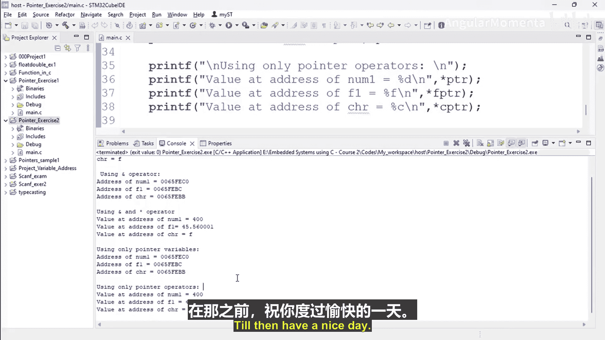

# 【EDUCBA】构建嵌入式系统 ｜ ARM Cortex (STM32) Fundamentals： Building Embedded Systems p17 01_04_05_指针练习2 实现部分2 -BV1KjcTzUEeY_p17-

Nil owners， welcome back。 So now let's discuss our next topic in this particular session from where we have left in the earlier video。

 so I'll continue it from the same。I will print here。Say using amperscent and asterisk operator。

And I will give your printf。 I'll say， value at。Address of。Numb one。Is equal to percentage D slash。

 and I will use here。As strict， as well as in bracket， I will give ampers cent number one。

Im printing the value at the address of number one。Not using the pointer variable。 Similarlyly。

 I'll do it for the next two。 This is for F1。This is for the character 1。

 I'll print here first in I have printed in digit。 This will be in float。 This will be in character。

 The name will change here。 This is F1。 This would be CHR。

And then I will give another print using only pointer。Varis。

This statements will be only using the pointer， So I'll use here the address for print。Address of。

Numb one。Percentage P s and I will only use the pointer variable。

 so I'll just put in here PTR no need to put at the rate or asterisk。Sorry， similarly。

The address of float， the address of CHR here， I will only use F1 here。 I will。 This is F PTR。

 This is CP PTR4。The character variables。 Now， after that， after printing the address。

 I also want to print the the values of the variables using pointer。

 So I'll just copy down all the three，4 statements and。Here， I will。

Just give using only pointer variables。Or I can say point0。Operators。

And here I will print not the address， but value。At。Address of。Numb one。Is percentage D。

 but this time， it is using this asterisk。So let me just replace this value of address of your F1。

And this is C HRR。 This will be in percentage F。 This will be in percentage C。 This will print。

The value of FPTR。 and this will print the value using CPptTR。 That's it。

End of my particular program。 So let me save this。 Let me go here and build this and then go and run this。

 I'll just make this about。 So these are the three variables， which were created。

The initial three statements are just printing the values of the variables。

 Then I am saying using the ampersent operator。 I am coming over here。

 I am printing the addresseses of the variable。 And after that， I am saying， okay。

 I'll give here as well。 a new line， because I want this to shift below Similarlyly for this as well。

嗯。Let me just build this again and execute this so that the output comes in a proper format。

 So now using the ampers cent operator， I'm printing the address of the variables using the variables itself。

 So this is 6，5， F， E， C， the 0。 This is F E， B C。 This is F E， B B。

 Then I'm using the ampers and the asterisk operator。

 So I print the value or at address of number one is。

 I'm using here this asterisk and ampers operator both So the value is printed properly。

Then I' am only using the pointer variables to print the address。

 So here the address of number one is this the same address you will find over here。

 address of F1 and the address of F1 through pointers will exactly match similarly for the character variables。

 And then finally， we print value at the address of number1 using the pointer that is as strictpi。

 So this print， the value of the given variable。 That was all about our second exercise。

 which we have successfully completed。 And now I guess you would have a complete understanding of pointers on how to use them with your C programming。

 Stay tuned for more such video still then have a nice day。 Thank you。

