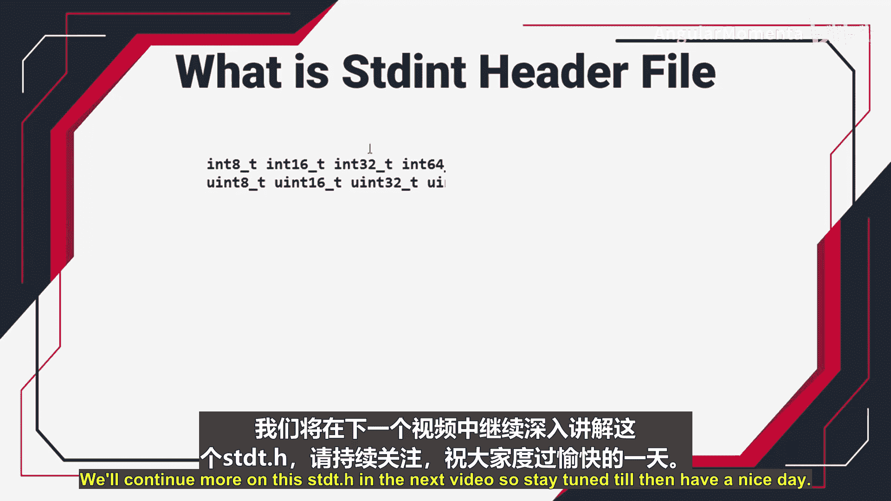

# 【EDUCBA】构建嵌入式系统 ｜ ARM Cortex (STM32) Fundamentals： Building Embedded Systems p18 02_01_01_什么是stdint头文件 -BV1KjcTzUEeY_p18-

Hey Ers， welcome back。 Now， in this particular video。

 we are going to learn about the importance of standard int dot edge。

 which is a standard int dot headerophile。 Now， this is one of the standard library headerophile。

 Let's first understand why or what is the importance of this first。 Now。

 let's say you have written a C program keeping in mind。

 you know certain data types and its associated sizes。 Now。

 let's say tomorrow you change the compiler when you change the compiler。

 The size of the data type also may differ code may compile。

 but it may be buggy because let's say a new compiler may use you know some different size of the data types that you have used in a particular program。

 That means you might face some portability issue。 Now。

 there will not be a problem when you use your compiler。

 but the same code is compiled using another compiler。

 then there is a possibility that the code may become buggy and。Can cause some problems。

 So when you write a particular C program， you should give attention to all these things as well。

 There is this possibility of the portability issue in your C code and due to the selection of some different data types Now。

 let's discuss about the portability issues which may occur in your C programming code due to size up data types clean C programming language。

 the most commonly used data types that we have if I have to mention them we have in we have long。

 which can cause this portability issue。 Now the reason is that the storage size for int and the long type variable is not defined within the standard C it is all depends on the compiler the compiler designers are the compiler vendors have the choice to define storage size for variable depending solely on the hardware capability of the target platform with respect to minimum widths defined by the standard standard only talks about the minimum。

Maximum values。 It doesn't talk about fixing a certain amount of size for end or long。 For example。

 let's say Im using here say X C8 compiler。 Now this X C 8 compiler designer have selected。

 let's say2 byte for an end data type The reason maybe according to the compiler designer keeping the size of int type variable as 2 byte will be most efficient for data manipulation considering the underlying architecture of the P 8 bit macrocontrollers。

 That may be the reason for that。 and let's say for arm， it may not be true。

 That's why let's say the arm compiler they must have the compiler designers。

 they must have selected4 byte for an end data type。 Now what happens here Now。

 if I create a particular example。 I use unsigned in。 let's say count is equal to0。

 I increment the variable count。 I check if count。Is more than 65，5，36。 Then inside the bracket。

 I write down here some task to be done over here， we have a variable count and its streotype is unsigned end and there is one conditional statement that is if count is greater than the particular given value。

 Some task has to be performed。 Basically you can just check this code。

 This code will cause the portability issue。 It will only cause the portability issue when you change the compiler。

 let's say I am using here one compiler。 and I call it as， let's say compiler a， for example。

 and this treats this particular variable as4 bytes。 when this variable is of 4 bytes。

 then this code will work fine There is no problem in it。 But when I use， let's say another compiler。

 let's say compiler B。 and this compiler treats this unsigned end as2 bys， not4 bytes。

 Then this particular task。is never going to execute because the maximum value for count is 65，5，35。

 And if you further increment this， what happens is the value actually rolls back to 0。

 and it starts over again。 That's why this code will become buggy on compiler beam if it uses2 byte for an unsigned。

 in order to get rid of these kinds of problem。 you have to stop using this standard data types like in or long。

 instead， you can use the data type Elis name given by the header file that is standard It dot H。

 the standard library header file SD I do H defines some fixed width in teachersger using the Eliies data type。

 For example， the standard data type available in C。

 So a fixed width in teacher data type is called as an Eliies data type that is based on the exact number of bits that is required to store that data。

 For example， here we have an Eliies name for。8 Bs s data type。

 You have various allies names given over here in the standard in dot H。 For example。

 you have it as say int 8 underscore T， which is exactly 8 Bs signed。

 Then you have U int 8 underscore T， which is exactly 8 Bs unsed。 Then you have。Int8 underscore t。

 which is exactly not 8 at 16 in 16， which is exactly 16 B signed。

 Then you have here U int16 underscoreos T， which is exactly 16 B unsigned。 These all are， you know。

 various Elis names， which are given depending on what data can be exactly stored into it。 Also。

 please note that these are not new data types。 These are just the Elis names that are given to these standard data types available in C。

 Each compiler carries its own S T D INt dot H， which needs to be included in the project to use these Elis types Eliies names similar to this。

 you also have something like int32 underscore T。 you have Uent 32 and underscore T。

 which is for 32 B signed and 32 bit unsigned。 Then you have similarly int 64 underscore。

And U went 64 underscore D， which is for 62 bits。 willll continue more on this steady It dot edge in the next video so stay tuned till then have a nice day。

 Thank you。

